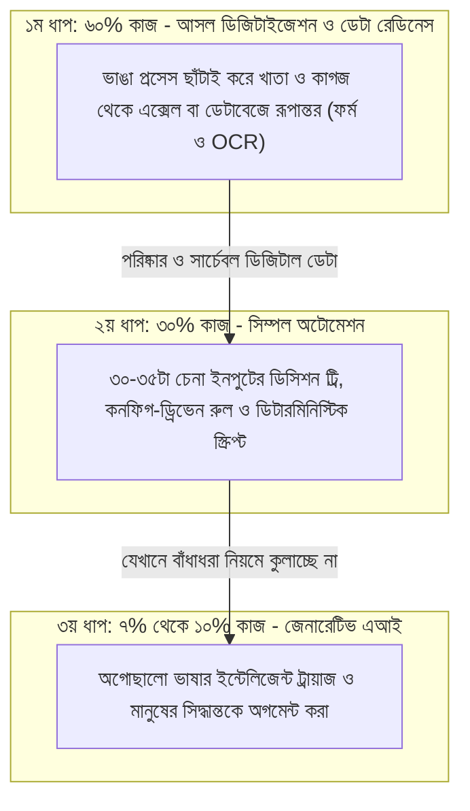

# বোনাস চ্যাপ্টার: এআই হাইপ বনাম গ্রাউন্ড রিয়েলিটি - ৬০-৩০-১০ সূত্র

---

### ১. কেন এই চ্যাপ্টারটা প্রথমে লিখতে চাইনি?

সত্যি কথা বলতে, শুরুতে আমি এই চ্যাপ্টারটা বইয়ে রাখতেই চাইনি। কারণ চারপাশে যখন জেনারেটিভ এআই আর এলএলএম নিয়ে এত মাতামাতি, তখন এই কথাগুলো শুনলে অনেকের কাছেই বেশ 'অ্যান্টি-এআই' ধরনের কথাবার্তা মনে হতে পারে। কেউ কেউ হয়তো ভাববেন, পুরো একটা বই জুড়ে লোকাল এআই আর কোডিং এজেন্টের কথা বলার পর লেখক নিজেই আবার এআইয়ের বিরুদ্ধে বলছেন কেন?

কিন্তু পাণ্ডুলিপি শেষ করার পর এডিটোরিয়াল রিভিশনের সময় মনে হলো, বোনাস চ্যাপ্টার হিসেবে হলেও এই সত্যিটা লিখে যাওয়া দরকার। কারণ আমার কথাগুলো মোটেই এআইয়ের বিরুদ্ধে নয় - বরং এআইকে ভুল জায়গায় ব্যবহার করে যেভাবে পুরো প্রযুক্তিটার বদনাম করা হচ্ছে, তার বিরুদ্ধে। আপনি যখন গলায় **'ডেপ্লয়-কো ইনক'**-এর আইডি কার্ড ঝুলিয়ে দেশের কোনো এন্টারপ্রাইজের অন-গ্রাউন্ডে নামবেন, প্রথম সপ্তাহেই এই বাস্তবতাটার মুখোমুখি আপনাকে হতেই হবে।

আজকাল আমরা যখন দেখি বড় বড় কোম্পানি এআই প্রজেক্টে নেমেও শেষমেশ ঠিকমতো কাজটা তুলতে পারছে না, তখন একটু গভীরে তাকালেই আসল গলদটা ধরা পড়ে। আন্তর্জাতিক গবেষণাগুলোতেও দেখা যাচ্ছে, আশি শতাংশের বেশি এন্টারপ্রাইজ এআই প্রজেক্ট পাইলট বা পিওসি (PoC) ধাপেই আটকে যাচ্ছে। কারণ কোম্পানিগুলোর ম্যানেজমেন্ট ভাবছে, এআই বোধহয় আলাদিনের চেরাগের মতো কোনো জাদুর কাঠি - অফিসের সব কিছু, সব সমস্যার সমাধান সে একাই করে দেবে। এই ভাবনা থেকে তারা তাদের অফিসের সব ধরনের সমস্যা চোখ বন্ধ করে সরাসরি এআই ওয়ার্কফ্লোতে পাঠিয়ে দিচ্ছে। ফলাফল কী হচ্ছে? কোম্পানিগুলোর প্রচুর টাকা আর সময় নষ্ট হচ্ছে, কিন্তু কাজের কাজ বা চূড়ান্ত ফলাফল কিছুই আসছে না। ভুল বলেছি, বলুন?

---

### ২. এন্টারপ্রাইজের গ্রাউন্ড রিয়েলিটি ও ৬০-৩০-১০ হিসাব

আমি যখন নিজে দেশের অনেক এন্টারপ্রাইজে গিয়েছি এবং সেখানে বিভিন্ন পর্যায়ের মানুষের সঙ্গে সামনাসামনি বসে আলাপ করেছি, তখন একটা জিনিস খুব পরিষ্কার বুঝতে পেরেছি। বাংলাদেশে এআইয়ের উপযোগিতা বা সরাসরি এআই ব্যবহার করে চূড়ান্ত ফলাফল তুলে আনার মতো জায়গায় আমাদের বেশিরভাগ অর্গানাইজেশন এখনো পৌঁছায়নি।

কেন পৌঁছায়নি? কারণ কোনো বিল্ডিংয়ের একতলা আর দোতলা না বানিয়ে আপনি সরাসরি তিনতলার ছাদ ঢালাই দিতে পারবেন না। পুরনো একটা কথা আছে, 'গারবেজ ইন, গারবেজ আউট'। জেনারেটিভ এআইয়ের যুগে সমস্যাটা আরও ভয়াবহ। আপনি যদি অগোছালো, ভুল বা অসম্পূর্ণ ডেটা এলএলএমের ভেতর ঢোকান, সে কিন্তু সাধারণ সফটওয়্যারের মতো এরর মেসেজ দিয়ে থেমে যাবে না। সে চমৎকার ভদ্র ভাষায় আত্মবিশ্বাসের সাথে ভুল হিসাব বা হ্যালুসিনেশন তৈরি করে দেবে।

আমার অভিজ্ঞতায় আমাদের দেশের অর্গানাইজেশনগুলোর কাজের ধরন বিশ্লেষণ করলে দেখা যায়, পুরো সমস্যার জগতটা তিনটা আলাদা ভাগে বিভক্ত: **৬০% ডিজিটাইজেশন, ৩০% সিম্পল অটোমেশন, আর মাত্র ৭% থেকে ১০% আসল কৃত্রিম বুদ্ধিমত্তা (এআই)।**

অবশ্য এই অনুপাতটা কোম্পানি থেকে কোম্পানি ভ্যারি করতে পারে। আমাদের দেশের গার্মেন্টস, ম্যানুফ্যাকচারিং, বন্দর, হাসপাতাল বা সরকারি দপ্তরের মতো প্রথাগত এন্টারপ্রাইজে এই ৬০-৩০-১০ অনুপাত একদম খাঁটি বাস্তবতা। আর বিকাশ-নগদের মতো ফিনটেক, টেলিকম বা ই-কমার্সের মতো ডিজিটাল-ফার্স্ট কোম্পানিতে - যেখানে ডেটা আগে থেকেই ডেটাবেজে আছে - সেখানে প্রথম ৬০%-এর লড়াইটা কাগুজে খাতার বদলে হয় **ডেটা সাইলো (Data Silos)** ভাঙা এবং এক ডিপার্টমেন্টের ডেটার সাথে আরেক ডিপার্টমেন্টের ডেটার ফরম্যাট মেলানো নিয়ে।

নিচের ডায়াগ্রামে দেখুন, একটা অর্গানাইজেশনের প্রতিদিনের কাজগুলো আসলে কোন ধাপে কতটুকু ছড়িয়ে থাকে:

এই তিনটা ধাপের পার্থক্য না বোঝার কারণেই আজকের অধিকাংশ এআই প্রজেক্ট অন-গ্রাউন্ডে গিয়ে আটকে যাচ্ছে। চলুন, প্রতিটা ধাপের ভেতরের আসল চেহারাটা একটু খুলে দেখি।

---

### ৩. প্রথম ৬০%: স্ক্যান করা মানেই ডিজিটাইজেশন নয়!

আমাদের দেশের অর্গানাইজেশনগুলোর ভেতরে তাকালে আমার কাছে মনে হয়েছে, প্রায় **৬০% কাজই** এখনো আটকে আছে প্রাথমিক **ডিজিটাইজেশনের** ধাপে। সহজ কথায়, চ্যাপ্টার ১-এর সেই লাল মলাটের ম্যানুয়াল খাতা কিংবা ফাইলের স্তূপ থেকে তথ্যগুলোকে আগে ডিজিটাল ফর্মে তুলে আনা।

এখানে আমাদের অফিসগুলোতে একটা মারাত্মক ভুল ধারণা কাজ করে। আমরা প্রায়ই কাগুজে চালান বা ফাইল স্ক্যানার মেশিনে ঢুকিয়ে পিডিএফ বা ছবি (`JPEG/PDF`) বানিয়ে কম্পিউটারে সেভ করাটাকেই 'ডিজিটাইজেশন' বলে ভাবি। অনেক অফিসে গিয়ে শুনবেন, *"ভাই, আমাদের সব ফাইল ফুল ডিজিটাইজড, সব স্ক্যান করে সার্ভারে রাখা আছে!"*

কিন্তু প্রকৃতপক্ষে স্ক্যান করাকে কখনোই ডিজিটাইজেশন বলা যায় না। একটা কাগজের ছবি তুলে হার্ডডিস্কে রাখা মানে ডিজিটাল আলমারিতে কাগজের ছবি জমিয়ে রাখা - ওটার ভেতর থেকে কম্পিউটার নিজে কোনো হিসাব করতে পারে না, কোয়েরি চালাতে পারে না। যতক্ষণ পর্যন্ত ওই স্ক্যান করা ছবিকে টেক্সট বা ইন্টেলিজেন্ট ডেটা আকারে ট্রান্সফর্ম না করা হচ্ছে, ততক্ষণ সেটাকে ডিজিটাইজেশন বলা যাবে না।

এখানে ডিজিটাইজেশন মানে হলো কাগুজে খাতার তথ্যগুলোকে সরাসরি এক্সেল শিট, ডেটাবেজ টেবিল বা ডিজিটাল ফর্মে নিয়ে আসা, যাতে প্রতিটা সংখ্যা আর অক্ষর আলাদাভাবে প্রসেস করা যায়। তবে এই ৬০% ডিজিটাইজেশন করতে গিয়ে একজন এফডিইকে দুটো ব্যাপারে খুব সতর্ক থাকতে হবে:

১. **ভাঙা রাস্তার ওপর পিচ ঢালাই করবেন না (Process Re-engineering First):** কোনো অফিসে যদি একটা ফাইলে অকারণে চার টেবিল ঘুরে চারজন অফিসারের সই নেয়ার পুরনো নিয়ম থাকে, আর আপনি সেটাকে ডিজিটাইজ করে চারটা ডিজিটাল ফর্ম বানিয়ে দেন, তাহলে কিন্তু কাজের জট কমবে না। কাগুজে লাল ফিতার বদলে তখন তৈরি হবে 'ডিজিটাল লাল ফিতা'। তাই চ্যাপ্টার ১-এর শ্যাডো সেশনের নিয়মে আগে বাড়তি ধাপগুলো ছাঁটাই করে প্রসেসটাকে স্লিম করতে হবে, তারপর সেটাকে ডিজিটাল ফর্মে আনতে হবে।
২. **সাধারণ ওসিআর (OCR) বনাম আধুনিক ভিশন মডেলের হাইব্রিড ব্যবহার:** আজকাল অনেকে প্রশ্ন করেন, আধুনিক ভিশন-ল্যাঙ্গুয়েজ মডেল (VLM) তো সরাসরি হাতের লেখা বা চালানের ছবি দেখেই এক ধাপে `JSON` ডেটা বানিয়ে দিতে পারে, তাহলে আলাদা করে পুরনো ওসিআর বা ফর্মের কথা কেন আসছে? উত্তরটা লুকিয়ে আছে অন-গ্রাউন্ডের খরচের অঙ্কে। দিনে দশ হাজার ছাপানো চালান বা ফর্ম যদি আপনি বিশাল ভিশন মডেলের ভেতর দিয়ে চালাতে যান, তাহলে আপনার লোকাল সার্ভারের জিপিইউ (GPU) ও র‍্যাম হাঁপিয়ে উঠবে, আর ক্লাউড এপিআই হলে মাস শেষে বিশাল বিল আসবে। তাই স্মার্ট এফডিইরা এখানে হাইব্রিড পথ ধরেন - ৯০% নিয়মিত কাজের জন্য সহজ ডিজিটাল ইনপুট ফর্ম বা হালকা ওসিআর ব্যবহার করেন, আর শুধুমাত্র বাঁকা হাতের লেখা বা জটিল আনস্ট্রাকচার্ড কাগজের জন্য ভিশন মডেল কাজে লাগান।

অর্গানাইজেশনগুলোতে প্রথম পর্যায়ে এই ৬০% ডিজিটাইজেশনটাই সবচেয়ে বড় বটলনেক। বিশ্বাস করুন, এই ৬০% ডিজিটাইজেশন আর ডেটা ক্লিয়ারিংয়ের কাজটা একবার ঠিকমতো শেষ করে ফেলতে পারলে পরের বাকি কাজগুলো পানির মতো সহজ হয়ে যায়।

!!! warning "স্ক্যান বনাম ডিজিটাইজেশন: এই ভুলটা করবেন না"
    ফোল্ডার ভর্তি স্ক্যান করা পিডিএফ ফাইল মানে ডিজিটাল ডেটা নয়। ডেটা যতক্ষণ না রো-কলামের টেবিলে (`SQLite`, `PostgreSQL` বা অন্তত পরিষ্কার এক্সেল/JSON ফরম্যাটে) আসছে এবং এক ডিপার্টমেন্টের ডেটার সংজ্ঞা অন্য ডিপার্টমেন্টের সাথে মিলছে, ততক্ষণ তার ওপর কোনো অটোমেশন বা এআই মডেল চাপাবেন না।

---

### ৪. পরের ৩০%: সিম্পল অটোমেশন ও ৩০-৩৫ ইনপুটের ডিসিশন ট্রি

ডিজিটাইজেশনের ধাপ পার হয়ে পরিষ্কার ডেটা যখন আপনার হাতে চলে এল, তখন শুরু হচ্ছে দ্বিতীয় অংশ - **সিম্পল অটোমেশন**।

অনেকে মনে করেন এন্টারপ্রাইজের সিদ্ধান্তগুলো বোধহয় রকেট সায়েন্সের মতো জটিল। কিন্তু অন-গ্রাউন্ডে কাজ করতে গিয়ে আমি দেখেছি, আমাদের বিভিন্ন ডিপার্টমেন্টে কিন্তু খুব জটিল কোনো ডিসিশন ট্রি নেই। একটা অপারেশনাল সিদ্ধান্ত নিতে আপনাকে একশো-দুইশোটা অজানা ডিসিশন খুঁজতে হবে না। প্রায় সব ক্ষেত্রেই দেখা যায়, মাত্র **ত্রিশ থেকে পঁয়ত্রিশটা চেনা ইনপুট** থাকলেই পরিষ্কার সিদ্ধান্ত নেওয়া যায়।

আর ত্রিশ-পঁয়ত্রিশটা ইনপুটের এই হিসাব মেলানোর জন্য কি আপনার বিলিয়ন প্যারামিটারের এলএলএম দরকার আছে? একদমই না। এটা সিম্পল অটোমেশন বা সাধারণ ডিসিশন ট্রির মাধ্যমেই নিখুঁতভাবে প্রয়োগ করা যায়।

একটু পেছনে তাকিয়ে দেখুন, এই বইয়ের আগের চ্যাপ্টারগুলোতে আমরা ঠিক এই কাজটাই করেছি:
* চ্যাপ্টার ১-এ ম্যানেজারের ফিজিক্যাল সইয়ের বদলে ওটিপি অ্যাপ্রুভাল।
* চ্যাপ্টার ৩-এ হেড অ্যাকাউন্ট্যান্ট সাহেবের এক লাখ টাকার ওপরে ৫% রিবেট আর ১৫% ভ্যাটের ফাংশন।
* চ্যাপ্টার ৪-এ ওএলটি সুইচে `LOS` অ্যালার্ম দেখলে সরাসরি ফাইবার টিমকে অ্যালার্ট পাঠানো এবং বন্দরের তিনটা কাগজের ওজনের ১% টলারেন্স মেলানো।

এখানে একটা ছোট আর্কিটেকচারাল গার্ডরেইল মনে রাখবেন। ত্রিশ-পঁয়ত্রিশটা ইনপুটের নিয়মগুলো যদি আপনি কোডের ভেতরে একটার পর একটা নেস্টেড `if-else` দিয়ে হার্ডকোড করে ফেলেন, তাহলে ছয় মাস পর ক্লায়েন্টের নতুন নতুন শর্ত যোগ হতে হতে কোডটা জট পাকিয়ে স্প্যাগেটি কোড হয়ে যাবে। তাই চ্যাপ্টার ৫-এর ফিল্ড-টু-কোর প্যাটার্নের মতো ব্যবসার শর্তগুলো (`tolerance_pct` বা ডিসিশন টেবিল) রাখবেন আলাদা কনফিগ ফাইলে (`JSON` বা `YAML`), আর পাইথন স্ক্রিপ্টটা শুধু সেই কনফিগ পড়ে সিদ্ধান্ত নেবে।

এর মানে হলো, একটা অর্গানাইজেশনের প্রায় **৩০% কাজ** আমরা কোনো এআই ছাড়াই শুধুমাত্র এই সিম্পল অটোমেশনের মাধ্যমে শতভাগ নির্ভুলভাবে শেষ করতে পারি। এখানে টোকেন খরচ শূন্য, হ্যালুসিনেশনের ভয় শূন্য, আর গতি রকেটের মতো।

---

### ৫. বাকি ৭% থেকে ১০%: আসল কৃত্রিম বুদ্ধিমত্তা ও হিউম্যান অগমেন্টেশন

৬০% ডিজিটাইজেশন আর ৩০% সিম্পল অটোমেশন বাদ দিলে হাতে বাকি থাকে কতটুকু? **মাত্র ৭% থেকে ১০% কাজ।**

সত্যি বলতে কী, একটা সাধারণ অর্গানাইজেশনে এই ৭% থেকে ১০% জায়গাতেই রয়েছে সেই কাজ, যাকে আসলে কৃত্রিম বুদ্ধিমত্তা বা জেনারেটিভ এআইয়ের কাজ বলা যায়। অর্গানাইজেশনে এর সরাসরি কাজের ক্ষেত্র এখনো বেশ সীমাবদ্ধ এবং সুনির্দিষ্ট।

আজকাল চায়ের আড্ডায় বা সোশ্যাল মিডিয়ায় একটা ফিয়ার খুব ছড়ানো হয় - এআই এসে রাতারাতি অফিসের সব মানুষের চাকরি খেয়ে ফেলবে (Human Replacement)। কিন্তু আপনি যখন ৬০-৩০-১০ সূত্রের লেন্স দিয়ে তাকাবেন, তখন আসল ছবিটা পরিষ্কার হয়ে যাবে। এখানে একটা সূক্ষ্ম পার্থক্য বোঝা জরুরি: এআই পুরো একটা **মানুষকে (Job)** প্রতিস্থাপন করে না, বরং মানুষের প্রতিদিনের কাজের ভেতরকার একঘেয়ে **কিছু অংশকে (Task)** প্রতিস্থাপন করে। জেনারেটিভ এআই দিয়ে সরাসরি মানুষের শ্রম প্রতিস্থাপন করার মতো সেই কাজ অর্গানাইজেশনে আছে ওই **৭% থেকে ১০%**, যা পরিমাণে খুবই কম।

এই ৭% থেকে ১০% হলো সেই আসল ইন্টেলিজেন্স, যার মূল কাজ মানুষকে অফিস থেকে বের করে দেয়া নয় - বরং মানুষের বুদ্ধিমত্তাকে **অগমেন্ট (Augment)** করা, মানে তাঁর হাতকে আরও শক্তিশালী করা। যেমন:
* চ্যাপ্টার ২-এ কাস্টমার যখন ভাঙা ভাঙা বাংলায় আবেগ মিশিয়ে লম্বা মেসেজ লিখছেন, যেখানে সাধারণ `if-else` নিয়ম দিয়ে কুলাচ্ছে না, সেখানে লোকাল এলএলএম বসিয়ে মেসেজের আসল ক্যাটেগরি আর আর্জেন্সি বের করে সাপোর্ট স্টাফের স্ক্রিনে সাজিয়ে দেয়া।
* কিংবা চ্যাপ্টার ৫-এ ব্যাংকের লোন অফিসারের সামনে তিনশো পাতার ফাইলের নামের বানান আর টাকার অঙ্কের অসঙ্গতিগুলো কয়েক সেকেন্ডে হাইলাইট করে দেয়া, যাতে মানুষটা তিন ঘণ্টার ক্লান্তিকর খোঁজাখুঁজি পনেরো মিনিটে শেষ করে আসল ব্যবসায়িক সিদ্ধান্তে মনোযোগ দিতে পারেন।

স্টাফরা যখন দেখবেন আপনার বসানো এআই তাঁদের চাকরি খেতে আসেনি, বরং তাঁদের ঘাড় থেকে ওই ৭-১০% মাথাব্যথার কাজটুকু নামিয়ে নিচ্ছে, তখন চ্যাপ্টার ১-এর সেই অটোমেশন ফিয়ার এক নিমেষেই কেটে যাবে।

| কাজের ধাপ ও পরিধি | অর্গানাইজেশনে কাজের হার | আসল সমাধান কী? | ভুল এআই অ্যাপ্রোচ (টাকা নষ্টের কারণ) |
| :--- | :--- | :--- | :--- |
| **১. আসল ডিজিটাইজেশন** | **~৬০%** | প্রসেস স্লিম করে খাতা ও কাগজ থেকে ফর্ম, ওসিআর (OCR) ও ডেটাবেজে রূপান্তর | স্ক্যান করা ছবিকেই ডিজিটাইজেশন ভাবা এবং নোংরা ডেটা সরাসরি চ্যাটবটে পাঠানো |
| **২. সিম্পল অটোমেশন** | **~৩০%** | ৩০-৩৫টা ইনপুটের কনফিগ-ড্রিভেন ডিসিশন ট্রি, পাইথন স্ক্রিপ্ট ও বিজনেস রুল | সাধারণ হিসাব ও বাঁধাধরা নিয়মের কাজও অকারণে এলএলএম প্রম্পটে পাঠিয়ে দেয়া |
| **৩. জেনারেটিভ এআই** | **~৭% - ১০%** | আনস্ট্রাকচার্ড ভাষা বোঝা, সামারি ও মানুষের সিদ্ধান্তকে অগমেন্ট করা | মানুষ ছাড়াই ১০০% স্বয়ংক্রিয় সিদ্ধান্তের দায়িত্ব অন্ধভাবে এআইয়ের হাতে ছেড়ে দেয়া |

---

### ৬. স্মার্ট এফডিইর আসল কারিশমা কোথায়?

এখন পুরো ছবিটা একসাথে মিলিয়ে দেখুন। অর্গানাইজেশনে এআই নিয়ে আমরা আজ যে বিপুল টাকা বিনিয়োগ করছি বা সময় দিচ্ছি, তাতে বড় সমস্যাটা তৈরি হচ্ছে কেন? কারণ আমরা ৬০% ডিজিটাইজেশন আর ৩০% সিম্পল অটোমেশনের পার্থক্য না বুঝে, ১০০% সমস্যাই জেনারেটিভ এআইয়ের কাছে পাঠিয়ে দিচ্ছি।

ফলে কী ঘটছে? যে ৯০% কাজ এলএলএমের করারই কথা নয়, সেখানে গিয়ে সে হ্যালুসিনেট করছে, ভুল হিসাব দিচ্ছে আর ক্লাউড বিল বাড়াচ্ছে। এতে ক্লায়েন্ট বিরক্ত হয়ে ভাবছেন এআই জিনিসটাই বুঝি কাজের না। অর্থাৎ আমরা সঠিকভাবে এআই ব্যবহার করতে জানি না বলেই অর্গানাইজেশনে এআইয়ের মূল কাজের পরিধি উল্টো সংকুচিত হয়ে যাচ্ছে। ক্লায়েন্ট একবার এআইতে ভরসা হারালে, তাকে ফেরত আনা ডিফিকল্ট হবে।

ঠিক এই জায়গাতেই একজন ভালো, স্মার্ট **ফরওয়ার্ড ডেপ্লয়েড ইঞ্জিনিয়ার (FDE)** পুরো খেলাটা ঘুরিয়ে দিতে পারেন। কারণ একজন দক্ষ এফডিই ল্যাপটপ খুলে প্রথম দিনেই প্রম্পট লিখতে বসবেন না। তিনি অন-গ্রাউন্ডে নেমে পুরো ওয়ার্কফ্লোটা এমনভাবে ডিজাইন করবেন, যাতে প্রতিটা সমস্যার জন্য সঠিক টুলটা বরাদ্দ থাকে:
১. প্রথমে তিনি দেখবেন কোথায় ডেটা এখনো কাগজে, স্ক্যান করা ছবির ভেতর বা বিচ্ছিন্ন ডেটা সাইলোতে বন্দী হয়ে আছে। বাড়তি ম্যানুয়াল ধাপ ছেঁটে ফেলে সেখানে সহজ ইনপুট ফর্ম ও ওসিআর (OCR) বসিয়ে **৬০% ডিজিটাইজেশনের** বটলনেক দূর করবেন।
২. এরপর ডোমেইন এক্সপার্টের পাশে বসে ৩০-৩৫টা ইনপুটের নিয়মগুলো বের করে আনবেন এবং কনফিগ-ড্রিভেন ডিসিশন ট্রি ও পাইথন কোড দিয়ে **৩০% সিম্পল অটোমেশন** দাঁড় করাবেন।
৩. আর সবশেষে, যেখানে মানুষের ভাষা, অস্পষ্টতা বা জটিল প্রসঙ্গ বোঝার দরকার হচ্ছে, ঠিক সেই **৭% থেকে ১০% জায়গায়** জেনারেটিভ এআই বসিয়ে স্টাফদের কাজকে অগমেন্ট করবেন।

---

### ৭. বোনাস চ্যাপ্টারের লার্নিং

ভবিষ্যতের টেক দুনিয়ায় সবচেয়ে দামি ইঞ্জিনিয়ার তিনি হবেন না, যিনি সব সমস্যার গায়ে এআইয়ের স্টিকার লাগিয়ে দেন। সবচেয়ে দামি হবেন সেই স্মার্ট এফডিই, যিনি কাস্টমারের ফ্লোরে দাঁড়িয়ে স্পষ্টভাবে বলতে পারবেন - *"ভাই, আপনার এই ৬০% কাজের জন্য আগে আসল ডিজিটাইজেশন দরকার, এই ৩০% কাজের জন্য সাধারণ ডিসিশন ট্রিই যথেষ্ট, আর বাকি এই ১০% জায়গায় আমি আপনাকে দারুণ একটা এআই মডেল বসিয়ে দিচ্ছি।"*

যখন আপনি এভাবে চিন্তা করতে শিখবেন, তখন দেখবেন ক্লায়েন্টের একটা টাকাও অপচয় হচ্ছে না, আর ওই ৭-১০% জায়গার এআইটুকু তখন সত্যিকারের জাদুর মতোই কাজ করছে।

*(পরবর্তী পাতায় যুক্ত থাকা **অ্যাপেন্ডিক্স ও ফিল্ড রেফারেন্স** অংশে আপনার অন-গ্রাউন্ডে নামার চেকলিস্ট, ল্যাপটপে কোড চালানোর গাইড এবং সম্পূর্ণ ডিকশনারি দিলাম।)*
