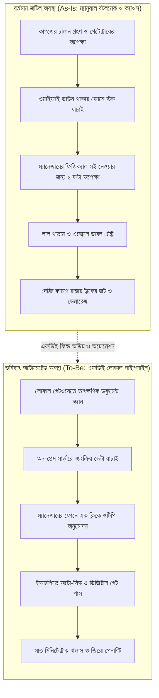

# চ্যাপ্টার ১: ফিল্ড ডিসকাভারি ও এসওপি অডিট - অফিশিয়াল পেপারওয়ার্ক বনাম গ্রাউন্ড রিয়েলিটি

---

### ১. প্রথম আটচল্লিশ ঘণ্টার মনস্তত্ত্ব ও ট্রাস্ট তৈরি

ক্লায়েন্টের অফিসের দরজার সামনে এসে একটু সময় নিন। ফরওয়ার্ড ডেপ্লয়েড ইঞ্জিনিয়ার হিসেবে প্রথম দিন যখন কোনো প্রতিষ্ঠানে পা রাখবেন, তখনকার পরিবেশটা মোটেই আপনার নিজের সফটওয়্যার অফিসের মতো বন্ধুসুলভ থাকবে না। আপনার পিঠে ল্যাপটপের ব্যাগ, গলায় ডেপ্লয়-কো ইনকের আইডি কার্ড।। আপনি তাঁদের টিমের কেউ নন, বাইরের মানুষ। আপনি ফ্লোরে ঢোকামাত্র দেখবেন আশপাশের কথাবার্তা হঠাৎ একটু থেমে গেছে। কেউ কেউ মনিটর থেকে চোখ তুলে আড়চোখে আপনাকে দেখে নিচ্ছেন।

ওই চোখের ভাষাটা পড়তে পারা একজন এফডিইর প্রথম কাজ। স্টাফরা মনে মনে ভাবছেন, হেড অফিস থেকে আবার কোন নতুন আপদ পাঠাল! তাঁরা ধরেই নেন আপনি তাঁদের কাজের ভুল ধরতে এসেছেন, কে কতক্ষণ টেবিলে থাকেন তা মাপতে এসেছেন, আর শেষে অটোমেশনের নাম করে তাঁদের চাকরিটাই খেয়ে দেবেন। এটা ওনাদের অবস্থান থেকে একটু চিন্তা করুন; মোটেই সুখকর নয়।

তাঁদের এই ফিয়ার অমূলক নয়। দিনশেষে এটা তাঁদের রুটিরুজির প্রশ্ন। তাই ফিল্ডে নামার প্রথম আটচল্লিশ ঘণ্টায় কোড লেখা তো দূরের কথা, টেকনিক্যাল কোনো কথাই মুখে আনবেন না। ল্যাপটপটা ব্যাগের ভেতরেই থাকতে দিন। প্রথম দুই দিনের একটাই লক্ষ্য - মানুষগুলোর মনের ফিয়ার কাটিয়ে ট্রাস্টের একটা ব্রিজ তৈরি করা। সফটওয়্যার ইঞ্জিনিয়ারিংয়ের ভাষায় একে বলে সাইকোলজিক্যাল সেফটি। মানুষ যদি নাই বোঝে যে আপনি তাঁর ভালো চান, তবে সে আপনাকে কখনোই সিস্টেমের আসল সমস্যার কথা বলবে না, ভেতরে ঢুকতে দেবে না।

সকালে অফিসে ঢুকে সেই হেড অ্যাকাউন্ট্যান্ট সাহেবকে বিনয়ের সাথে সালাম দিন। দুপুরে ক্যান্টিনে অপারেশন স্টাফদের টেবিলে বসে তাঁদের সাথেই ডাল-ভাত বা বিকালে সিঙাড়া-চা খান। শুরুতে বলা সেই ডেনিশ সিস্টেম ইন্টিগ্রেটরের কৌশলটা মনে রাখবেন - বাংলাদেশে কাজ নামাতে হলে আগে মানুষের সাথে "ভাই-ভাই" সম্পর্ক তৈরি করতে হবে। স্টাফদের রোজকার কাজের চাপের কথা মন দিয়ে শুনুন। কোন সিস্টেমে কাজ করতে গেলে তাঁদের মাথায় স্ট্রেস বাড়ে, কখন সার্ভার হ্যাং করলে বাইরে ট্রাকের ড্রাইভাররা চেঁচামেচি করেন - সেগুলো গল্পের ছলে জানুন। আপনার কথাবার্তা শুনে তাঁরা যেন ভরসা পান যে আপনি কারও চাকরি খেতে আসেননি, এসেছেন তাঁদের রোজকার ক্লান্তি আর গাধাখাটনি কমাতে। যেদিন স্টাফরা আপনাকে বাইরের ভেন্ডর না ভেবে নিজেদের একজন "ভাই" ভাবতে শুরু করবেন, আপনার আসল ফিল্ড ডিসকাভারি শুরু হবে ঠিক সেদিন থেকে।

!!! info "প্রথম আটচল্লিশ ঘণ্টার গোল্ডেন রুল"
    ক্লায়েন্টের সাইটে প্রথম দুই দিন ল্যাপটপ ব্যাগ থেকে বের করবেন না। কোড বা আর্কিটেকচারের কথাও ভুলে যান। আপনার প্রথম কাজ হলো স্টাফদের মনের ফিয়ার কমানো। তাঁরা যেন মন থেকে বিশ্বাস করেন যে আপনি তাঁদের ভুল ধরতে আসেননি, বরং তাঁদের প্রতিদিনের কাজের স্ট্রেস কমাতে এসেছেন।

---

### ২. কাগুজে এসওপির গল্প আর ফিল্ডের অলিখিত শর্টকাট

যেকোনো বড় প্রতিষ্ঠানের হেড অফিসে গেলে আলমারিতে চমৎকার বাঁধানো কিছু মোটা ফাইল দেখতে পাবেন। ওপরে বড় হরফে লেখা থাকে: স্ট্যান্ডার্ড অপারেটিং প্রসিডিউর, সংক্ষেপে এসওপি (SOP)। ভেতরে পাতার পর পাতা জুড়ে দারুণ সব ফ্লোচার্ট আঁকা। কোন ডিপার্টমেন্ট থেকে ফাইল কোথায় যাবে, কে কখন সই করবেন, কত মিনিটে কাজ শেষ হবে - সব নিখুঁতভাবে লেখা। নতুন এফডিই ইঞ্জিনিয়াররা প্রায়ই একটা বড় ভুল করেন। তাঁরা ওই এসওপি ফাইলগুলো পড়ে মনে করেন, তাঁরা পুরো বিজনেস লজিক বুঝে ফেলেছেন। কিন্তু আমার অভিজ্ঞতা বলে, এই এসওপি এবং 'অ্যাজ‑ইজ' ওয়ার্কফ্লোতে প্রায় ৩০ থেকে ৩৫% ড্রিফট থাকে।

কিন্তু অপারেশন ফ্লোরে বা গুদামে গিয়ে দাঁড়ালে দেখবেন, আলমারিতে রাখা ওই এসওপি আসলে একটা কাগুজে বাঘ। ফিল্ডের কাজ চলে সম্পূর্ণ ভিন্ন নিয়মে।

কাগজের এসওপিতে লেখা আছে, মালামালের চালান আসার সাথে সাথে বারকোড স্ক্যান হবে এবং তিন লেভেলের ভেরিফিকেশন শেষে চার ঘণ্টার মধ্যে ডেটা ইআরপি (ERP) সিস্টেমে ঢুকবে। শুনতে খুব গোছানো লাগবে। সেকারণে আসল ওয়্যারহাউসে চলুন। দুপুর একটায় বিশটা ট্রাক একসাথে গেটে এসে দাঁড়িয়েছে। কড়া রোদে ড্রাইভাররা হর্ন বাজাচ্ছেন। ওদিকে সকাল থেকে গুদামের ওয়াইফাই রাউটারটা ডাউন, তাই বারকোড স্ক্যানার কাজ করছে না। আর যে ম্যানেজারের ডিজিটাল সই ছাড়া চালান পাস হওয়ার কথা নয়, তিনি মহাখালীর জ্যামে আটকে আছেন।

এই পরিস্থিতিতে গেটের স্টাফ কী করবেন? চার ঘণ্টা ট্রাক আটকে রেখে এসওপি মানবেন? কখনোই না। তিনি আবার বাধাই খাতা বের করে ট্রাকের নম্বর আর মালের ওজন লিখে নেবেন, ড্রাইভারের সই নিয়ে ট্রাক ছেড়ে দেবেন। তারপর বিকেলে যখন চাপ কমবে, তখন নিজের কম্পিউটারে থাকা পুরনো এক্সেল ফাইলটা খুলে কাগজের হিসাবগুলো টাইপ করে রাখবেন।

কাজ চালু রাখার তাগিদে মানুষ প্রতিদিন এভাবে নিজের মতো করে রাস্তা বের করে নেয়। আলমারির এসওপি নয়, স্টাফদের বানানো এই অলিখিত শর্টকাটগুলোই হলো কোম্পানির আসল সিস্টেম। একজন এফডিই কখনো স্টাফদের কাছে গিয়ে বলবেন না, "আপনারা এসওপি ভাঙছেন কেন?" বরং তিনি খুজবেন, সিস্টেমের কোন বটলনেকের কারণে মানুষটা ওয়ার্কফ্লো এর নিয়ম ভেঙে শর্টকাট নিতে বাধ্য হলেন। কারণ ওই শর্টকাটের ভেতরেই লুকিয়ে আছে আপনার অটোমেশনের আসল ব্লুপ্রিন্ট।

!!! warning "কাগজের এসওপি বনাম গ্রাউন্ড রিয়েলিটি"
    হেড অফিসের ফাইলে রাখা এসওপি দেখে কখনোই সফটওয়্যারের ডেটাবেজ বা ফ্লো ডিজাইন করবেন না। ওয়াইফাই ডাউন হলে, ম্যানেজার জ্যামে আটকে গেলে আর গেটে ট্রাকের লাইন লম্বা হলে স্টাফরা কিভাবে কাজটা সামাল দেন - সেই অলিখিত শর্টকাটটাই হলো আসল গ্রাউন্ড রিয়েলিটি।

---

### ৩. শ্যাডো সেশন: প্রশ্ন না করে বটলনেক ডিসকাভারি করার কৌশল

এখন প্রশ্ন হলো, স্টাফদের এই গোপন শর্টকাট আর কাজের আসল জট আপনি খুঁজে বের করবেন কিভাবে? তাঁদের মিটিং রুমে ডেকে ইন্টারভিউ নেবেন? প্রশ্ন ছাপিয়ে ফর্ম পূরণ করতে দেবেন?

এই ভুলটা 'ভুলেও' করবেন না। মানুষকে যখনই আপনি আনুষ্ঠানিকভাবে প্রশ্ন করবেন, তখনই সে সতর্ক হয়ে যাবে। সে আপনাকে কখনোই নিজের শর্টকাটের কথা বলবে না, কারণ তার মনে ফিয়ার কাজ করবে - সত্যি কথা বললে যদি ম্যানেজমেন্টের কাছে জবাবদিহি করতে হয়! তাই ইন্টারভিউ নিলে স্টাফরা আপনাকে এসওপি বইয়ে যা লেখা আছে, ঠিক সেটাই তোতাপাখির মতো শুনিয়ে দেবেন।

তাহলে আসল চিত্রটা বের করার উপায় কী? উপায় হলো **শ্যাডো সেশন (Shadow Session)**।

ব্যাপারটা খুব সিম্পল। যে স্টাফ প্রতিদিন কাজটা করেন, তাঁর ডেস্কের পাশে একটা চেয়ার টেনে চুপচাপ বসুন। হাতে ল্যাপটপ বা বড় ডায়েরি রাখবেন না। তাঁকে শুরুতেই বলে নিন, "ভাই, আপনি আপনার মতো স্বাভাবিক কাজ করুন, আমি শুধু পাশে বসে একটু দেখব কিভাবে কাজটা হয়।" এরপর একটা ছায়ার মতো তাঁর পাশে বসে শুধু চোখ-কান খোলা রাখুন। কোনো মন্তব্য করবেন না, কোনো উপদেশ দেবেন না।

তিনি কম্পিউটারে কী করছেন, সেটা মনোযোগ দিয়ে খেয়াল করুন:
* **ডাবল এন্ট্রি ও কপি-পেস্ট:** তিনি কি একই চালানের নম্বর একবার ইআরপিতে লিখছেন, আবার মিনিমাইজ করে এক্সেল ফাইলেও কপি-পেস্ট করছেন? যদি করেন, তার মানে ইআরপির রিপোর্টিংয়ে তাঁর ভরসা নেই।
* **ড্রয়ারের চিরকুট বা লাল খাতা:** কাজ করতে করতে তাঁর চোখ কি বারবার টেবিলের কাঁচের নিচে গুঁজে রাখা কোনো কাগজের তালিকায় বা লাল খাতার দিকে যাচ্ছে? যাচ্ছে মানে ওই রেফারেন্স ডেটাটুকু আপনার সফটওয়্যারের ভেতরে নেই।
* **মুখের ভাব ও দীর্ঘশ্বাস:** মানুষ মুখে মিথ্যা বলতে পারে, কিন্তু বিরক্তি লুকাতে পারে না। খেয়াল করুন, সফটওয়্যারের কোন ফর্মটা বা কোন মেনুটা ওপেন করতেই তাঁর কপাল কুঁচকে গেল? কোন বাটনে ক্লিক করার পর পেজ লোড হওয়ার সময় তিনি বিরক্ত হয়ে চেয়ারে হেলান দিয়ে একটা দীর্ঘশ্বাস ফেললেন? 

ঠিক যে ফর্মটায় এসে স্টাফের কপাল কুঁচকে যায় আর দীর্ঘশ্বাস বেরিয়ে আসে, আপনার সিস্টেমের সবচেয়ে বড় বটলনেক লুকিয়ে আছে ঠিক সেখানেই।

!!! tip "শ্যাডো সেশনে কী খুঁজবেন?"
    স্টাফকে সরাসরি প্রশ্ন করলে সাজানো উত্তর পাবেন। তার চেয়ে তাঁর পাশে চুপচাপ বসে তিনটি জিনিস লক্ষ্য করুন - কোথায় তিনি এক ডেটা দুই জায়গায় কপি-পেস্ট করছেন, কোন তথ্যের জন্য বারবার খাতা বা চিরকুট দেখছেন, এবং কোন স্ক্রিনে এসে বিরক্ত হচ্ছেন।

---

### ৪. মাপার মতো সাকসেস মেট্রিক ও স্কোপ ডিফেন্স কন্ট্রাক্ট

ধরুন, দুদিনের শ্যাডো সেশন শেষ। আপনার পকেটের ছোট নোটপ্যাডে সিস্টেমের আসল বটলনেকগুলোর তালিকা চলে এসেছে। আপনি দেখেছেন ফর্মের সেই বারোটা ড্রপডাউন আর ম্যানেজারের ম্যানুয়াল সইয়ের কারণেই প্রতিটা চালানে ঘণ্টাখানেক সময় নষ্ট হচ্ছে। এখন কি সাথে সাথে ল্যাপটপ খুলে কোড লিখতে বসে যাবেন?

না। কোডে হাত দেওয়ার আগে নিজের ক্যারিয়ার আর প্রজেক্টকে বাঁচানোর জন্য দুটো কাজ সেরে নিতে হবে।

প্রথম কাজ হলো একটা **মাপার মতো স্পষ্ট সাকসেস মেট্রিক (Falsifiable Success Metric)** ঠিক করা। নতুন ইঞ্জিনিয়াররা প্রায়ই ক্লায়েন্টের সাথে 'ধরি মাছ,না ছুঁই পানি' লক্ষ্য ঠিক করেন, যেমন - "আমরা সিস্টেমটাকে অনেক ফাস্ট করে দেব" বা "অ্যাকাউন্টিং প্রসেস সহজ করে দেব"। এগুলো খুবই বিপজ্জনক কথা। কারণ তিন মাস পর আপনি বলবেন সিস্টেম ফাস্ট হয়েছে, আর ক্লায়েন্ট বলবেন "কই, আমার তো আগের মতোই লাগছে!" তখন এই তর্কের কোনো শেষ থাকবে না।

তাই কোড লেখার আগে সাদা কাগজে এক লাইনে এমন একটা লক্ষ্য লিখুন, যা ঘড়ি বা ডেটাবেজের সংখ্যা দিয়ে সরাসরি প্রমাণ করা যায়। যেমন:
> *"এই অটোমেশন সাকসেসফুল হবে যদি একটা ডেলিভারি চালান ক্লিয়ার করার সময় আড়াই ঘণ্টা থেকে কমে দশ মিনিটের নিচে নেমে আসে, যা গেট পাসের টাইমস্ট্যাম্প লগ দেখে মাপা যাবে।"*

লক্ষ্য করুন, এই বাক্যটায় ঝামেলা নেই। দশ মিনিটের নিচে নামলে প্রজেক্ট সাকসেস, না নামলে ব্যর্থ। আপনি যদি শ্যাডো সেশনের পর এমন একটা পরিষ্কার মেট্রিক লিখতে না পারেন, তাহলে বুঝবেন আপনার সমস্যা ডিসকাভারি করা এখনো পুরোপুরি শেষ হয়নি।

দ্বিতীয় কাজটা হলো ফিল্ডের সবচেয়ে বড় বিপদ - অর্থাৎ **স্কোপ ক্রিপ (Scope Creep)** বা ক্লায়েন্টের 'অন্তহীন মানে কেয়ামত পর্যন্ত' ফিচার রিকোয়েস্ট ঠেকানো। 

আপনি যখনই ফিল্ডে বসে কাজ শুরু করবেন এবং স্টাফরা দেখবেন আপনি চমৎকার কাজ পারেন, তখন চারদিক থেকে আবদারের বন্যা শুরু হবে। প্রজেক্ট ডিরেক্টর এসে বলবেন, "ভাই, আমাদের এইচআর অ্যাটেনডেন্সের রিপোর্টটাও একটু এর সাথে জুড়ে দিন না।" পাশের ডিপার্টমেন্টের ম্যানেজার বলবেন, "ভাই, আমাদের পুরনো ইনভেন্টরির একটা ড্যাশবোর্ডও বানিয়ে দিন।" নতুন ইঞ্জিনিয়াররা সবাইকে খুশি করতে গিয়ে সব প্রস্তাবেই "জি ভাই, করে দেব" বলে ফেলেন। ফল হয় ভয়াবহ - দুসপ্তাহের প্রজেক্ট ছয় মাসেও শেষ হয় না, আর শেষে কোনো কাজই ঠিকমতো চলে না।

অভিজ্ঞ এফডিই কখনো মুখের ওপর সরাসরি "না" বলেন না। সরাসরি না বললে ক্লায়েন্টের ইগোতে লাগে। এর বদলে তিনি প্রজেক্টের শুরুতেই এক/দুই পাতার একটা **আউট-অব-স্কোপ বাউন্ডারি কন্ট্রাক্ট** তৈরি করে রাখেন - যেখানে পরিষ্কার লেখা থাকে প্রথম ফেজে আমরা কোন কাজটা করব এবং কোন কোন কাজ প্রথম ফেজে হাতই দেব না।

এরপর মাঝপথে যখনই কেউ নতুন কোনো ফিচারের বায়না নিয়ে আসেন, এফডিই হাসিমুখে ওই সাকসেস মেট্রিকটার কথা মনে করিয়ে দেন: *"স্যার, আপনার আইডিয়াটা খুবই কাজের। কিন্তু এই ফিচারটা কি আমাদের ওই চালান ক্লিয়ারেন্সের সময় আড়াই ঘণ্টা থেকে দশ মিনিটে নামিয়ে আনতে সরাসরি সাহায্য করবে? যদি না করে, তাহলে আগে দশ মিনিটের টার্গেটটা অ্যাচিভ করে নিই, তারপর এটাকে ফেজ-টুর তালিকায় সবার ওপরে রাখি?"*

যেই মুহূর্তে আপনি আলোচনাটাকে ব্যক্তিগত ভালো-মন্দ থেকে সরিয়ে ওই দশ মিনিটের মেট্রিকের সাথে বেঁধে ফেলবেন, দেখবেন ক্লায়েন্ট নিজেই আর জোর করছেন না।

!!! tip "স্কোপ ডিফেন্সের কৌশল: মুখে 'না' না বলে মেট্রিক দেখান"
    ক্লায়েন্টের সাইটে টিকে থাকার সবচেয়ে বড় কৌশল হলো প্রজেক্টের বাউন্ডারি পাহারা দেওয়া। সব আবদার একসাথে ঘাড়ে নিলে কোনো ডেলিভারিই শেষ হবে না। শুরুতেই লিখিতভাবে ঠিক করে নিন কী কী আউট-অব-স্কোপ থাকবে। মাঝপথে নতুন আবদার এলে মুখে 'না' না বলে সাকসেস মেট্রিকের সাথে মিলিয়ে দেখান কেন ওটা পরের ফেজে যাওয়া উচিত।

#### কোড-স্যান্ডউইচ মেথড: ১-ট্যাপ ওটিপি অনুমোদন ও ফলসিফায়েবল মেট্রিক ট্র্যাকার

**১. কাস্টমারের বাস্তব সংকট:** ম্যানেজার মহাখালীর জ্যামে বা বোর্ড মিটিংয়ে আটকে থাকায় কাগুজে চালানে সই করতে আড়াই ঘণ্টা দেরি হয়। তার ওপর আমাদের প্রমাণ করতে হবে যে নতুন ওটিপি (OTP) সিস্টেম চালু করার পর চালান ক্লিয়ারেন্সের সময় আমাদের নির্ধারিত সাকসেস মেট্রিক (১০ মিনিটের নিচে) ছুঁতে পেরেছে।

**২. মূল কোড:** নিচের পাইথন ফাংশনটি ম্যানেজারের ফোনের ওটিপি যাচাই করে ডিজিটাল গেট পাস দেয় এবং টাইমস্ট্যাম্প হিসাব করে সাথে সাথে জানায় ১০ মিনিটের ফলসিফায়েবল সাকসেস মেট্রিকটি পূরণ হয়েছে কি না:

```python
# FDE Field Tool: 1-Tap OTP Approval & Falsifiable SLA Metric Tracker
def approve_challan_with_otp(challan_id: str, otp_ok: bool, wait_mins: float) -> dict:
    SLA_TARGET_MINS = 10.0  # আমাদের ফলসিফায়েবল সাকসেস মেট্রিক (১০ মিনিটের নিচে)

    if not otp_ok:
        return {"challan": challan_id, "status": "REJECTED", "sla_met": False}

    # ওটিপি মিলে গেলে সাথে সাথে ডিজিটাল সই ও মেট্রিক যাচাই
    sla_passed = wait_mins < SLA_TARGET_MINS
    return {
        "challan": challan_id,
        "status": " digitally_signed_and_cleared".strip().upper(),
        "clearance_mins": wait_mins,
        "sla_met": sla_passed
    }

# আড়াই ঘণ্টার (১৫০ মিনিট) কাগুজে সই এখন ফোনের ওটিপিতে ৬.৫ মিনিটে ক্লিয়ার
print(approve_challan_with_otp("CHL-2026-889", otp_ok=True, wait_mins=6.5))
```

**৩. সিস্টেমের বাস্তব ইমপ্যাক্ট ও কোডের ব্যাখ্যা:** স্ক্রিপ্টটা রান করলে আউটপুটে পাবেন:

```text
{'challan': 'CHL-2026-889', 'status': 'DIGITALLY_SIGNED_AND_CLEARED', 'clearance_mins': 6.5, 'sla_met': True}
```

কোডটার ভেতরে দুটো জিনিস খেয়াল করুন:
* **ফলসিফায়েবল মেট্রিক (`SLA_TARGET_MINS = 10.0`):** আমরা মুখে বলছি না যে "সিস্টেম ফাস্ট হয়েছে"। কোডের ভেতরেই `wait_mins < SLA_TARGET_MINS` বুলিয়ান চেক বসানো আছে। অর্থাৎ প্রতিটা চালান পাস হওয়ার সাথে সাথে ডেটাবেজে রেকর্ড হচ্ছে কাজটা ১০ মিনিটের নিচে (`6.5` মিনিটে) হয়েছে কি না।
* **স্কোপ ডিফেন্সের অস্ত্র:** সপ্তাহ শেষে যখন আপনি ক্লায়েন্টকে দেখাবেন যে ১০০টা চালানের মধ্যে ৯৮টাতেই `sla_met: True` এসেছে এবং গড় সময় ১৫০ মিনিট থেকে ৬.৫ মিনিটে নেমেছে, তখন ক্লায়েন্টের আর কোনো সন্দেহই থাকবে না।

**৪. গিটহাব রেফারেন্স:** ওটিপি অনুমোদন ও মেট্রিক ট্র্যাকারের সম্পূর্ণ কোড পাবেন অফিশিয়াল কমপ্যানিয়ন রিপোজিটরিতে: [https://github.com/raqueeb/fdebook_companion](https://github.com/raqueeb/fdebook_companion)।

---

### ৫. As-Is বনাম To-Be ট্রান্সফরমেশন ডায়াগ্রাম

শ্যাডো সেশন আর সাকসেস মেট্রিক ঠিক হয়ে যাওয়ার পর পুরো ওয়ার্কফ্লোটাকে একটা ভিজ্যুয়াল ডায়াগ্রামে নিয়ে আসতে হবে। কারণ ক্লায়েন্টের ম্যানেজমেন্ট আপনার পাইথন কোড পড়বেন না, তাঁরা দেখবেন ছবি।

বর্তমানে অফিসে যে এলোমেলো ও ম্যানুয়াল পদ্ধতিতে কাজ চলছে, তাকে আমরা বলি **As-Is আর্কিটেকচার**। আর বাড়তি জটিলতা ও ম্যানুয়াল অপেক্ষার ধাপগুলো ছেঁটে ফেলে আমরা যে অটোমেটেড ফ্লো তৈরি করব, তাকে বলি **To-Be আর্কিটেকচার**। নিচের মারমেইড ডায়াগ্রামে দুটো অবস্থাকে পাশাপাশি রাখলেই যে কেউ এক নজরে বুঝে যাবেন আপনি ঠিক কোথায় পরিবর্তন আনছেন:



---

### ৬. হ্যান্ডস-অন কোড প্রুফ: ফিল্ড বটলনেক ডায়াগনস্টিক ইঞ্জিন

নতুন যাঁরা অটোমেশন নিয়ে কাজ করেন, তাঁরা প্রায়ই পুরো সিস্টেমটা একসাথে নতুন করে লিখতে বসে যান। কিন্তু একজন এফডিই আগে ডেটা দিয়ে মাপেন যে পুরো প্রসেসের ঠিক কোন ধাপটায় সবচেয়ে বেশি সময় নষ্ট হচ্ছে।

#### কোড-স্যান্ডউইচ মেথড

**১. কাস্টমারের বাস্তব সংকট:** শ্যাডো সেশনে বসে আপনি খাতায় লিখে এনেছেন চালান প্রসেসিংয়ের কোন ধাপে আসলে কত মিনিট লাগছে। ওদিকে কোম্পানির এসওপিতে প্রতিটা ধাপের জন্য একটা আদর্শ সময় (Standard Time) লেখা আছে। এখন দশটা ধাপের মধ্যে ঠিক কোন ধাপটায় হাত দিলে ৯০% সময় বেঁচে যাবে, তা বের করার জন্য আমাদের একটা ছোট ডায়াগনস্টিক স্ক্রিপ্ট দরকার।

**২. মূল কোড:** নিচের পাইথন স্ক্রিপ্টটা প্রতিটা ধাপের এসওপির সময় আর ফিল্ডের আসল সময় তুলনা করে এবং যেখানে বাস্তবের সময় এসওপির দ্বিগুণ বা তার বেশি হয়ে গেছে, সেটাকে ক্রিটিক্যাল বটলনেক হিসেবে চিহ্নিত করে:

```python
# FDE Field Diagnostic: As-Is Workflow Bottleneck Analyzer
def analyze_workflow_bottlenecks(workflow_steps: list) -> dict:
    diagnostics = []
    total_wasted_minutes = 0

    for step in workflow_steps:
        sop_min = step["sop_time_min"]
        real_min = step["real_time_min"]
        delta = real_min - sop_min

        # বাস্তবের সময় এসওপির দ্বিগুণ বা বেশি হলেই সেটা প্রাইমারি বটলনেক
        if delta > 0 and real_min >= (sop_min * 2):
            diagnostics.append({
                "step": step["name"],
                "delay_min": delta,
                "action": "AUTOMATE_NOW" if step["is_manual"] else "OPTIMIZE_INFRA"
            })
            total_wasted_minutes += delta

    return {"total_delay_min": total_wasted_minutes, "bottlenecks": diagnostics}

# শ্যাডো সেশনে স্টপওয়াচ ধরে পাওয়া আসল ফিল্ড ডেটা
field_audit_data = [
    {"name": "Invoice Verification", "sop_time_min": 5, "real_time_min": 45, "is_manual": True},
    {"name": "Manager Physical Sign", "sop_time_min": 10, "real_time_min": 120, "is_manual": True},
    {"name": "ERP Data Sync", "sop_time_min": 2, "real_time_min": 3, "is_manual": False}
]

print(analyze_workflow_bottlenecks(field_audit_data))
```

**৩. সিস্টেমের বাস্তব ইমপ্যাক্ট:** কোডটা রান করলে আউটপুটে দেখবেন `total_delay_min: 150`। অর্থাৎ প্রতিটা চালানে আড়াই ঘণ্টা সময় শুধু অপেক্ষাতেই নষ্ট হচ্ছে! কিন্তু কোডের ভেতরের লজিকটা খেয়াল করুন। আমরা `real_min >= (sop_min * 2)` শর্তটা কেন দিয়েছি? কারণ `ERP Data Sync` হতে ২ মিনিটের জায়গায় ৩ মিনিট লাগছে - এই ১ মিনিট বাঁচানোর জন্য ডেটাবেজ অপ্টিমাইজ করতে যাওয়া মানে সময়ের অপচয়। আসল রক্তক্ষরণ হচ্ছে দুটো ম্যানুয়াল ধাপে: ইনভয়েস ভেরিফিকেশন (৪০ মিনিট লস) আর ম্যানেজারের ফিজিক্যাল সই (১১০ মিনিট লস)।

এই সংখ্যাটা হাতে পাওয়ার পর আপনার কাজ একদম পরিষ্কার। আপনি পুরো ইআরপি সফটওয়্যার ভাঙতে যাবেন না। শুধু ম্যানেজারের কাগজের সইয়ের জায়গাটায় একটা ছোট ওটিপি (OTP) অনুমোদনের এপিআই বসিয়ে দেবেন, যাতে ম্যানেজার মিটিংয়ে বা জ্যামে বসেই ফোনে এক ট্যাপে চালান অ্যাপ্রুভ করতে পারেন। এই একটা ছোট পরিবর্তনেই আড়াই ঘণ্টার জট কমে সাত মিনিটে নেমে আসে। প্রথম সপ্তাহেই এমন একটা কুইক উইন দেখলে অফিসের সব স্টাফ আপনার ভক্ত হয়ে যাবেন।

**৪. গিটহাব রেফারেন্স:** ডায়াগনস্টিক স্ক্রিপ্ট ও অডিট ডেটাসেট পাবেন বইয়ের অফিশিয়াল কমপ্যানিয়ন রিপোজিটরিতে: [https://github.com/raqueeb/fdebook_companion](https://github.com/raqueeb/fdebook_companion)।

---

### ৭. ডিসকাভারি পর্বের সারসংক্ষেপ

ক্লায়েন্টের অফিসে প্রথম সপ্তাহটা কাটানোর সময় কয়েকটা কথা সবসময় মাথায় রাখবেন। 

স্টাফরা রোজ যেভাবে কাজ সারছেন, সেটাই আপনার গ্রাউন্ড ট্রুথ - তাই এসওপি বই দেখিয়ে কখনো তাঁদের সাথে তর্কে যাবেন না। তাঁরা কেন শর্টকাট নিতে বাধ্য হচ্ছেন, তার পেছনের টেকনিক্যাল বাধাটা সরিয়ে দেওয়াই আপনার কাজ। আর সবসময় মনে রাখবেন, নিখুঁত কোড লেখার চেয়ে স্টাফদের রোজকার ক্লান্তি কমানো অনেক বেশি জরুরি। প্রথম সপ্তাহে পুরো সিস্টেম বদলানোর চেষ্টা না করে সবচেয়ে বড় একটা বটলনেক বেছে নিন এবং দুই-তিন দিনের মধ্যে সেটার একটা ছোট অটোমেশন ডেলিভারি দিন। এই একটা কুইক উইনই পুরো প্রজেক্টে আপনার পায়ের নিচের মাটি শক্ত করে দেবে।

পরের চ্যাপ্টারে আমরা আরেকটা বড় চ্যালেঞ্জের মুখোমুখি হব। আপনি তো ঠিক করলেন ইনভয়েস ভেরিফিকেশন আর কাস্টমারের মেসেজগুলো এআই দিয়ে অটোমেট করবেন; কিন্তু ক্লায়েন্ট যদি বলেন তাঁদের কোনো ডেটা ক্লাউডে পাঠানো যাবে না আর অফিসে কোনো জিপিইউ সার্ভারও নেই, তখন সাধারণ পুরনো পিসিতেই কিভাবে লোকাল এলএলএম চালাবেন? সেটাই দেখব চ্যাপ্টার ২-এ।

---

!!! question "আমার সাথে কথা বলতে চান?"
    আমাকে WhatsApp এ মেসেজ করতে পারেন: [+8801713095767](https://wa.me/+8801713095767)। আমি যেহেতু রোবট, কল থেকে মেসেজেই বেশি অভ্যস্ত। আমার সব আলাপ [মিডিয়াম](https://medium.com/@raqueeb), [ফেসবুক](https://www.facebook.com/raqueeb) আর [লিংকডইনে](https://www.linkedin.com/in/raqueeb/) পাবেন। ভিডিও দেখতে চাইলে আছে [ইউটিউব](https://www.youtube.com/@raqueeb)।

    আমার মাথায় আর কী কী ঘোরে, সেটাও পাবেন [এখানে](https://medium.com/@raqueeb/print-media-write-ups-2024-25-f2896ce92f7b)।

    এখানে পাবেন আমার লেখা [বিভিন্ন রিসোর্স](https://aiwithr.github.io/resources/), [আমি কে](https://aiwithr.github.io/about/) এবং প্রিন্ট মিডিয়াতে আমার [কিছু লেখা](https://aiwithr.github.io/print/)।
