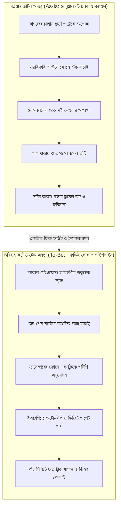

# চ্যাপ্টার ১: ফিল্ড ডিসকভারি ও এসওপি অডিট - অফিশিয়াল পেপারওয়ার্ক বনাম গ্রাউন্ড রিয়েলিটি

---

### ১. প্রথম আটচল্লিশ ঘণ্টার সাইকোলজি

দরজার সামনে গিয়ে এক মুহূর্ত থামুন। বুক ভরে একটা দীর্ঘশ্বাস নিন। 

আপনি যখন একজন ফরওয়ার্ড ডেপ্লয়েড ইঞ্জিনিয়ার হিসেবে কোনো ক্লায়েন্টের অফিসে প্রথম পা রাখেন, পরিস্থিতিটা সহজ থাকে না। পিঠে আপনার ল্যাপটপের ব্যাকপ্যাক। পরনে সাধারণ পোশাক। আপনি কিন্তু ওদের নিজস্ব লোক নন। আপনি বাইরের মানুষ। আপনি পা রাখামাত্রই পুরো অফিসের বাতাসে একটা চাপা অস্বস্তি তৈরি হয়। মানুষ কম্পিউটারের স্ক্রিন ছেড়ে আড়চোখে আপনার দিকে তাকায়। 

তাদের চোখের ভাষা পড়তে শিখুন। তারা ভাবছেন- "হেড অফিস থেকে নতুন কোনো আপদ পাঠিয়েছে। এরা আমাদের কাজ তদারকি করার জন্য এসেছে। ভুল ধরার জন্য এসেছে। শেষমেশ অটোমেশনের নাম করে আমাদের চাকরিটা কেটে দেওয়ার ধান্দা।" 

এই ভয়টা কিন্তু অমূলক নয়। মানুষের রুটিরুজির প্রশ্ন। তাই প্রথম আটচল্লিশ ঘণ্টায় কোড লেখা তো দূরের কথা, কাজের কথা মুখেও আনা যাবে না। এমনকি ল্যাপটপটাও ব্যাগ থেকে বের করবেন না। আপনার প্রথম কাজ হলো মানুষের সাথে একটা আস্থার সেতু তৈরি করা। একে আমরা বলি সাইকোলজিক্যাল সেফটি।

সকালে গিয়ে হেড একাউন্ট্যান্টকে বিনীত গলায় সালাম দিন। ক্যান্টিনে গিয়ে কর্মীদের সাথে সাধারণ চায়ের কাপে চুমুক দিন। তাদের কাজের কষ্টগুলোর কথা মন দিয়ে শুনুন। তাদের পরিবারের খোঁজ নিন। তাদের বুঝতে দিন- আপনি তাদের ভুল ধরতে আসেননি। আপনি এসেছেন তাদের কাঁধের বোঝার কিছুটা নামিয়ে দিতে। তাদের রোজকার কাজের স্ট্রেস কমিয়ে তাদের লাইফটা একটু সহজ করতে। 

যে মুহূর্তে মানুষের মনে আপনার প্রতি বিশ্বাস তৈরি হবে, আপনার আসল ফিল্ড ডিসকভারি ঠিক সেই মুহূর্ত থেকেই শুরু হবে।

!!! info "প্রথম আটচল্লিশ ঘণ্টার গোল্ডেন রুল"
    ক্লায়েন্টের সাইটে গিয়ে প্রথম দুই দিন কোড লেখা তো দূরের কথা, ল্যাপটপও ব্যাগ থেকে বের করবেন না। আপনার প্রথম কাজ হলো মানুষের ভয় দূর করা। তারা যেন বুঝতে পারেন আপনি তাদের চাকরি কাটার জন্য আসেননি, বরং তাদের কাজের অহেতুক ক্লান্তি কমাতেই আপনার আসা।

---

### ২. এসওপি-এর মিথ ও অলিখিত শর্টকাট

বড় বড় কোম্পানির হেড অফিসে যাবেন। কাঁচের শোকেসে দেখবেন সুন্দর চামড়ায় বাঁধানো বিশাল ফাইল। সোনালী হরফে লেখা- স্ট্যান্ডার্ড অপারেটিং প্রসিডিউর (SOP)। 

ভিতরে পাতার পর পাতা ঝকঝকে ফ্লোচার্ট। বড় বড় ড্রয়িং। পলিসি অনুযায়ী একটা কাজ কীভাবে হওয়া উচিত, তার বিস্তারিত বিবরণ। কিন্তু মাঠের কাজে সেই বাঁধাই করা এসওপি হলো একটা নিখাদ রূপকথা। 

বাস্তবতা সম্পূর্ণ উল্টো। 

কাগজের এসওপিতে লেখা থাকে- "চালান আসার সাথে সাথে বারকোড স্ক্যান হবে। তিন স্তরের ভেরিফিকেশন শেষে চার ঘণ্টার মধ্যে ডাটাবেজে পোস্টিং নিশ্চিত করতে হবে।" চমৎকার কথা। কিন্তু আসল ফিল্ডে গিয়ে দাঁড়ান। দেখবেন- চালান এসেছে দুপুর একটায়। কিন্তু লোকাল ওয়্যারহাউসের ওয়াইফাই রাউটারটা সকাল থেকে ডাউন। স্ক্যানার কাজ করছে না। যে ম্যানেজারের সই দেওয়ার কথা, তিনি আটকে আছেন বনানীর ট্রাফিক জ্যামে। ওদিকে বাইরে রোদের ভেতর বিশটা মালবাহী ট্রাকের লাইন লেগে গেছে। ড্রাইভাররা গালাগালি করছে। 

এখন ওই ক্লার্ক কী করবেন? তিনি কি চার ঘণ্টা বসে থেকে নিয়মের এসওপি মেনে চলবেন? কখনোই না। 

ক্লার্ক তখন নিজের মতো করে অলিখিত শর্টকাট বানিয়ে নেন। তিনি একটা সাদা কাগজে ট্রাকের নম্বর আর চালানের ওজন হাতে লিখে ড্রাইভারের হাতে সই দিয়ে ট্রাক ছেড়ে দেন। পরে বিকেলে যখন কাজ কমে, তখন নিজের মনগড়া অনুমান থেকে পুরনো এক্সেলে ডাটা এন্ট্রি দেন। 

এই যে মানুষ বাঁচার তাগিদে, কাজের গতি বজায় রাখতে অলিখিত সব শর্টকাট বানায়- এটাই হলো মাঠের আসল সিস্টেম। কাঁচের বাক্সে সাজানো এসওপি নয়। একজন এফডিই-এর মূল মুন্সিয়ানা হলো এই অলিখিত শর্টকাটগুলোকে চিহ্নিত করা। মানুষ কেন নিয়ম ভাঙতে বাধ্য হলো, সেই মনস্তত্ত্বটা উদ্ধার করা।

!!! warning "কাগজের এসওপি বনাম মাঠের বাস্তবতা"
    শোকেসে সাজানো সোনালী হরফের বাঁধাই করা এসওপি হলো একটা নিখাদ রূপকথা। আসল ফিল্ড চলে মানুষের অলিখিত শর্টকাটে। ওয়াইফাই ড্রপ করলে, ট্রাফিক জ্যামে ম্যানেজার আটকে থাকলে কিংবা রোদের ভেতর ট্রাকের লাইন বাড়লে কর্মী যেভাবে কাজ বের করে আনেন- সেটাই আসল গ্রাউন্ড ট্রুথ।

---

### ৩. শ্যাডো সেশনের কলাকৌশল

মাঠের আসল জট কীভাবে বের করবেন? কর্মীদের ডেকে প্রশ্ন করবেন? ইন্টারভিউ নেবেন? 

ভুল করেও এই ভুলটা করবেন না। 

মানুষকে আপনি যখন আনুষ্ঠানিকভাবে প্রশ্ন করবেন, মানুষ সবসময় সাজানো উত্তর দেবে। তিনি এসওপিতে যা লেখা আছে, সেটাই আপনাকে মুখস্থ শুনিয়ে দেবেন। কারণ তিনি ভয় পান- আসল সত্য বললে চাকরি নিয়ে টানাটানি হতে পারে। 

তাহলে উপায় কী? উপায় হলো 'শ্যাডো সেশন'। 

কর্মীর ডেস্কের পাশে একটা চেয়ার টেনে শান্ত হয়ে বসুন। কোনো ডায়েরি বা ল্যাপটপ নিয়ে বসবেন না। কোনো মন্তব্য করবেন না। কোনো ভুল ধরবেন না। শুধু নিঃশব্দে তার প্রতিটা পদক্ষেপ পর্যবেক্ষণ করুন। একটা ছায়ার মতো তার কাজের সাথে লেগে থাকুন। 

* **মাউসের অপ্রয়োজনীয় ক্লিক লক্ষ্য করুন:** কর্মী কি একই তথ্য পাওয়ার জন্য বারবার তিনটা আলাদা সফটওয়্যারে লগইন করছেন?
* **দৃষ্টির ওঠানামা খেয়াল করুন:** মনিটরের সামনে কাজ করতে গিয়ে তিনি কি বারবার টেবিলের নিচে রাখা ড্রয়ারের কাগজের নোটবইয়ের দিকে তাকাচ্ছেন? তার মানে ওই তথ্যটা সিস্টেমে নেই।
* **শারীরিক ভাষা বুঝুন:** কোন ফরমে কাজ করতে গিয়ে কর্মীর কপাল কুঁচকে যাচ্ছে? তিনি দীর্ঘশ্বাস ফেলছেন? বুঝবেন- ঠিক ওই জায়গাটাতেই সিস্টেমের বড় বটলনেক লুকিয়ে আছে।

!!! tip "শ্যাডো সেশনের গোপন পর্যবেক্ষণ"
    কর্মীকে কখনো সরাসরি প্রশ্ন করবেন না। প্রশ্ন করলে মানুষ সবসময় সাজানো কথা বলে। কর্মীর পাশে নিঃশব্দে বসুন। তার মাউসের অপ্রয়োজনীয় ক্লিক, ড্রয়ারের কাগজের দিকে ঘনঘন তাকানো এবং কপাল কুঁচকে যাওয়ার মুহূর্তগুলো লক্ষ্য করুন। সেখানেই লুকিয়ে আছে আসল বটলনেক।

---

### ৪. As-Is বনাম To-Be ট্রান্সফরমেশন ডায়াগ্রাম

শ্যাডো সেশন শেষ করার পর আপনার কাজ হলো বাস্তবতাকে ছবির রূপ দেওয়া। 

বর্তমান ভাঙাচোরা এবং জটিল কাজের ফ্লোকে আমরা বলি **As-Is আর্কিটেকচার**। আর অপ্রয়োজনীয় জটিলতা বাদ দিয়ে যে সহজ অটোমেটেড ফ্লো আমরা দাঁড় করাব, তাকে বলে **To-Be আর্কিটেকচার**।

নিচের Mermaid ফ্লোচার্টটি লক্ষ্য করুন। এখানে একটা এন্টারপ্রাইজ চালানের বর্তমান ভাঙাচোরা রাস্তা এবং এফডিই-এর আধুনিক অটোমেটেড পথের তুলনামূলক রূপরেখা দেওয়া হলো:



---

### ৫. হ্যান্ডস-অন কোড প্রুফ: ফিল্ড বটলনেক ডায়াগনস্টিক ইঞ্জিন

শ্যাডো সেশনে পাওয়া ডাটাকে কীভাবে কোডের মাধ্যমে বিশ্লেষণ করবেন? 

নিচে একটা কমপ্যাক্ট পাইথন ডায়াগনস্টিক রুটিন দেওয়া হলো। এটি এসওপির অফিশিয়াল কাগজের সময় বনাম শ্যাডো সেশনের আসল সময়ের পার্থক্য হিসাব করে। একই সাথে কোন ধাপগুলো শুধুই কাগুজে ভূত (Phantom Steps) আর কোথায় আসল ল্যাটেন্সি আটকে আছে, তা নিখুঁতভাবে বের করে আনে:

```python
# FDE Field Diagnostic: As-Is Workflow Bottleneck Analyzer
def analyze_workflow_bottlenecks(workflow_steps):
    diagnostics = []
    total_wasted_minutes = 0

    for step in workflow_steps:
        name = step["name"]
        sop_time = step["sop_time_min"]
        real_time = step["real_time_min"]
        is_manual = step.get("is_manual", True)

        delta = real_time - sop_time
        # যদি বাস্তবে সময় এসওপির দ্বিগুণ হয়, তবে সেটা প্রাইমারি বটলনেক
        if delta > 0 and real_time >= (sop_time * 2):
            diagnostics.append({
                "step": name,
                "status": "CRITICAL_BOTTLENECK",
                "delay_min": delta,
                "action": "AUTOMATE_IMMEDIATELY" if is_manual else "OPTIMIZE_INFRA"
            })
            total_wasted_minutes += delta

    return {"total_delay": total_wasted_minutes, "critical_steps": diagnostics}

# ফিল্ড শ্যাডো সেশনের সংগৃহীত নমুনা ডাটা
mock_field_audit = [
    {"name": "Invoice Verification", "sop_time_min": 5, "real_time_min": 45, "is_manual": True},
    {"name": "Manager Physical Sign", "sop_time_min": 10, "real_time_min": 120, "is_manual": True},
    {"name": "ERP Data Sync", "sop_time_min": 2, "real_time_min": 3, "is_manual": False}
]

audit_result = analyze_workflow_bottlenecks(mock_field_audit)
print(f"Total Wasted Time: {audit_result['total_delay']} minutes")
```

#### অপারেশনাল ফলাফল ও ব্যাখ্যা:
এই ডায়াগনস্টিক স্ক্রিপ্টটি রান করামাত্রই পরিষ্কার হয়ে যায় যে, ম্যানেজারের শারীরিক সই নেওয়ার ধাপটিতেই প্রতিদিন দুই ঘণ্টার বেশি সময় অপচয় হচ্ছে। 

এই তথ্যটা পাওয়ার পর একজন এফডিই পুরো সিস্টেম পরিবর্তনের বদলে শুধুমাত্র ওই নির্দিষ্ট সাইন-অফ প্রক্রিয়াটিকে একটা ওটিপি-ভিত্তিক লোকাল এপিআই দিয়ে অটোমেট করেন। ফলে পুরো ডেলিভারি সাইকেল তিন ঘণ্টা থেকে নেমে আসে মাত্র সাত মিনিটে। কর্মীরা হাঁফ ছেড়ে বাঁচেন। কাস্টমারের মুখে সত্যিকারের হাসি ফোটে।

---

### ৬. ফিল্ড রুলস: টিকে থাকার তিনটি মূল নীতি

ফিল্ডে সফল হতে হলে নিচের তিনটি কথা ডায়েরির পাতায় লিখে রাখুন:

!!! success "ফিল্ড রুলস: টিকে থাকার তিন মূলনীতি"
    * **রুল ১: কর্মীর সাথে এসওপি নিয়ে তর্ক করবেন না**  
      কর্মী যেভাবে প্রতিদিন কাজ সারছেন, সেটাই গ্রাউন্ড ট্রুথ। এসওপিতে কী ভুল আছে সেটা খোঁজা আপনার কাজ নয়; কর্মী কেন শর্টকাট নিতে বাধ্য হচ্ছেন, তার পেছনে লুকিয়ে থাকা আসল বাধাটা দূর করাই আপনার কাজ।
    * **রুল ২: আগে ক্লান্তি কমান, পরে নিখুঁত কোড লিখুন**  
      আপনার বানানো সফটওয়্যার যদি কর্মীর প্রতিদিনের কাজের মানসিক ক্লান্তি না কমায়, তবে সেই সিস্টেম এক মাসও টিকবে না। কোডের বিশুদ্ধতার চেয়ে কর্মীর কাজের বোঝা কমানো অনেক বেশি গুরুত্বপূর্ণ।
    * **রুল ৩: প্রথম সপ্তাহেই একটা ছোট জয় উপহার দিন**  
      পুরো এন্টারপ্রাইজ সিস্টেম একসাথে বদলাতে যাবেন না। যেকোনো একটা ছোট ভোগান্তি বেছে নিন। সেটা হতে পারে একটা ধীরগতির রিপোর্ট প্রিন্ট করার সমস্যা। মাত্র দুদিন খেটে সেই ছোট সমস্যাটা সমাধান করে দিন (Quick Win)। এই একটা ছোট জয়ে পুরো অফিসের মানুষ আপনার ভক্ত হয়ে যাবে।

পরবর্তী অধ্যায়ে আমরা দেখব- ক্লাউডের মুখাপেক্ষী না হয়ে অফিসের কমদামী সাধারণ সার্ভারে কীভাবে এই সম্পূর্ণ অটোমেশন লোকাল আর্কিটেকচারে পরিচালনা করা যায়।

!!! question "কথা বলতে চাচ্ছেন?"
    আমাকে Whataspp এ মেসেজ করতে পারেন: [+8801713095767](https://wa.me/+8801713095767)। আমি যেহেতু রোবট, কল থেকে মেসেজেই অভ্যস্ত৷। আমার সব আলাপ [মিডিয়াম](https://medium.com/@raqueeb), [ফেসবুক](https://www.facebook.com/raqueeb) এবং [লিংকডইনে](https://www.linkedin.com/in/raqueeb/) পাবেন। এর পাশাপাশি [ইউটিউবে](https://www.youtube.com/@raqueeb) ভিডিও দেখতে পারেন।

    আমার মাথায় আর কি কি ঘোরে সেটাও পাবেন [এখানে](https://medium.com/@raqueeb/print-media-write-ups-2024-25-f2896ce92f7b)।

