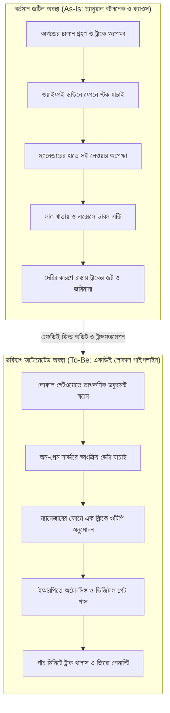

# চ্যাপ্টার ১: ফিল্ড ডিসকভারি ও এসওপি অডিট - অফিশিয়াল পেপারওয়ার্ক বনাম গ্রাউন্ড রিয়েলিটি

---

### ১. প্রথম আটচল্লিশ ঘণ্টার সাইকোলজি

দরজার সামনে এসে একটু থামুন। একটা লম্বা শ্বাস নিন।

ফরওয়ার্ড ডেপ্লয়েড ইঞ্জিনিয়ার হিসেবে ক্লায়েন্টের অফিসে প্রথম দিন পা রাখার সময় পরিস্থিতিটা মোটেই সহজ থাকে না। পিঠে ল্যাপটপের ব্যাকপ্যাক, পরনে সাধারণ পোশাক। আপনি ওদের নিজের লোক নন, বাইরের মানুষ। আপনি ঢোকামাত্র অফিসের বাতাসটা কেমন যেন ভারী হয়ে যায়। কেউ কেউ স্ক্রিন থেকে চোখ তুলে আড়চোখে আপনাকে দেখে নেন।

ওই চোখের ভাষা পড়তে শিখুন। তাঁরা মনে মনে ভাবছেন, হেড অফিস থেকে আবার কোন আপদ পাঠাল। এরা নিশ্চয়ই আমাদের কাজ তদারকি করতে এসেছে, ভুল ধরতে এসেছে। আর অটোমেশনের নাম করে শেষে আমাদের চাকরিটাই খাবে।

এই ভয়টা অমূলক না। মানুষের রুটিরুজির প্রশ্ন। তাই প্রথম আটচল্লিশ ঘণ্টায় কোড লেখা তো দূরের কথা, কাজের কথাই মুখে আনবেন না। ল্যাপটপটাও ব্যাগ থেকে বের করবেন না। এই সময়ের একটাই কাজ, মানুষের সাথে আস্থার একটা সাঁকো বানানো। একে বলে সাইকোলজিক্যাল সেফটি।

সকালে গিয়ে হেড অ্যাকাউন্ট্যান্ট সাহেবকে বিনয়ের সাথে সালাম দিন। ক্যান্টিনে স্টাফদের পাশে বসে চা খান। তাঁদের কাজের কষ্টের কথা মন দিয়ে শুনুন। বাড়ির খবর নিন। তাঁরা যেন বুঝতে পারেন, আপনি ভুল ধরতে আসেননি। আপনি এসেছেন তাঁদের কাঁধের বোঝাটা একটু নামিয়ে দিতে।

যেদিন মানুষগুলো আপনাকে বিশ্বাস করতে শুরু করবেন, আপনার আসল ফিল্ড ডিসকভারি শুরু হবে ঠিক সেদিন থেকেই।

!!! info "প্রথম আটচল্লিশ ঘণ্টার গোল্ডেন রুল"
    ক্লায়েন্টের সাইটে প্রথম দুই দিন ল্যাপটপ ব্যাগ থেকে বের করবেন না। কোড লেখার কথাও ভুলে যান। আপনার একমাত্র কাজ মানুষের ফিয়ারটা কমানো। তাঁরা যেন বোঝেন, আপনি চাকরি কাটতে আসেননি, তাঁদের রোজকার ক্লান্তিটা কমাতে এসেছেন।

---

### ২. এসওপির মিথ আর অলিখিত শর্টকাট

বড় কোম্পানির হেড অফিসে গেলে কাঁচের শোকেসে একটা মোটা ফাইল দেখতে পাবেন। চামড়ার বাঁধাই, সোনালি হরফে লেখা: স্ট্যান্ডার্ড অপারেটিং প্রসিডিউর, সংক্ষেপে এসওপি।

ভেতরে পাতার পর পাতা ঝকঝকে ফ্লোচার্ট। কোন কাজ কিভাবে হওয়া উচিত, তার নিখুঁত বিবরণ। কিন্তু মাঠে গিয়ে দাঁড়ালে বুঝবেন, ওই বাঁধানো ফাইল আসলে একটা রূপকথা।

একটা উদাহরণ দিই। কাগজের এসওপিতে লেখা আছে, চালান আসার সাথে সাথে বারকোড স্ক্যান হবে, তিন স্তরের ভেরিফিকেশন শেষে চার ঘণ্টার মধ্যে ডেটা সিস্টেমে ঢুকবে। শুনতে চমৎকার। এবার ওয়্যারহাউসে চলুন। দুপুর একটায় চালান এসেছে, কিন্তু সকাল থেকে ওয়াইফাই রাউটারটা ডাউন। স্ক্যানার চলছে না। যে ম্যানেজারের সই দেওয়ার কথা, তিনি বনানীর জ্যামে আটকে আছেন। বাইরে কড়া রোদে কুড়িটা ট্রাক লাইন ধরে দাঁড়িয়ে। ড্রাইভাররা বিরক্ত হয়ে গালমন্দ করছেন।

এখন ওই ক্লার্ক কী করবেন? চার ঘণ্টা বসে থেকে এসওপি মানবেন? কোনোদিন না।

তিনি একটা সাদা কাগজে ট্রাকের নম্বর আর চালানের ওজন লিখে নেবেন। ড্রাইভারের সই নিয়ে ট্রাক ছেড়ে দেবেন। বিকেলে কাজের চাপ কমলে পুরনো একটা এক্সেল ফাইল খুলে আন্দাজে ডেটাগুলো বসিয়ে দেবেন।

মানুষ এভাবেই বেঁচে থাকার তাগিদে, কাজ চালু রাখার জন্য নিজের মতো শর্টকাট বানিয়ে নেয়। শোকেসের এসওপি নয়, এই অলিখিত শর্টকাটগুলোই মাঠের আসল সিস্টেম। একজন এফডিইর আসল কাজ এই শর্টকাটগুলো খুঁজে বের করা। আর বোঝা, মানুষটা নিয়ম ভাঙতে বাধ্য হলেন কেন।

!!! warning "কাগজের এসওপি বনাম মাঠের বাস্তবতা"
    শোকেসে সাজানো এসওপি একটা রূপকথা। মাঠ চলে মানুষের অলিখিত শর্টকাটে। ওয়াইফাই বন্ধ হলে, ম্যানেজার জ্যামে আটকে গেলে, রোদে ট্রাকের লাইন বেড়ে গেলে কর্মী কিভাবে কাজটা বের করে আনেন, সেটাই আসল গ্রাউন্ড রিয়েলিটি।

---

### ৩. শ্যাডো সেশনের কৌশল

তাহলে মাঠের আসল জটটা বের করবেন কিভাবে? কর্মীদের ডেকে প্রশ্ন করবেন? ইন্টারভিউ নেবেন?

এই ভুলটা করবেন না।

আনুষ্ঠানিকভাবে প্রশ্ন করলে মানুষ সবসময় সাজানো উত্তর দেয়। এসওপিতে যা লেখা আছে, সেটাই মুখস্থ শুনিয়ে দেবে। কারণ সে ভয় পায়। আসল কথা বললে যদি চাকরি নিয়ে টানাটানি হয়?

তাহলে উপায় কী? উপায় হলো শ্যাডো সেশন।

কর্মীর ডেস্কের পাশে একটা চেয়ার টেনে চুপচাপ বসুন। সাথে ডায়েরি বা ল্যাপটপ রাখবেন না। কোনো মন্তব্য করবেন না, কোনো ভুল ধরবেন না। একটা ছায়ার মতো তাঁর কাজের সাথে লেগে থাকুন, আর দেখুন।

দেখুন, একই তথ্যের জন্য তিনি বারবার তিনটা আলাদা সফটওয়্যারে লগইন করছেন কি না। দেখুন, কাজ করতে করতে তাঁর চোখ বারবার টেবিলের ড্রয়ারের ভেতরের কাগজের নোটবইয়ের দিকে যাচ্ছে কি না। যাচ্ছে মানে, ওই তথ্যটা সিস্টেমে নেই। আর খেয়াল করুন তাঁর মুখের ভাব। কোন ফর্মটা খুলতেই কপাল কুঁচকে গেল? কোন জায়গায় এসে একটা ছোট দীর্ঘশ্বাস বেরিয়ে এল? সেই ফর্মটাতেই লুকিয়ে আছে সিস্টেমের সবচেয়ে বড় বটলনেক।

!!! tip "শ্যাডো সেশনের গোপন পর্যবেক্ষণ"
    কর্মীকে সরাসরি প্রশ্ন করবেন না, সাজানো উত্তর পাবেন। পাশে চুপচাপ বসুন। অপ্রয়োজনীয় ক্লিক, ড্রয়ারের কাগজের দিকে বারবার তাকানো, কপাল কুঁচকে যাওয়ার মুহূর্তগুলো লক্ষ্য করুন। আসল বটলনেক সেখানেই বসে আছে।

---

### ৪. As-Is বনাম To-Be ট্রান্সফরমেশন ডায়াগ্রাম

শ্যাডো সেশন শেষ হলে বাস্তবতাটাকে একটা ছবির রূপ দিতে হবে।

বর্তমান ভাঙাচোরা ওয়ার্কফ্লোকে আমরা বলি **As-Is আর্কিটেকচার**। অকারণ জটিলতা ছেঁটে ফেলে যে সহজ, অটোমেটেড ফ্লো দাঁড় করাব, তার নাম **To-Be আর্কিটেকচার**।

নিচের Mermaid ফ্লোচার্টে একটা এন্টারপ্রাইজ চালানের বর্তমান ভাঙাচোরা রাস্তা আর এফডিইর অটোমেটেড পথ পাশাপাশি দেখানো হলো:



---

### ৫. হ্যান্ডস-অন কোড প্রুফ: ফিল্ড বটলনেক ডায়াগনস্টিক ইঞ্জিন

ধরুন শ্যাডো সেশনে আপনি প্রতিটা ধাপের আসল সময় লিখে এনেছেন। হাতে আছে একটা খাতা, আর খাতার পাশে এসওপির কাগুজে সময়। এই দুই সংখ্যার ফারাকটা ঠিক কোথায় সবচেয়ে বেশি, সেটা চোখে দেখে আন্দাজ করবেন, নাকি কোড দিয়ে বের করবেন?

নিচের পাইথন স্ক্রিপ্টটা ঠিক সেই কাজটাই করে। প্রতিটা ধাপে এসওপির সময় আর বাস্তবের সময় মিলিয়ে দেখে, আর যেখানে সময় দ্বিগুণ বা তার বেশি লাগছে, সেটাকে ক্রিটিক্যাল বটলনেক হিসেবে চিহ্নিত করে দেয়।

```python
# FDE Field Diagnostic: As-Is Workflow Bottleneck Analyzer
def analyze_workflow_bottlenecks(workflow_steps):
    diagnostics = []
    total_wasted_minutes = 0

    for step in workflow_steps:
        name = step["name"]
        sop_time = step["sop_time_min"]
        real_time = step["real_time_min"]
        is_manual = step.get("is_manual", True)

        delta = real_time - sop_time
        # বাস্তবের সময় এসওপির দ্বিগুণ হলেই ধরে নিন এটা প্রাইমারি বটলনেক
        if delta > 0 and real_time >= (sop_time * 2):
            diagnostics.append({
                "step": name,
                "status": "CRITICAL_BOTTLENECK",
                "delay_min": delta,
                "action": "AUTOMATE_IMMEDIATELY" if is_manual else "OPTIMIZE_INFRA"
            })
            total_wasted_minutes += delta

    return {"total_delay": total_wasted_minutes, "critical_steps": diagnostics}

# শ্যাডো সেশনে সংগ্রহ করা নমুনা ডেটা
mock_field_audit = [
    {"name": "Invoice Verification", "sop_time_min": 5, "real_time_min": 45, "is_manual": True},
    {"name": "Manager Physical Sign", "sop_time_min": 10, "real_time_min": 120, "is_manual": True},
    {"name": "ERP Data Sync", "sop_time_min": 2, "real_time_min": 3, "is_manual": False}
]

audit_result = analyze_workflow_bottlenecks(mock_field_audit)
print(f"Total Wasted Time: {audit_result['total_delay']} minutes")
```

স্ক্রিপ্টটা চালালে স্ক্রিনে আসবে "Total Wasted Time: 150 minutes"। মানে প্রতিটা চালানে আড়াই ঘণ্টা শুধু অপেক্ষায় চলে যাচ্ছে। এর মধ্যে ম্যানেজারের শারীরিক সইয়ের ধাপেই যাচ্ছে প্রায় দুই ঘণ্টা। ইআরপি সিঙ্কের ধাপটা কিন্তু ধরা পড়েনি, কারণ ওখানে সময় প্রায় এসওপির কাছাকাছিই আছে।

এই তথ্য হাতে পেয়ে একজন এফডিই পুরো সিস্টেম বদলাতে বসেন না। তিনি শুধু সইয়ের ধাপটাকে একটা ওটিপিভিত্তিক লোকাল এপিআই দিয়ে অটোমেট করে দেন। ম্যানেজার ফোনে ওটিপি বসালেন, কাজ শেষ। পুরো ডেলিভারি সাইকেল তিন ঘণ্টা থেকে নেমে আসে সাত মিনিটে। কর্মীরা হাঁফ ছেড়ে বাঁচেন। অনেকদিন পর তাঁদের মুখে একটু হাসি দেখা যায়।

---

### ৬. ফিল্ড রুলস: টিকে থাকার তিন নিয়ম

ফিল্ডে টিকে থাকতে চাইলে নিচের তিনটা কথা ডায়েরির পাতায় লিখে রাখুন।

!!! success "ফিল্ড রুলস: টিকে থাকার তিন মূলনীতি"
    * **রুল ১: এসওপি নিয়ে কর্মীর সাথে তর্কে যাবেন না।**  
      কর্মী রোজ যেভাবে কাজ সারছেন, সেটাই গ্রাউন্ড ট্রুথ। এসওপির ভুল ধরা আপনার কাজ না। তিনি কেন শর্টকাট নিতে বাধ্য হচ্ছেন, তার পেছনের আসল বাধাটা সরিয়ে দেওয়াই আপনার কাজ।
    * **রুল ২: আগে ক্লান্তি কমান, তারপর নিখুঁত কোডের কথা ভাবুন।**  
      আপনার সফটওয়্যার যদি কর্মীর রোজকার মানসিক ক্লান্তি না কমায়, সিস্টেমটা এক মাসও টিকবে না। কোড কতটা সুন্দর, সেটা পরের কথা।
    * **রুল ৩: প্রথম সপ্তাহেই একটা ছোট জয় উপহার দিন।**  
      পুরো এন্টারপ্রাইজ সিস্টেম একসাথে বদলাতে যাবেন না। একটা ছোট ভোগান্তি বেছে নিন, যেমন ধীরগতির একটা রিপোর্ট প্রিন্ট করার ঝামেলা। দুই দিন খেটে সেটা ঠিক করে দিন। এই একটা কুইক উইনেই পুরো অফিস আপনার পাশে এসে দাঁড়াবে।

পরের চ্যাপ্টারে দেখব, ক্লাউডের ওপর নির্ভর না করে অফিসের সাধারণ সস্তা সার্ভারেই কিভাবে এই পুরো অটোমেশন লোকাল আর্কিটেকচারে চালানো যায়।

!!! question "কথা বলতে চান?"
    আমাকে WhatsApp এ মেসেজ করতে পারেন: [+8801713095767](https://wa.me/+8801713095767)। আমি যেহেতু রোবট, কল থেকে মেসেজেই বেশি অভ্যস্ত। আমার সব আলাপ [মিডিয়াম](https://medium.com/@raqueeb), [ফেসবুক](https://www.facebook.com/raqueeb) আর [লিংকডইনে](https://www.linkedin.com/in/raqueeb/) পাবেন। ভিডিও দেখতে চাইলে আছে [ইউটিউব](https://www.youtube.com/@raqueeb)।

    আমার মাথায় আর কী কী ঘোরে, সেটাও পাবেন [এখানে](https://medium.com/@raqueeb/print-media-write-ups-2024-25-f2896ce92f7b)।
