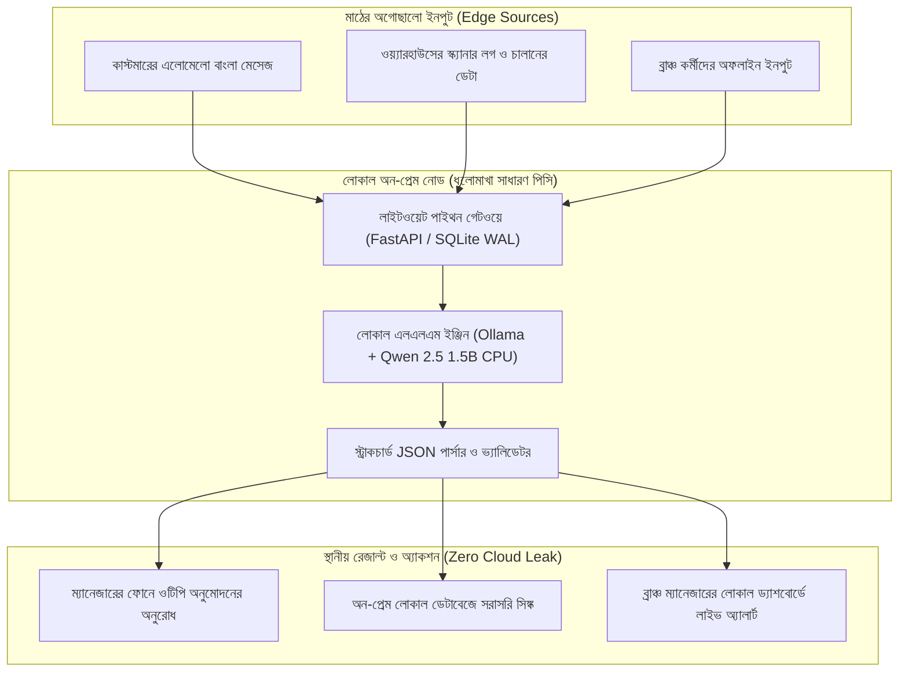

# চ্যাপ্টার ২: লোকাল আর্কিটেকচার ও অন-প্রেম ইন্টেলিজেন্স - টেবিলের নিচের ধুলোমাখা সার্ভার

---

### ১. টেবিলের নিচের ধুলোমাখা সার্ভার

গত চ্যাপ্টারে আপনি শ্যাডো সেশনে বসে ম্যানেজারের সইয়ের ধাপে প্রায় দুই ঘণ্টার অপচয় ধরে ফেলেছেন। কর্মীরাও আপনাকে বিশ্বাস করতে শুরু করেছেন। চায়ের কাপে আড্ডা জমে গেছে, লাল মলাটের খাতাটা আপনাকে দেখাতে এখন আর কারও আপত্তি নেই।

এবার ইঞ্জিনিয়ারিংয়ের পালা।

আটচল্লিশ ঘণ্টা পার হয়েছে। আজ প্রথমবার আপনি ব্যাগ থেকে ল্যাপটপটা বের করলেন। মনে মনে ছক কষা শুরু হয়ে গেছে। ক্লাউডে একটা চমৎকার কুবারনেটিস ক্লাস্টার বসাব। ওপেনএআই বা ক্লডের এপিআই ডাকব। টিকিট আর চালানের যত জট আছে, নিমেষে খুলে যাবে। ল্যাবে বসে আমরা তো এই স্বপ্নই দেখি।

ঠিক তখন ক্লায়েন্টের হেড অব আইটি এক কাপ ধোঁয়া ওঠা চা হাতে আপনার ডেস্কের পাশে এসে দাঁড়ালেন।

তিনি চায়ে ছোট একটা চুমুক দিয়ে মুচকি হাসলেন। তারপর খুব শান্ত গলায় বললেন, "শুনুন ভাই, কাস্টমারের কোনো ডেটা বাইরের সার্ভারে যেতে পারবে না। ব্যাংক আর অডিটরের শর্ত আছে। আর এই ব্রাঞ্চে দিনে তিনবার ফাইবার কাটে, ইন্টারনেট চলে যায়। যা করার, ওই হেড অ্যাকাউন্ট্যান্ট সাহেবের টেবিলের নিচের পুরনো ডেল সার্ভারটাতেই করতে হবে।"

আপনার চোখের সামনে ঝকঝকে ক্লাউড আর্কিটেকচারটা এক সেকেন্ডে হাওয়া হয়ে গেল।

আপনি টেবিলের নিচে উঁকি দিলেন। সেই লাল মলাটের খাতার ঠিক নিচেই, অন্ধকার কোণে একটা পুরনো কম্পিউটার। গায়ে এক ইঞ্চি ধুলো। ফ্যানের শব্দটা বেশ চড়া। কনফিগারেশন দেখলেন: আট কোরের একটা পুরনো জিওন প্রসেসর, বত্রিশ জিবি র‍্যাম, কোনো জিপিইউ নেই।

বুকের ভেতরটা একটু দমে গেল? ভাবছেন, এই ভাঙাচোরা বাক্সে এআই চালাব কিভাবে?

চাপ নেবেন না। একজন ফরওয়ার্ড ডেপ্লয়েড ইঞ্জিনিয়ার এই জায়গাতেই সাধারণ ডেভেলপার থেকে আলাদা হয়ে যান। তিনি হার্ডওয়্যার নিয়ে আক্ষেপ করেন না। হাতের কাছে যা আছে, সেটাকেই নিজের সবচেয়ে বড় অস্ত্র বানিয়ে নেন।

!!! warning "ক্লাউডের মোহ আর মাঠের বাস্তবতা"
    ল্যাবে বসে ক্লাউড এপিআই ডাকা খুব সহজ। মাঠের বাস্তবতা অনেক নির্মম। কমপ্লায়েন্সের শর্ত, দুর্বল ইন্টারনেট আর মাস শেষের আনএক্সপেক্টেড ক্লাউড বিলের সামনে অনেক চকচকে আর্কিটেকচার তাসের ঘরের মতো ভেঙে পড়ে। একজন এফডিইর আসল গর্ব হলো, তিনি টেবিলের নিচের ধুলোমাখা পুরনো সার্ভারেই একটা পুরো সিস্টেম সচল করে দিয়ে আসতে পারেন।

---

### ২. ক্লাউডের তিন ফাঁদ বনাম অন-প্রেমের স্বস্তি

সফটওয়্যার দুনিয়ায় অনেক বছর ধরে একটা ফ্যাশন চলছে। যা-ই বানান, ক্লাউডে তুলে দিন। মাইক্রোসার্ভিস বানান, ক্লাউড প্রোভাইডারের শ'খানেক সার্ভিসের সাথে জুড়ে দিন।

মাঠে নামলে টের পাওয়া যায়, চোখ বন্ধ করে পাবলিক ক্লাউডে ভরসা করা কতটা ঝুঁকির। এখানে তিনটা ফাঁদ আছে।

ফার্স্ট থিং ফার্স্ট, ইন্টারনেটের অনিশ্চয়তা। আমাদের দেশে জেলা শহরে তো বটেই, ঢাকার অলিগলিতেও একটু বৃষ্টি হলেই ফাইবার কাটা পড়ে। ওয়াইফাই বসে যায়। আপনার সফটওয়্যার যদি প্রতিটা ক্লিকের জন্য ক্লাউডের দিকে তাকিয়ে থাকে, নেট গেলেই পুরো সিস্টেম অচল। বাইরে ট্রাকের লাইন বাড়বে, আর কর্মীরা সফটওয়্যার বন্ধ করে আবার লাল খাতা খুলে বসবেন। ঠিক যেমনটা আমরা ইন্ট্রোতে দেখেছিলাম।

দ্বিতীয় ফাঁদ খরচের মিটার। টোকেনের হিসাবে চলা ক্লাউড এলএলএম এপিআই প্রথমে খুব লোভনীয় লাগে। কিন্তু লাখ লাখ রিকোয়েস্টের পর মাস শেষে যখন বিশাল একটা বিল আসে, ক্লায়েন্টের ম্যানেজমেন্টের কপাল কুঁচকে যায়। তাঁরা সোজা বলে দেন, এই সিস্টেম আমরা চালাতে পারব না।

তৃতীয় আর সবচেয়ে বড় বাধা ডেটা প্রাইভেসি। কাস্টমারের লেনদেন, ব্যক্তিগত তথ্য, সাপ্লায়ারের দরদামের গোপন ডেটা বাইরের কোনো পাবলিক ক্লাউডে পাঠানো ঝুঁকির কাজ, অনেক ক্ষেত্রে সরাসরি আইনের বিরুদ্ধে। কমপ্লায়েন্স অডিটে ধরা পড়লে ক্লায়েন্টের বিপদ।

তাহলে উপায় কী? উপায় অন-প্রেমিসেস লোকাল আর্কিটেকচার।

নিজের অফিসের ভেতরের একটা লোকাল সার্ভারেই পুরো সিস্টেম চলবে। ইন্টারনেট থাকুক বা না থাকুক, সফটওয়্যারের তাতে কিচ্ছু আসে যায় না। লোকাল এরিয়া নেটওয়ার্কে (LAN) প্রতিটা রিকোয়েস্টের উত্তর আসবে চোখের পলকে। কোনো এপিআই বিল নেই। ক্লায়েন্টের ডেটা ক্লায়েন্টের ঘরের ভেতরেই নিরাপদ।

এই স্বস্তির কোনো তুলনা হয় না।

!!! info "লোকাল ফার্স্ট আর্কিটেকচারের তিন স্তম্ভ"
    * **জিরো এক্সটার্নাল ডিপেন্ডেন্সি:** ইন্টারনেট পুরোপুরি বন্ধ থাকলেও সিস্টেমের একটা ফিচারও আটকে থাকবে না।
    * **জিরো ডেটা লিকেজ:** কাস্টমারের এনআইডি, ফোন নম্বর বা টাকাপয়সার হিসাব লোকাল মেশিনের বাইরে এক চুলও যাবে না।
    * **প্রেডিক্টেবল কস্ট:** টোকেন চার্জ নেই, ক্লাউড বিল নেই। সিস্টেম আজীবন একই খরচে চলবে।

---

### ৩. হালকা ডেটা পাইপলাইন: ক্যাফকা ছাড়াই

অনেক সিনিয়র আর্কিটেক্ট ক্লায়েন্টের অফিসে ঢুকেই বিশ নোডের কুবারনেটিস ক্লাস্টার আর ক্যাফকা ব্রোকারের নকশা আঁকতে বসে যান। একে বলে ওভার-ইঞ্জিনিয়ারিং।

মাঠের সিস্টেমে দরকার হালকা, দ্রুত আর টেকসই পাইপলাইন।

একবার ভেবে দেখুন তো, একটা ব্রাঞ্চে দিনে সর্বোচ্চ কতগুলো মেসেজ বা অভিযোগ আসতে পারে? পাঁচ হাজার? দশ হাজার? এর জন্য ক্যাফকার মতো ভারী দানব ডাকার মানে হয় না। একটা সাধারণ পাইথন স্ক্রিপ্ট আর পেছনে SQLite-এর Write-Ahead Logging (WAL) মোড দিয়েই লোকালহোস্টে প্রতি সেকেন্ডে কয়েক হাজার রিকোয়েস্ট সামলে ফেলা যায়।

নকশাটা একদম সোজা।

প্রথমে অগোছালো ইনপুট আসবে। হতে পারে হোয়াটসঅ্যাপে কাস্টমারের ভাঙা বাংলা মেসেজ, ওয়্যারহাউসের স্ক্যানারের লগ, কিংবা ব্রাঞ্চের কর্মীর অফলাইনে জমানো কোনো নোট। একটা লোকাল ইনজেশন গেটওয়ে সেটা রিসিভ করবে।

তারপর টেক্সটটা চলে যাবে টেবিলের নিচের সার্ভারে চলা একটা ছোট লোকাল এলএলএম ইঞ্জিনে। মডেলটা পড়ে ঠিক করবে, সমস্যাটা কী, কোন বিভাগের কাজ, আর কতটা জরুরি।

মডেলের উত্তর আসবে একটা পরিষ্কার JSON হয়ে। সেটা জমা হবে অন-প্রেম ডেটাবেজে, আর সাথে সাথে ম্যানেজারের ফোনে সইয়ের অনুরোধ চলে যাবে, গত চ্যাপ্টারে যে ওটিপির পথটা বানিয়েছিলাম, ঠিক সেটা দিয়ে।

পুরো পথটা ঘুরতে সময় লাগবে মাত্র কয়েক সেকেন্ড। বাইরে ঝড় উঠুক, ইন্টারনেট কাটা পড়ুক, ভেতরের কাজ থামবে না।

---

### ৪. ভিজ্যুয়াল আর্কিটেকচার: অন-প্রেম ইন্টেলিজেন্স পাইপলাইন

নিচের Mermaid ডায়াগ্রামে লোকাল অন-প্রেম পাইপলাইনের প্রতিটা স্তর একনজরে দেখানো হলো:



---

### ৫. হ্যান্ডস-অন কোড প্রুফ: লোকাল এলএলএম ট্রায়াজ ইঞ্জিন

এবার সরাসরি কোডে নামা যাক। লক্ষ্যটা স্পষ্ট: ক্লাউডের সাহায্য ছাড়া, পুরোপুরি অফলাইনে, অফিসের সাধারণ একটা কম্পিউটারের সিপিইউ দিয়ে কাস্টমারের বাংলা মেসেজ থেকে কাজে লাগার মতো JSON বের করা।

এর জন্য আমরা ব্যবহার করব **Ollama** আর আলিবাবার ওপেন সোর্স মডেল **Qwen 2.5 (1.5B বা 3B)**। সাইজে এত ছোট যে সাধারণ ল্যাপটপের র‍্যামেই চলে যায়।

#### কোড-স্যান্ডউইচ মেথড

**১. মাঠের সংকট:** ক্লায়েন্টের অফিসে রোজ ফোনে আর হোয়াটসঅ্যাপে ডজন ডজন মেসেজ আসে। কেউ লেখেন "ট্রাক সকাল থেকে গেটে দাঁড়িয়ে আছে, চালানে নাকি ভুল", কেউ লেখেন "আমার মালের হিসাবটা মিলছে না ভাই, একটু দেখেন"। কর্মীরা মেসেজগুলো পড়ে কোনটা কোন বিভাগের, কোনটা আগে দেখতে হবে, সেটা ঠিক করতেই রোজ ঘণ্টা দুয়েক খরচ করেন।

**২. মূল কোড:** নিচের বিশ লাইনের মধ্যের পাইথন স্ক্রিপ্টটা লোকাল Ollama এপিআই দিয়ে সাথে সাথে ট্রায়াজ করে ফেলে:

```python
# FDE Field Engine: Local LLM Triage Worker (Zero-Cloud Dependency)
import json, urllib.request

def triage_customer_ticket(raw_text: str) -> dict:
    prompt = f"""You are an on-prem triage worker. Read this Bengali customer message and return ONLY valid JSON:
    Message: "{raw_text}"
    JSON format: {{"category": "DELIVERY|BILLING|STOCK", "priority": "HIGH|MEDIUM|LOW", "action": "string"}}"""

    payload = json.dumps({
        "model": "qwen2.5:1.5b",
        "prompt": prompt,
        "stream": False,
        "format": "json"
    }).encode("utf-8")

    req = urllib.request.Request("http://localhost:11434/api/generate", data=payload,
                                 headers={"Content-Type": "application/json"})
    with urllib.request.urlopen(req) as resp:
        result = json.loads(resp.read().decode("utf-8"))
        return json.loads(result["response"])

# ফিল্ড টেস্ট: আসল মেসেজ দিয়ে যাচাই
sample = "আমার মালের ট্রাক সকাল থেকে গেটে দাঁড়িয়ে আছে, চালানে নাকি ভুল আছে, খুব আর্জেন্ট!"
print(json.dumps(triage_customer_ticket(sample), indent=2, ensure_ascii=False))
```

**৩. সিস্টেমের বাস্তব বদল:** স্ক্রিপ্টটা চালালে স্ক্রিনে এরকম একটা আউটপুট ভেসে উঠবে:

```json
{
  "category": "BILLING",
  "priority": "HIGH",
  "action": "Ask warehouse manager to verify the invoice and approve gate release"
}
```

ইন্টারনেট ছাড়া, পুরোপুরি লোকাল মেশিনে, কয়েক সেকেন্ডে কাজটা হয়ে গেল। কোনো ডেটা ক্লাউডে যায়নি, কোনো বিলও ওঠেনি। যে মেসেজটা কর্মীর টেবিলে ঘণ্টা দুয়েক পড়ে থাকত, সেটা এখন কয়েক সেকেন্ডের মাথায় ম্যানেজারের ফোনে সইয়ের অনুরোধ হয়ে পৌঁছে গেছে। ছোট মডেল মাঝে মাঝে ভুল করে, তাই আউটপুট প্রতিবার হুবহু এক হবে না। সেই কারণেই পাইপলাইনে একটা ভ্যালিডেটর আছে, যা JSON-এর ফরম্যাট আর ক্যাটাগরি যাচাই করে নেয়।

সেদিন হেড অ্যাকাউন্ট্যান্ট সাহেব আপনার স্ক্রিনের দিকে চোখ বড় বড় করে তাকিয়ে ছিলেন। লাল মলাটের খাতাটা তখনো টেবিলে ছিল। শুধু সেদিন সেটা একবারও খোলা হয়নি।

**৪. গিটহাব রিপোজিটরি লিংক:** পুরো প্রোডাকশন পাইপলাইন আর টেস্ট ডেটাসেট পাবেন বইয়ের অফিশিয়াল রিপোজিটরিতে: [https://github.com/aiwithr/fde_book](https://github.com/aiwithr/fde_book)।

---

### ৬. মডেল নির্বাচনের হিসাব: কেন Qwen 2.5 1.5B বা 3B?

অনেকেই জিজ্ঞেস করেন, বাজারে তো সত্তর বিলিয়ন, এমনকি চারশো বিলিয়ন প্যারামিটারের বিশাল মডেলও আছে। আমরা এত ছোট মডেল বাছছি কেন?

উত্তরটা সোজা। আমরা ল্যাবে বসে গবেষণাপত্র লিখছি না, ক্লায়েন্টের মাঠে সিস্টেম চালাচ্ছি।

সত্তর বিলিয়নের মডেল চালাতে গেলে দামি জিপিইউ লাগে, সব মিলিয়ে বিশ-তিরিশ লাখ টাকার মতো ধাক্কা। আমাদের ক্লায়েন্ট এই টাকা দেবেন না। কিন্তু Qwen 2.5-এর দেড় বিলিয়নের (1.5B) 4-bit কোয়ান্টাইজড ভার্সনের সাইজ মাত্র এক জিবির কাছাকাছি। চলতে লাগে বড়জোর দেড় থেকে দুই জিবি র‍্যাম। অফিসের আট বছরের পুরনো কম্পিউটারেও এটা দিব্যি চলে। গতি ধীর হতে পারে, কিন্তু কাস্টমারের মেসেজ ছাঁটাই করার মতো ছোট কাজের জন্য সেটাই যথেষ্ট।

একটা কথা সৎভাবে বলে রাখি। ছোট মডেলের বাংলা বোঝার ক্ষমতা সবসময় নিখুঁত না। সাধারণ মেসেজে ভালোই চলে, কিন্তু জটিল বা অশুদ্ধ বাংলায় ভুল করতে পারে। তাই ক্লায়েন্টের আসল মেসেজ দিয়ে আগে টেস্ট করে নেবেন। দরকার হলে 3B ভার্সনে উঠে যান।

কম্পিউট ক্ষমতা সীমিত হলে বিশাল মডেলের পেছনে না ছুটে, কাজের মাপের ছোট মডেল বেছে নেওয়াই ইঞ্জিনিয়ারের বুদ্ধিমানের কাজ।

!!! tip "মডেল নির্বাচনের অঙ্ক: কেন ছোট মডেল?"
    ফিল্ডের কাজে মডেল বাছাইয়ের সহজ সূত্র: যে কাজ দেড় বিলিয়নের ছোট মডেল দিয়ে অল্প সময়ে সারা যায়, তার জন্য সত্তর বিলিয়নের দানব ডেকে আনা অকারণ খরচ। কম মেমোরি, কম বিদ্যুৎ আর অফলাইনে স্থির থাকা, এটাই অন-প্রেম ইন্টেলিজেন্সের আসল শক্তি। শুধু একটা কাজ করে নেবেন, ক্লায়েন্টের নিজের মেসেজ দিয়ে টেস্ট।

---

### ৭. ফিল্ড রুলস: অন-প্রেমের জয়ে তিন শপথ

অন-প্রেমিসেস আর্কিটেকচার দাঁড় করানোর সময় এই তিনটা কথা মাথায় রাখবেন।

!!! success "ফিল্ড রুলস: অন-প্রেমের জয়ে তিন শপথ"
    * **শপথ ১: হার্ডওয়্যার নিয়ে আক্ষেপ করবেন না।**  
      ক্লায়েন্ট আপনাকে যে সাধারণ সিপিইউ বা পুরনো সার্ভার দিয়েছেন, তাকে অবহেলা করবেন না। সীমাবদ্ধতার ভেতর থেকেই সেরা পারফরম্যান্স বের করে আনা আপনার ক্যারিয়ারের সবচেয়ে বড় পরীক্ষা।
    * **শপথ ২: সিস্টেমকে প্রথম দিন থেকেই অফলাইন-ফার্স্ট বানান।**  
      ইন্টারনেট থাকলে ভালো, না থাকলেও কাজ থামবে না। আপনার লোকাল পাইপলাইন যেন এক সপ্তাহ পুরোপুরি বিচ্ছিন্ন দ্বীপে বসেও এক ফোঁটা না থমকে চলতে পারে।
    * **শপথ ৩: ক্লায়েন্টকে ক্লাউড বিলের ভয় থেকে বাঁচান।**  
      ম্যানেজমেন্টকে ক্যালকুলেটর হাতে দেখিয়ে দিন, লোকাল মডেল চালানোয় প্রতি মাসে তাঁদের কত টাকা বেঁচে যাচ্ছে। প্রথম সপ্তাহের সেই কুইক উইনের সাথে এই একটা সংখ্যা যোগ হলে ক্লায়েন্টের চোখে আপনার দাম কয়েক গুণ বেড়ে যাবে।

পরের চ্যাপ্টারে দেখব দ্য নিউ এসডিএলসি। আধুনিক এআই কোডিং এজেন্ট দিয়ে ফিল্ডে বসেই কিভাবে দ্রুত শক্ত সফটওয়্যার বানানো যায়, আর কিভাবে সেলফ-হিলিং সিআই/সিডি পাইপলাইন গড়ে সিস্টেমকে ভেঙে পড়া থেকে বাঁচানো যায়।

---

!!! question "কথা বলতে চান?"
    আমাকে WhatsApp এ মেসেজ করতে পারেন: [+8801713095767](https://wa.me/+8801713095767)। আমি যেহেতু রোবট, কল থেকে মেসেজেই বেশি অভ্যস্ত। আমার সব আলাপ [মিডিয়াম](https://medium.com/@raqueeb), [ফেসবুক](https://www.facebook.com/raqueeb) আর [লিংকডইনে](https://www.linkedin.com/in/raqueeb/) পাবেন। ভিডিও দেখতে চাইলে আছে [ইউটিউব](https://www.youtube.com/@raqueeb)।

    আমার মাথায় আর কী কী ঘোরে, সেটাও পাবেন [এখানে](https://medium.com/@raqueeb/print-media-write-ups-2024-25-f2896ce92f7b)।
