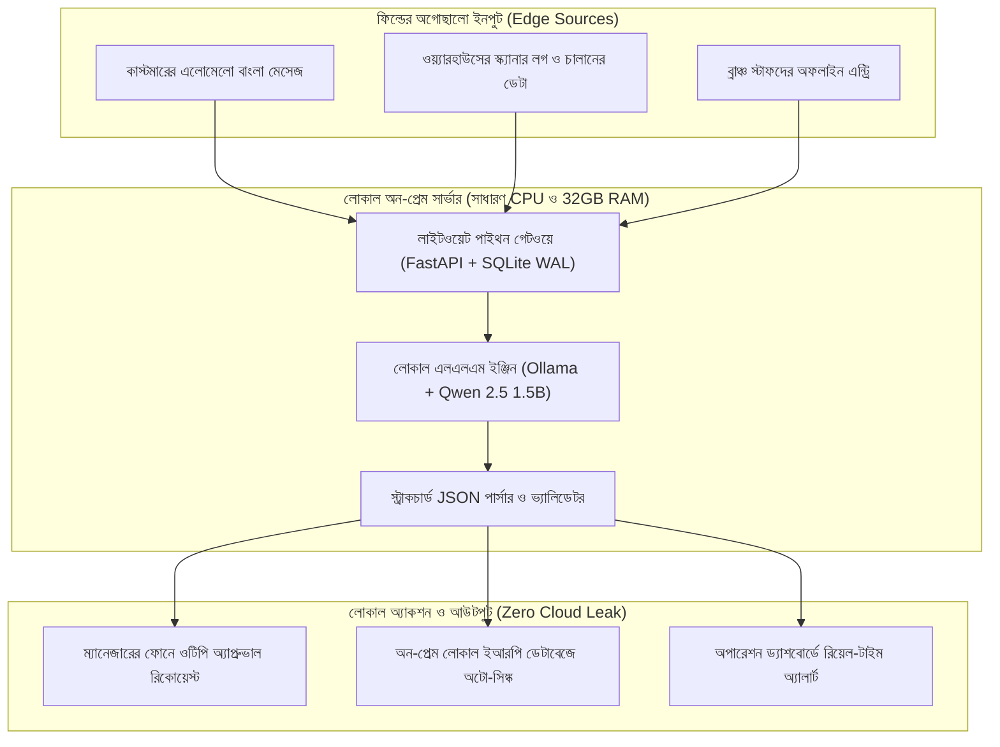

# চ্যাপ্টার ২: লোকাল আর্কিটেকচার ও অন-প্রেম ইন্টেলিজেন্স - টেবিলের নিচের ধুলোমাখা সার্ভার

---

### ১. টেবিলের নিচের ধুলোমাখা সার্ভার

চ্যাপ্টার ১-এর শ্যাডো সেশনে আপনি ম্যানেজারের সইয়ের ধাপে প্রায় দুই ঘণ্টার অপচয় ধরে ফেলেছেন এবং ওটিপি দিয়ে তার একটা কুইক উইনও দেখিয়েছেন। অফিসের স্টাফরা এখন আপনাকে বিশ্বাস করেন। ক্যান্টিনে চায়ের কাপে আড্ডা জমে গেছে, আর হেড অ্যাকাউন্ট্যান্ট সাহেবও তাঁর লাল মলাটের খাতাটা আপনাকে দেখাতে এখন আর দ্বিধা করেন না। প্রথম আটচল্লিশ ঘণ্টার ট্রাস্ট তৈরির পর্ব সফলভাবে শেষ।

আজ তৃতীয় দিন। আপনি প্রথমবার ব্যাগ থেকে নিজের ল্যাপটপটা বের করলেন। এবার কাস্টমারদের পাঠানো এলোমেলো মেসেজ আর চালানের ইনভয়েস ভেরিফিকেশনের জট খোলার পালা। মাথার ভেতর আপনি চমৎকার একটা ক্লাউড আর্কিটেকচার সাজিয়ে ফেলেছেন - এডব্লিউএস বা গুগল ক্লাউডে একটা সার্ভিস তুলবেন, ওপেনএআই বা ক্লডের এপিআই কল করবেন, আর নিমেষে সব মেসেজ বাছাই হয়ে যাবে। হেডকোয়ার্টারে বসে আমরা তো এভাবেই চিন্তা করি।

ঠিক তখন ক্লায়েন্টের হেড অব আইটি এক কাপ চা হাতে আপনার ডেস্কের পাশে এসে দাঁড়ালেন। চায়ে চুমুক দিয়ে খুব শান্ত গলায় বললেন, "শুনুন ভাই, একটা কথা আগেই পরিষ্কার করে রাখি। আমাদের কাস্টমারদের কোনো ডেটা বা চালানের তথ্য বাইরের কোনো ক্লাউড সার্ভারে পাঠানো যাবে না। ব্যাংক আর কমপ্লায়েন্স অডিটরের কড়া নিষেধ আছে। তাছাড়া আমাদের এই এরিয়ায় দিনে দু-তিনবার ফাইবার কাটা পড়ে, ইন্টারনেট থাকে না। তাই যা করার, ওই হেড অ্যাকাউন্ট্যান্ট সাহেবের টেবিলের নিচে যে পুরনো ডেল সার্ভারটা আছে, ওতেই করতে হবে।"

আইটি হেডের কথাটা শুনেই মাথার ভেতর সাজানো ঝকঝকে ক্লাউড আর্কিটেকচারটা মুছে ফেলতে হলো। আপনি টেবিলের নিচে ঝুঁকে দেখলেন, এক কোণে একটা পুরনো ডেল পিসি চলছে। গায়ে ধুলোর আস্তরণ, কুলিং ফ্যানটাও বেশ জোরে শব্দ করছে। টার্মিনাল খুলে কনফিগারেশন দেখে নিলেন - আট কোরের একটা পুরনো ইন্টেল জিওন (Xeon) প্রসেসর আর বত্রিশ জিবি র‍্যাম। আলাদা কোনো গ্রাফিক্স কার্ড বা জিপিইউ (GPU) নেই।

নতুন যাঁরা এআই আর অটোমেশন নিয়ে কাজ শুরু করেন, এই অবস্থায় পড়লে প্রথমেই হতাশ হয়ে যান। মনে প্রশ্ন জাগে, জিপিইউ আর ক্লাউড এপিআই ছাড়া এই পুরনো বাক্সে আবার এআই চালানো যায় নাকি? চাপ নেবেন না। একজন ফরওয়ার্ড ডেপ্লয়েড ইঞ্জিনিয়ারের আসল কারিশমা এই জায়গাতেই। তিনি হার্ডওয়্যার নিয়ে আক্ষেপ করেন না। আমাদের তো চ্যাটজিপিটির মতো দুনিয়ার সব বিষয়ে প্রবন্ধ লেখার বিশাল মডেল দরকার নেই; আমাদের দরকার কাস্টমারের বাংলা মেসেজ পড়ে সেটা কোন ডিপার্টমেন্টের কাজ তা বাছাই করা। আর সেই কাজের জন্য বত্রিশ জিবি র‍্যামের ওই পুরনো সার্ভারটাই যথেষ্টের চেয়ে বেশি।

!!! warning "ক্লাউডের মোহ বনাম ফিল্ডের বাস্তবতা"
    হেডকোয়ার্টারে বসে ক্লাউড এপিআই কল করা খুব সহজ, কিন্তু ফিল্ডের বাস্তবতা অনেক কঠিন। ডেটা প্রাইভেসির কড়া শর্ত, দুর্বল ইন্টারনেট আর মাস শেষের আনএক্সপেক্টেড ক্লাউড বিলের ধাক্কায় অনেক আধুনিক ক্লাউড আর্কিটেকচার ফিল্ডে গিয়ে অচল হয়ে পড়ে। একজন এফডিইর সবচেয়ে বড় শক্তি হলো, তিনি হাতের কাছে থাকা সাধারণ লোকাল সার্ভারেই পুরো ইন্টেলিজেন্ট পাইপলাইন সচল করে দিয়ে আসতে পারেন।

---

### ২. পাবলিক ক্লাউডের ঝুঁকি ও অন-প্রেম আর্কিটেকচারের কমফোর্ট

গত এক দশকে সফটওয়্যার ইন্ডাস্ট্রিতে একটা হ্যাবিট তৈরি হয়ে গেছে - ছোট-বড় যা-ই বানান, আগে পাবলিক ক্লাউডে তুলুন। কিন্তু বাংলাদেশের মতো মার্কেটে কিংবা যেকোনো সিরিয়াস এন্টারপ্রাইজের ফিল্ডে নামলে আপনি টের পাবেন, চোখ বন্ধ করে পাবলিক ক্লাউডের ওপর নির্ভর করলে প্রজেক্ট কেন বিপদে পড়ে।

ফার্স্ট থিং ফার্স্ট, ইন্টারনেটের অনিশ্চয়তা। ঢাকার বাইরে কারখানা বা বন্দরে তো বটেই, খোদ ঢাকার বাণিজ্যিক এলাকাতেও রাস্তায় কাজ চলার সময় ফাইবার কেটে গিয়ে ঘণ্টার পর ঘণ্টা ইন্টারনেট বন্ধ থাকে। আপনার অটোমেশন পাইপলাইন যদি প্রতিটা সিদ্ধান্তের জন্য আমেরিকার কোনো ক্লাউড সার্ভারের এপিআই কলের দিকে তাকিয়ে থাকে, তবে ইন্টারনেট ডাউন হওয়ার সাথে সাথে পুরো অফিসের কাজ থমকে যাবে। বাইরে ট্রাকের লাইন বাড়বে, আর স্টাফরা বিরক্ত হয়ে আপনার সফটওয়্যার বন্ধ করে আবার সেই পুরনো লাল খাতা আর এক্সেল ফাইল খুলে বসবেন।

এরপর আসে খরচের হিসাব। ডেভেলপমেন্টের সময় ক্লাউড এলএলএম এপিআইতে কয়েক সেন্ট খরচ হতে দেখে মনে হয় এ আর এমন কী! কিন্তু সিস্টেমটা যখন প্রোডাকশনে যায় এবং প্রতিদিন হাজার হাজার মেসেজ ও ডকুমেন্ট প্রসেস হতে থাকে, তখন মাস শেষে টোকেনের বিল দেখে ক্লায়েন্টের ম্যানেজমেন্টের মাথায় হাত পড়ে। আমাদের দেশের বেশিরভাগ প্রতিষ্ঠান এককালীন সার্ভার কিনতে রাজি থাকে, কিন্তু প্রতি মাসে হাজার ডলারের রিকারিং এপিআই বিল দিতে চায় না।

সবচেয়ে বড় বাধা হলো ডেটা প্রাইভেসি ও কমপ্লায়েন্স। ব্যাংকিং, হাসপাতাল, গার্মেন্টস বা কাস্টমস ক্লিয়ারিংয়ের কাজে কাস্টমারের ফোন নম্বর, এনআইডি, ইনভয়েসের দরদাম এবং ট্যাক্সের ডেটা থাকে। এই সংবেদনশীল ডেটা থার্ড-পার্টি ক্লাউডে পাঠানো অনেক ক্ষেত্রে সরাসরি রেগুলেশনের পরিপন্থী।

এই সবগুলো সমস্যার একটাই সমাধান - **অন-প্রেমিসেস (On-Premises) লোকাল আর্কিটেকচার**। 

অর্থাৎ ক্লায়েন্টের অফিসের ভেতরে থাকা ওই লোকাল সার্ভারটাতেই আপনার ডেটাবেজ, ব্যাকএন্ড এবং ছোট এআই মডেল চলবে। অফিসের স্টাফদের কম্পিউটারগুলো লোকাল এরিয়া নেটওয়ার্কের (LAN) মাধ্যমে সরাসরি ওই সার্ভারের সাথে কথা বলবে। বাইরে ইন্টারনেট থাকুক বা না থাকুক, ফাইবার কাটুক বা ঝড়-বৃষ্টি হোক - লোকাল নেটওয়ার্কে মিলিসেকেন্ডের মধ্যে কাজ চলতে থাকবে। কোনো টোকেন বিল নেই, ডেটা লিক হওয়ারও কোনো ফিয়ার নেই।

!!! info "লোকাল-ফার্স্ট আর্কিটেকচারের মূল সুবিধা"
    * **জিরো ইন্টারনেট ডিপেন্ডেন্সি:** বাইরের ইন্টারনেট পুরোপুরি বিচ্ছিন্ন থাকলেও অফিসের লোকাল নেটওয়ার্কে সিস্টেমের প্রতিটা ফিচার একশো ভাগ সচল থাকবে।
    * **পূর্ণ ডেটা প্রাইভেসি:** কাস্টমারের গোপন ব্যবসায়িক ডেটা অফিসের রাউটারের বাইরে এক বাইটও যাবে না।
    * **স্থির খরচ:** কোনো মাসিক এপিআই বা টোকেন চার্জ নেই; অফিসের বিদ্যমান হার্ডওয়্যারেই সিস্টেম আজীবন চলবে।

---

### ৩. হালকা ডেটা পাইপলাইন: ক্যাফকা ছাড়াই হাজার রিকোয়েস্ট সামলানো

অনেক সময় দেখা যায়, ক্লায়েন্টের অফিসে সামান্য একটা মেসেজ প্রসেসিং সিস্টেম বানাতে গিয়ে ইঞ্জিনিয়াররা বিশাল কুবারনেটিস ক্লাস্টার, অ্যাপাচি ক্যাফকা (Kafka) আর রেডিস বসানোর প্ল্যান করে ফেলেন। সফটওয়্যার প্রকৌশলের ভাষায় একে বলে ওভার-ইঞ্জিনিয়ারিং। বত্রিশ জিবি র‍্যামের ওই লোকাল সার্ভারে আপনি যদি এতগুলো ভারী সার্ভিস তোলেন, তাহলে আসল কাজের আগেই সার্ভারের র‍্যাম ফুরিয়ে যাবে। আর পরে সেগুলো মেইনটেইন করার মতো ডেভঅপস টিমও ক্লায়েন্টের অফিসে থাকে না।

ফিল্ডের সিস্টেম হতে হবে ছিপছিপে, দ্রুত এবং জিরো-মেইনটেন্যান্স।

একটু ঠান্ডা মাথায় হিসাব করুন। একটা ব্রাঞ্চ অফিসে বা মাঝারি প্রতিষ্ঠানে দিনে সর্বোচ্চ কয়টা মেসেজ বা চালান আসে? পাঁচ হাজার? খুব বেশি হলে দশ হাজার? দিনে দশ হাজার রিকোয়েস্ট মানে মিনিটে গড়ে মাত্র সাত-আটটা রিকোয়েস্ট! এই কাজের জন্য ক্যাফকার মতো ভারী টুল ডাকার কোনো মানেই হয় না। একটা হালকা পাইথন সার্ভিস (`FastAPI`) আর পেছনে `SQLite` ডেটাবেজ দিয়েই এই লোডের দশ গুণ কাজ হাসিমুখে সামলানো যায়।

এখানে নতুন ডেভেলপারদের মনে একটা দারুণ টেকনিক্যাল প্রশ্ন আসে: *"ভাই, SQLite তো একটা ফাইলের ওপর চলে। একসাথে দশজন স্টাফ ডেটা সেভ করতে গেলে আর ব্যাকগ্রাউন্ডে এআই ওয়ার্কার ডেটা পড়তে গেলে তো `Database is locked` এরর দেওয়ার কথা!"*

খুবই খাঁটি প্রশ্ন। ডিফল্ট অবস্থায় SQLite-এ কেউ লেখার সময় অন্য কেউ পড়তে গেলে বাধা পায়। কিন্তু আপনি যখনই SQLite-এ এক লাইনের একটা কমান্ড চালিয়ে **`WAL` (Write-Ahead Logging)** মোড চালু করে দেবেন (`PRAGMA journal_mode=WAL;`), তখন দৃশ্যটা পুরো বদলে যায়। `WAL` মোডে নতুন ডেটা সরাসরি মূল ডেটাবেজ ফাইলে না লিখে পাশের একটা আলাদা লগ ফাইলে চট করে অ্যাপেন্ড করে রাখা হয়। ফলে একদিকে স্টাফরা যখন ডেটা পড়ছেন, ঠিক একই সময়ে অন্য প্রসেস কোনো লক ছাড়াই নতুন ডেটা লিখতে পারে। আলাদা কোনো ডেটাবেজ সার্ভার ইনস্টল না করেই লোকাল ডিস্কে প্রতি সেকেন্ডে কয়েক হাজার রিড-রাইট অপারেশন করার জন্য এই একটা কৌশলই যথেষ্ট।

আমাদের লোকাল পাইপলাইনের প্রবাহটা তাহলে দাঁড়াচ্ছে খুব সোজা:
১. হোয়াটসঅ্যাপ মেসেজ, ওয়েব ফর্ম বা স্ক্যানার থেকে আসা অগোছালো ডেটা প্রথমে পাইথন গেটওয়ে রিসিভ করে `SQLite WAL` কিউতে রাখবে।
২. লোকাল সার্ভারে চলা ছোট এলএলএম (`Ollama`) সেই টেক্সট পড়ে বুঝে নেবে মেসেজটা কোন ক্যাটাগরির এবং কতটা আর্জেন্ট।
৩. মডেল থেকে বের হওয়া পরিষ্কার `JSON` ডেটা সরাসরি লোকাল ডেটাবেজে সেভ হবে এবং চ্যাপ্টার ১-এ বানানো সেই ওটিপি বা নোটিফিকেশন চ্যানেলে অ্যাকশন ট্রিগার করবে।

---

### ৪. ভিজ্যুয়াল আর্কিটেকচার: অন-প্রেম ইন্টেলিজেন্স পাইপলাইন

নিচের মারমেইড ডায়াগ্রামে দেখুন কিভাবে কোনো ক্লাউড ছাড়াই অফিসের ওই পুরনো পিসির ভেতরে পুরো ডেটা পাইপলাইনটা কাজ করে:



---

### ৫. মডেল নির্বাচনের অঙ্ক: কেন Qwen 2.5 (1.5B বা 3B) এবং ৪-বিট কোয়ান্টাইজেশন?

কোডে হাত দেওয়ার আগে নতুন পাঠকদের জন্য একটা জরুরি প্রশ্নের উত্তর পরিষ্কার করে দিই। বাজারে তো সত্তর বিলিয়ন (70B) বা তার চেয়েও বড় ওপেন সোর্স মডেল আছে। আমরা সেগুলো বাদ দিয়ে দেড় বিলিয়ন (`1.5B`) বা তিন বিলিয়ন (`3B`) প্যারামিটারের ছোট মডেল কেন নিচ্ছি? আর জিপিইউ ছাড়া এটা এত দ্রুত চলে কিভাবে?

হিসাবটা লুকিয়ে আছে র‍্যাম আর **কোয়ান্টাইজেশন (Quantization)**-এর ভেতর। 

একটা সাধারণ এআই মডেলের ভেতরে কোটি কোটি সংখ্যা বা ওয়েট (Weights) থাকে, যেগুলো সাধারণত ১৬-বিট বা ৩২-বিট ফ্লোটিং পয়েন্ট নাম্বার হিসেবে মেমোরিতে জায়গা নেয়। সত্তর বিলিয়নের একটা মডেল চালাতে গেলে শুধু র‍্যাম বা ভির‍্যামই (VRAM) লাগে চল্লিশ জিবির ওপর, সাথে লাগে বিশ-তিরিশ লাখ টাকার এনভিডিয়া জিপিইউ সার্ভার। আমাদের ক্লায়েন্ট কখনোই সেই টাকা খরচ করবেন না।

কিন্তু আমরা যখন আলিবাবার তৈরি ওপেন সোর্স মডেল **`Qwen 2.5:1.5b`**-এর **4-bit Quantized** ভার্সন ব্যবহার করি, তখন কী ঘটে? কোয়ান্টাইজেশন মানে হলো মডেলের ভেতরের ওই বিশাল দশমিক সংখ্যাগুলোকে সংকুচিত করে ৪-বিটের ছোট সংখ্যায় নামিয়ে আনা - অনেকটা একটা বড় হাই-রেজোলিউশন ছবিকে কম্প্রেস করে ছোট করার মতো, যাতে খালি চোখে ছবির মান প্রায় একই থাকে কিন্তু ফাইলের সাইজ চার ভাগের এক ভাগ হয়ে যায়। 

এর ফলে দেড় বিলিয়ন প্যারামিটারের পুরো মডেলটার সাইজ দাঁড়ায় মাত্র ১ জিবির কাছাকাছি! এটি চলার সময় র‍্যাম খরচ করে বড়জোর দেড় থেকে দুই জিবি। আর **`Ollama`** নামের ওপেন সোর্স টুলটা সি++ (`llama.cpp`) ইঞ্জিনের ওপর তৈরি হওয়ায় সাধারণ সিপিইউর (CPU) সবগুলো কোর ব্যবহার করে মাত্র এক-দুই সেকেন্ডের মধ্যেই উত্তর বের করে আনতে পারে।

তবে একজন ইঞ্জিনিয়ার হিসেবে একটা বাস্তব সীমাবদ্ধতা সবসময় মাথায় রাখবেন। দেড় বিলিয়নের ছোট মডেল কাস্টমারের মেসেজ পড়ে ক্যাটাগরি বাছাই করা (`Classification`) বা ছোট তথ্য বের করার (`Extraction`) কাজে দারুণ চলে। কিন্তু খুব জটিল বা আঞ্চলিক বাংলা থাকলে সে কখনো কখনো ভুল করতে পারে। তাই ক্লায়েন্টের আসল মেসেজ দিয়ে আগে টেস্ট করে দেখবেন; যদি দেখেন `1.5B` মডেলে বাংলা বুঝতে একটু ঘাটতি হচ্ছে, তখন বত্রিশ জিবি র‍্যামের সার্ভারে অনায়াসে `qwen2.5:3b` বা `7b` ভার্সন চালিয়ে দিতে পারবেন।

---

### ৬. হ্যান্ডস-অন কোড প্রুফ: লোকাল এলএলএম ট্রায়াজ ইঞ্জিন

এবার সরাসরি কোডে নামা যাক। আমাদের লক্ষ্য একদম পরিষ্কার: বাইরের কোনো ক্লাউড বা পেইড এপিআই ছাড়া, অফিসের ওই পুরনো সার্ভারে চলা লোকাল `Ollama` ইঞ্জিনকে কল করে কাস্টমারের বাংলা মেসেজ থেকে সরাসরি কাজের উপযোগী `JSON` বের করা।

#### কোড-স্যান্ডউইচ মেথড

**১. কাস্টমারের বাস্তব সংকট:** ক্লায়েন্টের সাপোর্ট ও অপারেশন ডেস্কে রোজ হোয়াটসঅ্যাপে আর পোর্টালে শত শত বাংলা ও বাংলিশ মেসেজ আসে। কেউ লেখেন *"আমার মালের ট্রাক সকাল থেকে গেটে দাঁড়িয়ে আছে, চালানে নাকি ভুল"*, আবার কেউ লেখেন *"ভাই স্টকের হিসাব মিলতেছে না"*। স্টাফরা এই সব মেসেজ চোখে পড়ে কোনটা বিলিংয়ের, কোনটা ডেলিভারির আর কোনটা আর্জেন্ট - তা বাছাই করতেই রোজ দুই ঘণ্টা সময় নষ্ট করেন।

**২. মূল কোড:** নিচের বিশ লাইনের পাইথন স্ক্রিপ্টটা কোনো থার্ড-পার্টি লাইব্রেরি ছাড়াই লোকালহোস্টে চলা `Ollama` সার্ভারকে কল করে মেসেজটাকে স্ট্রাকচার্ড JSON-এ রূপান্তর করে ফেলে:

```python
# FDE Field Engine: Local LLM Triage Worker (Zero-Cloud Dependency)
import json, urllib.request

def triage_customer_ticket(raw_text: str) -> dict:
    prompt = f"""You are an on-prem triage engine. Read this Bengali customer message and return ONLY JSON:
    Message: "{raw_text}"
    Required keys: {{"category": "DELIVERY|BILLING|STOCK", "priority": "HIGH|MEDIUM|LOW", "action": "string"}}"""

    payload = json.dumps({
        "model": "qwen2.5:1.5b",
        "prompt": prompt,
        "stream": False,
        "format": "json"
    }).encode("utf-8")

    req = urllib.request.Request("http://localhost:11434/api/generate", data=payload,
                                 headers={"Content-Type": "application/json"})
    with urllib.request.urlopen(req, timeout=10) as resp:
        body = json.loads(resp.read().decode("utf-8"))
        return json.loads(body["response"])

# ফিল্ড টেস্ট: কাস্টমারের আসল মেসেজ দিয়ে যাচাই
sample_msg = "আমার মালের ট্রাক সকাল থেকে গেটে দাঁড়িয়ে আছে, চালানে নাকি ভুল আছে, খুব আর্জেন্ট!"
print(json.dumps(triage_customer_ticket(sample_msg), indent=2, ensure_ascii=False))
```

**৩. সিস্টেমের বাস্তব ইমপ্যাক্ট:** আপনার মেশিনে `ollama pull qwen2.5:1.5b` করা থাকলে এই স্ক্রিপ্টটা রান করামাত্র এরকম আউটপুট পাবেন:

```json
{
  "category": "BILLING",
  "priority": "HIGH",
  "action": "Verify challan discrepancy immediately and clear truck at gate"
}
```

নতুন যাঁরা অটোমেশন তৈরি করছেন, তাঁরা কোডটার ভেতরে তিনটা জিনিস বিশেষভাবে লক্ষ্য করুন:
* **কেন `urllib.request` ব্যবহার করলাম?** ক্লায়েন্টের পুরনো অন-প্রেম সার্ভারে প্রায়ই ইন্টারনেট থাকে না বা `pip install` করার অনুমতি মেলে না। পাইথনের নিজস্ব স্ট্যান্ডার্ড লাইব্রেরি ব্যবহার করলে কোডটা যেকোনো মেশিনে কোনো ডিপেন্ডেন্সি ছাড়াই সাথে সাথে রান করে।
* **কেন `"stream": False` এবং `"format": "json"` দিলাম?** চ্যাটবট বানানোর সময় শব্দগুলো একটা একটা করে স্ক্রিনে ভাসলে (`stream: True`) দেখতে ভালো লাগে। কিন্তু ব্যাকএন্ড অটোমেশনে আমাদের দরকার পুরো উত্তরটা একসাথে পাওয়া, এবং তার ভেতরে যেন `"Sure! Here is your JSON:"`-জাতীয় বাড়তি কোনো কথা না থাকে। `"format": "json"` প্যারামিটারটা মডেলকে বাধ্য করে শুধুমাত্র ভ্যালিড JSON আউটপুট দিতে, যাতে পরের লাইনেই `json.loads()` কোনো এরর ছাড়াই ডেটাটা ডিকশনারিতে নিয়ে নিতে পারে।
* **কাজে কী বদল এল?** যে মেসেজটা আগে ঘণ্টার পর ঘণ্টা সাপোর্ট ইনবক্সে পড়ে থাকত, এখন সেটা আসার দুই সেকেন্ডের মধ্যে `"priority": "HIGH"` এবং `"category": "BILLING"` ট্যাগ নিয়ে সরাসরি হেড অ্যাকাউন্ট্যান্ট ও গেট ম্যানেজারের ড্যাশবোর্ডে পপ-আপ করছে।

সেদিন বিকেলে হেড অ্যাকাউন্ট্যান্ট সাহেব আপনার মনিটরের দিকে অবাক হয়ে তাকিয়ে ছিলেন। টেবিলের নিচের সেই ধুলোমাখা পিসিটা থেকেই যে এই জাদু ঘটছে, তা তিনি বিশ্বাসই করতে পারছিলেন না।

**৪. গিটহাব রেফারেন্স:** সম্পূর্ণ ট্রায়াজ ইঞ্জিন এবং টেস্ট করার জন্য ৫০টি মক টিকিটের ডেটাসেট (`mock_tickets.json`) পাবেন বইয়ের অফিশিয়াল রিপোজিটরিতে: [https://github.com/aiwithr/fde_book](https://github.com/aiwithr/fde_book)।

---

### ৭. অন-প্রেম আর্কিটেকচারের সারসংক্ষেপ

ক্লায়েন্টের সাইটে লোকাল আর্কিটেকচার দাঁড় করানোর সময় সবসময় বাস্তববাদী থাকবেন। 

ক্লায়েন্ট আপনাকে যে পুরনো সিপিইউ বা কম র‍্যামের সার্ভার দিয়েছেন, তা নিয়ে মন খারাপ না করে সীমাবদ্ধতার ভেতর থেকেই সেরা পারফরম্যান্স বের করে আনাই একজন এফডিইর দক্ষতা। সিস্টেম ডিজাইন করার সময় প্রথম দিন থেকেই ধরে নেবেন যে অফিসে ইন্টারনেট থাকবে না - অর্থাৎ আপনার পুরো পাইপলাইন হতে হবে অফলাইন-ফার্স্ট। আর সবশেষে ম্যানেজমেন্টের সাথে কথা বলার সময় ক্যালকুলেটর ধরে দেখিয়ে দেবেন, ক্লাউড এপিআই ব্যবহার না করে টেবিলের নিচের ওই লোকাল সার্ভারে সিস্টেম চালানোয় প্রতি মাসে কোম্পানির কত হাজার টাকা বেঁচে যাচ্ছে। টেকনিক্যাল কাজের পাশাপাশি এই ব্যবসায়িক হিসাবটুকু দেখাতে পারলে ক্লায়েন্টের চোখে আপনার গুরুত্ব বহুগুণ বেড়ে যাবে।

পরের চ্যাপ্টারে আমরা ঢুকব **দ্য নিউ এসডিএলসি**-তে। সেখানে দেখব এআই কোডিং এজেন্ট ব্যবহার করে ফিল্ডে বসেই কিভাবে বিশ মিনিটের মধ্যে হেড অ্যাকাউন্ট্যান্ট সাহেবের সেই লাল খাতার ভ্যাট-রিবেটের হিসাব কোডে নামানো যায়, কিভাবে কোড লেখার আগেই ইভ্যালুয়েশন হারনেস বানাতে হয়, এবং মাঝরাতে সার্ভার ক্র্যাশ করলে সিস্টেম কিভাবে নিজেই আগের ভালো ভার্সনে রোলব্যাক করে।

---

!!! question "কথা বলতে চান?"
    আমাকে WhatsApp এ মেসেজ করতে পারেন: [+8801713095767](https://wa.me/+8801713095767)। আমি যেহেতু রোবট, কল থেকে মেসেজেই বেশি অভ্যস্ত। আমার সব আলাপ [মিডিয়াম](https://medium.com/@raqueeb), [ফেসবুক](https://www.facebook.com/raqueeb) আর [লিংকডইনে](https://www.linkedin.com/in/raqueeb/) পাবেন। ভিডিও দেখতে চাইলে আছে [ইউটিউব](https://www.youtube.com/@raqueeb)।

    আমার মাথায় আর কী কী ঘোরে, সেটাও পাবেন [এখানে](https://medium.com/@raqueeb/print-media-write-ups-2024-25-f2896ce92f7b)।
