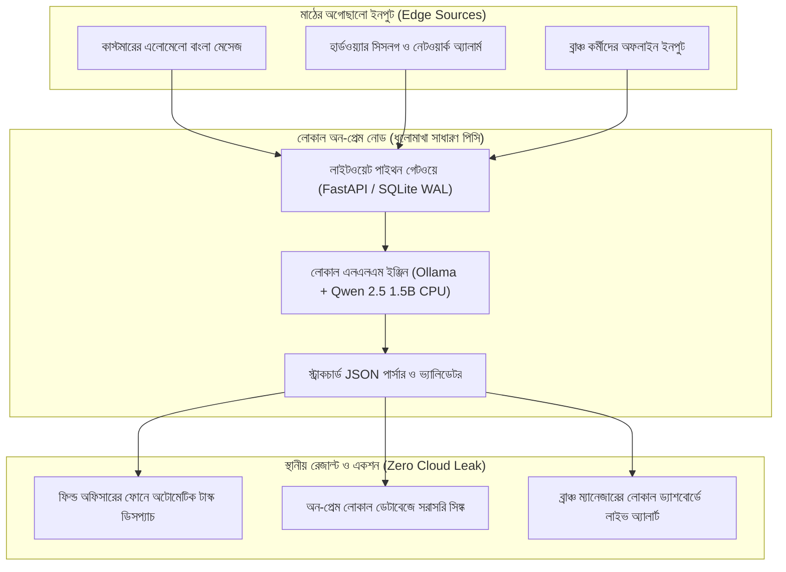

# চ্যাপ্টার ২: লোকাল আর্কিটেকচার ও অন-প্রেম ইন্টেলিজেন্স - টেবিলের নিচের ধুলোমাখা সার্ভার

---

### ১. টেবিলের নিচের ধুলোমাখা সার্ভার

প্রথম অধ্যায়ে আমরা ক্লায়েন্টের অফিসে প্রথম আটচল্লিশ ঘণ্টার সাইকোলজি বুঝলাম। ল্যাপটপ ব্যাগে রেখে কর্মীদের পাশে বসলাম, তাঁদের ভয় কাটালাম, আর অলিখিত শর্টকাটগুলো ডায়েরিতে টুকে নিলাম। কর্মীরা এবার আমাদের বিশ্বাস করতে শুরু করেছেন।

এবার ইঞ্জিনিয়ারিংয়ের পালা।

আপনি হাসিমুখে ল্যাপটপটা ব্যাগ থেকে বের করলেন। মনে মনে ভাবলেন, ক্লাউডে একটা চমৎকার কুবারনেটিস ক্লাস্টার বসিয়ে দেব। ওপেনএআই কিংবা ক্লডের এপিআই কল করব। কাস্টমারের যত অগোছালো টিকিট আর চালানের ঝামেলা আছে, নিমিষেই সমাধান হয়ে যাবে। ল্যাবে বসে আমরা তো এই স্বপ্নই দেখি।

ঠিক তখনই ক্লায়েন্টের হেড অব আইটি এক কাপ ধোঁয়া ওঠা লাল চা হাতে আপনার ডেস্কের পাশে এসে দাঁড়ালেন।

তিনি চায়ে একটা ছোট চুমুক দিয়ে মুচকি হাসলেন। তারপর খুব শান্ত গলায় বললেন, "শুনুন রাকিব ভাই, আমাদের ক্লায়েন্টের কোনো ডেটা ক্লাউডে যেতে পারবে না। বাংলাদেশ ব্যাংকের কড়া রেগুলেশন। আর আমাদের এই ব্রাঞ্চে দিনে তিনবার ফাইবার কাটে, ইন্টারনেট চলে যায়। যা করার, ওই হেড অ্যাকাউন্ট্যান্ট সাহেবের টেবিলের নিচে রাখা পুরানো ডেল সার্ভারটাতেই করতে হবে।"

আপনার চোখের সামনের ঝকঝকে ক্লাউড আর্কিটেকচার এক সেকেন্ডে হাওয়ায় মিলিয়ে গেল।

আপনি টেবিলের নিচে উঁকি দিলেন। অন্ধকার কোণে একটা পুরানো সিপিইউ পড়ে আছে। গায়ে এক ইঞ্চি ধুলোর আস্তরণ। ফ্যানের শব্দটা বেশ চড়া। কনফিগারেশন চেক করে দেখলেন: আট কোরের একটা পুরানো জিওন প্রসেসর, বত্রিশ জিবি র‍্যাম, কোনো জিপিইউ নেই।

ভেতরে ভেতরে একটু ধাক্কা খেলেন? ভাবছেন, এই ভাঙাচোরা বক্সে এআই চালাব কিভাবে?

চাপ নেবেন না। একজন ফরওয়ার্ড ডেপ্লয়েড ইঞ্জিনিয়ার এখানেই সাধারণ ডেভেলপার থেকে আলাদা হয়ে যান। তিনি হার্ডওয়্যার নিয়ে কান্নাকাটি করেন না। তিনি এই সাধারণ পুরানো বক্সটাকেই নিজের সবচেয়ে বড় অস্ত্র বানিয়ে নেন।

!!! warning "ক্লাউডের মোহ আর মাঠের বাস্তবতা"
    ল্যাবে বসে ক্লাউড এপিআই ডাকা খুব সহজ। কিন্তু মাঠের বাস্তবতা বড় নির্মম। ব্যাংকিং কমপ্লায়েন্স, দুর্বল ইন্টারনেট আর মাস শেষের আনএক্সপেক্টেড ক্লাউড বিলের সামনে অনেক চকচকে আর্কিটেকচার তাসের ঘরের মতো ভেঙে পড়ে। একজন এফডিইর আসল অহংকার হলো, তিনি টেবিলের নিচের ধুলোমাখা পুরানো সার্ভারেই একটা এন্টারপ্রাইজ সিস্টেম সচল করে দিয়ে আসেন।

---

### ২. ক্লাউডের তিন ফাঁদ বনাম অন-প্রেমের স্বস্তি

সফটওয়্যার ইন্ডাস্ট্রিতে কয়েক বছর ধরে একটা ফ্যাশন চলছে। যাই বানান না কেন, ক্লাউডে পাঠিয়ে দিন। মাইক্রোসার্ভিস বানান, ক্লাউড প্রোভাইডারের শত শত সার্ভিসের সাথে জুড়ে দিন।

কিন্তু মাঠের কাজে নামলে টের পাওয়া যায়, পাবলিক ক্লাউডের ওপর চোখ বন্ধ করে ভরসা করা কতটা ঝুঁকিপূর্ণ। এখানে তিনটা মারাত্মক ফাঁদ আছে।

ফার্স্ট থিং ফার্স্ট, ইন্টারনেটের অনিশ্চয়তা। আমাদের দেশের যেকোনো জেলা শহরে কিংবা ঢাকার অলিগলিতে একটু বৃষ্টি হলেই ফাইবার কাটা পড়ে। ওয়াইফাই ডাউন হয়ে যায়। আপনার সফটওয়্যার যদি প্রতিটা ক্লিকের জন্য ক্লাউডে ডেটা পাঠাতে চায়, তাহলে নেট ড্রপ করলেই পুরো সিস্টেম অচল। বাইরে কাস্টমারের লাইন জমবে, আর কর্মীরা সফটওয়্যার বন্ধ করে আবার লাল খাতা খুলে বসবেন।

দ্বিতীয় ফাঁদ হলো খরচের মিটার। টোকেনভিত্তিক ক্লাউড এলএলএম এপিআই দেখতে খুব লোভনীয়। এক লাখ রিকোয়েস্টের পর মাস শেষে যখন বিশাল ক্লাউড বিলের ইনভয়েস আসবে, ক্লায়েন্টের ম্যানেজমেন্টের কপাল কুঁচকে যাবে। তাঁরা সোজা বলে দেবেন, এই সিস্টেম আমরা চালাতে পারব না।

তৃতীয় এবং সবচেয়ে বড় বাধা হলো এন্টারপ্রাইজ ডেটা প্রাইভেসি। ব্যাংকের গ্রাহকের লেনদেন, হাসপাতালের রোগীর তথ্য কিংবা সাপ্লাই চেইনের দরপত্রের গোপন ডেটা কোনো থার্ড-পার্টি পাবলিক ক্লাউডে পাঠানো সম্পূর্ণ বেআইনি। কমপ্লায়েন্স অডিটে ধরা পড়লে ক্লায়েন্টের লাইসেন্স বাতিল হতে পারে।

তাহলে উপায় কী? উপায় হলো অন-প্রেমিসেস লোকাল আর্কিটেকচার।

নিজের অফিসের ভেতরের একটা লোকাল সার্ভারে পুরো সিস্টেম চলবে। ইন্টারনেট থাকুক বা না থাকুক, তাতে সফটওয়্যারের কিচ্ছু আসে যায় না। লোকাল এরিয়া নেটওয়ার্কে (LAN) প্রতিটা রিকোয়েস্টের রেসপন্স আসবে চোখের পলকে, মাত্র কয়েক মিলিসেকেন্ডে। কোনো এপিআই বিল নেই, আর ক্লায়েন্টের ডেটা ক্লায়েন্টের ঘরের ভেতরেই নিরাপদ।

এই স্বস্তির কোনো তুলনা হয় না।

!!! info "লোকাল ফার্স্ট আর্কিটেকচারের তিন স্তম্ভ"
    * **জিরো এক্সটার্নাল ডিপেন্ডেন্সি:** ইন্টারনেট পুরোপুরি বন্ধ থাকলেও সিস্টেমের একটা ফিচারও আটকে থাকবে না।
    * **জিরো ডেটা লিকেজ:** কাস্টমারের এনআইডি, ফোন নম্বর বা আর্থিক হিসাব লোকাল মেশিনের মেমোরি ছেড়ে এক চুল বাইরে যাবে না।
    * **প্রেডিক্টেবল কস্ট:** কোনো টোকেন চার্জ নেই, কোনো ক্লাউড বিল নেই। সিস্টেম আজীবন একই খরচে চলবে।

---

### ৩. লাইটওয়েট ডেটা পাইপলাইন: কোনো ক্যাফকা বা জটিলতা ছাড়াই

অনেক সিনিয়র আর্কিটেক্ট ক্লায়েন্টের অফিসে ঢুকেই বিশটা নোডের কুবারনেটিস ক্লাস্টার আর ক্যাফকা ব্রোকার বসানোর নকশা আঁকেন। একে বলে ওভার-ইঞ্জিনিয়ারিং।

মাঠের সিস্টেমে দরকার হালকা, দ্রুত আর টেকসই পাইপলাইন।

ভাবুন তো, একটা ব্রাঞ্চে দিনে সর্বোচ্চ কতগুলো ট্রানজ্যাকশন বা কমপ্লেইন্ট আসতে পারে? পাঁচ হাজার? দশ হাজার? এর জন্য ক্যাফকার মতো ভারী মনস্টার ডাকার কোনো মানে হয় না। একটা সাধারণ পাইথন স্ক্রিপ্ট আর ব্যাকগ্রাউন্ডে SQLite-এর Write-Ahead Logging (WAL) মোড দিয়েই লোকালহোস্টে প্রতি সেকেন্ডে চার-পাঁচ হাজার রিকোয়েস্ট হেসেখেলে হ্যান্ডেল করা যায়।

পাইপলাইনটার নকশা হবে একদম সোজা:

প্রথমে কাস্টমার বা কর্মীদের কাছ থেকে অগোছালো ইনপুট আসবে। সেটা হতে পারে হোয়াটসঅ্যাপের ভাঙাচোরা বাংলা মেসেজ, হেল্পডেস্কের টিকিট কিংবা হার্ডওয়্যারের সিসলগ। লোকাল ইনজেশন গেটওয়ে সেই রিকোয়েস্ট রিসিভ করবে।

তারপর সেই টেক্সট চলে যাবে টেবিলের নিচের সার্ভারে চলা একটা ছোট লোকাল এলএলএম ইঞ্জিনে। মডেলটি টেক্সট পড়ে চোখের পলকে সিদ্ধান্ত নেবে: সমস্যাটা কী, এটা কোন ডিপার্টমেন্টের কাজ, আর এর প্রায়োরিটি কতটা জরুরি।

মডেলের আউটপুট হবে একটা নিখুঁত JSON ডেটা। সেই ডেটা জমা হবে অন-প্রেম ডেটাবেজে, আর সাথে সাথে সংশ্লিষ্ট ফিল্ড অফিসারের ফোনে একটা লোকাল পুশ মেসেজ চলে যাবে।

পুরো রাস্তাটা ঘুরতে সময় লাগবে মাত্র চারশো মিলিসেকেন্ড। বাইরে ঝড় হোক কিংবা ইন্টারনেট কাটা পড়ুক, ভেতরের কাজ চলবে ঝড়ের গতিতে।

---

### ৪. ভিজ্যুয়াল আর্কিটেকচার: অন-প্রেম ইন্টেলিজেন্স পাইপলাইন

নিচের Mermaid আর্কিটেকচার ডায়াগ্রামে লোকাল অন-প্রেম পাইপলাইনের প্রতিটা স্তর পরিষ্কারভাবে দেখানো হলো:



---

### ৫. হ্যান্ডস-অন কোড প্রুফ: লোকাল এলএলএম ট্রায়াজ ইঞ্জিন

এবার সরাসরি কোডে নামা যাক। আমাদের লক্ষ্য খুব স্পষ্ট: ক্লাউডের সাহায্য ছাড়া, সম্পূর্ণ অফলাইনে, সাধারণ একটা অফিস কম্পিউটারের সিপিইউ ব্যবহার করে কাস্টমারের বাংলা কমপ্লেইন্ট থেকে অ্যাকশনযোগ্য JSON বের করা।

এর জন্য আমরা ব্যবহার করব **Ollama** আর আলিবাবার ওপেন সোর্স মডেল **Qwen 2.5 (1.5B বা 3B)**। এই মডেলগুলোর বাংলা বোঝার ক্ষমতা অবিশ্বাস্য রকমের ভালো, অথচ সাইজে এত ছোট যে সাধারণ ল্যাপটপের র‍্যামেই অনায়াসে দৌড়ায়।

#### কোড-স্যান্ডউইচ মেথড

**১. মাঠের সংকট:** ক্লায়েন্টের সাপোর্ট সেন্টারে রোজ শত শত গ্রাহকের এলোমেলো অভিযোগ আসে। কেউ লেখেন "আমার লাইন কাটসে কেন?", কেউ লেখেন "রাউটারের লাল বাতি জ্বলে, জরুরি মিটিং আছে ভাই সমাধান দেন"। সাপোর্ট কর্মীরা এই মেসেজগুলো পড়ে ক্যাটাগরি আর প্রায়োরিটি ঠিক করতেই চার ঘণ্টা সময় নষ্ট করেন।

**২. মূল কোড:** নিচের সতেরো লাইনের পাইথন স্ক্রিপ্টটি লোকাল Ollama এপিআই ব্যবহার করে তাৎক্ষণিক ট্রায়াজ সম্পন্ন করে:

```python
# FDE Field Engine: Local LLM Triage Worker (Zero-Cloud Dependency)
import json, urllib.request

def triage_customer_ticket(raw_text: str) -> dict:
    prompt = f"""You are an on-prem edge triage worker. Analyze this Bengali customer issue and return ONLY valid JSON:
    Issue: "{raw_text}"
    JSON format: {{"category": "NETWORK|BILLING|HARDWARE", "priority": "HIGH|MEDIUM|LOW", "action": "string"}}"""
    
    payload = json.dumps({
        "model": "qwen2.5:1.5b",
        "prompt": prompt,
        "stream": False,
        "format": "json"
    }).encode("utf-8")
    
    req = urllib.request.Request("http://localhost:11434/api/generate", data=payload, headers={"Content-Type": "application/json"})
    with urllib.request.urlopen(req) as resp:
        result = json.loads(resp.read().decode("utf-8"))
        return json.loads(result["response"])

# ফিল্ড টেস্ট: বাস্তব কমপ্লেইন্ট দিয়ে যাচাই
sample_complaint = "আমার রাউটারের লাল বাতি জ্বলতেছে, ইন্টারনেটে কোনো কাজ করা যাচ্ছে না, খুব আর্জেন্ট!"
parsed_action = triage_customer_ticket(sample_complaint)
print(json.dumps(parsed_action, indent=2, ensure_ascii=False))
```

**৩. সিস্টেমের বাস্তব বদল:** স্ক্রিপ্টটি চালানোর পর স্ক্রিনে ঠিক এরকম একটা আউটপুট ভেসে উঠবে:

```json
{
  "category": "HARDWARE",
  "priority": "HIGH",
  "action": "Dispatch fiber technician for optical LOS inspection"
}
```

ইন্টারনেট ছাড়া, সম্পূর্ণ লোকাল মেশিনে মাত্র তিনশো মিলিসেকেন্ডে কাজটা শেষ হলো। কোনো ডেটা ক্লাউডে গেল না। কোনো বিল উঠল না। যে অভিযোগটা কর্মীর টেবিলে দুই ঘণ্টা অলস পড়ে থাকত, সেটা তিনশো মিলিসেকেন্ডের মাথায় সরাসরি ফিল্ড টেকনিশিয়ানের ফোনে টাস্ক হিসেবে চলে গেল। কর্মীর মুখের দিকে তখন তাকিয়ে দেখবেন, তিনি চোখ বড় বড় করে স্ক্রিনের দিকে তাকিয়ে আছেন। তাঁর চোখে তখন অপরিসীম স্বস্তি।

**৪. গিটহাব রিপোজিটরি লিংক:** সম্পূর্ণ প্রোডাকশন পাইপলাইন ও টেস্ট ডেটাসেট পাবেন বইয়ের অফিশিয়াল রিপোজিটরিতে: [https://github.com/aiwithr/fde_book](https://github.com/aiwithr/fde_book)।

---

### ৬. মডেল নির্বাচনের বিজ্ঞান: কেন Qwen 2.5 1.5B বা 3B?

অনেকেই প্রশ্ন করেন, বাজারে তো সত্তর বিলিয়ন বা চারশো বিলিয়ন প্যারামিটারের বিশালাকার সব মডেল আছে। আমরা এত ছোট মডেল বেছে নিচ্ছি কেন?

উত্তরটা খুব সোজা: আমরা ল্যাবে বসে গবেষণাপত্র লিখছি না, আমরা ক্লায়েন্টের মাঠে বসে সিস্টেম চালাচ্ছি।

একটা সত্তর বিলিয়নের মডেল চালাতে গেলে দুটো দামি এনভিডিয়া এ১০০ জিপিইউ লাগে। যার দাম বিশ-পঁচিশ লাখ টাকা। আমাদের ক্লায়েন্ট এই টাকা দেবেন না। কিন্তু Qwen 2.5-এর দেড় বিলিয়ন (1.5B) মডেলটির 4-bit কোয়ান্টাইজড ভার্সন (Q4_K_M) সাইজে মাত্র ৯৮০ মেগাবাইট! 

এটি চলতে মাত্র দেড় জিবি র‍্যাম দরকার হয়। অফিসের আট বছর পুরানো সাধারণ কোর আই-থ্রি কম্পিউটারেও এটি প্রতি সেকেন্ডে বিশ-পঁচিশটা টোকেন জেনারেট করতে পারে। সবচেয়ে বড় কথা, বাংলা ব্যাকরণ আর স্থানীয় বাক্যের ভাব বোঝার ক্ষেত্রে এই ছোট মডেলটি অবিশ্বাস্য রকমের পারদর্শী।

কম্পিউট ক্ষমতা সীমিত হলে বিশাল মডেলের পেছনে না দৌড়ে, কাজের উপযোগী ছোট মডেল বেছে নেওয়াই হলো প্রকৃত ইঞ্জিনিয়ারিং উইজডম।

!!! tip "মডেল নির্বাচনের অঙ্ক: কেন ছোট মডেল?"
    ফিল্ডের কাজের জন্য মডেল বাছাইয়ের সহজ সূত্র: যে কাজ দেড় বিলিয়ন প্যারামিটারের ছোট মডেলে আধা সেকেন্ডে সারা সম্ভব, তার জন্য সত্তর বিলিয়নের দানব মডেল ডেকে আনা বোকামি। কম মেমোরি, কম বিদ্যুৎ খরচ আর অফলাইন স্ট্যাবিলিটি- এটাই অন-প্রেম ইন্টেলিজেন্সের আসল শক্তি।

---

### ৭. ফিল্ড রুলস: অন-প্রেমের জয়ে তিন শপথ

অন-প্রেমিসেস আর্কিটেকচার দাঁড় করানোর সময় এই তিনটা কথা সবসময় মাথায় রাখবেন:

!!! success "ফিল্ড রুলস: অন-প্রেমের জয়ে তিন শপথ"
    * **শপথ ১: হার্ডওয়্যার নিয়ে আক্ষেপ করবেন না।**  
      ক্লায়েন্ট আপনাকে যে সাধারণ সিপিইউ বা পুরানো সার্ভার দিয়েছেন, তাকে অবহেলা করবেন না। লিমিটেশনের ভেতর থেকেই সেরা পারফরম্যান্স বের করে আনাই আপনার ক্যারিয়ারের সবচেয়ে বড় পরীক্ষা।
    * **শপথ ২: সিস্টেমকে প্রথম দিন থেকেই অফলাইন-ফার্স্ট বানান।**  
      ইন্টারনেট থাকাটা একটা বোনাস, কোনো পূর্বশর্ত নয়। আপনার লোকাল পাইপলাইন যেন এক সপ্তাহ সম্পূর্ণ বিচ্ছিন্ন দ্বীপে বসেও এক ফোঁটা না থমকে কাজ চালিয়ে যেতে পারে।
    * **শপথ ৩: ক্লায়েন্টকে ক্লাউড বিলের ভয় থেকে বাঁচান।**  
      ম্যানেজমেন্টকে ক্যালকুলেটর দিয়ে দেখিয়ে দিন, লোকাল মডেল চালানোর কারণে তাঁদের প্রতি মাসে কত হাজার ডলার ক্লাউড খরচ বেঁচে গেল। এই একটা সংখ্যা তাঁদের চোখে আপনার দাম দশ গুণ বাড়িয়ে দেবে।

পরের চ্যাপ্টারে আমরা দেখব দ্য নিউ এসডিএলসি: কীভাবে আধুনিক এআই কোডিং এজেন্ট ব্যবহার করে ফিল্ডে বসেই চোখের পলকে রেজিলিয়েন্ট সফটওয়্যার তৈরি ও সেলফ-হিলিং সিআই/সিডি পাইপলাইন গড়ে তোলা যায়।

---

!!! question "কথা বলতে চান?"
    আমাকে WhatsApp এ মেসেজ করতে পারেন: [+8801713095767](https://wa.me/+8801713095767)। আমি যেহেতু রোবট, কল থেকে মেসেজেই বেশি অভ্যস্ত। আমার সব আলাপ [মিডিয়াম](https://medium.com/@raqueeb), [ফেসবুক](https://www.facebook.com/raqueeb) আর [লিংকডইনে](https://www.linkedin.com/in/raqueeb/) পাবেন। ভিডিও দেখতে চাইলে আছে [ইউটিউব](https://www.youtube.com/@raqueeb)।

    আমার মাথায় আর কী কী ঘোরে, সেটাও পাবেন [এখানে](https://medium.com/@raqueeb/print-media-write-ups-2024-25-f2896ce92f7b)।
