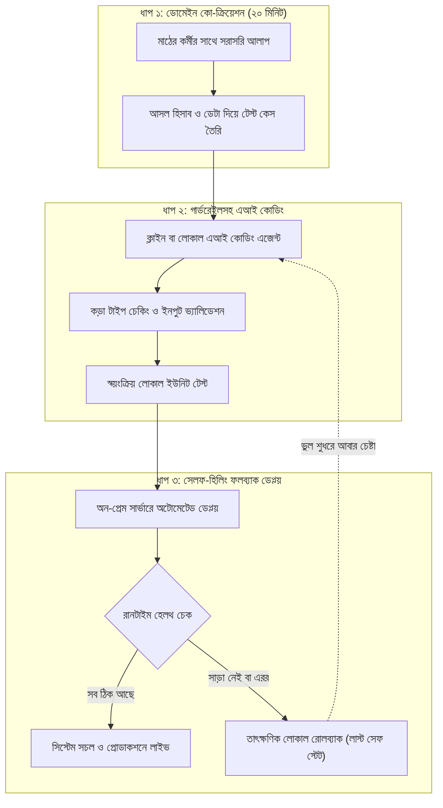

# চ্যাপ্টার ৩: দ্য নিউ এসডিএলসি - এআই কোডিং এজেন্টস ও রেজিলিয়েন্ট পাইপলাইন

---

### ১. পুরনো এসডিএলসির দিন শেষ

গত চ্যাপ্টারের শেষে আপনি টেবিলের নিচের সেই ধুলোমাখা সার্ভারে একটা লোকাল ট্রায়াজ ইঞ্জিন চালু করে ফেলেছেন। ইন্টারনেট ছাড়া, কয়েক সেকেন্ডে মেসেজ বাছাই হয়ে যাচ্ছে। ক্লাউড বিলের ভয় নেই। কর্মীদের মুখে সেদিন একটু হাসিও দেখা গেছে।

পরদিন সকালে অফিসে ঢুকতেই ক্লায়েন্টের প্রজেক্ট ডিরেক্টর আপনার টেবিলে এসে বসলেন।

তিনি বেশ খুশি। ট্রায়াজের গতি দেখে তাঁর চোখ চকচক করছে। কিন্তু কথার মাঝখানেই তিনি একটা নতুন বোমা ফাটালেন। "ভাই, এটা তো দারুণ চলছে। কিন্তু আমাদের মূল অ্যাকাউন্টিং সফটওয়্যারের সাথে এটাকে জুড়বেন কিভাবে? ওখানে ভ্যাটের সাতটা আলাদা স্ল্যাব, গুদামের ইনভেন্টরির জটিল হিসাব, সব আছে। আর সময় আমাদের হাতে বেশি নেই। পরশু সরকারি অডিট টিম আসছে। তার আগেই পুরো পাইপলাইন লাইভ চাই।"

পুরনো ধাঁচের একজন সফটওয়্যার মানুষ হলে এই কথা শুনে আপনার মাথা ঘুরে যেত।

কারণ পুরনো সফটওয়্যার ডেভেলপমেন্ট লাইফসাইকেল, মানে এসডিএলসি, আমাদের কী শিখিয়েছে? আগে পঞ্চাশ পাতার একটা বিজনেস রিকোয়ারমেন্ট ডকুমেন্ট, সংক্ষেপে বিআরডি, লিখুন। তারপর আর্কিটেকচার রিভিউ মিটিং। তারপর প্রজেক্ট ম্যানেজারের জিরা টিকিটের লম্বা সারি। দুই সপ্তাহের স্প্রিন্ট, স্টোরি পয়েন্ট নিয়ে তর্ক। সব ঠিকঠাক চললে তিন মাস পর হয়তো প্রথম স্টেজিং ডেপ্লয়মেন্ট দেখা যাবে।

মাঠে এই গতি একদম অচল। ফিল্ডে দাঁড়িয়ে যদি বলেন, "আমাকে দুই মাস দিন, আগে ডকুমেন্ট লিখে আনি", ক্লায়েন্ট পরদিনই আপনাকে বিদায় করে দেবেন। ইন্ট্রোর সেই চারজনের লগইনের গল্পটা মনে আছে? ধীরে চলা সফটওয়্যারের পরিণতি ওটাই। মাঠের লড়াইয়ে সমাধান বানাতে হয় ঘণ্টার হিসাবে।

আর ঠিক এই জায়গা থেকেই এসেছে **দ্য নিউ এসডিএলসি**। এর চালিকাশক্তি আধুনিক এআই কোডিং এজেন্ট।

!!! info "পুরনো এসডিএলসি বনাম এআই এজেন্টের গতি"
    পুরনো এসডিএলসি তৈরি হয়েছিল এমন এক সময়ে, যখন প্রতিটা বন্ধনী আর বয়লারপ্লেট কোড মানুষকে নিজের হাতে টাইপ করতে হতো। এখন এআই কোডিং এজেন্ট কোড লেখে মানুষের চেয়ে অনেক গুণ দ্রুত। তাই লড়াইটা আর কোড লেখা নিয়ে নেই। লড়াই হলো সঠিক ব্যবসায়িক লজিকটা এজেন্টের মাথায় ঢুকিয়ে দেওয়া, আর সিস্টেমের সীমানা পাহারা দেওয়া।

---

### ২. ভাইব কোডিং আর লাগামছাড়া এজেন্টের বিপদ

আজকাল টেক দুনিয়ায় একটা নতুন শব্দ খুব শোনা যায়, ভাইব কোডিং।

ব্যাপারটা সোজা। কোডের প্রতিটা ভ্যারিয়েবলের নাম আপনাকে মুখস্থ রাখতে হবে না। আপনি সাধারণ মানুষের ভাষায় সমস্যাটা বুঝিয়ে বললেন। ক্লাইন (Cline), কার্সর (Cursor) বা লোকাল এআই কোডিং এজেন্ট এপিআই এন্ডপয়েন্ট, ডেটাবেজ স্কিমা, টেস্ট কেস, সব লিখে ফেলবে।

ফিল্ডের একজন এফডিইর হাতে এটা একটা সুপারপাওয়ার। যে কাজে আগে কয়েক ঘণ্টা লাগত, এজেন্ট সেটা কয়েক মিনিটে চোখের সামনে নামিয়ে দেয়।

কিন্তু এই আরামের পেছনে একটা ফাঁদ ওত পেতে আছে।

কোনো সীমানা বা গার্ডরেইল ছাড়া একটা এআই এজেন্টকে ছেড়ে দিলে সে হয়ে যায় বিশ কাপ কফি খাওয়া অতি-উৎসাহী জুনিয়র ডেভেলপারের মতো। কাজ শেষ করার জন্য সে ব্যাকুল। কোড যেন চলে, সেজন্য নিজের মনে একগাদা থার্ড-পার্টি লাইব্রেরি ইনস্টল করে বসবে। ক্লায়েন্টের বছরের পর বছর ধরে চলা ডেটাবেজ স্কিমা নিজের ইচ্ছেমতো বদলে দেবে। কাউকে না বলে পুরনো কোডের একটা গুরুত্বপূর্ণ লজিক মুছে ফেলবে।

এর নাম **কোড ড্রিফট**, আর এর সাথে জমতে থাকে নিঃশব্দ টেকনিক্যাল ডেট। বাইরে থেকে দেখবেন সব চলছে। ভেতরে ভেতরে আর্কিটেকচারটা একটু একটু করে সরে যাচ্ছে। একদিন হঠাৎ সব ভেঙে পড়বে।

একজন এফডিই কখনো এজেন্টের অন্ধ ভক্ত হন না। তিনি এজেন্টকে আগে থেকেই কড়া কিছু নিয়ম বলে দেন। নতুন কোনো এক্সটার্নাল প্যাকেজ ইনস্টল করা যাবে না। ডেটাবেজ স্কিমায় হাত দেওয়া যাবে না, যেকোনো ডেটা আদান-প্রদান চলবে পাইডান্টিক (Pydantic) মডেলের কড়া টাইপ চেকিংয়ের ভেতর দিয়ে। প্রতিটা ফাংশনের ইনপুট-আউটপুট ভ্যালিডেশন টেস্ট লিখতে হবে, আর একটা টেস্ট ফেল করলে কোড সেভই হবে না।

গাড়ির চালকের আসনে বসবে এজেন্ট। কিন্তু স্টিয়ারিং আর ব্রেকের নিয়ন্ত্রণ থাকবে আপনার হাতেই।

!!! warning "এআই কোডিং এজেন্টের বাড়াবাড়ি আর কোড ড্রিফট"
    এজেন্টকে পুরো স্বাধীনতা দেওয়া মানে নিজের পায়ে কুড়াল মারা। এজেন্ট যত দ্রুত ফিচার বানায়, তত দ্রুতই পুরো কোডবেস এলোমেলো করে ফেলতে পারে। তার চারপাশে টাইপ ভ্যালিডেশন, ইনপুট গার্ডরেইল আর অটোমেটেড টেস্টের দেয়াল তুলে দিন। সীমানা ঠিক থাকলে তবেই এজেন্টের গতি আপনার কাজে লাগবে।

---

### ৩. বিশ মিনিটের ডোমেইন স্প্রিন্ট: লাল খাতার হিসাব উদ্ধার

তাহলে ক্লায়েন্টের সেই জটিল ভ্যাট আর ইনভেন্টরির হিসাব আমরা মেলাব কিভাবে? দুই ঘণ্টার একটা লম্বা মিটিং ডেকে?

কখনোই না। মিটিংয়ে বসলে মানুষ কাজের কথার চেয়ে অফিস পলিটিক্স নিয়ে বেশি কথা বলে।

এফডিইর গোপন অস্ত্র হলো **বিশ মিনিটের ডোমেইন স্প্রিন্ট**।

ল্যাপটপ হাতে সোজা চলে যান হেড অ্যাকাউন্ট্যান্ট সাহেবের ডেস্কে। ইন্ট্রোতে যে লাল মলাটের খাতাটার কথা বলেছিলাম, সেটা আজও তাঁর টেবিলে খোলা।

পাশে একটা টুল টেনে বসুন। বিনয়ের সাথে বলুন, "চাচা, ভ্যাটের এই সাতটা স্ল্যাবের হিসাবটা একটু বুঝিয়ে বলবেন? কোন জায়গায় এসে আপনার মাথায় সবচেয়ে বেশি চাপ পড়ে?"

তিনি চশমার ফাঁক দিয়ে আপনার দিকে তাকাবেন। তারপর হয়তো বলবেন, "বাবা, কমার্শিয়াল চালানে পনেরো পারসেন্ট ভ্যাট, আবার ট্রান্সপোর্টের চালানে পাঁচ পারসেন্ট রিবেট। আমাদের আগের সফটওয়্যার এই দুটোকে আলাদা করতে পারত না, সব মিশিয়ে ফেলত। তখন ক্যালকুলেটর টিপে হিসাব করে এই লাল খাতায় আলাদা করে লিখে রাখতাম।"

এই কথাটাই আসল। ইন্ট্রোর সেই "মাস শেষে আমার হিসাবটা ওতে মেলে না, খাতায় মেলে" কথার ভেতরের কারণ এটাই। কোনো বিআরডিতে এটা লেখা ছিল না।

আপনি আর দেরি করলেন না। সেখানেই বসে, চা খেতে খেতে একটা ছোট টেস্ট কেস লিখে ফেললেন। কমার্শিয়াল চালান এক লাখ টাকা, ভ্যাট পনেরো হাজার। ট্রান্সপোর্ট চালান বিশ হাজার টাকা, রিবেট এক হাজার। নেট ভ্যাট হবে চৌদ্দ হাজার টাকা।

এবার ক্লাইনকে, মানে এআই এজেন্টকে, প্রম্পট দিলেন: "Write a pure, deterministic Python module to calculate 15% VAT and 5% transport rebate strictly matching this test case. Do not touch external DB."

দুই মিনিটের মধ্যে এজেন্ট ফাংশনটা লিখে ফেলল, টেস্টও পাস।

আপনি স্ক্রিনটা অ্যাকাউন্ট্যান্ট সাহেবের দিকে ঘুরিয়ে ধরলেন। "চাচা, একবার দেখুন তো, হিসাবটা ঠিক আছে কি না?"

তিনি ক্যালকুলেটরে একবার চোখ বুলিয়ে নিলেন। তারপর অবাক হয়ে আপনার মুখের দিকে তাকালেন। "আরে, এই সংখ্যাটাই তো রোজ আমি আধা ঘণ্টা ধরে হাতে মিলাই! এত তাড়াতাড়ি বের হলো কিভাবে?"

বিশ মিনিটের একটা আলাপে ক্লায়েন্টের সবচেয়ে জটিল ব্যবসায়িক সমস্যার সমাধান হয়ে গেল। কোনো মিটিং নেই, কোনো লম্বা ডকুমেন্ট নেই। একেই বলে ডোমেইন এক্সপার্টের সাথে সরাসরি কো-ক্রিয়েশন।

!!! tip "বিশ মিনিটের ডোমেইন স্প্রিন্ট"
    শীতাতপ নিয়ন্ত্রিত মিটিং রুমে বসে ডোমেইন লজিক বের করা যায় না। ল্যাপটপ নিয়ে যিনি কাজটা করেন তাঁর ডেস্কের পাশে গিয়ে বসুন। তাঁর খাতার আসল হিসাবটা দেখুন। সেখান থেকে একটা ছোট টেস্ট কেস লিখে এআই এজেন্ট দিয়ে লজিকটা বানিয়ে ফেলুন, আর তাঁর চোখের সামনেই ফলটা দেখিয়ে যাচাই করিয়ে নিন।

---

### ৪. ভিজ্যুয়াল আর্কিটেকচার: দ্য নিউ এসডিএলসি চক্র

নিচের Mermaid ফ্লোচার্টে দেখানো হলো, ডোমেইন আলাপ থেকে শুরু করে এআই এজেন্টের গার্ডরেইল পেরিয়ে কিভাবে সরাসরি রেজিলিয়েন্ট ডেপ্লয়মেন্টে পৌঁছানো যায়:



---

### ৫. হ্যান্ডস-অন কোড প্রুফ: সেলফ-হিলিং সিআই/সিডি ফলব্যাক পাইপলাইন

মাঠের সবচেয়ে বড় দুঃস্বপ্ন কী?

আপনি খুব দ্রুত একটা ফিচার বানালেন। এআই এজেন্ট চমৎকার কোড দিল। অন-প্রেম সার্ভারে ডেপ্লয় করে আপনি হোটেলে ফিরে ঘুমিয়ে পড়লেন। রাত আড়াইটায় ফোন বাজল। ওপাশে নাইট শিফটের সুপারভাইজার, গলায় আতঙ্ক। "ভাই, সফটওয়্যার তো ক্র্যাশ করেছে! মেমোরি ভরে গিয়ে পুরো সার্ভার আটকে গেছে!"

এখান থেকে বাঁচার উপায় একটাই, **সেলফ-হিলিং সিআই/সিডি ফলব্যাক**।

নতুন আপডেট দেওয়ার পর যদি অ্যাপ ঠিকমতো সাড়া না দেয়, মেমোরি ফুরিয়ে বা ডেটাবেজ স্কিমা ভেঙে ক্র্যাশ করলে সাধারণত এমনটাই হয়, তাহলে সিস্টেম মানুষের জন্য বসে থাকবে না। সে নিজেই শেষ ভালো অবস্থায় ফিরে যাবে।

#### কোড-স্যান্ডউইচ মেথড

**১. মাঠের সংকট:** অন-সাইট সার্ভারে সরাসরি নতুন কোড পাঠানোর পর কিছু ভেঙে গেলে পুরো ব্রাঞ্চের কাজ থেমে যায়। মাঝরাতে ইঞ্জিনিয়ার ঘুমিয়ে থাকলেও সিস্টেম যেন নিজে নিজেই আগের নিরাপদ ভার্সনে ফিরে যেতে পারে, সেই বন্দোবস্ত দরকার।

**২. মূল কোড:** নিচে বিশ লাইনের মধ্যে একটা ছোট GitHub Actions স্ক্রিপ্ট দেওয়া হলো, যা অন-প্রেম সার্ভারে নিজে নিজে ডেপ্লয় আর রোলব্যাক করে:

```yaml
# FDE Resilient Pipeline: Self-Healing On-Prem Deploy & Rollback
name: OnPrem-Resilient-Deploy
on: [push]
jobs:
  deploy-and-validate:
    runs-on: self-hosted
    steps:
      - name: Checkout Code and Snapshot Last Stable State
        run: |
          git rev-parse HEAD~1 > .last_stable_commit
          docker compose up -d --build
      - name: Healthcheck and Self-Healing Rollback
        run: |
          sleep 5
          STATUS=$(curl -s -o /dev/null -w "%{http_code}" http://localhost:8000/healthz || echo "500")
          if [ "$STATUS" -ne 200 ]; then
            echo "Deployment failed with status $STATUS. Initiating immediate rollback..."
            git checkout $(cat .last_stable_commit)
            docker compose up -d --build
            exit 1
          fi
          echo "Healthcheck passed. System is live and resilient."
```

**৩. সিস্টেমের বাস্তব বদল:** এই পাইপলাইন চালু থাকলে আপনার বুক ধড়ফড়ানি অনেকটা কমে যাবে। নতুন ফিচারে কোনো ভুল থাকলে, অ্যাপ যদি পাঁচ সেকেন্ডের মধ্যে ঠিকমতো সাড়া না দেয়, পাইপলাইন নিজেই আগের নিরাপদ কমিটে ফিরে যাবে। নাইট শিফটের কর্মীরা কয়েক সেকেন্ডের বেশি কিছু টের পাবেন না। আপনি সকালে অফিসে এসে শান্ত মাথায় লগ দেখে ভুলটা ঠিক করবেন।

একটা সৎ কথা বলে রাখি। শুধু কোড ফিরিয়ে দিলেই সব ফিরে আসে না। ডেটাবেজ স্কিমায় বদল থাকলে সেটা আলাদা করে সামলাতে হবে। তাই স্কিমা বদলানোর আগে সবসময় ডেটাবেজের একটা ব্যাকআপ রেখে নেবেন।

**৪. গিটহাব রিপোজিটরি লিংক:** পুরো সিআই/সিডি অটোমেশন স্ক্রিপ্ট আর টেস্ট স্যুট পাবেন বইয়ের অফিশিয়াল রিপোজিটরিতে: [https://github.com/aiwithr/fde_book](https://github.com/aiwithr/fde_book)।

---

### ৬. ফিল্ড রুলস: নতুন এসডিএলসির তিন মূলনীতি

এআই এজেন্টের যুগে মাঠে টিকে থাকতে চাইলে এই তিনটা কথা মনে গেঁথে নিন।

!!! success "ফিল্ড রুলস: নতুন এসডিএলসির তিন মূলনীতি"
    * **মূলনীতি ১: কোড লেখার সময় কমান, ডোমেইন বোঝার সময় বাড়ান।**  
      কোড এখন সস্তা জিনিস। এআই যেকোনো কোড লিখে দিতে পারে। কিন্তু অ্যাকাউন্ট্যান্ট সাহেবের ভ্যাট রিবেটের সূক্ষ্ম হিসাব এআই নিজে থেকে জানবে না। আপনার আসল কাজ মানুষের সমস্যাটা গভীরভাবে বোঝা।
    * **মূলনীতি ২: কড়া টেস্ট পাস না করলে এজেন্টের কোড সেভ করবেন না।**  
      এজেন্ট যত সুন্দর কোডই দিক, বাস্তব ডেটার টেস্ট পাস না করা পর্যন্ত তার কোনো দাম নেই। টাইপ সেফটি আর অটো-টেস্টই আপনার প্রধান ঢাল।
    * **মূলনীতি ৩: মাঝরাতের জন্য আশা জমিয়ে রাখবেন না।**  
      "আমার ল্যাপটপে তো চলেছিল, সার্ভারেও বোধহয় চলবে", এই আশাবাদ ছাড়ুন। প্রতিটা ডেপ্লয়মেন্টে অটো-রোলব্যাক চালু রাখুন। কিছু ভেঙে পড়লে সিস্টেম যেন নিজের চিকিৎসা নিজেই করতে পারে।

পরের চ্যাপ্টারে আমরা সোজা চলে যাব বাংলাদেশের দুটো হাই-স্টেক্স ইন্ডাস্ট্রির আসল মাঠে। একটা ঢাকার বড় আইএসপির টিকিট অটোমেশন, আরেকটা চট্টগ্রাম বন্দরের কন্টেইনার ইনভয়েস রিকনসিলিয়েশন।

---

!!! question "কথা বলতে চান?"
    আমাকে WhatsApp এ মেসেজ করতে পারেন: [+8801713095767](https://wa.me/+8801713095767)। আমি যেহেতু রোবট, কল থেকে মেসেজেই বেশি অভ্যস্ত। আমার সব আলাপ [মিডিয়াম](https://medium.com/@raqueeb), [ফেসবুক](https://www.facebook.com/raqueeb) আর [লিংকডইনে](https://www.linkedin.com/in/raqueeb/) পাবেন। ভিডিও দেখতে চাইলে আছে [ইউটিউব](https://www.youtube.com/@raqueeb)।

    আমার মাথায় আর কী কী ঘোরে, সেটাও পাবেন [এখানে](https://medium.com/@raqueeb/print-media-write-ups-2024-25-f2896ce92f7b)।
