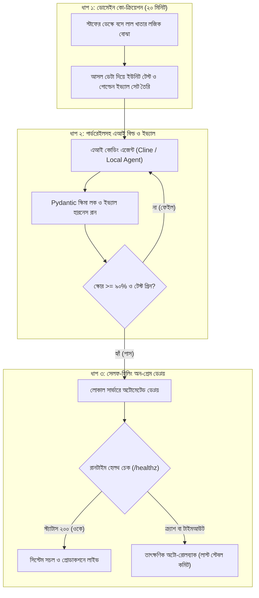

# চ্যাপ্টার ৩: দ্য নিউ এসডিএলসি - এআই কোডিং এজেন্টস ও রেজিলিয়েন্ট পাইপলাইন

---

### ১. পুরনো এসডিএলসি কেন ফিল্ডে অচল?

গত চ্যাপ্টারের শেষে আপনি টেবিলের নিচের সেই ধুলোমাখা সার্ভারে একটা লোকাল ট্রায়াজ ইঞ্জিন চালু করে ফেলেছেন। বাইরের ইন্টারনেট ছাড়াই কয়েক সেকেন্ডে কাস্টমারের বাংলা মেসেজ বাছাই হয়ে যাচ্ছে, মাসিক কোনো এপিআই বিলেরও চিন্তা নেই। অফিসের স্টাফদের মুখে অনেকদিন পর একটু স্বস্তির হাসি দেখা গেছে।

পরদিন সকালে আপনি অফিসে ঢুকতেই ক্লায়েন্টের প্রজেক্ট ডিরেক্টর আপনার ডেস্কের সামনে এসে বসলেন। লোকাল ট্রায়াজ ইঞ্জিনের গতি দেখে তিনি দারুণ খুশি। কিন্তু চায়ের কাপে চুমুক দিতে দিতেই তিনি নতুন এক চ্যালেঞ্জ ছুড়ে দিলেন: "ভাই, মেসেজ বাছাই তো চমৎকার হচ্ছে। কিন্তু আমাদের মূল অ্যাকাউন্টিং মডিউলের সাথে এটাকে জুড়বেন কবে? ইন্ট্রোতে তো দেখেছিলেন, উনষাট জন স্টাফের মধ্যে মাত্র চারজন সিস্টেমে লগইন করেন, কারণ ভ্যাটের সাতটা আলাদা স্ল্যাব আর ট্রান্সপোর্ট রিবেটের হিসাব সিস্টেমে মেলে না। পরশুদিন হেড অফিস থেকে অডিট টিম আসছে। তার আগেই এই হিসাবের পাইপলাইনটা লাইভ করে দেওয়া যাবে?"

প্রথাগত ধাঁচের কোনো সফটওয়্যার টিমের কাছে এই আবদারটা রীতিমতো অসম্ভব। 

কারণ আমাদের চেনা সফটওয়্যার ডেভেলপমেন্ট লাইফসাইকেল, মানে পুরনো এসডিএলসি (SDLC), আমাদের কী শিখিয়েছে? কোনো ফিচার বানাতে হলে আগে বিজনেস অ্যানালিস্ট বসে তিরিশ পাতার একটা রিকোয়ারমেন্ট ডকুমেন্ট (BRD) লিখবেন। তারপর আর্কিটেকচার রিভিউ মিটিং বসবে। প্রজেক্ট ম্যানেজার জিরাতে (Jira) টিকিট খুলবেন, স্টোরি পয়েন্ট নিয়ে ঘণ্টাখানেক তর্ক হবে, তারপর দুই সপ্তাহের স্প্রিন্ট শুরু হবে। সব ঠিকঠাক থাকলে হয়তো এক মাস পর ফিচারটা স্টেজিং সার্ভারে মুখ দেখবে।

ফিল্ডে দাঁড়িয়ে আপনি যদি ক্লায়েন্টকে বলেন, "স্যার, আমাকে এক মাস সময় দিন, আগে বিআরডি লিখে জিরা টিকিট সাজিয়ে নিই" - ক্লায়েন্ট পরদিনই প্রজেক্ট বন্ধ করে দেবেন। ফিল্ডের ক্যাওসের ভেতরে সমাধান ডেলিভারি দিতে হয় ঘণ্টার হিসাবে, মাসের হিসাবে নয়। আর এই গতির চাহিদা মেটাতেই জন্ম নিয়েছে **দ্য নিউ এসডিএলসি**, যার মূল চালিকাশক্তি হলো আধুনিক এআই কোডিং এজেন্ট।

!!! info "পুরনো এসডিএলসি বনাম এআই এজেন্টের যুগ"
    পুরনো এসডিএলসি তৈরি হয়েছিল এমন এক সময়ে, যখন প্রতিটা ফাংশন আর বয়লারপ্লেট কোড ডেভেলপারকে নিজের হাতে লাইন ধরে টাইপ করতে হতো। এখন এআই কোডিং এজেন্ট সেকেন্ডের মধ্যে কোড লিখে ফেলে। তাই ইঞ্জিনিয়ারের আসল কাজ আর সিনট্যাক্স টাইপ করা নয়; আসল কাজ হলো কাস্টমারের সঠিক বিজনেস লজিকটা ডিসকাভারি করা এবং এজেন্টের চারপাশে কড়া গার্ডরেইল বসানো।

---

### ২. ভাইব কোডিংয়ের ফাঁদ ও এআই এজেন্টের গার্ডরেইল

আজকাল নতুন প্রোগ্রামারদের মুখে একটা শব্দ খুব শোনা যায় - **ভাইব কোডিং (Vibe Coding)**। অর্থাৎ কোডের ভেতরে কী হচ্ছে তা নিয়ে মাথা না ঘামিয়ে চ্যাটবট বা কোডিং এজেন্টকে বাংলায় বা ইংরেজিতে প্রম্পট দেওয়া, আর এজেন্ট যা লিখে দিচ্ছে সেটাই চোখ বন্ধ করে রান করানো। ব্যক্তিগত ছোট প্রজেক্ট বা হ্যাকাথনে এই ভাইব কোডিং বেশ মজার। ক্লাইন (Cline), কার্সর (Cursor) বা ওপেনকোডের মতো এআই এজেন্টকে বললে সে কয়েক মিনিটে এপিআই এন্ডপয়েন্ট, ডেটাবেজ কুয়েরি আর ফ্রন্টএন্ড ফর্ম নামিয়ে দেয়।

কিন্তু ক্লায়েন্টের প্রোডাকশন এনভায়রনমেন্টে কোনো গার্ডরেইল ছাড়া ভাইব কোডিং করতে যাওয়া মানে নিজের পায়ে কুড়াল মারা।

কেন? কারণ লাগামছাড়া এআই এজেন্ট হলো এমন এক নতুন ডেভেলপারের মতো, যে প্রচণ্ড দ্রুত কোড লিখতে পারে কিন্তু আপনার ক্লায়েন্টের পুরনো সিস্টেমের ইতিহাস জানে না। তাকে যদি শুধু বলেন, *"ভ্যাট ক্যালকুলেশনের বাগটা ফিক্স করে দাও"*, সে কোড চালানোর তাগিদে নিজে থেকেই একগাদা অচেনা থার্ড-পার্টি লাইব্রেরি ইনস্টল করে বসবে, ক্লায়েন্টের দশ বছরের পুরনো ডেটাবেজ টেবিলের কলামের নাম বদলে দেবে, কিংবা অন্য ফাইলের জরুরি একটা ভ্যালিডেশন লজিক মুছে ফেলবে। সফটওয়্যার আর্কিটেকচারের ভাষায় একে বলে **কোড ড্রিফট (Code Drift)**। বাইরে থেকে মনে হবে ফিচারটা কাজ করছে, কিন্তু ভেতরে ভেতরে পুরো সিস্টেমটা নড়বড়ে হয়ে যাবে।

একজন দক্ষ এফডিই তাই এজেন্টকে কখনোই খোলা মাঠে ছেড়ে দেন না। তিনি এজেন্টকে দিয়ে কাজ করানোর আগে তিনটা কড়া টেকনিক্যাল বাউন্ডারি বা গার্ডরেইল বেঁধে দেন:
১. **ডেটা টাইপ ও স্কিমা লক (Pydantic Guardrails):** এজেন্ট যেন নিজের ইচ্ছেমতো ডিকশনারির কি (Key) বা ডেটাবেজের কলাম বদলাতে না পারে, সেজন্য ইনপুট আর আউটপুটের মাঝে `Pydantic` মডেল বা কড়া টাইপ-চেকিং বসানো থাকে।
২. **জিরো এক্সটার্নাল ডিপেন্ডেন্সি রুল:** এজেন্টের রুল ফাইলে (`.clinerules` বা সিস্টেম প্রম্পটে) স্পষ্ট বলে দেওয়া হয় - অনুমতি ছাড়া নতুন কোনো `pip` প্যাকেজ ইনস্টল করা যাবে না এবং সরাসরি প্রোডাকশন ডেটাবেজ স্কিমায় হাত দেওয়া যাবে না।
৩. **টেস্ট-ফার্স্ট বাধ্যবাধকতা:** এজেন্টকে আগে আমরা আমাদের লেখা টেস্ট কেস দেব। তার লেখা কোড যদি সেই টেস্ট পাস না করে, তবে সেই কোড রিপোজিটরিতে সেভই হবে না।

সহজ কথায়, এআই এজেন্ট হলো আপনার গাড়ির শক্তিশালী ইঞ্জিন; কিন্তু স্টিয়ারিং আর ব্রেকটা সবসময় আপনার নিজের হাতেই রাখতে হবে।

!!! warning "ভাইব কোডিং নয়, দরকার গার্ডরেইলড ইঞ্জিনিয়ারিং"
    এআই এজেন্ট যত দ্রুত ফিচার বানায়, গার্ডরেইল না থাকলে ঠিক তত দ্রুতই পুরো প্রজেক্ট এলোমেলো করে ফেলতে পারে। এজেন্টকে কোড লিখতে দেওয়ার আগে সবসময় ইনপুট-আউটপুট স্কিমা লক করে দিন এবং টেস্ট কেস আগে লিখে নিন।

---

### ৩. বিশ মিনিটের ডোমেইন স্প্রিন্ট: লাল খাতার হিসাব উদ্ধার

এবার প্রজেক্ট ডিরেক্টরের সেই চ্যালেঞ্জে ফিরে আসি। পরশু অডিট টিম আসছে, আর আমাদের হেড অ্যাকাউন্ট্যান্ট সাহেবের সেই ভ্যাট ও ট্রান্সপোর্ট রিবেটের হিসাব মেলাতে হবে। প্রথাগত পদ্ধতি হলে আমরা এখন দুই ঘণ্টার একটা মিটিং ডাকতাম। কিন্তু মিটিং রুমে বসলে মানুষ আসল হিসাবের চেয়ে অফিস পলিটিক্স নিয়ে বেশি কথা বলে।

এর বদলে আমরা ব্যবহার করব এফডিইর সবচেয়ে কার্যকর অস্ত্র - **বিশ মিনিটের ডোমেইন স্প্রিন্ট**।

ল্যাপটপটা হাতে নিয়ে সরাসরি চলে যান হেড অ্যাকাউন্ট্যান্ট সাহেবের ডেস্কে। ইন্ট্রোডাকশনে যে লাল মলাটের খাতাটার কথা তিনি বলেছিলেন - *"মাস শেষে আমার হিসাবটা ওতে মেলে না, খাতায় মেলে"* - সেই খাতাটা আজও তাঁর টেবিলে খোলা। পাশে একটা টুল টেনে বসে বিনয়ের সাথে বলুন, "চাচা, আপনার বিশ মিনিট সময় নেব। খাতায় যে ভ্যাট আর রিবেটের হিসাবটা করেন, ওটা আমাকে একটা আসল চালান ধরে একটু দেখিয়ে দেবেন?"

নিজের কাজের কদর পেলে মানুষ খুশি হয়। তিনি চশমাটা ঠিক করে খাতার একটা পাতা খুলে দেখালেন, "এই দেখো বাবা, সাধারণ কমার্শিয়াল চালানে পনেরো পারসেন্ট ভ্যাট যোগ হয়। কিন্তু যদি চালানের সাথে আমাদের নিজস্ব ট্রান্সপোর্ট যুক্ত থাকে, তবে সেই ট্রান্সপোর্ট খরচের ওপর পাঁচ পারসেন্ট রিবেট বা ছাড় বাদ দিতে হয়। তোমাদের আগের সফটওয়্যারটা পুরো টাকার ওপর একসাথে পনেরো পারসেন্ট ভ্যাট বসিয়ে দিত, ট্রান্সপোর্টের ছাড়টা আলাদা করে বাদ দিত না। তাই মাস শেষে কাস্টমসের খাতার সাথে আমার তিরিশ-চল্লিশ হাজার টাকার গরমিল হয়ে যেত!"

ব্যস! যে রহস্য উদ্ধার করতে তিরিশ পাতার বিআরডি আর পাঁচটা মিটিং লাগত, হেড অ্যাকাউন্ট্যান্টের টেবিলে বসে মাত্র পাঁচ মিনিটে তার আসল লজিক বেরিয়ে এল।

আপনি টেবিল ছেড়ে উঠলেন না। সেখানে বসেই তাঁর খাতার সংখ্যাগুলো দিয়ে একটা বাস্তব টেস্ট কেস লিখে ফেললেন: কমার্শিয়াল মালের দাম ১,০০,০০০ টাকা (১৫% ভ্যাট = ১৫,০০০ টাকা)। ট্রান্সপোর্ট খরচ ২০,০০০ টাকা (৫% রিবেট = ১,০০০ টাকা ছাড়)। তাহলে নিট প্রদেয় ভ্যাট হতে হবে ঠিক ১৪,০০০ টাকা।

এবার নিজের ল্যাপটপে এআই কোডিং এজেন্টকে (`Cline`) ছোট ও সুনির্দিষ্ট প্রম্পট দিলেন:
> *"Write a pure Python function `calculate_net_vat(commercial_amount, transport_cost)` that adds 15% VAT on commercial amount and deducts 5% rebate on transport cost. Must strictly pass `assert calculate_net_vat(100000, 20000) == 14000`. No external libraries."*

মাত্র ত্রিশ সেকেন্ডে এজেন্ট ফাংশনটা লিখে টেস্ট পাস করিয়ে দিল। আপনি সাথে সাথে ল্যাপটপের স্ক্রিনটা অ্যাকাউন্ট্যান্ট সাহেবের দিকে ঘুরিয়ে দিয়ে বললেন, "চাচা, আপনার গত মাসের সবচেয়ে জটিল চালানটার সংখ্যা দুটো এখানে বসিয়ে দেখুন তো, খাতার সাথে মেলে কি না?"

তিনি নিজের ক্যালকুলেটরের সংখ্যার সাথে স্ক্রিনের সংখ্যাটা মিলিয়ে দেখে অবাক হয়ে তাকালেন। মুখে চওড়া হাসি ফুটিয়ে বললেন, "আরে, হুবহু এই সংখ্যাটাই তো আমি রোজ আধা ঘণ্টা ধরে হাতে মিলাই! এত তাড়াতাড়ি ঠিক করে ফেললে?"

মাত্র বিশ মিনিটের একটা ডোমেইন স্প্রিন্টে কোম্পানির সবচেয়ে বড় একটা পেইন-পয়েন্টের সমাধান হয়ে গেল। কোনো মিটিং রুম লাগল না, কোনো জিরা টিকিট লাগল না। একেই বলে ডোমেইন এক্সপার্টের সাথে সরাসরি কো-ক্রিয়েশন।

!!! tip "বিশ মিনিটের ডোমেইন স্প্রিন্টের সূত্র"
    ঠান্ডা মিটিং রুমে বসে বিজনেস লজিক খুঁজবেন না। ল্যাপটপ নিয়ে সরাসরি যিনি কাজটা করেন তাঁর ডেস্কের পাশে বসুন। তাঁর খাতার আসল হিসাব দেখে আগে একটা ছোট ইউনিট টেস্ট লিখুন, তারপর এআই এজেন্ট দিয়ে ফাংশনটা বানিয়ে সেখানেই স্টাফকে দিয়ে আউটপুট যাচাই করিয়ে নিন।

---

### ৪. কোড লেখার আগেই ইভ্যালুয়েশন হারনেস: এআই যখন অনিশ্চিত

নতুন পাঠকদের মনে এখানে একটা জরুরি প্রশ্ন জাগতে পারে। ভ্যাটের হিসাব তো খাঁটি পাটিগণিত। এক লাখ টাকার পনেরো পারসেন্ট করলে আজীবন পনেরো হাজারই আসবে - তাই `assert net_vat == 14000` দিয়ে খুব সহজে টেস্ট করে ফেললাম। কিন্তু চ্যাপ্টার ২-এ আমরা যে লোকাল এলএলএম (`Qwen 2.5`) দিয়ে কাস্টমারের বাংলা মেসেজ ট্রায়াজ করলাম, সেটার টেস্ট লিখব কিভাবে?

খুবই গুরুত্বপূর্ণ প্রশ্ন। সাধারণ প্রোগ্রামিং ফাংশন হলো **ডিটারমিনিস্টিক (Deterministic)** - মানে ইনপুট এক হলে আউটপুট সবসময় শতভাগ এক হবে। কিন্তু এলএলএম বা এআই মডেল হলো **নন-ডিটারমিনিস্টিক (Non-Deterministic)**। 

ধরুন, সকালে আপনার প্রম্পট দেখে মডেলটা চমৎকার JSON দিল। বিকেলে আপনি প্রম্পটের ভাষা একটু সুন্দর করতে গিয়ে দুটো শব্দ বদলালেন। অমনি দেখা গেল, কাস্টমারের মেসেজে একটা নতুন আঞ্চলিক বাংলা শব্দ দেখেই মডেলটা `"BILLING"`-এর বদলে `"FINANCE_DEPT"` লিখে দিল, কিংবা JSON-এর ব্র্যাকেট ক্লোজ করতে ভুলে গেল! সাথে সাথে আপনার ব্যাকএন্ড পাইপলাইন ক্র্যাশ করবে। প্রথাগত `assert output == expected` দিয়ে এই এআই ড্রিফট আটকানো যায় না।

তাহলে প্রোডাকশনে এআই মডেলের কোয়ালিটি মাপার উপায় কী? উপায় হলো কোড বা প্রম্পট লেখার আগেই একটা **ইভ্যালুয়েশন হারনেস (Evaluation Harness)** তৈরি করা।

পাহাড়ে চড়ার সময় পর্বতারোহীরা কোমরে যে শক্ত সেফটি বেল্ট বেঁধে নেন, তাকে বলে হারনেস - যাতে পা ফসকে গেলেও নিচে পড়ে না যান। এআই ইঞ্জিনিয়ারিংয়ে ইভ্যালুয়েশন হারনেস ঠিক সেই সেফটি বেল্টের কাজ করে। এর নিয়মটা খুব পরিষ্কার:
১. **গোল্ডেন টেস্ট সেট (Golden Dataset):** প্রথমে ক্লায়েন্টের পুরনো লগ থেকে বাস্তব বিশ-তিরিশটা জটিল ও এলোমেলো বাংলা মেসেজ বেছে নিয়ে একটা JSON ফাইল বানান। প্রতিটা মেসেজের পাশে মানুষের হাতে যাচাই করা সঠিক ক্যাটাগরি (`expected`) লিখে রাখুন।
২. **অটোমেটেড স্কোরার:** এরপর বিশ লাইনের একটা পাইথন স্ক্রিপ্ট লিখুন, যা আপনার লোকাল এলএলএমকে ওই বিশটা মেসেজের ওপর একটানা চালাবে এবং দুটো জিনিস মাপবে:
   * **স্কিমা ভ্যালিডিটি (Schema Validity):** মডেল কি শতভাগ ক্ষেত্রে ভ্যালিড ডিকশনারি এবং সঠিক কি (`category`, `priority`) ফেরত দিচ্ছে?
   * **ক্যাটাগরি অ্যাকুরেসি (Accuracy):** মানুষের ঠিক করে রাখা উত্তরের সাথে মডেলের উত্তর কত পারসেন্ট মিলছে?

নিচের কোডটা দেখুন, কিভাবে মাত্র পনেরো-বিশ লাইনে একটা পূর্ণাঙ্গ ইভ্যালুয়েশন হারনেস তৈরি করা যায়:

```python
# FDE Field Eval: Evaluation Harness Before Build
def evaluate_triage_model(golden_dataset: list, triage_fn) -> dict:
    valid_schema_count = 0
    correct_category_count = 0
    total = len(golden_dataset)

    for sample in golden_dataset:
        try:
            result = triage_fn(sample["text"])
            # ১. স্কিমা ভ্যালিডিটি পরীক্ষা: আউটপুট কি সঠিক ফরম্যাটে আছে?
            if isinstance(result, dict) and result.get("category") in {"DELIVERY", "BILLING", "STOCK"}:
                valid_schema_count += 1
                # ২. অ্যাকুরেসি পরীক্ষা: আসল গ্রাউন্ড ট্রুথের সাথে কি মিলেছে?
                if result["category"] == sample["expected_category"]:
                    correct_category_count += 1
        except Exception:
            continue

    return {
        "schema_pass_rate": round((valid_schema_count / total) * 100, 1),
        "accuracy_score": round((correct_category_count / total) * 100, 1)
    }
```

এই ছোট্ট ফাংশনটা আপনার হাতে থাকলে প্রম্পট টিউনিং বা মডেল আপডেট করা আর অন্ধকারে ঢিল ছোড়ার মতো থাকে না। আপনি যখনই প্রম্পটে কোনো পরিবর্তন আনবেন বা `Qwen 1.5B`-এর বদলে অন্য কোনো মডেল টেস্ট করবেন, আগে এই ইভ্যাল স্ক্রিপ্টটা চালাবেন। যদি দেখেন `schema_pass_rate` ১০০% এবং `accuracy_score` ৯০%-এর ওপরে আছে, কেবল তখনই সেই কোড প্রোডাকশনে যাবে।

!!! warning "ইভ্যাল হারনেস ছাড়া প্রোডাকশনে এআই নামাবেন না"
    এআই সিস্টেমে কোড বা প্রম্পট লেখার আগেই কাস্টমারের আসল ডেটা দিয়ে গোল্ডেন টেস্ট সেট ও ইভ্যালুয়েশন হারনেস তৈরি করে নিন। নতুন কোনো প্রম্পট বা মডেল যদি আপনার গোল্ডেন ডেটাসেটে অন্তত ৯০% অ্যাকুরেসি এবং ১০০% স্কিমা ভ্যালিডিটি না দেয়, তবে সেটি কখনোই ক্লায়েন্টের সার্ভারে ডেপ্লয় করবেন না।

---

### ৫. ভিজ্যুয়াল আর্কিটেকচার: দ্য নিউ এসডিএলসি চক্র

নিচের মারমেইড ফ্লোচার্টে দেখুন কিভাবে বিশ মিনিটের ডোমেইন স্প্রিন্ট থেকে শুরু করে এআই এজেন্ট, ইভ্যাল হারনেস এবং সেলফ-হিলিং ডেপ্লয়মেন্ট একটা নিশ্ছিদ্র চক্রে কাজ করে:



---

### ৬. হ্যান্ডস-অন কোড প্রুফ: সেলফ-হিলিং সিআই/সিডি ফলব্যাক পাইপলাইন

এবার ফিল্ড ইঞ্জিনিয়ারিংয়ের সবচেয়ে বড় দুঃস্বপ্নটার কথা বলি।

ধরুন, সন্ধ্যাবেলা আপনি নতুন একটা আপডেট লোকাল সার্ভারে ডেপ্লয় করে খুশিমনে বাসায় ফিরে ঘুমিয়ে পড়েছেন। রাত আড়াইটার সময় আপনার ফোন বেজে উঠল। ওপাশে ক্লায়েন্টের নাইট শিফটের সুপারভাইজার আতঙ্কিত গলায় বলছেন, "ভাই, সর্বনাশ হয়ে গেছে! সার্ভার হ্যাং করেছে, একটা চালানের গেট পাসও প্রিন্ট হচ্ছে না, বাইরে ট্রাকের জ্যাম লেগে গেছে!"

কেন এমন হয়? হয়তো নতুন কোনো কোডে মেমোরি লিক ছিল, কিংবা কোনো একটা কনফিগারেশন মিসিং থাকায় ডকার কন্টেইনারটা রানটাইমে ক্র্যাশ করেছে। প্রথাগত সিস্টেমে মানুষ জেগে উঠে লগ দেখে ম্যানুয়ালি রোলব্যাক না করা পর্যন্ত পুরো অপারেশন বন্ধ হয়ে থাকে। কিন্তু একজন এফডিই মাঝরাতের ফোনের আশায় বসে থাকেন না; তিনি তৈরি করেন **সেলফ-হিলিং সিআই/সিডি পাইপলাইন (Self-Healing CI/CD Pipeline)**।

#### কোড-স্যান্ডউইচ মেথড

**১. কাস্টমারের বাস্তব সংকট:** অন-প্রেম সার্ভারে নতুন কোনো কোড পুশ করার পর যদি রানটাইমে অ্যাপ ক্র্যাশ করে বা সাড়া না দেয়, তবে অফিসের সব কাজ থমকে যায়। মাঝরাতে ইঞ্জিনিয়ারের সাহায্য ছাড়াই সার্ভার যেন নিজে থেকেই মাত্র কয়েক সেকেন্ডের মধ্যে আগের ভালো ভার্সনে ফিরে যেতে পারে (Auto-Rollback), সেই ব্যবস্থা দরকার।

**২. মূল কোড:** নিচের বিশ লাইনের GitHub Actions (বা GitLab CI) ওয়ার্কফ্লোটি ক্লায়েন্টের লোকাল সার্ভারে (`self-hosted` রানারে) কোড ডেপ্লয় করে, পাঁচ সেকেন্ড পর হেলথ চেক করে এবং কোনো সমস্যা দেখলে স্বয়ংক্রিয়ভাবে আগের ভালো কমিটে রোলব্যাক করে:

```yaml
# FDE Resilient Pipeline: Self-Healing On-Prem Deploy & Auto-Rollback
name: OnPrem-Resilient-Deploy
on: [push]
jobs:
  deploy-and-verify:
    runs-on: self-hosted
    steps:
      - name: Snapshot Last Stable Commit & Deploy New Build
        run: |
          git rev-parse HEAD~1 > .last_stable_commit
          docker compose up -d --build
      - name: Runtime Healthcheck & Self-Healing Rollback
        run: |
          sleep 5
          HTTP_STATUS=$(curl -s -o /dev/null -w "%{http_code}" http://localhost:8000/healthz || echo "500")
          if [ "$HTTP_STATUS" -ne 200 ]; then
            echo "Healthcheck failed ($HTTP_STATUS). Rolling back to last stable state..."
            git checkout $(cat .last_stable_commit)
            docker compose up -d --build
            exit 1
          fi
          echo "System healthy (200 OK). Deployment verified."
```

**৩. সিস্টেমের বাস্তব ইমপ্যাক্ট:** নতুন ডেভেলপারদের জন্য এই YAML স্ক্রিপ্টটার মেকানিজম বোঝা খুব কাজের:
* প্রথম ধাপে নতুন কোড বিল্ড করার ঠিক আগে `git rev-parse HEAD~1 > .last_stable_commit` কমান্ডটি আগের সচল কমিটের হ্যাশ নম্বরটা একটা ফাইলে লিখে রাখে।
* দ্বিতীয় ধাপে কন্টেইনার চালু হওয়ার জন্য ৫ সেকেন্ড সময় (`sleep 5`) দিয়ে লোকালহোস্টের `/healthz` এন্ডপয়েন্টে পিং করা হয়।
* যদি নতুন কোডে কোনো বাগ থাকে এবং সার্ভার ক্র্যাশ করে, তবে `HTTP_STATUS` ২০০ (OK) না এসে ৫০০ আসবে। তখন `if [ "$HTTP_STATUS" -ne 200 ]` ব্লকটা সাথে সাথে চালু হয়ে যাবে এবং মানুষের হাত ছাড়াই `git checkout $(cat .last_stable_commit)` চালিয়ে আগের সুস্থ ভার্সনটা পুনরায় লাইভ করে দেবে!

এতে লাভ কী হলো? নাইট শিফটের স্টাফরা বড়জোর পাঁচ-সাত সেকেন্ডের একটা রিফ্রেশ দেখবেন, তারপর আগের সিস্টেমটাই দিব্যি চলতে থাকবে। আপনার ঘুমও ভাঙবে না, আর ক্লায়েন্টের অপারেশনও এক মিনিটের জন্য থামবে না। সকালে অফিসে এসে আপনি শান্ত মাথায় ফেইল হওয়া লগ দেখে বাগটা ফিক্স করবেন। (এখানে একটা ছোট্ট টেকনিক্যাল টিপস মনে রাখবেন: কোড রোলব্যাক করা সহজ, কিন্তু ডেটাবেজ টেবিল মুছে গেলে রোলব্যাক কঠিন। তাই ডেটাবেজ স্কিমা পরিবর্তনের আগে পাইপলাইনে সবসময় `SQLite` বা `Postgres` ডেটাবেজের একটা কপি ব্যাকআপ রেখে নেবেন।)

**৪. গিটহাব রেফারেন্স:** সম্পূর্ণ সেলফ-হিলিং পাইপলাইন (`field-deploy.yml`) এবং ইভ্যালুয়েশন হারনেস (`eval_harness.py`) পাবেন বইয়ের অফিশিয়াল রিপোজিটরিতে: [https://github.com/aiwithr/fde_book](https://github.com/aiwithr/fde_book)।

---

### ৭. নতুন এসডিএলসির সারসংক্ষেপ

এআই এজেন্টের এই নতুন যুগে ফিল্ডে কাজ করার সময় নিজের ফোকাসটা একটু বদলে নিন। 

এখন আর ঘণ্টার পর ঘণ্টা সিনট্যাক্স টাইপ করার সময় নেই - কোড লেখার কাজটুকু এআই এজেন্টকে দিন, আর নিজের সময়টা দিন হেড অ্যাকাউন্ট্যান্টের লাল খাতার ডোমেইন লজিক বোঝায়। এজেন্ট যত সুন্দর কোডই লিখুক, আপনার লেখা ইউনিট টেস্ট এবং গোল্ডেন ইভ্যালুয়েশন হারনেসে ৯০%-এর ওপর স্কোর না তোলা পর্যন্ত সেই কোডকে বিশ্বাস করবেন না। আর সবসময় মনে রাখবেন, "আমার ল্যাপটপে তো চলেছিল" - এই কথা ফিল্ডে অচল। প্রতিটা অন-প্রেম সার্ভারে অটোমেটেড হেলথ চেক আর রোলব্যাক পাইপলাইন বসিয়ে রাখুন, যাতে সিস্টেম ভেঙে পড়লে নিজেই নিজেকে সামলে নিতে পারে।

প্রথম তিন চ্যাপ্টারে আমরা ফিল্ড ডিসকাভারি, লোকাল এলএলএম আর্কিটেকচার এবং নতুন এসডিএলসির সবগুলো হাতিয়ার নিজের হাতে তুলে নিয়েছি। পরের চ্যাপ্টারে আমরা এই সবগুলো কৌশল একসাথে নিয়ে নামব বাংলাদেশের দুটো হাই-স্টেক্স ইন্ডাস্ট্রির আসল ময়দানে - ঢাকার একটা বড় আইএসপির বৃষ্টির দিনের টিকিট অটোমেশন এবং চট্টগ্রাম বন্দরের কন্টেইনার ইনভয়েস রিকনসিলিয়েশন।

---

!!! question "কথা বলতে চান?"
    আমাকে WhatsApp এ মেসেজ করতে পারেন: [+8801713095767](https://wa.me/+8801713095767)। আমি যেহেতু রোবট, কল থেকে মেসেজেই বেশি অভ্যস্ত। আমার সব আলাপ [মিডিয়াম](https://medium.com/@raqueeb), [ফেসবুক](https://www.facebook.com/raqueeb) আর [লিংকডইনে](https://www.linkedin.com/in/raqueeb/) পাবেন। ভিডিও দেখতে চাইলে আছে [ইউটিউব](https://www.youtube.com/@raqueeb)।

    আমার মাথায় আর কী কী ঘোরে, সেটাও পাবেন [এখানে](https://medium.com/@raqueeb/print-media-write-ups-2024-25-f2896ce92f7b)।
