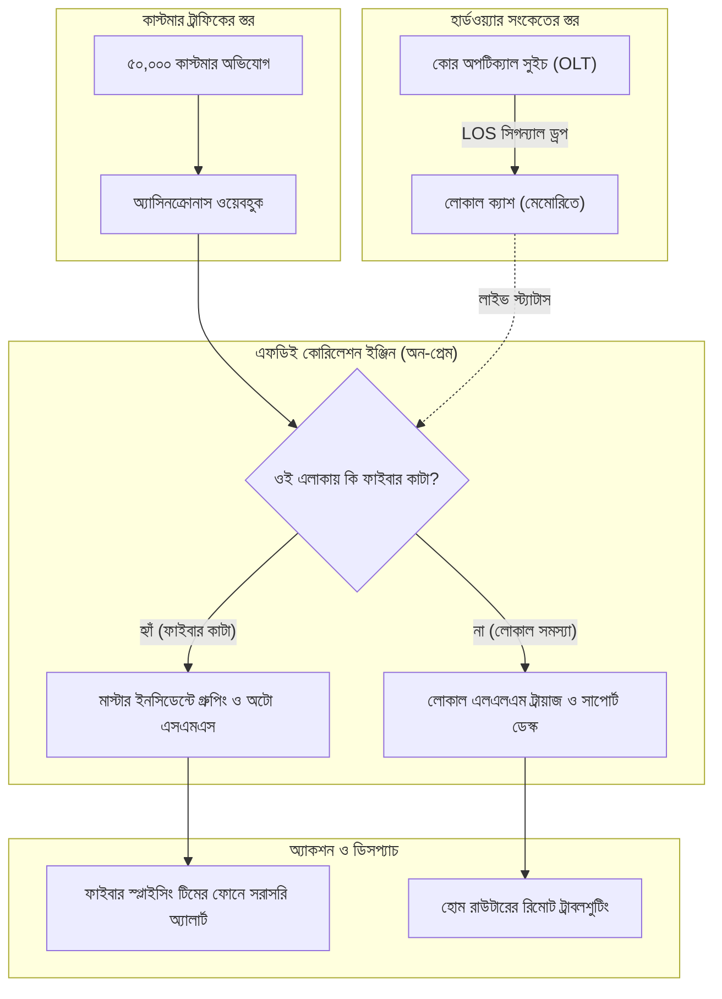
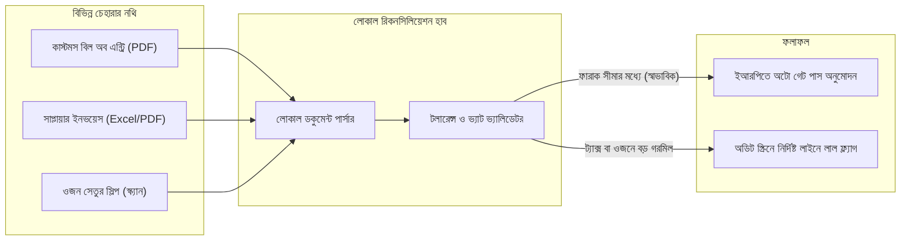

# চ্যাপ্টার ৪: ফিল্ড প্লেবুক ইন অ্যাকশন - হাই-স্টেক্স রিয়েল কেস স্টাডিজ

---

### ১. থিওরি যখন মাঠে আছড়ে পড়ে

প্রথম তিন চ্যাপ্টারে আমরা এফডিইর ঝুলিটা গুছিয়ে নিয়েছি। একটু মনে করিয়ে দিই।

চ্যাপ্টার ১-এ শিখেছি, ক্লায়েন্টের অফিসে মানুষের ভয় কিভাবে কাটাতে হয়, আর শ্যাডো সেশন দিয়ে এসওপির আড়ালের অলিখিত শর্টকাট কিভাবে খুঁজে বের করতে হয়। চ্যাপ্টার ২-এ দেখেছি, টেবিলের নিচের ধুলোমাখা পুরনো পিসিতে ক্লাউড ছাড়াই ছোট একটা এআই মডেল চালিয়ে মেসেজ বাছাই করা যায়। চ্যাপ্টার ৩-এ শিখেছি, বিশ মিনিটের ডোমেইন স্প্রিন্ট আর এমন একটা পাইপলাইন, যা কিছু ভেঙে গেলে নিজেই আগের ভালো অবস্থায় ফিরে যায়।

ল্যাবের হিসাব এখানেই শেষ। এবার রক্তমাংসের মাঠে নামার পালা।

মাঠে কিছুই শান্ত নিয়মে চলে না। সংকট এলে একসাথে শত শত ফোন বাজে। মনিটরে লাল বাতি জ্বলে ওঠে। গেটের বাইরে বিরক্ত মানুষের লাইন লম্বা হতে থাকে। আর প্রতিটা ভুলের দাম মেটাতে হয় ঘণ্টায় ঘণ্টায় বেড়ে চলা জরিমানায়।

এই চ্যাপ্টারে বাংলাদেশের দুটো সত্যিকারের কঠিন ময়দানে ঢুকব। একটা ঢাকার বড় আইএসপির টিকিটের ঝড়। আরেকটা চট্টগ্রাম বন্দরের কন্টেইনার জট আর ইনভয়েসের গরমিল।

আমি এখানে শুধু সমাধানটা দেখাব না। প্রতিটা গল্পে ধাপে ধাপে বলব, আগের তিন চ্যাপ্টারের কোন কৌশলটা কোথায় কাজে লাগল, আর কেন। যিনি এই লাইনে একদম নতুন, তিনিও যেন প্রতিটা ধাপ ধরে ধরে বুঝতে পারেন।

---

### ২. ট্র্যাক এ: ঢাকার বৃষ্টি, আইএসপির ক্যাওস আর স্মার্ট টিকিট ট্রায়াজ

প্রথমে একটু পটভূমি। ধরুন, গত তিন দিন ধরে আপনি ঢাকার একটা বড় আইএসপির সাপোর্ট সেন্টারে বসে আছেন। চ্যাপ্টার ১-এর মতো ল্যাপটপ বন্ধ, চোখ খোলা, শ্যাডো সেশন চলছে। একটা জিনিস আপনার চোখ এড়ায়নি। প্রতিটা সাপোর্ট কর্মীর সামনে দুটো স্ক্রিন। একটায় কাস্টমারের টিকিট। আরেকটায় নেটওয়ার্ক অপারেশন সেন্টারের, মানে এনওসির, ড্যাশবোর্ড। টিকিট পড়ে প্রতিবার তিনি দ্বিতীয় স্ক্রিনের দিকে তাকান। কখনো ফোন তুলে এনওসির ইঞ্জিনিয়ারকে জিজ্ঞেস করেন, "ধানমন্ডিতে কি কিছু ডাউন আছে?"

আপনি মনে মনে লিখে রাখলেন। এটাই বটলনেক।

তিন দিন পর এল সেই বৃষ্টিভেজা শ্রাবণের বিকেল।

ধানমন্ডির সাত মসজিদ রোডে ড্রেন খোঁড়ার কাজ চলছে। হঠাৎ একটা বুলডোজারের ধাক্কায় মাটির নিচের প্রধান ফাইবার অপটিক ক্যাবলটা ছিঁড়ে গেল। মুহূর্তের মধ্যে এলাকার দশ হাজার বাসার ইন্টারনেট বন্ধ। ওদিকে উত্তরায় আরেকটা ব্রাঞ্চে বিদ্যুৎ চলে গেছে।

পরের বিশ মিনিটে সাপোর্ট সেন্টারটা যেন নরক হয়ে উঠল।

ফোন একটানা বেজেই চলেছে। মেসেঞ্জারে আর ওয়েব পোর্টালে প্রতি মিনিটে আছড়ে পড়ছে অভিযোগ। দিনের শেষে টিকিটের সংখ্যা পঞ্চাশ হাজার ছাড়িয়ে যাচ্ছে। দশজন স্টাফ স্ক্রিনের সামনে দিশেহারা। কোনটা রেখে কোনটা ধরবেন?

আসল সমস্যাটা হলো, কাস্টমারের অভিযোগ পড়ে বোঝার উপায় নেই ঘটনাটা আসলে কোথায়।

একজন লিখছেন, "আমার নেট নাই, তাড়াতাড়ি ঠিক করেন।" আরেকজন লিখছেন, "ইউটিউব ঘুরতেছে, জুমে মিটিং ড্রপ করল।"

এখন সাপোর্ট কর্মী কিভাবে বুঝবেন, এটা কি সাত মসজিদ রোডে কাটা পড়া ফাইবারের ঘটনা, নাকি ওই গ্রাহকের ঘরের ভেতরে রাউটারের ক্যাবল ঢিলে হয়ে গেছে?

পার্থক্যটা ধরতে না পারলে ভুল হয়। ফাইবার কাটা এলাকায় কর্মীরা একে একে সবাইকে রাউটার রিসেট করতে বলেন। আর যেখানে একটা সাধারণ ক্যাবল বদলালেই কাজ হতো, সেখানে ব্যাকবোন ইঞ্জিনিয়ারের টিম পাঠিয়ে বসে থাকেন। ফল হলো ক্ষোভ, বন্ধ লাইন, আর শেষ পর্যন্ত শত শত সাবস্ক্রিপশন বাতিল।

!!! warning "ঢাকার বৃষ্টির দিনে আইএসপির ক্যাওস"
    নেটওয়ার্ক অপারেশনে সবচেয়ে বড় বিপর্যয় ঘটে, যখন হার্ডওয়্যারের অ্যালার্ম আর কাস্টমারের অভিযোগ আলাদা দুই দুনিয়ায় পড়ে থাকে। পঞ্চাশ হাজার টিকিটের পাহাড়ে আসল সমস্যাটা চাপা পড়ে যায়। কোর হার্ডওয়্যারের সংকেত আর কাস্টমারের বাংলা টেক্সট চোখের পলকে এক জায়গায় না আনতে পারলে কোনো সাপোর্ট টিমই টিকতে পারে না।

---

### ৩. ট্র্যাক এ-এর সমাধান: হার্ডওয়্যারের সংকেত আর কাস্টমারের টেক্সটের মিলন

একজন এফডিই এই হট্টগোলের মধ্যে নতুন সাপোর্ট কর্মী নিয়োগের কথা বলেন না। তিনি সিস্টেমের দিকে তাকান।

কিন্তু শুরুটা করবেন কিভাবে? ধাপে ধাপে দেখি।

**ধাপ ১: শ্যাডো সেশন থেকে সমস্যা ধরা।** এটা তো আপনি আগেই করে ফেলেছেন। দুই স্ক্রিনের মাঝে কর্মীদের ছোটাছুটিই আসল জট।

**ধাপ ২: বিশ মিনিটের ডোমেইন স্প্রিন্ট।** চ্যাপ্টার ৩-এর কৌশলে এনওসির ইঞ্জিনিয়ারের পাশে গিয়ে একটা টুল টেনে বসুন। জিজ্ঞেস করুন, "ভাই, কোন সংকেত দেখে আপনারা বোঝেন যে ফাইবার কেটেছে?" তিনি হয়তো বলবেন, "ওএলটিতে এলওএস অ্যালার্ম আসে, জোন কোড ধরে বুঝি কোন এলাকা।" ব্যস, আপনি চাবিকাঠিটা পেয়ে গেলেন।

**ধাপ ৩: একটা ছোট ওয়ার্কার বানানো।** এনওসির এই অ্যালার্ম আর সাপোর্টের টিকিট এতদিন দুটো আলাদা দ্বীপে ছিল। আপনার কাজ দুই দ্বীপের মাঝখানে একটা সাঁকো বসানো।

!!! info "শব্দগুলো সহজ করে বলি"
    * **ওএলটি (OLT):** আইএসপির অফিসের যে যন্ত্র থেকে ফাইবার ক্যাবল বেরিয়ে এলাকায় এলাকায় বাসায় বাসায় যায়। একে ইন্টারনেটের "মূল সুইচবোর্ড" ভাবতে পারেন।
    * **এলওএস (LOS):** মানে "লস অব সিগন্যাল"। ফাইবারের ভেতর দিয়ে আলোর সংকেত আসা বন্ধ হয়ে গেলে ওএলটি এই অ্যালার্ম দেয়।
    * **ওয়েবহুক (Webhook):** একটা প্রোগ্রাম আরেকটা প্রোগ্রামকে "খবর এলে আমাকে ডেকো" বলে রাখার ব্যবস্থা। দরজায় কলিং বেলের মতো।
    * **অ্যাসিনক্রোনাস (Async):** একসাথে অনেক কাজ সামলানোর ধরন। যেমন একজন ওয়েটার দশটা টেবিলের অর্ডার নেয়, কিচেনে খাবার তৈরি হওয়ার সময় এক জায়গায় দাঁড়িয়ে অপেক্ষা করে না।

ওয়ার্কারের কাজ চারটা ধাপে।

1. কাস্টমারের অভিযোগ ঢোকামাত্র তাঁর এলাকার কোড দেখে ওই এলাকার ওএলটির স্ট্যাটাস মিলিয়ে নেওয়া।
2. যদি দেখা যায় ওই এলাকার মূল ফাইবার কাটা, তাহলে টিকিটটাকে আলাদা কোনো সমস্যা না ধরে একটা "মাস্টার ইনসিডেন্টের" সাথে জুড়ে দেওয়া।
3. কাস্টমারকে এক সেকেন্ডের মধ্যে স্বয়ংক্রিয় বাংলা এসএমএস পাঠানো: "আপনার এলাকায় ফাইবার মেরামতের কাজ চলছে, ৪৫ মিনিটের মধ্যে সংযোগ ফিরবে।"
4. একই সাথে ফাইবার টিমের ফোনে জিপিএস লোকেশনসহ কাজের নির্দেশ পাঠিয়ে দেওয়া।

আর যে টিকিটগুলো ফাইবার কাটার সাথে সম্পর্কিত না? সেগুলো যাবে চ্যাপ্টার ২-এ বানানো সেই লোকাল এলএলএম ট্রায়াজ ইঞ্জিনে। সে বুঝবে এটা পাসওয়ার্ডের সমস্যা, নাকি রাউটারের।

**ধাপ ৪: ডেপ্লয়।** এই ওয়ার্কারটা ক্লায়েন্টের সার্ভারে বসাবেন চ্যাপ্টার ৩-এর সেলফ-হিলিং পাইপলাইন দিয়ে। কারণ বৃষ্টির রাতে কোনো ভুল হলে আপনাকে ফোন করে ঘুম থেকে তুলতে হবে না, সিস্টেম নিজেই আগের ভালো অবস্থায় ফিরে যাবে।

নিচের Mermaid ডায়াগ্রামে পুরো ট্রায়াজের ফ্লো দেখানো হলো:



---

### ৪. হ্যান্ডস-অন কোড প্রুফ: অ্যাসিনক্রোনাস টিকিট ট্রায়াজ ওয়ার্কার

এবার কোডটা দেখি। ভয় পাবেন না, পুরোটা প্রায় কুড়ি লাইনের।

#### কোড-স্যান্ডউইচ মেথড

**১. মাঠের সংকট:** বৃষ্টির দিনে একসাথে হাজার হাজার অভিযোগ এলে সাধারণ ধাঁচের প্রোগ্রাম একটা একটা করে টিকিট সামলায়, অন্যগুলো লাইনে দাঁড়িয়ে থাকে। আর হার্ডওয়্যারের সংকেতের সাথে সংযোগ না থাকায় কর্মীরা ভুল টিম পাঠিয়ে সময় নষ্ট করেন।

**২. মূল কোড:**

```python
# FDE Field Engine: Async Telecom Triage Worker
import asyncio

# অপটিক্যাল সুইচের লাইভ স্ট্যাটাস (মেমোরিতে, ক্লাউড ছাড়াই)
FIBER_GRID = {"DHK-DHN-07": {"status": "FIBER_CUT", "eta_min": 45},
              "DHK-UTT-03": {"status": "NORMAL", "eta_min": 0}}

async def process_ticket(ticket: dict) -> dict:
    node = FIBER_GRID.get(ticket["area_code"], {"status": "NORMAL"})
    await asyncio.sleep(0.05)  # আসল সিস্টেমে এখানে এসএমএস গেটওয়েতে কল যাবে
    if node["status"] == "FIBER_CUT":
        return {"id": ticket["id"], "action": "AUTO_SMS_AND_GROUP",
                "sms": f"আপনার এলাকায় ফাইবার মেরামতের কাজ চলছে। আনুমানিক {node['eta_min']} মিনিট।",
                "route_to": "FIBER_SPLICING_TEAM"}
    return {"id": ticket["id"], "action": "DISPATCH_L1_REMOTE",
            "sms": "আপনার রাউটারটি দুই মিনিট বন্ধ রেখে আবার চালু করুন।",
            "route_to": "DESK_SUPPORT"}

async def main():
    tickets = [{"id": 101, "area_code": "DHK-DHN-07"}, {"id": 102, "area_code": "DHK-UTT-03"}]
    results = await asyncio.gather(*(process_ticket(t) for t in tickets))
    for r in results:
        print(f"Ticket {r['id']}: {r['action']} -> {r['route_to']}")

asyncio.run(main())
```

**৩. সিস্টেমের বাস্তব বদল:** স্ক্রিপ্টটা চালালে এরকম আউটপুট আসবে:

```text
Ticket 101: AUTO_SMS_AND_GROUP -> FIBER_SPLICING_TEAM
Ticket 102: DISPATCH_L1_REMOTE -> DESK_SUPPORT
```

কোডের ভেতরে কী হচ্ছে, একটু খুলে বলি।

`FIBER_GRID` হলো সেই সাঁকো, মানে এনওসির অ্যালার্ম থেকে পাওয়া এলাকার স্ট্যাটাস। `process_ticket` প্রতিটা টিকিটের এলাকা কোড ধরে এই তালিকায় খোঁজে। এলাকায় ফাইবার কাটা থাকলে টিকিট চলে মাস্টার ইনসিডেন্টে, সাথে যায় এসএমএস। না থাকলে টিকিট যায় সাধারণ সাপোর্ট ডেস্কে।

আর `asyncio.gather` কেন? আগের সেই ওয়েটারের কথা মনে করুন। এসএমএস গেটওয়েতে বার্তা পৌঁছাতে খানিকটা সময় লাগে। সাধারণ প্রোগ্রাম সেই সময়টা হাত গুটিয়ে বসে থাকে। অ্যাসিনক্রোনাস প্রোগ্রাম সেই ফাঁকে অন্য টিকিট ধরে ফেলে। হাজার হাজার টিকিটে এই সময়টুকুই বাঁচে। একটা সৎ কথা বলে রাখি, উদাহরণের কোডে এসএমএস কলটা `sleep` দিয়ে নকল করা হয়েছে। আসল গেটওয়েতে জোড়া লাগালে পুরোটা বাস্তবে কাজ করবে।

আরেকটা ছোট বুদ্ধি আছে। কাস্টমারের টেক্সট এআই দিয়ে বিশ্লেষণ করার আগেই আমরা হার্ডওয়্যারের স্ট্যাটাস মিলিয়ে নিচ্ছি। এলাকার মূল ফাইবারই কাটা থাকলে টেক্সট পড়ে সময় নষ্ট করার কোনো মানে নেই। একে বলা যায় আর্কিটেকচারের শর্টকাট।

এরপর কী হলো? যে হাজার হাজার কাস্টমার ক্ষোভে ফেটে পড়ছিলেন, তাঁরা কয়েক সেকেন্ডের মধ্যে পরিষ্কার বাংলায় একটা এসএমএস পেলেন। কল সেন্টারে ফোনের চাপ অনেকটা কমে গেল। ফাইবার টিম সরাসরি ঠিক জায়গায় পৌঁছে লাইন জোড়া লাগিয়ে দিল।

**৪. গিটহাব রিপোজিটরি লিংক:** টেলিকম ট্রায়াজ ইঞ্জিনের পুরো টেস্ট স্যুট আর ডকার কম্পোজ কনফিগ পাবেন: [https://github.com/aiwithr/fde_book](https://github.com/aiwithr/fde_book)।

!!! tip "টেলিকমে এফডিই উইজডম: টিকিট বাড়ানোর চেয়ে গ্রুপ করা জরুরি"
    বিপর্যয়ের সময় সবচেয়ে খারাপ কাজ হলো প্রতিটা অভিযোগের জন্য আলাদা টিকিট খোলা। এতে ডেটাবেজ ধীর হয়, কর্মীরা গুলিয়ে ফেলেন। বুদ্ধিমানের কাজ হলো দশ হাজার সমস্যাকে একটা "প্যারেন্ট আউটরেজের" ছাতার নিচে নিয়ে আসা।

---

### ৫. ট্র্যাক বি: চট্টগ্রাম বন্দরের জট আর ইনভয়েসের গরমিল

এবার ঢাকা ছেড়ে চলে যাই দেশের অর্থনীতির হৃৎপিণ্ডে, চট্টগ্রাম বন্দরে।

কড়া রোদ। চারদিকে ধুলো। বিশ চাকার ট্রেইলারের কানফাটা হর্ন। জাহাজ থেকে নামানো কন্টেইনারের পাহাড়। বাতাসে পোড়া ডিজেল আর সমুদ্রের লোনা গন্ধ।

একটা আমদানি করা চালানের কন্টেইনার বন্দর থেকে ছাড়িয়ে ট্রাকে তুলতে হলে তিনটা কাগজের হিসাব মিলতে হয়:

1. **কাস্টমস বিল অব এন্ট্রি:** রাজস্ব কর্তৃপক্ষের ডিজিটাল ঘোষণাপত্র। এখানে পণ্যের মোট ওজন, দাম আর শ্রেণী লেখা থাকে।
2. **সাপ্লায়ারের কমার্শিয়াল ইনভয়েস:** বিদেশি রপ্তানিকারকের পাঠানো বিল। এখানে পণ্যের ওজন আর এইচএস কোড লেখা থাকে। এইচএস কোড হলো পণ্যের আন্তর্জাতিক শ্রেণীর নম্বর, যার ওপর ট্যাক্সের হার নির্ভর করে।
3. **গেট পাস আর ওজন সেতুর স্লিপ:** বন্দরের স্কেলে ট্রাকসহ কন্টেইনার মেপে পাওয়া আসল ওজন।

মাঠের সংকটটা কোথায় বাধে, একটা উদাহরণে বলি।

কাস্টমসের বিল অব এন্ট্রিতে লেখা মোট ওজন ৫০,০০০ কেজি। সাপ্লায়ারের ইনভয়েসে লেখা নিট ওজন ৪৯,৫০০ কেজি, কারণ ৫০০ কেজি যাচ্ছে কাঠের প্যালেট আর প্যাকিংয়ে। আর বন্দরের ওজন সেতুতে ট্রাক ওঠার পর ডিসপ্লেতে এল ৫০,১৫০ কেজি।

এই ১৫০ কেজির ফারাক দেখেই কাস্টমস ইন্সপেক্টর ফাইল আটকে দিলেন। তাঁর ভাবনাটা অযৌক্তিক না। অতিরিক্ত ১৫০ কেজিতে হয়তো কিছু লুকিয়ে আনা হয়েছে, কিংবা ট্যাক্স ফাঁকির চেষ্টা আছে।

আমদানিকারকের প্রতিনিধি ফাইল হাতে এক টেবিল থেকে আরেক টেবিলে দৌড়াদৌড়ি করেন। এদিকে একজন হেড ক্লার্ক নাকের ডগায় মোটা চশমা ঝুলিয়ে ক্যালকুলেটরে ওজন আর ভ্যাট মেলাতে বসেন। ঘণ্টা যায়, দিন যায়। কন্টেইনার ইয়ার্ডে পড়ে থাকে। আর আমদানিকারককে প্রতিদিন গুনতে হয় ডেমারেজ, মানে কন্টেইনার বেশিদিন ফেলে রাখার জরিমানা। অঙ্কটা হাজার হাজার ডলার।

কেন এই সহজ হিসাব মেলাতে এত সময় লাগে? কারণ তিনটা কাগজ তিন রকম চেহারায় আসে। একটা অপরিষ্কার স্ক্যান করা পিডিএফ। একটা কার্বন কপির হাতে লেখা স্লিপ। আর একটা কাস্টমসের অ্যাসিকুডা (ASYCUDA) সফটওয়্যারের আউটপুট। তার ওপর পোর্ট এলাকায় ইন্টারনেট ঝিমিয়ে পড়ে প্রায়ই, আর ক্লিয়ারিং এজেন্টের সংবেদনশীল চালানের তথ্য বাইরের কোনো ক্লাউডে পাঠানোর অনুমতিও থাকে না।

!!! info "বন্দর ও কাস্টমসের ত্রিভুজ ফাঁদ"
    সাপ্লাই চেইনের সবচেয়ে বড় আর্থিক ক্ষতি আসে সফটওয়্যারের অভাব থেকে না, আসে নথির চেহারার অমিল থেকে। কাস্টমস, বিদেশি ইনভয়েস আর ওজন সেতুর হিসাবের মধ্যে ছোট ফারাক যদি সিস্টেম নিজে মেলাতে না পারে, তাহলে কোটি কোটি টাকার চালানও দিনের পর দিন আটকে থাকে।

---

### ৬. ট্র্যাক বি-এর সমাধান: লোকাল ডকুমেন্ট রিকনসিলিয়েশন পাইপলাইন

এখানেও সেই একই ধাপগুলো ধরব, আগের তিন চ্যাপ্টারের কৌশল ধরে ধরে।

**ধাপ ১: শ্যাডো সেশন।** ক্লিয়ারিং এজেন্টের হেড ক্লার্ক সাহেবের ডেস্কের পাশে একটা চেয়ার টেনে চুপ করে বসুন। দেখবেন, তিনি একটা কাগজ ধরছেন, ক্যালকুলেটর টিপছেন, আরেকটা কাগজ ধরছেন। ওই ছোটাছুটিই আপনার জটের মূল।

**ধাপ ২: বিশ মিনিটের ডোমেইন স্প্রিন্ট।** তাঁকে জিজ্ঞেস করুন, "চাচা, কত কেজি পর্যন্ত গরমিল আপনি চোখ বুজে ছেড়ে দেন?" তিনি হয়তো বলবেন, "বাবা, প্যাকিংয়ে আর স্কেলের কারণে শতকরা এক-দুই ভাগ ফারাক তো হবেই।" এই এক লাইনের কথা কোনো সরকারি ডকুমেন্টে পাবেন না। অথচ পুরো সিস্টেমের চাবি এটাই।

**ধাপ ৩: লোকাল পাইপলাইন।** সব চলবে ক্লিয়ারিং এজেন্টের নিজের সার্ভারে, চ্যাপ্টার ২-এর অন-প্রেম ধাঁচে। এতে তিনটা কাজ থাকবে:

1. **আনস্ট্রাকচার্ড এক্সট্রাকশন:** স্ক্যান করা পিডিএফ থেকে ওজন, এইচএস কোড আর ট্যাক্সের সংখ্যাগুলো বের করে আনা। এই কাজে ওসিআর টুল আর লোকাল মডেল দুটোই কাজে লাগে। এর পূর্ণ কোড রিপোজিটরিতে আছে। এই চ্যাপ্টারে আমরা ধরে নিচ্ছি সংখ্যাগুলো বের হয়ে গেছে।
2. **টলারেন্স রুলস ইঞ্জিন:** ব্যবসার বাস্তবতা মেনে একটা সহনশীলতার সীমা ঠিক করা। ক্লার্ক সাহেবের কাছ থেকে যে "শতকরা এক ভাগ" পেয়েছেন, সেটাই এখানে বসবে।
3. **স্বয়ংক্রিয় ইআরপি এন্ট্রি:** সব মিলে গেলে সিস্টেম মানুষের হাত ছাড়াই ক্লিয়ারেন্স ভাউচার তৈরি করে ফেলবে। বড় কোনো গরমিল থাকলে লাল কালিতে ঠিক সেই লাইনটা চিহ্নিত করে ক্লার্কের স্ক্রিনে দেখাবে।

**ধাপ ৪: ডেপ্লয়।** এখানেও চ্যাপ্টার ৩-এর সেলফ-হিলিং পাইপলাইন। কারণ পোর্টে কিছু ভুল হলে রাতের শিফটে আপনাকে খুঁজে পাওয়া যাবে না।

নিচের Mermaid ডায়াগ্রামে চট্টগ্রামের এই রিকনসিলিয়েশন ফ্লো দেখানো হলো:



---

### ৭. হ্যান্ডস-অন কোড প্রুফ: থ্রি-ওয়ে রিকনসিলিয়েশন ইঞ্জিন

#### কোড-স্যান্ডউইচ মেথড

**১. মাঠের সংকট:** তিনটা কাগজের ওজনের ছোট ফারাক আর ট্যাক্সের হিসাব হাতে মেলাতে গিয়ে কন্টেইনার দিনের পর দিন আটকে থাকে, আর আমদানিকারককে রোজ চড়া জরিমানা গুনতে হয়।

**২. মূল কোড:**

```python
# FDE Field Engine: Three-Way Port Document Reconciler
def reconcile(customs: dict, invoice: dict, scale: dict) -> dict:
    declared = customs["gross_kg"]                        # বিল অব এন্ট্রির ওজন
    invoiced = invoice["net_kg"] + invoice["packing_kg"]  # ইনভয়েসের নিট + প্যাকিং
    weighed = scale["scale_kg"]                           # ওজন সেতুর ওজন
    limit = declared * 0.01                               # ১% ছাড়ের সীমা

    weight_ok = abs(weighed - declared) <= limit and abs(invoiced - declared) <= limit
    hs_ok = customs["hs_code"] == invoice["hs_code"]
    diff = abs(weighed - declared)

    if weight_ok and hs_ok:
        return {"status": "APPROVED", "action": "AUTO_GATE_PASS", "diff_kg": diff}
    return {"status": "FLAGGED", "action": "MANUAL_INSPECTION", "diff_kg": diff}

customs = {"gross_kg": 50000, "hs_code": "8471.30"}
invoice = {"net_kg": 49500, "packing_kg": 500, "hs_code": "8471.30"}
scale = {"scale_kg": 50150}
print(reconcile(customs, invoice, scale))
```

**৩. সিস্টেমের বাস্তব বদল:** আমাদের উদাহরণের সংখ্যা দিয়ে চালালে আউটপুট আসবে:

```text
{'status': 'APPROVED', 'action': 'AUTO_GATE_PASS', 'diff_kg': 150}
```

কোডটা কী করল, একটু ধরে ধরে বলি।

প্রথমে তিনটা কাগজ থেকে তিনটা ওজন নিল। কাস্টমসের ঘোষণা ৫০,০০০ কেজি। ইনভয়েসের নিট ৪৯,৫০০ আর প্যাকিং ৫০০ মিলিয়ে ৫০,০০০ কেজি। ওজন সেতুর হিসাবে ৫০,১৫০ কেজি। এরপর ঘোষিত ওজনের শতকরা এক ভাগ, মানে ৫০০ কেজি, ছাড়ের সীমা ধরল। ১৫০ কেজির ফারাক এই সীমার ভেতরে। এইচএস কোডও দুই কাগজে হুবহু এক। তাই সিস্টেম নিজেই গেট পাস দিয়ে দিল।

ওজন সেতুতে যদি আসত ৫০,৮০০ কেজি, ফারাক ৮০০ কেজি হয়ে সীমা ছাড়িয়ে যেত। তখন সিস্টেম "FLAGGED" দেখিয়ে ক্লার্কের স্ক্রিনে সতর্কবার্তা পাঠাত। কোডটা মানুষকে বাদ দেয় না। যেখানে সন্দেহ, সেখানে মানুষকে ডাকে।

এখানে দুটো কথা পাঠকের জন্য। ছাড়ের সীমা কত হবে, সেটা প্রতিটা ক্লায়েন্ট আর কাস্টমসের নিয়ম মিলিয়ে ঠিক করতে হয়। শতকরা এক ভাগ এখানে শুধু উদাহরণ। আর এইচএস কোডের এই এক লাইনের মিলটা কেন জরুরি? কারণ ট্যাক্স ফাঁকির বড় একটা পথ হলো কোড বদলে সস্তা শ্রেণীতে পণ্য দেখানো।

ফলে যে ক্লিয়ারেন্স পেতে আগে তিন দিন লাগত, সেটা এখন মিনিট কয়েকে হয়ে যায়। ১৫০ কেজির ফারাক সিস্টেম বৈধ হিসেবে মেনে নেয়। আমদানিকারকের রোজকার ডেমারেজের খরচ বেঁচে যায়।

**৪. গিটহাব রিপোজিটরি লিংক:** পুরো ইনভয়েস পার্সার আর টলারেন্স টেস্ট স্যুট গিটহাবে দেখুন: [https://github.com/aiwithr/fde_book](https://github.com/aiwithr/fde_book)।

!!! tip "লজিস্টিকসে নির্ভুলতা বনাম টলারেন্স"
    ল্যাবে বানানো সফটওয়্যার সবকিছু শূন্য আর একের নিখুঁত চোখে দেখে। কিন্তু সাপ্লাই চেইনের মাঠ চলে শতকরা হিসাব আর বাস্তবের ছাড়ে। কঠিন নিয়ম মানার পাশাপাশি মাঠের ছাড়গুলোকে কোডের ভেতরে জায়গা দিতে পারাটাই একজন ভালো এফডিইর লক্ষণ।

---

### ৮. ফিল্ড ফেইলিউর মোডস: যখন প্রজেক্ট থমকে যায়

এবার মাঠের সবচেয়ে গোপন কথাটা বলি।

আপনার কোড নিখুঁত হতে পারে। আর্কিটেকচার ডায়াগ্রাম দেখার মতো সুন্দর হতে পারে। তবু প্রজেক্ট মুখ থুবড়ে পড়তে পারে।

কেন? কোডের দোষে না। মানুষের কারণে।

মাঠে নামলে একদিন দেখবেন, কোনো এক মিড-লেভেল ম্যানেজার আপনার দিকে ঠান্ডা চোখে তাকিয়ে আছেন। তিনি আপনার কোনো কাজে সাহায্য করছেন না। মিটিংয়ে একের পর এক অজুহাত তুলছেন। কেন?

মনস্তত্ত্বটা বুঝুন। ওই মানুষটা হয়তো দশ বছর ধরে ওই ফাইলের স্তূপের ওপর রাজত্ব করেছেন। কোন ফাইল কখন ছাড়তে হবে, কাকে আটকে রাখতে হবে, এই ক্ষমতাটাই অফিসে তাঁর জায়গা তৈরি করেছিল। ইন্ট্রোর সেই লাল মলাটের খাতাটার কথা মনে করুন। ওটা শুধু খাতা না। ওর ভেতরেই থাকে কোন হিসাব কিভাবে মিলতে হয়, সেই জ্ঞান। আর যার হাতে জ্ঞান, তার হাতেই ক্ষমতা। আপনি যখন সব কিছু এক ক্লিকে স্বচ্ছ আর অটোমেটেড করে দিলেন, তিনি ভয় পেলেন। মনে মনে ভাবলেন, এই সিস্টেম চালু হলে ম্যানেজমেন্টের কাছে আমার দাম কমে যাবে। সবাই ভাববে আমার তো কোনো কাজই নেই।

এই ভয় থেকেই জন্ম নেয় নীরব অসহযোগ। চ্যাপ্টার ১-এ আমরা সাধারণ কর্মীদের ভয়ের কথা বলেছিলাম। এখানে ভয়টা আরও সূক্ষ্ম, কারণ এই মানুষ আপনার প্রজেক্ট আটকে দেওয়ার ক্ষমতা রাখেন।

আনাড়ি ইঞ্জিনিয়ার এই অবস্থায় ম্যানেজারের সাথে তর্কে জড়ান, সিইওর কাছে নালিশ করেন। এতে আগুনে ঘি পড়ে।

অভিজ্ঞ এফডিই সম্পূর্ণ অন্য পথ ধরেন। ম্যানেজারকে কখনো প্রতিপক্ষ বানাবেন না। তাঁকে সিস্টেমের নায়ক বানিয়ে দিন।

তাঁর ডেস্কে গিয়ে বলুন, "স্যার, রোজ সন্ধ্যায় সিইও সাহেবকে যে এক্সেল সামারি পাঠাতে আপনার দেড় ঘণ্টা চলে যায়, সিস্টেমে আমি একটা বাটন বানিয়ে দিয়েছি। এক ক্লিকে আপনার নামে সুন্দর একটা পিডিএফ রিপোর্ট বেরিয়ে আসবে। আপনার দেড় ঘণ্টা বেঁচে যাবে।"

যে মুহূর্তে ম্যানেজার দেখবেন এই অটোমেশনের কারণে সিইওর সামনে তাঁর নিজের কাজের প্রশংসা বাড়ছে, তিনি পাল্টে যাবেন। দেখা যাবে তিনিই আপনার সবচেয়ে বড় সমর্থক।

শত্রুকে বন্ধু বানানোর এই কৌশলটাই মাঠে টিকে থাকার আসল কলা।

!!! success "ফিল্ড রুলস: অচলাবস্থা কাটানোর তিন মূলনীতি"
    * **মূলনীতি ১: ক্ষমতা কাড়বেন না, সম্মান বাড়িয়ে দিন।**  
      অটোমেশন যেন কারও ভেতরের নিরাপত্তাহীনতা না বাড়ায়। মিড-লেভেল ম্যানেজারকে দেখিয়ে দিন, এই সিস্টেম তাঁর চাকরি কাড়ছে না, বরং হেড অফিসের কাছে তাঁর কাজের দাম বাড়াচ্ছে।
    * **মূলনীতি ২: প্রথম সাত দিনের মধ্যে একটা চোখে পড়ার মতো ছোট জয় দিন।**  
      চ্যাপ্টার ১-এর কথাটাই আবার বলছি, কারণ এটা এত জরুরি। পুরো বন্দর বা পুরো নেটওয়ার্ক একসাথে বদলাতে যাবেন না। একটা ছোট সমস্যা বেছে নিন, যা এক সপ্তাহের মধ্যে সবার চোখে পড়বে। একটা ছোট জয় মানুষের অনেক সন্দেহ ধুয়ে দেয়।
    * **মূলনীতি ৩: তর্কে জিতবেন না, তথ্য দিয়ে কথা বলুন।**  
      কেউ যখন বলবে "আপনার সিস্টেম কাজ করে না", রেগে যাবেন না। শান্তভাবে লগ আর এক্সিকিউশন টাইম বের করে তাঁর সামনে মেলে ধরুন। শান্ত একটা সংখ্যা সবচেয়ে জোরালো চিৎকারকেও থামিয়ে দেয়।

পরের চ্যাপ্টারে দেখব, একা কাজ করা থেকে বেরিয়ে একটা পুরো এফডিই টিম কিভাবে গড়তে হয়, আর একজন জুনিয়র ইঞ্জিনিয়ার ধাপে ধাপে কিভাবে এই পেশার শীর্ষে পৌঁছাতে পারেন।

---

!!! question "কথা বলতে চান?"
    আমাকে WhatsApp এ মেসেজ করতে পারেন: [+8801713095767](https://wa.me/+8801713095767)। আমি যেহেতু রোবট, কল থেকে মেসেজেই বেশি অভ্যস্ত। আমার সব আলাপ [মিডিয়াম](https://medium.com/@raqueeb), [ফেসবুক](https://www.facebook.com/raqueeb) আর [লিংকডইনে](https://www.linkedin.com/in/raqueeb/) পাবেন। ভিডিও দেখতে চাইলে আছে [ইউটিউব](https://www.youtube.com/@raqueeb)।

    আমার মাথায় আর কী কী ঘোরে, সেটাও পাবেন [এখানে](https://medium.com/@raqueeb/print-media-write-ups-2024-25-f2896ce92f7b)।
