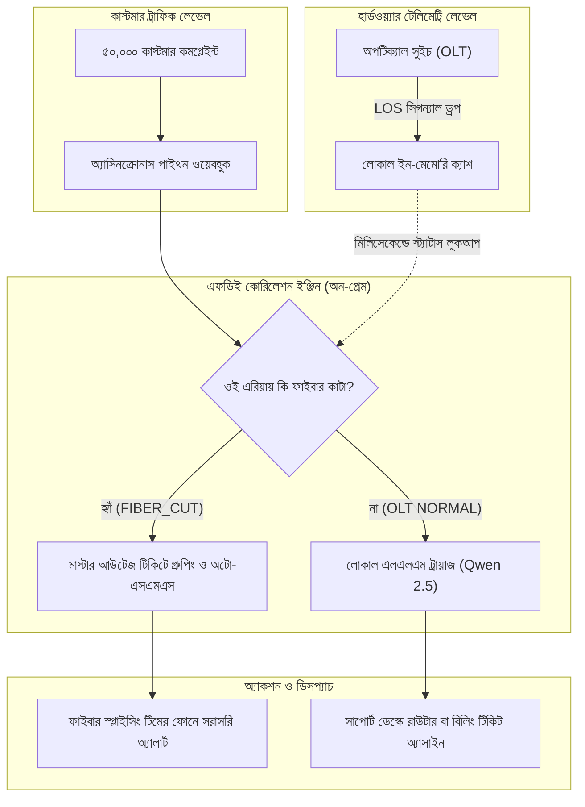
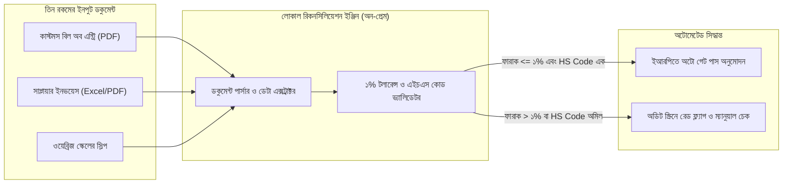

# চ্যাপ্টার ৪: ফিল্ড প্লেবুক ইন অ্যাকশন - হাই-স্টেক্স রিয়েল কেস স্টাডি

---

### ১. তত্ত্বের বাইরে আসল ফিল্ডের লড়াই

প্রথম তিন চ্যাপ্টারে আমরা একজন ফরওয়ার্ড ডেপ্লয়েড ইঞ্জিনিয়ারের কাজের পুরো টুলবক্সটা সাজিয়ে নিয়েছি। চ্যাপ্টার ১-এ দেখেছি কিভাবে প্রথম আটচল্লিশ ঘণ্টায় স্টাফদের মনের ফিয়ার কাটিয়ে শ্যাডো সেশনের মাধ্যমে এসওপির আড়ালের আসল বটলনেক খুঁজে বের করতে হয়। চ্যাপ্টার ২-এ শিখেছি কিভাবে ক্লাউড বা জিপিইউ ছাড়াই টেবিলের নিচের পুরনো পিসিতে লোকাল এলএলএম (`Ollama` ও `Qwen 2.5`) এবং `SQLite WAL` চালিয়ে ডেটা প্রসেস করা যায়। আর চ্যাপ্টার ৩-এ দেখেছি বিশ মিনিটের ডোমেইন স্প্রিন্ট, ইভ্যালুয়েশন হারনেস এবং সেলফ-হিলিং সিআই/সিডি রোলব্যাক পাইপলাইন।

এবার এই সবগুলো অস্ত্র একসাথে নিয়ে আসল ফিল্ডে নামার পালা।

ফিল্ডের সংকট কখনোই বইয়ের অঙ্কের মতো শান্তভাবে আসে না। সেখানে বিপদ এলে একসাথে শত শত ফোন বাজে, মনিটরে লাল অ্যালার্ম জ্বলে ওঠে, গেটের বাইরে ট্রাকের লম্বা লাইন লেগে যায়, আর প্রতি ঘণ্টার দেরিতে কোম্পানিকে গুনতে হয় বড় অঙ্কের জরিমানা। এই চ্যাপ্টারে আমরা বাংলাদেশের দুটো অতি পরিচিত এবং হাই-স্টেক্স ইন্ডাস্ট্রির কেস স্টাডি ব্যবচ্ছেদ করব। প্রথমটা ঢাকার একটা বড় ইন্টারনেট সার্ভিস প্রোভাইডারের (ISP) বৃষ্টির দিনের টিকিট অটোমেশন, আর দ্বিতীয়টা চট্টগ্রাম বন্দরের কন্টেইনার খালাসের থ্রি-ওয়ে ইনভয়েস রিকনসিলিয়েশন। 

প্রতিটা কেস স্টাডিতে আমরা শুধু পাইথন কোডটাই দেখব না; বরং আগের তিন চ্যাপ্টারের কোন কৌশলটা কিভাবে জোড়া লেগে পুরো সিস্টেমটা দাঁড় করাল, তা নতুন পাঠকদের জন্য ধাপে ধাপে খুলে বলব।

---

### ২. ট্র্যাক এ: ঢাকার বৃষ্টি, আইএসপির ক্যাওস ও স্মার্ট টিকিট ট্রায়াজ

প্রথমেই চলুন ঢাকার একটা বড় ব্রডব্যান্ড আইএসপির হেড অফিসে। ধরুন, আপনি গত দুদিন ধরে তাঁদের কাস্টমার সাপোর্ট ও নেটওয়ার্ক অপারেশন সেন্টারে (NOC) চ্যাপ্টার ১-এর নিয়মে শ্যাডো সেশন করছেন। ল্যাপটপ ব্যাগে বন্ধ, আপনি শুধু স্টাফদের পাশে বসে তাঁদের কাজ দেখছেন।

একটা অদ্ভুত বটলনেক আপনার চোখে পড়ল। সাপোর্ট ডেস্কের প্রতিটা স্টাফের সামনে দুটো আলাদা মনিটর। প্রথম মনিটরে কাস্টমারদের পাঠানো সাপোর্ট টিকিট আর ফেসবুক মেসেঞ্জারের কমপ্লেইন্ট ভাসছে। আর দ্বিতীয় মনিটরে খোলা আছে এনওসির নেটওয়ার্ক মনিটরিং ড্যাশবোর্ড। কোনো কাস্টমার যখনই মেসেজ দিচ্ছেন *"ভাই আমার নেট নাই"*, সাপোর্ট স্টাফ প্রথমে কাস্টমারের আইডি দেখে তাঁর এলাকা বের করছেন, তারপর দ্বিতীয় মনিটরে খুঁজে দেখছেন ওই এলাকার মূল অপটিক্যাল সুইচ ঠিক আছে কি না। না বুঝলে ইন্টারকমে এনওসি ইঞ্জিনিয়ারকে ফোন করে জিজ্ঞেস করছেন, *"ভাই, ধানমন্ডি সাত নম্বরে কি কোনো ফাইবার ডাউন আছে?"*

আপনি নোটপ্যাডে লিখে রাখলেন - এই দুই স্ক্রিনের মাঝখানের ম্যানুয়াল চেকিংটাই হলো আসল বটলনেক। সাধারণ দিনে এতে কোনোমতে কাজ চলে যায়, কিন্তু ঝড়-বৃষ্টির দিনে কী ঘটে?

তৃতীয় দিন বিকেলে নামল শ্রাবণের মুষলধারে বৃষ্টি। ধানমন্ডির সাত মসজিদ রোডে ওয়াসার খোঁড়াখুঁড়ির সময় ভেকুর ধাক্কায় মাটির নিচের মেইন ফাইবার ক্যাবলটা ছিঁড়ে গেল। এক সেকেন্ডের মধ্যে ওই এলাকার দশ হাজার বাসার ইন্টারনেট সংযোগ বিচ্ছিন্ন। ওদিকে উত্তরার একটা জোনে সাবস্টেশন ট্রিপ করে বিদ্যুৎ চলে গেল।

পরের বিশ মিনিটে আইএসপির কল সেন্টার রীতিমতো রণক্ষেত্রে পরিণত হলো।

ফোন একটানা বেজে চলেছে। ওয়েব পোর্টাল, অ্যাপ আর হোয়াটসঅ্যাপে প্রতি মিনিটে হাজার হাজার মেসেজ ঢুকছে। সন্ধ্যা নাগাদ আনরেজলভড টিকিটের সংখ্যা পঞ্চাশ হাজার ছাড়িয়ে গেল। সাপোর্ট ডেস্কের পনেরোজন স্টাফ স্ক্রিনের সামনে বসে হিমশিম খাচ্ছেন। কোনটা রেখে কোনটা দেখবেন?

আসল সংকটটা হলো, কাস্টমারের লেখা মেসেজ পড়ে বোঝার কোনো উপায় নেই প্রবলেমটা আসলে কোথায়। ধানমন্ডির একজন ইউজার লিখছেন, *"ভাই নেট চলে গেছে, আর্জেন্ট অফিস মিটিং আছে, তাড়াতাড়ি দেখেন।"* আবার মিরপুরের একজন ইউজারও লিখছেন, *"নেট পাচ্ছি না, লাল বাতি জ্বলছে।"* অথচ ধানমন্ডির ইউজারের এলাকার মেইন ফাইবার রাস্তায় কাটা পড়েছে, আর মিরপুরের ইউজারের বাসায় বিড়াল ধাক্কা দিয়ে রাউটারের প্যাচ কর্ড ঢিলে করে দিয়েছে!

দুই স্ক্রিনের ডেটা আলাদা থাকায় সাপোর্ট স্টাফরা ধানমন্ডির ফাইবার কাটা এলাকার কাস্টমারদেরও ফোন করে বলছেন, *"স্যার, রাউটারটা একটু রিস্টার্ট দিয়ে দেখেন তো!"* কাস্টমার রাউটার রিস্টার্ট দিয়ে দেখেন নেট আসে না, তখন ক্ষোভে ফেটে পড়েন। আবার যেখানে রিমোটলি রাউটার কনফিগার করলেই সমাধান হতো, সেখানে ভুল করে ফিল্ড টেকনিশিয়ানের ভ্যান পাঠিয়ে দেওয়া হচ্ছে।

!!! warning "নেটওয়ার্ক অপারেশনের প্রধান বটলনেক"
    আইএসপি বা টেলিকম সাপোর্টে সবচেয়ে বড় ক্যাওস তৈরি হয় যখন হার্ডওয়্যারের অ্যালার্ম আর কাস্টমারের কমপ্লেইন্ট টেক্সট দুটো আলাদা সিস্টেমে বিচ্ছিন্ন হয়ে পড়ে থাকে। রাস্তায় মেইন ফাইবার কাটা পড়লে দশ হাজার কাস্টমারের জন্য দশ হাজার আলাদা টিকিট খুলে সাপোর্ট টিমকে বসিয়ে রাখা মানে পুরো অপারেশন অচল করে দেওয়া।

---

### ৩. ট্র্যাক এ-এর সমাধান: হার্ডওয়্যার টেলিমেট্রি ও কাস্টমার টেক্সটের অটো-কোরিলেশন

একজন এফডিই এই সংকট মেটাতে আরও বিশজন নতুন কল সেন্টার স্টাফ নিয়োগ দিতে বলেন না। তিনি ওই দুই মনিটরের মাঝখানে একটা স্বয়ংক্রিয় সাঁকো তৈরি করেন। 

নতুন যাঁরা নেটওয়ার্ক বা ব্যাকএন্ড অটোমেশন নিয়ে কাজ করছেন, তাঁদের বোঝার সুবিধার্থে আগে আইএসপির দুটো চেনা টেকনিক্যাল শব্দ একদম সহজ বাংলায় পরিষ্কার করে নিই:
* **ওএলটি (OLT - Optical Line Terminal):** আইএসপির সার্ভার রুমে বা পপ (POP) অফিসে বসানো মেইন সুইচবোর্ড, যেখান থেকে ফাইবার অপটিক ক্যাবল বেরিয়ে মহল্লার বাসায় বাসায় যায়।
* **এলওএস অ্যালার্ম (LOS - Loss of Signal):** রাস্তায় কোথাও ফাইবার ক্যাবল কেটে গেলে ওএলটি যন্ত্রটাতে আলোর সংকেত আসা বন্ধ হয়ে যায়। তখন ওএলটি সাথে সাথে লাল বাতি জ্বালিয়ে `LOS` অ্যালার্ম দেয়।

চ্যাপ্টার ৩-এর কৌশলে আপনি এনওসি ইঞ্জিনিয়ারের পাশে বিশ মিনিটের একটা ডোমেইন স্প্রিন্টে বসলেন। তাঁকে জিজ্ঞেস করলেন, *"ভাই, ওএলটিতে যে এলওএস অ্যালার্ম আসে, সেটা কি কোনো এপিআই বা লগে পাওয়া যায়?"* ইঞ্জিনিয়ার দেখালেন, ওএলটি প্রতি সেকেন্ডে লোকাল সার্ভারে জোন কোডসহ (`DHK-DHN-07`) স্ট্যাটাস পাঠায়।

ব্যস, আপনার আর্কিটেকচার রেডি! আপনি এমন একটা পাইথন ওয়ার্কার ডিজাইন করলেন যা চারটা ধাপে কাজ করে:
১. কাস্টমারের কমপ্লেইন্ট ওয়েবহুকে (Webhook) ঢোকামাত্র সিস্টেম আগে কাস্টমারের এরিয়া কোড দেখে মেমোরিতে থাকা ওএলটির লাইভ স্ট্যাটাস চেক করবে।
২. যদি দেখা যায় ওই জোনের ওএলটিতে `FIBER_CUT` বা `LOS` অ্যালার্ম জ্বলছে, তবে এই মেসেজটাকে চ্যাপ্টার ২-এর এলএলএম-এর কাছে পাঠানোর কোনো দরকারই নেই! সিস্টেম সাথে সাথে টিকিটটাকে একটা **মাস্টার আউটেজ টিকিটের** নিচে গ্রুপ করে ফেলবে।
৩. এক সেকেন্ডের মধ্যে কাস্টমারের ফোনে অটোমেটেড বাংলা এসএমএস চলে যাবে: *"আপনার এলাকায় মেইন ফাইবার মেরামতের কাজ চলছে। আনুমানিক ৪৫ মিনিটের মধ্যে সংযোগ স্বাভাবিক হবে।"* এবং একই সাথে ফিল্ডের ফাইবার স্প্লাইসিং টিমের ফোনে লোকেশন চলে যাবে।
৪. আর যদি দেখা যায় এলাকার ওএলটি সম্পূর্ণ স্বাভাবিক (`NORMAL`), কেবল তখনই মেসেজটা যাবে আমাদের চ্যাপ্টার ২-এর লোকাল এলএলএম ট্রায়াজ ইঞ্জিনে (`Qwen 2.5`) - যে মেসেজ পড়ে বুঝবে এটা রাউটার কনফিগারেশনের সমস্যা নাকি বিলিংয়ের সমস্যা।

নিচের মারমেইড ডায়াগ্রামে পুরো আর্কিটেকচারটা দেখুন:



---

### ৪. হ্যান্ডস-অন কোড প্রুফ: অ্যাসিনক্রোনাস টিকিট রাউটিং ওয়ার্কার

বৃষ্টির দিনে যখন একসাথে হাজার হাজার রিকোয়েস্ট আসে, তখন সাধারণ সিনক্রোনাস (Synchronous) পাইথন কোড লিখলে সিস্টেম ঝুলে যাবে। কারণ প্রথম কাস্টমারকে এসএমএস পাঠানোর নেটওয়ার্ক কলের উত্তর না আসা পর্যন্ত পরের কাস্টমারের টিকিট লাইনে দাঁড়িয়ে থাকবে। এই সমস্যার সমাধান হলো পাইথনের **`asyncio` (অ্যাসিনক্রোনাস প্রোগ্রামিং)** - অনেকটা রেস্তোরাঁর স্মার্ট ওয়েটারের মতো, যে এক টেবিলের অর্ডার কিচেনে দিয়েই দাঁড়িয়ে না থেকে সাথে সাথে পাশের টেবিলের অর্ডার নিতে চলে যায়।

#### কোড-স্যান্ডউইচ মেথড

**১. কাস্টমারের বাস্তব সংকট:** ফাইবার কাটার দিনে একসাথে আসা হাজার হাজার টিকিট হার্ডওয়্যার অ্যালার্মের সাথে মিলিয়ে মিলিসেকেন্ডের মধ্যে আলাদা করতে হবে, যাতে ফাইবার কাটা এলাকার টিকিটগুলো অটোমেটিক গ্রুপ হয়ে যায় এবং সাধারণ রাউটার সমস্যার টিকিটগুলো আলাদা সাপোর্ট ডেস্কে যায়।

**২. মূল কোড:** নিচের কুড়ি লাইনের অ্যাসিনক্রোনাস পাইথন স্ক্রিপ্টটি ওএলটির লাইভ স্ট্যাটাসের সাথে কাস্টমারের টিকিট মিলিয়ে একসাথে সমান্তরালভাবে (Concurrently) রাউটিং করে:

```python
# FDE Field Engine: Async ISP Ticket Correlation & Routing Worker
import asyncio

# ওএলটি সুইচের লাইভ টেলিমেট্রি ক্যাশ (লোকাল মেমোরিতে)
OLT_STATUS_CACHE = {
    "DHK-DHN-07": {"status": "FIBER_CUT", "eta_min": 45},
    "DHK-UTT-03": {"status": "NORMAL", "eta_min": 0}
}

async def route_isp_ticket(ticket: dict) -> dict:
    olt = OLT_STATUS_CACHE.get(ticket["zone"], {"status": "NORMAL"})
    await asyncio.sleep(0.05)  # লোকাল এসএমএস গেটওয়ে কলের নন-ব্লকিং সিমুলেশন

    if olt["status"] == "FIBER_CUT":
        return {"ticket_id": ticket["id"], "action": "GROUP_UNDER_MASTER_OUTAGE",
                "sms": f"আপনার এলাকায় ফাইবার মেরামতের কাজ চলছে। আনুমানিক সময় {olt['eta_min']} মিনিট।",
                "dispatch": "FIELD_FIBER_TEAM"}
    return {"ticket_id": ticket["id"], "action": "SEND_TO_LOCAL_LLM_TRIAGE",
            "sms": "আপনার অভিযোগটি সাপোর্ট ইঞ্জিনিয়ার দেখছেন।",
            "dispatch": "L1_SUPPORT_DESK"}

async def main():
    incoming_burst = [{"id": 101, "zone": "DHK-DHN-07"}, {"id": 102, "zone": "DHK-UTT-03"}]
    results = await asyncio.gather(*(route_isp_ticket(t) for t in incoming_burst))
    for r in results:
        print(f"Ticket #{r['ticket_id']}: {r['action']} -> {r['dispatch']}")

asyncio.run(main())
```

**৩. সিস্টেমের বাস্তব ইমপ্যাক্ট:** কোডটা রান করলে স্ক্রিনে সাথে সাথে দেখবেন:

```text
Ticket #101: GROUP_UNDER_MASTER_OUTAGE -> FIELD_FIBER_TEAM
Ticket #102: SEND_TO_LOCAL_LLM_TRIAGE -> L1_SUPPORT_DESK
```

নতুন পাঠকেরা এখানে আর্কিটেকচারের দুটো চমৎকার কৌশল খেয়াল করুন:
* **আর্কিটেকচারাল শর্টকাট (এআই বাঁচানো):** আমরা কিন্তু প্রতিটা টিকিট চোখ বন্ধ করে এলএলএম-এর কাছে পাঠাইনি! আগে একটা সাধারণ ডিকশনারি লুকআপ (`OLT_STATUS_CACHE.get`) দিয়ে এক মাইক্রোসেকেন্ডে চেক করে নিয়েছি ওই এলাকায় ফাইবার কাটা কি না। ফাইবার কাটা থাকলে এআই মডেল চালিয়ে সিপিইউ খরচ করার কোনো দরকারই নেই। যেগুলো সাধারণ সমস্যা (`DHK-UTT-03`), শুধু সেগুলোই পরের ধাপে এলএলএম ট্রায়াজে যাচ্ছে।
* **`asyncio.gather`-এর শক্তি:** দশ হাজার টিকিট এলে `asyncio.gather` সবগুলো টিকিটকে একসাথে ইভেন্ট লুপে তুলে দেয়। ফলে একটা টিকিটের এসএমএস যেতে যে ৫০ মিলিসেকেন্ড সময় লাগে, সেই ফাঁকে বাকি শত শত টিকিটের ওএলটি স্ট্যাটাস চেক হয়ে যায়।

এই বিশ লাইনের কোডটা বসানোর পর পরের সপ্তাহে যখন আবার বৃষ্টি নামল, সাপোর্ট সেন্টারের দৃশ্যই বদলে গেল। ফাইবার কাটার সাথে সাথে দশ হাজার গ্রাহকের ফোনে বাংলায় এসএমএস চলে গেল যে ৪৫ মিনিটে লাইন ঠিক হবে। কল সেন্টারে ফোনের চাপ এক ধাক্কায় ৮০% কমে গেল, আর সাপোর্ট স্টাফরা ঠান্ডা মাথায় বাকি ২০% গ্রাহকের রাউটারের সমস্যা মিটিয়ে ফেললেন।

**৪. গিটহাব রেফারেন্স:** আইএসপি রাউটিং ওয়ার্কার (`worker.py`) ও টেস্ট স্ক্রিপ্ট পাবেন বইয়ের অফিশিয়াল কমপ্যানিয়ন রিপোজিটরিতে: [https://github.com/raqueeb/fdebook_companion](https://github.com/raqueeb/fdebook_companion)।

---

### ৫. ট্র্যাক বি: চট্টগ্রাম বন্দরের কন্টেইনার জট ও ইনভয়েস রিকনসিলিয়েশন

এবার ঢাকার কল সেন্টার ছেড়ে চলুন দেশের অর্থনীতির সবচেয়ে ব্যস্ত ময়দানে - চট্টগ্রাম বন্দরে।

চারদিকে কড়া রোদ আর ধুলোবালি। বিশ চাকার লম্বা কন্টেইনার ট্রেইলারের হর্ন বাজছে। ইয়ার্ডে হাজার হাজার কন্টেইনারের স্তূপ। বিদেশ থেকে জাহাজে আসা একটা কন্টেইনার বন্দর থেকে ক্লিয়ার করে কারখানার ট্রাকে তোলার আগে সিঅ্যান্ডএফ (C&F) এজেন্ট এবং অডিট স্টাফদের তিনটা ভিন্ন নথির (Documents) হিসাব মেলাতে হয়। সাপ্লাই চেইনের ভাষায় একে বলে **থ্রি-ওয়ে রিকনসিলিয়েশন (Three-Way Reconciliation)**:
১. **কাস্টমস বিল অব এন্ট্রি (Bill of Entry):** কাস্টমসের অ্যাসিকুডা (ASYCUDA) সিস্টেমে দাখিল করা ঘোষণাপত্র, যেখানে পণ্যের ঘোষিত মোট ওজন (Gross Weight), দাম এবং এইচএস কোড লেখা থাকে।
২. **সাপ্লায়ারের কমার্শিয়াল ইনভয়েস (Commercial Invoice):** বিদেশি রপ্তানিকারকের পাঠানো বিল, যেখানে পণ্যের নিট ওজন (Net Weight), প্যাকিং ওজন এবং এইচএস কোড (HS Code - পণ্যের আন্তর্জাতিক শ্রেণী নম্বর, যার ওপর কাস্টমস ডিউটির হার নির্ভর করে) থাকে।
৩. **ওয়েব্রিজ স্কেলের স্লিপ (Weighbridge Slip):** বন্দরের গেট দিয়ে বেরোনোর সময় ডিজিটাল ওয়েব্রিজে (বড় ট্রাক মাপার স্কেল) কন্টেইনার ওজন করে পাওয়া আসল ওজনের স্লিপ।

এখন ফিল্ডের আসল প্রবলেমটা কোথায় বাধে, একটা বাস্তব সংখ্যা দিয়ে দেখুন।

ধরুন, কাস্টমসের বিল অব এন্ট্রিতে ঘোষণা করা আছে চালানের মোট ওজন **৫০,০০০ কেজি**। বিদেশি সাপ্লায়ারের ইনভয়েসে লেখা আছে মালের নিট ওজন ৪৯,৫০০ কেজি এবং কাঠের প্যালেট ও প্যাকিংয়ের ওজন ৫০০ কেজি (মোট ৫০,০০০ কেজি)। কিন্তু কন্টেইনারটা যখন বন্দরের ওয়েব্রিজ স্কেলে তোলা হলো, তখন স্লিপে ওজন প্রিন্ট হয়ে এল **৫০,১৫০ কেজি**!

এই ১৫০ কেজির পার্থক্য দেখেই প্রথাগত সফটওয়্যার বা জুনিয়র অডিট ক্লার্ক ফাইলটা আটকে দেন। ফাইল হাতে স্টাফরা এক টেবিল থেকে আরেক টেবিলে দৌড়াদৌড়ি করেন। ওদিকে হেড ক্লার্ক সাহেব চশমা চোখে দিয়ে ক্যালকুলেটরে একটা একটা করে প্যাকিং লিস্ট আর এইচএস কোড মেলাতে বসেন। এভাবে ফাইল ক্লিয়ার হতে তিন-চার দিন পার হয়ে যায়। আর কন্টেইনার বন্দরের ইয়ার্ডে অতিরিক্ত একদিন পড়ে থাকা মানেই আমদানিকারককে শত শত ডলারের **ডেমারেজ (Demurrage)** বা পোর্ট জরিমানা গুনতে হওয়া!

!!! info "সাপ্লাই চেইনের আসল বটলনেক: কাগুজে অমিল"
    বন্দরে বা বড় ফ্যাক্টরিতে কন্টেইনার আটকে থাকে সফটওয়্যারের অভাবে নয়; আটকে থাকে তিনটা আলাদা ফরম্যাটের কাগজের (বিল অব এন্ট্রি, সাপ্লায়ার ইনভয়েস ও ওয়েব্রিজ স্লিপ) ছোটখাটো ওজনের ফারাক সিস্টেম নিজে থেকে বিচার করতে পারে না বলে।

---

### ৬. ট্র্যাক বি-এর সমাধান: টলারেন্স রুলস ও লোকাল থ্রি-ওয়ে রিকনসিলার

আপনি সিঅ্যান্ডএফ এজেন্টের অফিসে গিয়ে চ্যাপ্টার ১ ও চ্যাপ্টার ৩-এর নিয়মে হেড ক্লার্ক সাহেবের পাশে বসলেন। বিশ মিনিটের ডোমেইন স্প্রিন্টে তাঁকে একটা সোজা প্রশ্ন করলেন, *"চাচা, কাস্টমসের কাগজে ৫০,০০০ কেজি লেখা থাকলে ওয়েব্রিজ স্কেলে কত কেজি পর্যন্ত এদিক-সেদিক হলে আপনারা সেটাকে স্বাভাবিক বলে ছেড়ে দেন?"*

হেড ক্লার্ক সাহেব হেসে বললেন, *"বাবা, সমুদ্রের বাতাসে কাঠের প্যালেট আর্দ্রতা টেনে একটু ভারী হয়, আবার দুটো স্কেলের মাপেও সামান্য তফাত থাকে। তাই মোট ওজনের শতকরা এক ভাগ (১%) পর্যন্ত ওজন কম-বেশি হলে এবং দুই কাগজে এইচএস কোড হুবহু এক থাকলে আমরা সেটাকে স্বাভাবিক ধরে গেট পাস দিয়ে দিই। কিন্তু এইচএস কোড যদি এক চুলও অমিল হয়, কিংবা ওজন এক পারসেন্টের বেশি এদিক-সেদিক হয়, তখন কাস্টমস ফিজিক্যাল ইনস্পেকশনে যায়।"*

দেখুন, এই **"১% টলারেন্স (Tolerance) এবং এইচএস কোড ম্যাচিং"**-এর নিয়মটা কোনো প্রোগ্রামিং বইয়ে লেখা নেই। কিন্তু হেড ক্লার্কের মুখের এই একটা কথাই আপনার অটোমেশনের প্রধান চাবিকাঠি।

আপনি চ্যাপ্টার ২-এর মতো ক্লায়েন্টের লোকাল সার্ভারেই তিন ধাপের একটা পাইপলাইন বসালেন:
১. **ডকুমেন্ট এক্সট্রাকশন:** স্ক্যান করা পিডিএফ বা এক্সেল থেকে ওজন আর এইচএস কোডগুলো ডিকশনারিতে তুলে আনা।
২. **টলারেন্স ভ্যালিডেটর:** হেড ক্লার্কের বলা ১% ছাড়ের সূত্র এবং এইচএস কোডের মিল পরীক্ষা করা।
৩. **অটো-গেটপাস বা রেড-ফ্ল্যাগ:** শর্ত মিলে গেলে মানুষের হাত ছাড়াই ইআরপিতে `AUTO_GATE_PASS` ইস্যু হবে। আর যদি ওজনের ফারাক ১%-এর বেশি হয় কিংবা এইচএস কোড না মেলে, তবে সিস্টেম সাথে সাথে ফাইলটাকে `FLAGGED` করে ক্লার্কের স্ক্রিনে ঠিক কোন লাইনে গরমিল তা লাল রঙে দেখিয়ে দেবে।



---

### ৭. হ্যান্ডস-অন কোড প্রুফ: থ্রি-ওয়ে পোর্ট ডকুমেন্ট রিকনসিলার

#### কোড-স্যান্ডউইচ মেথড

**১. কাস্টমারের বাস্তব সংকট:** কাস্টমস বিল অব এন্ট্রি, সাপ্লায়ার ইনভয়েস এবং ওয়েব্রিজ স্কেলের স্লিপের ওজন ও এইচএস কোড ম্যানুয়ালি মেলাতে গিয়ে কন্টেইনার বন্দরে আটকে থাকে এবং প্রতিদিন মোটা অঙ্কের ডেমারেজ জরিমানা গুনতে হয়।

**২. মূল কোড:** নিচের পাইথন স্ক্রিপ্টটি তিনটি ডকুমেন্টের ডেটা নিয়ে ১% টলারেন্স এবং এইচএস কোড যাচাই করে মুহূর্তের মধ্যে গেট পাস বা অডিট ফ্ল্যাগের সিদ্ধান্ত দেয়:

```python
# FDE Field Engine: Three-Way Port Document Reconciler
def reconcile_shipment(customs: dict, invoice: dict, weighbridge: dict) -> dict:
    declared_kg = customs["gross_kg"]                          # বিল অব এন্ট্রির ঘোষিত ওজন
    invoiced_kg = invoice["net_kg"] + invoice["packing_kg"]    # ইনভয়েসের নিট + প্যাকিং ওজন
    weighed_kg = weighbridge["scale_kg"]                       # ওয়েব্রিজ স্কেলের আসল ওজন
    tolerance_kg = declared_kg * 0.01                          # ১% বাস্তব টলারেন্স সীমা

    weight_within_limit = (abs(weighed_kg - declared_kg) <= tolerance_kg and
                           abs(invoiced_kg - declared_kg) <= tolerance_kg)
    hs_code_matched = customs["hs_code"] == invoice["hs_code"]
    variance_kg = abs(weighed_kg - declared_kg)

    if weight_within_limit and hs_code_matched:
        return {"status": "APPROVED", "action": "AUTO_GATE_PASS", "variance_kg": variance_kg}
    return {"status": "FLAGGED", "action": "MANUAL_CUSTOMS_AUDIT", "variance_kg": variance_kg}

# চট্টগ্রাম বন্দরের আসল চালানের নমুনা ডেটা
customs_doc = {"gross_kg": 50000, "hs_code": "8471.30"}
invoice_doc = {"net_kg": 49500, "packing_kg": 500, "hs_code": "8471.30"}
scale_slip = {"scale_kg": 50150}

print(reconcile_shipment(customs_doc, invoice_doc, scale_slip))
```

**৩. সিস্টেমের বাস্তব ইমপ্যাক্ট:** কোডটা রান করলে আউটপুটে আসবে:

```text
{'status': 'APPROVED', 'action': 'AUTO_GATE_PASS', 'variance_kg': 150}
```

নতুন প্রোগ্রামাররা কোডটার লজিকটা খেয়াল করুন। হেডকোয়ার্টারে বসে কোনো ডেভেলপার যদি এই কোডটা ডোমেইন স্প্রিন্ট ছাড়া লিখতেন, তিনি নির্ঘাত লিখতেন `if weighed_kg == declared_kg`। আর তার ফলে ৫০,০০০ কেজির বিপরীতে ৫০,১৫০ কেজি আসামাত্র প্রতিটা বৈধ কন্টেইনার আটকে যেত! কিন্তু একজন এফডিই ফিল্ডে বসে কাজ করেছেন বলেই তিনি `tolerance_kg = declared_kg * 0.01` (অর্থাৎ ৫০,০০০ কেজিতে ৫০০ কেজি পর্যন্ত ছাড়) কোডে বসিয়েছেন। যেহেতু ১৫০ কেজির পার্থক্য ৫০০ কেজির সীমার ভেতরে আছে এবং দুটো কাগজেই ল্যাপটপ/কম্পিউটারের এইচএস কোড (`8471.30`) হুবহু মিলেছে, সিস্টেম এক সেকেন্ডে অটো গেট পাস দিয়ে দিয়েছে।

অন্যদিকে, যদি ওয়েব্রিজ স্কেলে ওজন আসত ৫০,৮০০ কেজি (৮০০ কেজি ফারাক), কিংবা কেউ ট্যাক্স ফাঁকি দেওয়ার জন্য ইনভয়েসে অন্য এইচএস কোড বসাত, তবে সিস্টেম সাথে সাথে সেটাকে `FLAGGED` করে হেড ক্লার্কের মনিটরে পাঠিয়ে দিত। অর্থাৎ ৯০% সাধারণ চালান চোখের পলকে বন্দর থেকে বেরিয়ে যাচ্ছে, আর হেড ক্লার্ক সাহেব তাঁর মূল্যবান সময় দিচ্ছেন শুধু বাকি ১০% সন্দেহজনক ফাইলের পেছনে। কোম্পানির মাসে লাখ লাখ টাকার ডেমারেজ জরিমানা জিরোতে নেমে এল।

**৪. গিটহাব রেফারেন্স:** সম্পূর্ণ সাপ্লাই চেইন রিকনসিলার স্ক্রিপ্ট (`audit.py`) পাবেন বইয়ের অফিশিয়াল কমপ্যানিয়ন রিপোজিটরিতে: [https://github.com/raqueeb/fdebook_companion](https://github.com/raqueeb/fdebook_companion)।

---

### ৮. ফিল্ড পলিটিক্স: কোড নিখুঁত, তবু যখন প্রজেক্ট আটকে যায়

কেস স্টাডি দুটোর টেকনিক্যাল সমাধান তো দেখলেন। এবার ফিল্ড ইঞ্জিনিয়ারিংয়ের এমন এক গোপন বাস্তবতার কথা বলি, যা কোনো কম্পিউটার সায়েন্সের সিলেবাসে পড়ানো হয় না।

ধরুন, আপনার পাইথন কোড দুর্দান্ত চলছে, ডায়াগ্রাম নিখুঁত, সব টেস্ট গ্রিন। তবু হঠাৎ দেখবেন ক্লায়েন্টের অফিসের কোনো একজন মিড-লেভেল ম্যানেজার বা সুপারভাইজার আপনার কাজে পদে পদে বাধা দিচ্ছেন। আপনি ডেটা চাইলে তিনি তিন দিন ঘোরান, মিটিংয়ে বসে উল্টোপাল্টা অজুহাত তোলেন, স্টাফদের আড়ালে বলেন নতুন সিস্টেমে কাজ না করতে। কেন তিনি এমন করছেন? কোডে বাগ আছে বলে?

মোটেই না। কারণটা পুরোপুরি মনস্তাত্ত্বিক।

একটু ঠান্ডা মাথায় মানুষটার জায়গায় দাঁড়িয়ে চিন্তা করুন। ওই মিড-লেভেল ম্যানেজার হয়তো গত দশ বছর ধরে ওই বন্দরের ফাইল বা গোডাউনের লেজার খাতার ওপর একচ্ছত্র আধিপত্য চালিয়েছেন। কোন ট্রাক আগে ছাড়বে, কোন ফাইলটা কোথায় আটকে আছে - এই তথ্যগুলো এতদিন শুধু তাঁর মাথায় এবং তাঁর ড্রয়ারের ফাইলে ছিল। অফিসে তাঁর গুরুত্ব ও ক্ষমতার উৎসই ছিল এই তথ্যের একচেটিয়া নিয়ন্ত্রণ। এখন আপনি এসে যখন সব তথ্য এক ক্লিকে স্বচ্ছ ড্যাশবোর্ডে তুলে দিলেন, তখন তাঁর মনে প্রচণ্ড একটা ইনসিকিউরিটি বা ফিয়ার ঢুকে গেল। তিনি ভাবছেন, *"সব যদি অটোমেটিক হয়ে যায়, তবে এমডি সাহেবের কাছে আমার আর দাম থাকবে কী?"*

এই ফিয়ার থেকেই জন্ম নেয় নীরব অসহযোগিতা। আনাড়ি ইঞ্জিনিয়াররা এই পরিস্থিতিতে ওই ম্যানেজারের সাথে তর্কে জড়ান কিংবা কোম্পানির সিইওর কাছে গিয়ে তাঁর নামে নালিশ করেন। এতে ফল হয় উল্টো - ম্যানেজার তখন কোমর বেঁধে প্রজেক্টটা ব্যর্থ করার জন্য উঠেপড়ে লাগেন।

একজন অভিজ্ঞ এফডিই কখনোই ওই ম্যানেজারকে নিজের প্রতিপক্ষ বানান না; বরং তাঁকে সিস্টেমের **"হিরো"** বানিয়ে দেন। 

কৌশলটা খুব সহজ। আপনি একদিন বিকেলে ওই ম্যানেজারের কেবিনে গিয়ে একান্তে বলুন, *"স্যার, খেয়াল করলাম প্রতিদিন সন্ধ্যায় এমডি সাহেবকে পুরো দিনের অপারেশন সামারি এক্সেলে বানিয়ে মেইল করতে আপনার দেড় ঘণ্টা সময় চলে যায়, আর বাসায় ফিরতে রাত হয়। আমি সিস্টেমে শুধু আপনার অ্যাকাউন্টের জন্য একটা স্পেশাল বাটন বানিয়ে দিয়েছি। ওটায় ক্লিক করলে আপনার নাম আর ডেজিগনেশনসহ চমৎকার একটা পিডিএফ রিপোর্ট এক সেকেন্ডে তৈরি হয়ে যাবে। আপনি শুধু নিজের মেইল থেকে এমডি সাহেবকে পাঠিয়ে দেবেন।"*

ম্যাজিকটা ঘটবে তার পরদিনই। যখন ওই ম্যানেজার দেখবেন আপনার অটোমেশনের কারণে প্রতিদিন সন্ধ্যা ছটায় তাঁর হাত থেকে ঝকঝকে রিপোর্ট দেখে এমডি সাহেব তাঁর প্রশংসা করছেন এবং তাঁর নিজেরও দেড় ঘণ্টা সময় বেঁচে যাচ্ছে, তখন তাঁর মনের সব ফিয়ার কেটে যাবে। দেখবেন, পরদিন থেকে তিনিই স্টাফদের ডেকে বলছেন আপনার সিস্টেমে কাজ করার জন্য!

!!! tip "ফিল্ডে মানুষ সামলানোর গোল্ডেন রুল"
    অটোমেশন করতে গিয়ে কখনো কারও সম্মান বা গুরুত্ব কেড়ে নেবেন না। যে মিড-লেভেল ম্যানেজার প্রজেক্টে বাধা দিচ্ছেন, তাঁকে সিইওর কাছে ছোট না করে এমন একটা অটোমেটেড রিপোর্টিং ফিচার উপহার দিন যা ম্যানেজমেন্টের চোখে তাঁর নিজের ক্রেডিট বাড়িয়ে দেয়। আর কেউ যদি মুখের ওপর বলে "আপনার সিস্টেম কাজ করে না", তবে তর্কে না গিয়ে শান্তভাবে সার্ভারের টাইমস্ট্যাম্প লগ আর ডেটা বের করে দেখান। আবেগের চেয়ে ডেটার শক্তি সবসময় বেশি।

#### কোড-স্যান্ডউইচ মেথড: মিড-লেভেল ম্যানেজারকে 'হিরো' বানানোর ১-ক্লিক সামারি জেনারেটর

**১. কাস্টমারের বাস্তব সংকট:** অপারেশন ম্যানেজারকে প্রতিদিন সন্ধ্যা ছটায় এমডি সাহেবের কাছে সারাদিনের কন্টেইনার ক্লিয়ারেন্স ও সাশ্রয় হওয়া ডেমারেজের সামারি এক্সেলে বানিয়ে মেইল করতে দেড় ঘণ্টা সময় ব্যয় করতে হয়। এই কাজটা এক ক্লিকে তাঁর নাম ও পদবিসহ জেনারেট করে দিলে তাঁর দেড় ঘণ্টা সময়ও বাঁচবে এবং তিনি আনন্দের সাথে নতুন সিস্টেমের ওনারশিপ নেবেন।

**২. মূল কোড:** নিচের পনেরো লাইনের পাইথন স্ক্রিপ্টটি সারাদিনের অডিট লগ হিসাব করে ম্যানেজারের নামে এমডি সাহেবের কাছে পাঠানোর মতো রেডিমেড এক্সিকিউটিভ সামারি তৈরি করে দেয়:

```python
# FDE Stakeholder Aligner: 1-Click Executive Summary for Mid-Level Manager
def build_manager_hero_report(manager_name: str, logs: list) -> str:
    total = len(logs)
    auto_cleared = sum(1 for x in logs if x["status"] == "APPROVED")
    flagged = total - auto_cleared
    saved_usd = auto_cleared * 150  # প্রতি কন্টেইনারে গড় ১৫০ ডলার ডেমারেজ সাশ্রয়

    return (
        f"বিষয়: দৈনিক পোর্ট অপারেশন সামারি | তত্ত্বাবধানে: {manager_name}\n"
        f"- মোট কন্টেইনার প্রসেসড: {total} টি (অটো-গেটপাস: {auto_cleared} টি)\n"
        f"- কাস্টমস অডিটের জন্য ফ্ল্যাগড: {flagged} টি\n"
        f"- আনুমানিক ডেমারেজ সাশ্রয়: ${saved_usd:,} USD"
    )

daily_logs = [{"status": "APPROVED"}, {"status": "APPROVED"}, {"status": "FLAGGED"}]
print(build_manager_hero_report("কামরুল হাসান, ডেপুটি ম্যানেজার (পোর্ট অপারেশনস)", daily_logs))
```

**৩. সিস্টেমের বাস্তব ইমপ্যাক্ট ও কোডের ব্যাখ্যা:** কোডটা রান করলে আউটপুটে আসবে:

```text
বিষয়: দৈনিক পোর্ট অপারেশন সামারি | তত্ত্বাবধানে: কামরুল হাসান, ডেপুটি ম্যানেজার (পোর্ট অপারেশনস)
- মোট কন্টেইনার প্রসেসড: 3 টি (অটো-গেটপাস: 2 টি)
- কাস্টমস অডিটের জন্য ফ্ল্যাগড: 1 টি
- আনুমানিক ডেমারেজ সাশ্রয়: $300 USD
```

এই ছোট্ট স্ক্রিপ্টটার মনস্তাত্ত্বিক ও টেকনিক্যাল দিকটা খেয়াল করুন:
* **তত্ত্বাবধানে ম্যানেজারের নাম (`তত্ত্বাবধানে: {manager_name}`):** রিপোর্টের একদম প্রথম লাইনেই ক্রেডিট দেওয়া হচ্ছে ওই মিড-লেভেল ম্যানেজারকে, আপনার সফটওয়্যারকে নয়!
* **ব্যবসায়িক ইমপ্যাক্টের হিসাব (`saved_usd`):** এমডি সাহেব কতগুলো `if-else` চলেছে তা জানতে চান না; তিনি জানতে চান আজ কত ডলার ডেমারেজ জরিমানা বেঁচেছে (`$300 USD`)। এই এক ক্লিকের বাটনটা পাওয়ার পর থেকেই ওই ম্যানেজার সিস্টেমের সবচেয়ে বড় ফ্যান হয়ে যান।

**৪. গিটহাব রেফারেন্স:** সম্পূর্ণ কেস স্টাডি ও রিপোর্ট জেনারেটর স্ক্রিপ্ট পাবেন অফিশিয়াল কমপ্যানিয়ন রিপোজিটরিতে: [https://github.com/raqueeb/fdebook_companion](https://github.com/raqueeb/fdebook_companion)।

পরের চ্যাপ্টারে আমরা দেখব, একজন একক এফডিই হিসেবে কাজ করার গণ্ডি পেরিয়ে কিভাবে একটা পুরো এফডিই টিম বা অর্গানাইজেশন দাঁড় করাতে হয়, কিভাবে ফিল্ডের কাস্টম কোড থেকে কোম্পানির মূল প্রোডাক্ট তৈরি হয় (প্যালান্টিয়ার প্যাটার্ন), এবং একজন জুনিয়র ডেভেলপার কোন রোডম্যাপ ধরে এই ক্যারিয়ারের শীর্ষে পৌঁছাতে পারেন।

---

!!! question "আমার সাথে কথা বলতে চান?"
    আমাকে WhatsApp এ মেসেজ করতে পারেন: [+8801713095767](https://wa.me/+8801713095767)। আমি যেহেতু রোবট, কল থেকে মেসেজেই বেশি অভ্যস্ত। আমার সব আলাপ [মিডিয়াম](https://medium.com/@raqueeb), [ফেসবুক](https://www.facebook.com/raqueeb) আর [লিংকডইনে](https://www.linkedin.com/in/raqueeb/) পাবেন। ভিডিও দেখতে চাইলে আছে [ইউটিউব](https://www.youtube.com/@raqueeb)।

    আমার মাথায় আর কী কী ঘোরে, সেটাও পাবেন [এখানে](https://medium.com/@raqueeb/print-media-write-ups-2024-25-f2896ce92f7b)।

    এখানে পাবেন আমার লেখা [বিভিন্ন রিসোর্স](https://aiwithr.github.io/resources/), [আমি কে](https://aiwithr.github.io/about/) এবং প্রিন্ট মিডিয়াতে আমার [কিছু লেখা](https://aiwithr.github.io/print/)।
