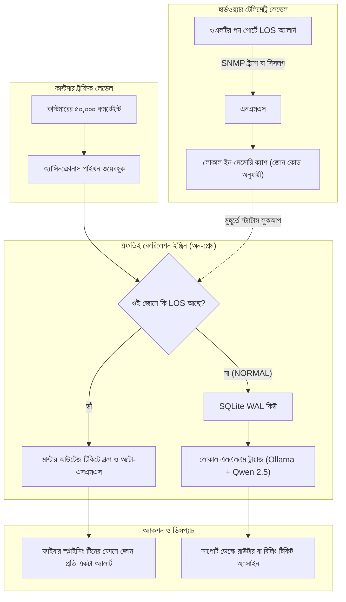
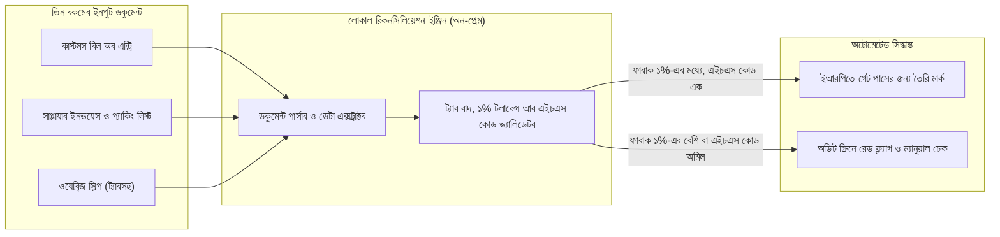

# চ্যাপ্টার ৪: ফিল্ড প্লেবুক ইন অ্যাকশন - হাই-স্টেক রিয়েল কেস স্টাডি

---

### ১. থিওরির বাইরে আসল গ্রাউন্ডের লড়াই

প্রথম তিন চ্যাপ্টারে আমি আপনার টুলবক্সটা সাজিয়ে দিয়েছি। চ্যাপ্টার ১-এ ছিল প্রথম আটচল্লিশ ঘণ্টা, ল্যাপটপ ব্যাগে রেখে শ্যাডো সেশনে বসা, আর কাগুজে এসওপির পেছনে আসল বটলনেক খুঁজে বের করা। চ্যাপ্টার ২-এ টেবিলের নিচের পুরনো পিসিতে, ক্লাউড আর জিপিইউ ছাড়াই, `Ollama` দিয়ে `Qwen 2.5` চালিয়েছি, আর `SQLite WAL` দিয়ে বানিয়েছি একটা হালকা টিকিট কিউ। চ্যাপ্টার ৩-এ ছিল বিশ মিনিটের ডোমেইন স্প্রিন্ট, গোল্ডেন টেস্ট সেটের ইভ্যালুয়েশন হারনেস, আর `GitHub Actions`-এর সেলফ-হিলিং রোলব্যাক পাইপলাইন।

এবার এই সবগুলো টুল একসাথে নিয়ে আসল গ্রাউন্ডে নামার পালা। গলায় ডেপ্লয়-কো ইনকের আইডি কার্ড, পিঠে ল্যাপটপের ব্যাগ।

ল্যাবের সংকট আর ফিল্ডের সংকট এক জিনিস নয়। ফিল্ডে বিপদ এলে একসাথে শত শত ফোন বাজবে, মনিটরে লাল অ্যালার্ম জ্বলবে, গেটের বাইরে ট্রাকের লম্বা লাইন লেগে যাবে, আর প্রতি ঘণ্টার দেরিতে ক্লায়েন্টকে গুনতে হবে বড় অঙ্কের খরচ। এই চ্যাপ্টারে আমরা বাংলাদেশের দুটো হাই-স্টেক ইন্ডাস্ট্রির আসল ময়দানে নামব। প্রথমটা ঢাকার একটা বড় ইন্টারনেট সার্ভিস প্রোভাইডারের (আইএসপি) বৃষ্টির দিনের টিকিট অটোমেশন। দ্বিতীয়টা চট্টগ্রাম বন্দরের কন্টেইনার খালাসের থ্রি-ওয়ে ইনভয়েস রিকনসিলিয়েশন। পাতার জায়গা কম বলে অন্য ইন্ডাস্ট্রির কেসগুলো আমি বইয়ের অনলাইন অংশে রেখে দিয়েছি।

একটা কথা আগেই বলে রাখি। এখানকার ক্লায়েন্ট, জোন কোড আর সংখ্যাগুলো বোঝানোর জন্য বানানো। সমস্যার ধরনটা কিন্তু বাস্তব।

প্রতিটা কেস স্টাডিতে আপনি শুধু পাইথন কোডটাই দেখবেন না। আগের তিন চ্যাপ্টারের কোন স্ট্রাটেজিটা কীভাবে জোড়া লেগে পুরো সিস্টেমটা দাঁড় করাচ্ছে, সেটাও ধাপে ধাপে খুলে বলব।

---

### ২. ট্র্যাক এ: ঢাকার বৃষ্টি, আইএসপির ক্যাওস ও স্মার্ট টিকিট ট্রায়াজ

প্রথমেই চলুন ঢাকার একটা ব্রডব্যান্ড আইএসপির হেড অফিসে। চ্যাপ্টার ১-এর নিয়মে আপনি গত দুই দিন ধরে কাস্টমার সাপোর্ট আর নেটওয়ার্ক অপারেশন সেন্টারে (এনওসি) স্টাফদের পাশে বসে আছেন। ল্যাপটপ ব্যাগে বন্ধ, হাতে শুধু একটা নোটপ্যাড।

একটা জিনিস আপনার চোখে পড়ল। সাপোর্ট ডেস্কের প্রতিটা স্টাফের সামনে দুটো মনিটর। প্রথমটায় কাস্টমারদের সাপোর্ট টিকিট, ইমেইল আর সোশ্যাল মিডিয়ার কমপ্লেইন্ট। দ্বিতীয়টায় এনওসির নেটওয়ার্ক মনিটরিং ড্যাশবোর্ড, যেখানে কাস্টমার এই মুহূর্তে অনলাইনে নাকি অফলাইনে, বর্তমান স্পিড কত, ওয়াই-ফাই রাউটারের ডেটা কী, সবই দেখা যায়। কোনো কাস্টমার মেসেজ দিলেন *"ভাই আমার নেট নাই"*। স্টাফ প্রথমে আইডি দেখে কাস্টমারের এলাকা বের করছেন, তারপর দ্বিতীয় মনিটরে খুঁজছেন ওই এলাকার মূল ফাইবারে কোনো গোলমাল আছে কি না। না বুঝলে ইন্টারকমে এনওসি ইঞ্জিনিয়ারকে ফোন: *"ভাই, ধানমন্ডি সাত নম্বরে কি কোনো ফাইবার ডাউন আছে?"*

আপনি নোটপ্যাডে লিখে রাখলেন - এই দুই স্ক্রিনের মাঝখানের ম্যানুয়াল চেকিংটাই আসল বটলনেক। সাধারণ দিনে কোনোমতে চলে যায়। কিন্তু বৃষ্টির দিনে কী ঘটবে?

তৃতীয় দিন বিকেলে নামল শ্রাবণের মুষলধারে বৃষ্টি। ধানমন্ডির সাত মসজিদ রোডে ওয়াসার খোঁড়াখুঁড়ির সময় শাবলের এক ধাক্কায় মাটির নিচের মেইন ফাইবার ক্যাবলটা ছিঁড়ে গেল। এক সেকেন্ডের মধ্যে ওই এলাকার দশ হাজার বাসার ইন্টারনেট বন্ধ।

পরের বিশ মিনিটে আইএসপির কল সেন্টারে হাটবাজার বসে গেল। ফোন একটানা বাজছে। ওয়েব পোর্টাল, অ্যাপ আর হোয়াটসঅ্যাপে প্রতি মিনিটে হাজার হাজার মেসেজ ঢুকছে। একটা বাসা থেকেই ফোন, অ্যাপ আর হোয়াটসঅ্যাপ মিলিয়ে গড়ে চার-পাঁচটা অভিযোগ আসছে, তাই সন্ধ্যা নাগাদ আনরিজলভড টিকিট পঞ্চাশ হাজারের কাছাকাছি। পনেরোজন স্টাফ স্ক্রিনের সামনে হিমশিম খাচ্ছেন। কোনটা রেখে কোনটা দেখবেন?

আসল ঝামেলা লাগে অন্য জায়গায়। কাস্টমারের লেখা মেসেজ পড়ে বোঝার কোনো উপায় নেই, প্রবলেমটা আসলে কোথায়। ধানমন্ডির একজন ইউজার লিখছেন, *"ভাই নেট চলে গেছে, আর্জেন্ট অফিস মিটিং আছে, তাড়াতাড়ি দেখেন।"* মিরপুরের আরেকজনও লিখছেন, *"নেট পাচ্ছি না, লাল বাতি জ্বলছে।"* অথচ ধানমন্ডির ইউজারের এলাকায় মেইন ফাইবার রাস্তায় কাটা পড়েছে, আর মিরপুরের ইউজারের বাসায় বাচ্চারা ধাক্কা দিয়ে রাউটারের প্যাচ কর্ড ঢিলে করে দিয়েছে!

দুই স্ক্রিনের ডেটা আলাদা, তাই সাপোর্ট স্টাফরা ফাইবার কাটা এলাকার কাস্টমারদেরও ফোন করে বলছেন, *"স্যার, রাউটারটা একটু রিস্টার্ট দিয়ে দেখেন তো!"* কাস্টমার রিস্টার্ট দিয়ে দেখলেন নেট আসছে না, তখন রেগে ফেটে পড়লেন। উল্টো দিকে যেখানে রিমোটলি রাউটার কনফিগার করলেই সমাধান হতো, সেখানে ভুল করে ফিল্ড টেকনিশিয়ানের ভ্যান পাঠানো হচ্ছে। ভীতিকর অবস্থা, তাই না?

!!! warning "নেটওয়ার্ক অপারেশনের প্রধান বটলনেক"
    আইএসপি বা টেলিকম সাপোর্টে সবচেয়ে বড় ক্যাওস তৈরি হয় যখন হার্ডওয়্যারের অ্যালার্ম আর কাস্টমারের কমপ্লেইন্ট টেক্সট দুটো আলাদা সিস্টেমে পড়ে থাকে। রাস্তায় মেইন ফাইবার কাটা পড়লে দশ হাজার বাসার জন্য পঞ্চাশ হাজার আলাদা টিকিট খুলে সাপোর্ট টিমকে বসিয়ে রাখা মানে পুরো অপারেশন অচল করে দেয়া।

---

### ৩. ট্র্যাক এ-এর সমাধান: হার্ডওয়্যার টেলিমেট্রি আর কাস্টমার টেক্সটের অটো-কোরিলেশন

একজন এফডিই এই সংকট মেটাতে আরও বিশজন নতুন স্টাফ নিতে বলবেন না। তিনি ওই দুই মনিটরের মাঝখানে একটা অটোমেটেড ব্রিজ বানাবেন।

নতুন যাঁরা নেটওয়ার্ক অটোমেশন নিয়ে কাজ করছেন, তাঁদের জন্য আগে তিনটা চেনা টেকনিক্যাল শব্দ সহজ বাংলায় বুঝে নিই:

* **ওএলটি (OLT - Optical Line Terminal):** আইএসপির পপ (POP) অফিসে বসানো মূল যন্ত্র। এখান থেকে ফাইবার ক্যাবল বেরিয়ে মহল্লার বাসায় বাসায় যায়। ওএলটির একেকটা পন পোর্ট (PON port) থেকে একটা ফাইবার বেরোয়, আর সেটা স্প্লিটারে ভাগ হয়ে অনেকগুলো বাসায় পৌঁছায়।
* **ওএনইউ (ONU - Optical Network Unit):** বাসার দেয়ালে বসানো ছোট ফাইবার বক্স। কোথাও কোথাও একে ওএনটি (ONT) বলে। আপনার ওয়াই-ফাই রাউটার এর পেছনেই লাগানো থাকে।
* **এলওএস অ্যালার্ম (LOS - Loss of Signal):** ওএলটি কোনো ওএনইউ থেকে আলোর সংকেত না পেলে সেই ওএনইউর জন্য `LOS` অ্যালার্ম দেয়।

এই তিনটা জানলেই পুরো লজিকটা পানির মতো পরিষ্কার। একটা পন পোর্টের নিচের অনেকগুলো ওএনইউ যদি একসাথে `LOS`-এ যায়, তাহলে সমস্যা মেইন ফাইবারে, ঠিক ধানমন্ডির মতো। আর শুধু একটা ওএনইউ `LOS`-এ গেলে সমস্যা ওই একটা বাসার ড্রপ ক্যাবলে বা বাসার পাওয়ারে। এনএমএস (নেটওয়ার্ক ম্যানেজমেন্ট সিস্টেম) সাধারণত এই 'একসাথে অনেকগুলো' ব্যাপারটাই পন পোর্ট লেভেলের একটা অ্যালার্ম হিসেবে দেখিয়ে দেয়। যদি না দেয়, তাহলে আপনার ওয়ার্কারকে একটা থ্রেশহোল্ড বেঁধে দিতে হবে, আর সেই সংখ্যাটা আপনি জেনে নেবেন ক্লায়েন্টের এনওসি ইঞ্জিনিয়ারের কাছ থেকে। আন্দাজে বসাবেন না।

চ্যাপ্টার ৩-এর স্ট্রাটেজিতে আপনি এনওসি ইঞ্জিনিয়ারের পাশে বিশ মিনিটের একটা ডোমেইন স্প্রিন্টে বসলেন। জিজ্ঞেস করলেন, *"ভাই, ওএলটির এই `LOS` অ্যালার্ম কি কোথাও লগে বা এপিআইতে পাওয়া যায়?"* ইঞ্জিনিয়ার দেখালেন, ওএলটির অ্যালার্ম `SNMP` ট্র্যাপ আর সিসলগ হয়ে এনএমএসে আসছে, আর ইনভেন্টরি শিটে প্রতিটা পন পোর্টের পাশে জোন কোড লেখা আছে, যেমন `DHK-DHN-07`।

ব্যস, আপনার আর্কিটেকচার রেডি। আপনি এমন একটা পাইথন ওয়ার্কার ডিজাইন করলেন, যা চারটা ধাপে কাজ করবে:

১. কাস্টমারের কমপ্লেইন্ট ওয়েবহুকে (`Webhook`) ঢোকামাত্র ওয়ার্কার কাস্টমারের আইডি থেকে জোন কোড বের করবে, আর মেমোরির ক্যাশে ওই জোনের লাইভ স্ট্যাটাস দেখবে।
২. জোনে `LOS` থাকলে টিকিটটা এলএলএমের কাছে যাবেই না। সিস্টেম সাথে সাথে সেটাকে ওই জোনের একটা **মাস্টার আউটেজ টিকিটের** নিচে গ্রুপ করে ফেলবে। ফাইবার স্প্লাইসিং টিমের ফোনে অ্যালার্ট যাবে জোন প্রতি একবার, প্রতিটা টিকিটের জন্য আলাদা করে নয়।
৩. কাস্টমারের ফোনে অটোমেটেড বাংলা এসএমএস চলে যাবে: *"আপনার এলাকায় মেইন ফাইবার মেরামতের কাজ চলছে। আনুমানিক ৪৫ মিনিটের মধ্যে সংযোগ স্বাভাবিক হবে।"* সময়টা আসবে ফিল্ড টিমের দেয়া আনুমানিক হিসাব থেকে। তাঁরা না দিলে সংখ্যা বসাবেন না, শুধু লিখবেন "মেরামতের কাজ চলছে"।
৪. জোন `NORMAL` থাকলে মেসেজটা ঢুকবে চ্যাপ্টার ২-এর `SQLite WAL` কিউয়ে। সেখান থেকে `Ollama`-তে চলা `qwen2.5:1.5b` ঠিক আগের মতো `JSON` ট্রায়াজ করবে। শুধু ক্যাটাগরির লেবেল হবে `ROUTER|BILLING|OTHER`, যাতে বোঝা যায় এটা রাউটার কনফিগারেশনের সমস্যা নাকি বিলিংয়ের।

এখানে একটা হিসাব দরকার, নইলে শর্টকাটটার আসল দাম বোঝা যাবে না। চ্যাপ্টার ২-এর পুরনো পিসিতে `qwen2.5:1.5b` একটা মেসেজ বুঝতে ১ থেকে ২ সেকেন্ড নিচ্ছে, আর সিপিইউতে মডেল চলছে একটা একটা করে। পঞ্চাশ হাজার টিকিট সবই এলএলএমে পাঠালে লাগবে প্রায় ১৪ থেকে ২৮ ঘণ্টা। ওই বৃষ্টির সন্ধ্যায় আপনি পঁয়তাল্লিশ হাজার টিকিট ফাইবার কাটার জোন থেকেই আলাদা করে ফেললে এলএলএমের সামনে থাকবে মাত্র পাঁচ হাজার। সেটা দেড় থেকে পৌনে তিন ঘণ্টার কাজ। এই হিসাবটাই আসলে প্রজেক্টের প্রাণ।

ছোট মডেল বাংলা মেসেজে মাঝে মাঝে ভুল করবে, এটা মেনে নিয়েই নকশা করতে হবে। তাই লাইভে যাওয়ার আগে চ্যাপ্টার ৩-এর নিয়মে ক্লায়েন্টের পুরনো লগ থেকে বিশ-তিরিশটা রিয়েল ওয়ার্ল্ড বাংলা মেসেজ নিয়ে একটা গোল্ডেন টেস্ট সেট বানিয়ে নিন। ক্যাটাগরি অ্যাকুরেসি ৯০% আর স্কিমা ভ্যালিডিটি ১০০% না এলে ডেপ্লয় নয়। যে মেসেজ মডেল বুঝতে পারছে না, সেটা সোজা `L1` সাপোর্ট ডেস্কে চলে যাবে। আর ওয়ার্কারটা ডেপ্লয় হবে চ্যাপ্টার ৩-এর `GitHub Actions` পাইপলাইনে, `/healthz` ফেইল করলে অটোমেটিক রোলব্যাক। শুধু একটা অনুরোধ, বৃষ্টির আগের রাতে নতুন ভার্সন ডেপ্লয় করবেন না!

একটা বাসার ওএনইউ আলাদাভাবে `LOS`-এ থাকলে টিকিটটা সরাসরি ফিল্ড টেকনিশিয়ানের কাছে যাওয়ার কথা। সেটা পরের ভার্সনের কাজ, কারণ তার জন্য জোন লেভেলের সাথে কাস্টমার লেভেলের একটা স্ট্যাটাস টেবিলও লাগবে।

নিচের ডায়াগ্রামে পুরো আর্কিটেকচারটা দেখুন:



---

### ৪. হ্যান্ডস-অন কোড প্রুফ: অ্যাসিনক্রোনাস টিকিট রাউটিং ওয়ার্কার

বৃষ্টির দিনে একসাথে হাজার হাজার রিকোয়েস্ট এলে সাধারণ সিনক্রোনাস (Synchronous) পাইথন কোড সিস্টেম ঝুলিয়ে দেবে। কারণ প্রথম কাস্টমারকে এসএমএস পাঠানোর নেটওয়ার্ক কলের উত্তর না আসা পর্যন্ত পরের কাস্টমারের টিকিট 'কিউ'য়ে দাঁড়িয়ে থাকবে। এর সমাধান পাইথনের **`asyncio` (অ্যাসিনক্রোনাস প্রোগ্রামিং)**। ধরুন রেস্তোরাঁর একজন স্মার্ট ওয়েটার, যিনি এক টেবিলের অর্ডার কিচেনে দিয়ে দাঁড়িয়ে থাকেন না, সাথে সাথে পাশের টেবিলের অর্ডার নিতে চলে যান।

তবে একটা কথা পরিষ্কার করে নিই। `asyncio` বাঁচায় অপেক্ষার সময়, যেমন এসএমএস গেটওয়ের উত্তরের অপেক্ষা। এলএলএম চলে সিপিইউতে, সেখানে `asyncio` কোনো জাদু দেখাবে না। এই কারণেই এলএলএমের কাজটা আমি আলাদা `SQLite WAL` কিউয়ে সরিয়ে দিয়েছি।

#### কোড-স্যান্ডউইচ মেথড

**১. কাস্টমারের সংকট:** ফাইবার কাটার দিনে একসাথে আসা হাজার হাজার টিকিট হার্ডওয়্যার অ্যালার্মের সাথে মিলিয়ে মুহূর্তে আলাদা করতে হবে। ফাইবার কাটা জোনের টিকিটগুলো অটোমেটিক গ্রুপ হয়ে যাবে, ফিল্ড টিমের কাছে জোন প্রতি একটাই অ্যালার্ট যাবে, আর বাকি টিকিট চলে যাবে এলএলএম ট্রায়াজের লাইনে।

**২. মূল কোড:** নিচের কুড়ি লাইনের মতো অ্যাসিনক্রোনাস পাইথন স্ক্রিপ্টটা জোনের লাইভ স্ট্যাটাসের সাথে টিকিট মিলিয়ে একসাথে অনেকগুলো টিকিট কনকারেন্টলি রাউট করবে:

```python
# FDE Field Engine: Async ISP Ticket Correlation & Routing Worker
import asyncio

ZONE_STATUS = {"DHK-DHN-07": {"status": "LOS", "eta_min": 45},   # এনএমএস থেকে আসা ক্যাশ
               "DHK-MIR-02": {"status": "NORMAL", "eta_min": 0}}
ALERTED_ZONES = set()  # যেসব জোনের অ্যালার্ট ফিল্ড টিমের কাছে চলে গেছে

async def route_ticket(t: dict) -> dict:
    info = ZONE_STATUS.get(t["zone"], {"status": "NORMAL"})
    await asyncio.sleep(0.05)  # এসএমএস গেটওয়ে বা কিউয়ে লেখার নন-ব্লকিং কলের সিমুলেশন
    if info["status"] != "LOS":
        return {"id": t["id"], "action": "QUEUE_FOR_LLM_TRIAGE", "dispatch": "SQLITE_QUEUE"}
    first = t["zone"] not in ALERTED_ZONES  # চেক আর অ্যাডের মাঝে কোনো await নেই
    ALERTED_ZONES.add(t["zone"])
    sms = f"ফাইবার মেরামতের কাজ চলছে। আনুমানিক {info['eta_min']} মিনিট।"
    return {"id": t["id"], "action": "GROUP_UNDER_MASTER_OUTAGE", "sms": sms,
            "dispatch": "FIELD_FIBER_TEAM" if first else "ALREADY_DISPATCHED"}

async def main():
    burst = [{"id": 101, "zone": "DHK-DHN-07"}, {"id": 102, "zone": "DHK-MIR-02"},
             {"id": 103, "zone": "DHK-DHN-07"}]
    for r in await asyncio.gather(*(route_ticket(t) for t in burst)):
        print(f"Ticket #{r['id']}: {r['action']} -> {r['dispatch']}")

asyncio.run(main())
```

**৩. সিস্টেমের ইমপ্যাক্ট ও কোডের মানে কী:** কোডটা রান করলে স্ক্রিনে সাথে সাথে দেখবেন:

```text
Ticket #101: GROUP_UNDER_MASTER_OUTAGE -> FIELD_FIBER_TEAM
Ticket #102: QUEUE_FOR_LLM_TRIAGE -> SQLITE_QUEUE
Ticket #103: GROUP_UNDER_MASTER_OUTAGE -> ALREADY_DISPATCHED
```

আর্কিটেকচারের দুটো স্ট্রাটেজি খেয়াল করুন। প্রথমটা এআই বাঁচানো। আমি প্রতিটা টিকিট চোখ বন্ধ করে এলএলএমের কাছে পাঠাইনি। আগে একটা সাধারণ ডিকশনারি লুকআপ (`ZONE_STATUS.get`) দিয়ে মুহূর্তে দেখে নিয়েছি, ওই জোনে ফাইবার কাটা কি না। কাটা থাকলে এলএলএম চালিয়ে সিপিইউ খরচ করার কোনো দরকারই নেই। জোন `NORMAL` হলে তবেই টিকিট কিউয়ে ঢুকছে। ক্যাশটা সাধারণ ডিকশনারি বলে চ্যাপ্টার ২-এর মতোই এখানেও রেডিস বা কাফকা লাগছে না, জিরো-মেইনটেন্যান্স।

দ্বিতীয়টা `asyncio.gather`। এটা সবগুলো টিকিটকে একসাথে ইভেন্ট লুপে তুলে দেয়। একটা টিকিটের এসএমএসের জন্য ৫০ মিলিসেকেন্ড অপেক্ষার ফাঁকে বাকি টিকিটগুলোর স্ট্যাটাস চেক হয়ে যাচ্ছে। এটা কনকারেন্সি, প্যারালেলিজম নয়। ইভেন্ট লুপ একটা থ্রেডেই চলছে, তাই `ALERTED_ZONES`-এ চেক আর অ্যাড করার মাঝখানে কোনো `await` নেই বলে একই জোনের দুটো টিকিট একসাথে "আমিই প্রথম" ভাবতে পারবে না। এ কারণেই #103 টিকিটের জন্য ফিল্ড টিমের কাছে দ্বিতীয় অ্যালার্ট যায়নি।

প্রোডাকশনে যাওয়ার আগে তিনটা জিনিস বদলে নেবেন। এক, এসএমএস গেটওয়েতে সবগুলো কল একসাথে ছেড়ে দেবেন না। `asyncio.Semaphore` দিয়ে একসাথে চলা কলের সংখ্যা বেঁধে দেবেন, গেটওয়ের রেট লিমিট জেনে নিয়ে। দুই, ক্যাশের প্রতিটা এন্ট্রির সাথে আপডেটের সময় রাখবেন। এনএমএসের ফিড থেমে গিয়ে ক্যাশ পুরনো হয়ে গেলে ভুল ইনফো পাঠানোর চেয়ে টিকিটকে সাধারণ ট্রায়াজ লাইনে ফেলে দেয়া নিরাপদ। তিন, ক্যাশ মেমোরিতে থাকে বলে ওয়ার্কার রিস্টার্ট দিলে সেটা খালি হয়ে যায়। চালু হওয়ার সময় একবার এনএমএস থেকে পুরো স্ট্যাটাস টেনে নেবেন।

এই কোডটা বসানোর পর পরের বার বৃষ্টি নামলে সাপোর্ট সেন্টারের দৃশ্যটা অনেকটা বদলে যাবে। ফাইবার কাটার সাথে সাথে ওই জোনের প্রতিটা কাস্টমারের ফোনে বাংলায় এসএমএস যাবে, আর ফোনের চাপ অনেকটাই কমে আসবে। কতটা কমল, সেটা আন্দাজে বলবেন না। চ্যাপ্টার ১-এর নিয়মে একটা মাপার মতো সাকসেস মেট্রিক ঠিক করে নিন, যেমন বৃষ্টির দিনে ঘণ্টায় আসা কলের সংখ্যা। সাপোর্ট স্টাফরা তখন ঠান্ডা মাথায় রাউটারের আসল সমস্যাগুলো সামলাতে পারবেন। রাউটারে রিমোট লগইন করে নিজে নিজে সমস্যা মেটানো এজেন্টের গল্প না হয় আরেক দিন বলব।

**৪. গিটহাব রেফারেন্স:** আইএসপি রাউটিং ওয়ার্কার (`worker.py`) ও টেস্ট স্ক্রিপ্ট পাবেন বইয়ের অফিশিয়াল কমপ্যানিয়ন রিপোজিটরিতে: [https://github.com/raqueeb/fdebook_companion](https://github.com/raqueeb/fdebook_companion)।

---

### ৫. ট্র্যাক বি: চট্টগ্রাম বন্দরের কন্টেইনার জট ও ইনভয়েস রিকনসিলিয়েশন

এবার ঢাকার কল সেন্টার ছেড়ে চলুন দেশের অর্থনীতির সবচেয়ে ব্যস্ত জায়গায় - চট্টগ্রাম বন্দরে।

চারদিকে কড়া রোদ আর ধুলোবালি। বিশ চাকার লম্বা ট্রেইলারের হর্ন বাজছে। ইয়ার্ডে হাজার হাজার কন্টেইনারের স্তূপ। জাহাজে আসা একটা কন্টেইনার ক্লিয়ার করে কারখানার ট্রাকে তোলার আগে সিঅ্যান্ডএফ (C&F) এজেন্ট আর অডিট স্টাফদের তিনটা আলাদা কাগজের হিসাব মেলাতে হচ্ছে। সাপ্লাই চেইনের ভাষায় একে বলে **থ্রি-ওয়ে রিকনসিলিয়েশন (Three-Way Reconciliation)**:

১. **কাস্টমস বিল অব এন্ট্রি (Bill of Entry):** সিঅ্যান্ডএফ এজেন্ট কাস্টমসের অটোমেটেড সিস্টেমে (যেমন অ্যাসিকুডা ওয়ার্ল্ড) যে ঘোষণাপত্র জমা দেন। এখানে পণ্যের ঘোষিত মোট ওজন (Gross Weight), দাম আর এইচএস কোড লেখা থাকে।
২. **সাপ্লায়ারের কমার্শিয়াল ইনভয়েস ও প্যাকিং লিস্ট:** বিদেশি রপ্তানিকারকের পাঠানো বিল আর প্যাকিংয়ের হিসাব। ইনভয়েসে দাম আর পণ্যের বিবরণ থাকে, প্যাকিং লিস্টে থাকে নিট ওজন (Net Weight) আর প্যাকিংয়ের ওজন। এইচএস কোড (HS Code - পণ্যের আন্তর্জাতিক শ্রেণি নম্বর, যার ওপর শুল্কের হার নির্ভর করে) থাকে ইনভয়েসে বা প্যাকিং লিস্টে।
৩. **ওয়েব্রিজ স্লিপ (Weighbridge Slip):** বন্দরের গেটে ডিজিটাল ওয়েব্রিজে, মানে ট্রাক মাপার বিশাল স্কেলে, মাপা ওজনের স্লিপ।

তৃতীয় কাগজটায় একটা ফাঁদ আছে। স্কেলে ওঠে ট্রাক আর কন্টেইনারসহ পুরো গাড়ি, শুধু মাল নয়। তাই ট্যার (Tare - ট্রাক আর খালি কন্টেইনারের নিজের ওজন) বাদ না দিলে ওজন কোনোদিনই মিলবে না।

এবার আসল প্রবলেমটা কোথায় বাধে, একটা কল্পিত কিন্তু বাস্তবসম্মত হিসাব দিয়ে দেখুন। কাস্টমসের বিল অব এন্ট্রিতে চালানের ঘোষিত মোট ওজন **২৫,০০০ কেজি**। সাপ্লায়ারের কাগজে নিট ওজন ২৪,৭৫০ কেজি আর কাঠের প্যালেট ও প্যাকিংয়ের ওজন ২৫০ কেজি, মোট ২৫,০০০ কেজি। কিন্তু ট্রাকসহ কন্টেইনার যখন বন্দরের ওয়েব্রিজে উঠল, স্লিপে এল ৪০,০৭৫ কেজি। ট্যার ১৫,০০০ কেজি বাদ দিলে মালের ওজন দাঁড়ায় **২৫,০৭৫ কেজি**।

৭৫ কেজির এই ফারাক দেখেই প্রথাগত সফটওয়্যার বা জুনিয়র অডিট ক্লার্ক ফাইলটা আটকে দেন। ফাইল হাতে স্টাফরা এক টেবিল থেকে আরেক টেবিলে দৌড়াচ্ছেন। ওদিকে হেড ক্লার্ক সাহেব চশমা নাকের ডগায় নামিয়ে ক্যালকুলেটরে একটা একটা করে প্যাকিং লিস্ট আর এইচএস কোড মেলাতে বসেছেন। এভাবে ফাইল ক্লিয়ার হতে তিন-চার দিন পার হয়ে যাচ্ছে। আর কন্টেইনার ফ্রি টাইমের পরেও ইয়ার্ডে পড়ে থাকা মানেই আমদানিকারকের ঘাড়ে ডেমারেজ আর স্টোরেজ চার্জ, প্রতিদিন বাড়তে থাকা বিল।

!!! info "সাপ্লাই চেইনের আসল বটলনেক: কাগুজে অমিল"
    বন্দরে বা বড় ফ্যাক্টরিতে কন্টেইনার আটকে থাকে সফটওয়্যারের অভাবে নয়। আটকে থাকে তিনটা আলাদা ফরম্যাটের কাগজের (বিল অব এন্ট্রি, সাপ্লায়ারের কাগজ ও ওয়েব্রিজ স্লিপ) ছোটখাটো ওজনের ফারাক সিস্টেম নিজে থেকে বিচার করতে পারে না বলে।

---

### ৬. ট্র্যাক বি-এর সমাধান: টলারেন্স রুলস ও লোকাল থ্রি-ওয়ে রিকনসিলার

আপনি সিঅ্যান্ডএফ এজেন্টের অফিসে গিয়ে চ্যাপ্টার ১ ও চ্যাপ্টার ৩-এর নিয়মে হেড ক্লার্ক সাহেবের পাশে বসলেন। বিশ মিনিটের ডোমেইন স্প্রিন্টে তাঁকে সোজা একটা প্রশ্ন করলেন, *"চাচা, কাস্টমসের কাগজে ২৫,০০০ কেজি লেখা থাকলে ওয়েব্রিজে কত কেজি পর্যন্ত এদিক-সেদিক হলে আপনারা সেটাকে স্বাভাবিক বলে ছেড়ে দেন?"*

হেড ক্লার্ক সাহেব হেসে বললেন, *"বাবা, সমুদ্রের বাতাসে কাঠের প্যালেট ভিজে একটু ভারী হয়, আবার দুটো স্কেলের মাপেও সামান্য তফাত থাকে। আমরা ওয়েব্রিজের ওজন ধরি ট্রাক আর কন্টেইনারের ট্যার বাদ দিয়ে। তারপর ১% পর্যন্ত কম-বেশি হলে আর দুই কাগজে এইচএস কোড এক থাকলে ওটাকে স্বাভাবিক ধরে ফাইল এগিয়ে দিই। কিন্তু এইচএস কোড এক চুলও অমিল হলে, কিংবা ওজন ১%-এর বেশি এদিক-সেদিক হলে ফাইলটা আলাদা করে রাখি। ওটা কাস্টমসের ফিজিক্যাল ইনস্পেকশনে যেতে পারে। দেখো, এটা আমাদের অফিসের নিয়ম, কোনো আইনের বই থেকে বলছি না।"*

দেখুন, এই **"১% টলারেন্স (Tolerance) আর এইচএস কোড ম্যাচিং"**-এর নিয়মটা কোনো প্রোগ্রামিং বইয়ে লেখা নেই। কিন্তু হেড ক্লার্কের মুখের এই কয়েকটা কথাই আপনার অটোমেশনের চাবিকাঠি। আর ওই শেষ বাক্যটাও খেয়াল করুন, ওটাই পরের বক্সের কথা।

!!! warning "ছাড়ের হিসাবটা ক্লায়েন্টের নিয়ম, আপনার নয়"
    এই ১% এখানে একজন হেড ক্লার্কের অফিসের নিয়ম। আরেক ক্লায়েন্টে সেটা ০.৫% হতে পারে, কিংবা পণ্যভেদে আলাদা। ডোমেইন স্প্রিন্টে সংখ্যাটা না জেনে কোডে বসাবেন না। আর গেট পাস দেয় বন্দর কর্তৃপক্ষ আর কাস্টমস, আপনার সিস্টেম নয়। আপনার সিস্টেমের কাজ ফাইলটা আগেভাগে যাচাই করে সিঅ্যান্ডএফ টিমকে বলে দেয়া, কোনটা এগোতে পারে আর কোনটা আটকাতে হবে।

আপনি চ্যাপ্টার ২-এর মতো ক্লায়েন্টের লোকাল সার্ভারেই তিন ধাপের একটা পাইপলাইন বসালেন:

১. **ডকুমেন্ট এক্সট্রাকশন:** ডিজিটাল পিডিএফ বা এক্সেল থেকে ওজন, ট্যার আর এইচএস কোড ডিকশনারিতে তুলে আনা। কাগজ স্ক্যান করা হলে আগে ওসিআর (`Tesseract`) লাগবে। সংখ্যা তোলার কাজটা করবে ডিটারমিনিস্টিক পার্সার, এলএলএম নয়। ওজনের মতো সংখ্যায় হ্যালুসিনেশনের ঝুঁকি নেয়া যায় না। কাগজের ফরম্যাট খুব এলোমেলো হলে এলএলএম শুধু বুঝতে সাহায্য করতে পারে কোন ঘরে কী লেখা, আর তার তোলা প্রতিটা সংখ্যা ভ্যালিডেটরে যাচাই হবে।
২. **টলারেন্স ভ্যালিডেটর:** ট্যার বাদ দিয়ে ওয়েব্রিজের ওজন বের করা, তারপর হেড ক্লার্কের বলা ১% ছাড় আর এইচএস কোডের মিল পরীক্ষা করা।
৩. **ইআরপিতে মার্ক বা রেড-ফ্ল্যাগ:** শর্ত মিললে ইআরপিতে ফাইলটা `READY_FOR_GATE_PASS` হয়ে যাবে, মানে সিঅ্যান্ডএফ টিমের দিক থেকে ফাইল জমার জন্য তৈরি। ওজনের ফারাক ১%-এর বেশি হলে কিংবা এইচএস কোড না মিললে সিস্টেম সাথে সাথে `FLAGGED` করে ক্লার্কের স্ক্রিনে ঠিক কোন লাইনে গরমিল, তা লাল রঙে দেখিয়ে দেবে।

নিচের ডায়াগ্রামে পুরো ফ্লোটা দেখুন:



---

### ৭. হ্যান্ডস-অন কোড প্রুফ: থ্রি-ওয়ে পোর্ট ডকুমেন্ট রিকনসিলার

#### কোড-স্যান্ডউইচ মেথড

**১. আসল সংকট:** বিল অব এন্ট্রি, সাপ্লায়ারের কাগজ আর ওয়েব্রিজ স্লিপের ওজন ও এইচএস কোড ম্যানুয়ালি মেলাতে গিয়ে কন্টেইনার বন্দরে আটকে থাকছে, আর প্রতিদিন ডেমারেজ আর স্টোরেজ চার্জ বাড়ছে।

**২. মূল কোড:** নিচের পাইথন স্ক্রিপ্টটা তিনটা কাগজের ডেটা নিয়ে ট্যার বাদ দেবে, ১% টলারেন্স আর এইচএস কোড যাচাই করবে, তারপর মুহূর্তের মধ্যে `READY_FOR_GATE_PASS` বা `FLAGGED` সিদ্ধান্ত দেবে:

```python
# FDE Field Engine: Three-Way Port Document Reconciler
TOLERANCE_PCT = 1  # হেড ক্লার্কের মুখে শোনা নিয়ম, ক্লায়েন্ট ভেদে বদলাবে

def hs6(code: str) -> str:
    return code.replace(".", "")[:6]  # আন্তর্জাতিক এইচএস কোডের প্রথম ছয় ডিজিট

def reconcile(customs: dict, invoice: dict, slip: dict) -> dict:
    declared = customs["gross_kg"]                       # বিল অব এন্ট্রির ঘোষিত ওজন
    invoiced = invoice["net_kg"] + invoice["packing_kg"]  # নিট + প্যাকিং ওজন
    weighed = slip["scale_kg"] - slip["tare_kg"]          # ট্রাক আর খালি কন্টেইনারের ওজন বাদ

    def within(kg):  # পূর্ণসংখ্যার হিসাব, তাই ফ্লোটিং পয়েন্টের গোলমাল নেই
        return abs(kg - declared) * 100 <= declared * TOLERANCE_PCT

    hs_ok = hs6(customs["hs_code"]) == hs6(invoice["hs_code"])
    ok = within(weighed) and within(invoiced) and hs_ok
    return {"status": "READY_FOR_GATE_PASS" if ok else "FLAGGED",
            "variance_kg": weighed - declared, "hs_match": hs_ok}

customs_doc = {"gross_kg": 25000, "hs_code": "8471.30"}
invoice_doc = {"net_kg": 24750, "packing_kg": 250, "hs_code": "8471.30"}
print(reconcile(customs_doc, invoice_doc, {"scale_kg": 40075, "tare_kg": 15000}))
print(reconcile(customs_doc, invoice_doc, {"scale_kg": 40400, "tare_kg": 15000}))
```

**৩. সিস্টেমের ইমপ্যাক্ট ও কোডের মানে কী:** কোডটা রান করলে আউটপুটে আসবে:

```text
{'status': 'READY_FOR_GATE_PASS', 'variance_kg': 75, 'hs_match': True}
{'status': 'FLAGGED', 'variance_kg': 400, 'hs_match': True}
```

কোডের লজিকটা খেয়াল করুন। হেডকোয়ার্টারে বসে কোনো ডেভেলপার যদি ডোমেইন স্প্রিন্ট ছাড়া এই কোড লিখতেন, তিনি নির্ঘাত লিখতেন `if weighed == declared`। আর ওজন মেলাতে গিয়ে ট্রাকের ওজনটাও ধরে ফেলতেন। তখন প্রতিটা বৈধ কন্টেইনারই আটকে যেত। একজন এফডিই অন-গ্রাউন্ডে বসে ডোমেইন এক্সপার্টের ধারণাটা ঠিকমতো বুঝেছেন বলেই কোডে এসেছে ট্যার বাদ দেয়ার লাইন আর ১% ছাড়। ২৫,০০০ কেজির ১% মানে ২৫০ কেজি। ফারাক ৭৫ কেজি, সীমার ভেতরে, আর এইচএস কোডও (`8471.30`) দুই কাগজে মিলে গেছে। তাই প্রথম চালানটা `READY_FOR_GATE_PASS`। দ্বিতীয়টায় ফারাক ৪০০ কেজি, সীমার বাইরে, তাই সোজা `FLAGGED` হয়ে হেড ক্লার্কের মনিটরে চলে গেল। কেউ ট্যাক্স ফাঁকি দেয়ার জন্য ইনভয়েসে অন্য এইচএস কোড বসালেও একই পথে যেত।

দুটো ছোট খুঁটিনাটি। এক, `hs6` ফাংশনটা এইচএস কোডের ডট সরিয়ে প্রথম ছয় ডিজিট মেলায়। কারণ আন্তর্জাতিক এইচএস কোড ছয় ডিজিটের, আর দেশ নিজের শুল্ক তালিকার জন্য এর পরে আরও ডিজিট জোড়ে। তাই বিল অব এন্ট্রিতে কোড লম্বা আর ইনভয়েসে ছোট থাকতেই পারে। আপনার ক্লায়েন্টের কাগজে ঠিক কোন ফরম্যাট আছে, সেটা ডোমেইন স্প্রিন্টে দেখে নিন। দুই, ওজনের হিসাবটা আমি পূর্ণসংখ্যায় করেছি (`abs(kg - declared) * 100 <= declared * TOLERANCE_PCT`)। তাই ঠিক সীমার ওপর পড়া সংখ্যায় কোনো গোলমাল হবে না। চ্যাপ্টার ৩-এর টেস্ট-ফার্স্ট গার্ডরেইলের নিয়মে এখানে দুটো `assert` লিখে ফেলুন: ফারাক ঠিক ২৫০ কেজি হলে `READY_FOR_GATE_PASS`, ২৫১ কেজি হলে `FLAGGED`। সীমার ওপর টেস্ট না থাকলে ছাড়ের হিসাবটা কেউ ভরসা করবে না।

এই স্ক্রিপ্ট চালু হওয়ার পর বেশিরভাগ সাধারণ চালান ছাড়ের ভেতরেই থাকার কথা, আর হেড ক্লার্ক সাহেব তাঁর সময়টা দেবেন শুধু সন্দেহজনক ফাইলগুলোর পেছনে। কত শতাংশ চালান অটো-পাস হচ্ছে, সেটা কিন্তু আন্দাজে বলবেন না। প্রথম মাসের লগ থেকে মেপে নিন। ডেমারেজ কতটা কমল, সেই সংখ্যাও ক্লায়েন্টের ফাইন্যান্স টিমের খাতা থেকে আসবে, আপনার কোড থেকে নয়।

**৪. গিটহাব রেফারেন্স:** সম্পূর্ণ সাপ্লাই চেইন রিকনসিলার স্ক্রিপ্ট (`audit.py`) পাবেন বইয়ের অফিশিয়াল কমপ্যানিয়ন রিপোজিটরিতে: [https://github.com/raqueeb/fdebook_companion](https://github.com/raqueeb/fdebook_companion)।

---

### ৮. ফিল্ড পলিটিক্স: কোড নিখুঁত, তবু যখন প্রজেক্ট আটকে যায়

দুটো কেস স্টাডির টেকনিক্যাল সমাধান তো দেখলেন। এবার ফিল্ড ইঞ্জিনিয়ারিংয়ের এমন একটা গোপন বাস্তবতার কথা বলি, যা কোনো কম্পিউটার সায়েন্সের সিলেবাসে পড়ানো হয় না।

আপনার পাইথন কোড দুর্দান্ত চলছে, ডায়াগ্রাম নিখুঁত, প্রতিটা টেস্ট গ্রিন। তবু হঠাৎ দেখবেন ক্লায়েন্টের অফিসের একজন মিড-লেভেল ম্যানেজার আপনার কাজে পদে পদে বাধা দিচ্ছেন। আপনি ডেটা চাইলে তিনি তিন দিন ঘোরাচ্ছেন। মিটিংয়ে উল্টোপাল্টা অজুহাত তুলছেন। স্টাফদের আড়ালে বলছেন নতুন সিস্টেমে কাজ না করতে। কেন তিনি এমন করছেন? কোডে বাগ আছে বলে?

মোটেই না। কারণটা পুরোপুরি মনস্তাত্ত্বিক। আমি আপনাকে সাইকোলজি পড়তে বলছি না। তবে ভবিষ্যতের অটোমেটেড ওয়ার্ল্ডে মানুষ কীভাবে চিন্তা করে, আর তাদের মনের ভেতরে ঢোকার স্ট্রাটেজি কী, সেটা আমাদের জানতেই হবে।

একটু ঠান্ডা মাথায় মানুষটার জায়গায় দাঁড়ান। ওই ম্যানেজার হয়তো গত দশ বছর ধরে বন্দরের ফাইল বা গোডাউনের লেজার খাতার ওপর একচ্ছত্র আধিপত্য চালিয়েছেন। কোন ট্রাক আগে ছাড়বে, কোন ফাইল কোথায় আটকে আছে, এই তথ্যগুলো এতদিন শুধু তাঁর মাথায় আর ড্রয়ারের ফাইলে ছিল। অফিসে তাঁর গুরুত্ব আর ক্ষমতার উৎসই ছিল এই তথ্যের একচেটিয়া নিয়ন্ত্রণ। এখন আপনি এসে সব তথ্য এক ক্লিকে স্বচ্ছ ড্যাশবোর্ডে তুলে দিলেন। তাঁর মনে প্রচণ্ড একটা ফিয়ার ঢুকে গেল। তিনি ভাবছেন, *"সব যদি অটোমেটিক হয়ে যায়, তাহলে এমডি সাহেবের কাছে আমার আর দাম থাকবে কী?"* এটা ওনাদের অবস্থান থেকে একটু চিন্তা করুন; মোটেই সুখকর নয়।

এই ফিয়ার থেকেই জন্ম নেয় নীরব অসহযোগিতা। আনাড়ি ইঞ্জিনিয়াররা এই পরিস্থিতিতে ম্যানেজারের সাথে তর্কে জড়ান, কিংবা সিইওর কাছে গিয়ে তাঁর নামে নালিশ করেন। ফল হয় উল্টো। ম্যানেজার তখন কোমর বেঁধে প্রজেক্টটা ব্যর্থ করতে উঠেপড়ে লাগেন।

একজন অভিজ্ঞ এফডিই ওই ম্যানেজারকে কখনোই প্রতিপক্ষ বানাবেন না। তিনি তাঁকে সিস্টেমের **"হিরো"** বানিয়ে দেবেন। মনে রাখবেন, বসকে হিরো বানালে শেষে লাভ আপনারই। আমি সামরিক বাহিনীতে পনেরো বছর, তারপর সরকারে আরও পনেরো বছর কাজ করেছি। মোট ৩০ বছর। আইডিয়া একটাই, আপনাকে কাজ বের করে আনতে হবে।

স্ট্রাটেজিটা খুব সোজা। একদিন বিকেলে ওই ম্যানেজারের কেবিনে গিয়ে একান্তে বলুন, *"স্যার, খেয়াল করলাম প্রতিদিন সন্ধ্যায় এমডি সাহেবকে পুরো দিনের অপারেশন সামারি এক্সেলে বানিয়ে মেইল করতে আপনার দেড় ঘণ্টা সময় চলে যাচ্ছে, আর বাসায় ফিরতে রাত হচ্ছে। আমি সিস্টেমে শুধু আপনার অ্যাকাউন্টের জন্য একটা স্পেশাল বাটন বানিয়ে দিয়েছি। ওটায় ক্লিক করলে আপনার নাম আর ডেজিগনেশনসহ চমৎকার একটা রিপোর্ট এক সেকেন্ডে তৈরি হয়ে যাবে। আপনি শুধু নিজের মেইল থেকে এমডি সাহেবকে পাঠিয়ে দেবেন।"*

উনি আপনার দিকে সন্দেহের দৃষ্টিতে তাকাবেন, তবে গাইগুই করে কাজটা করবেন। ম্যাজিকটা ঘটবে পরদিন। যখন দেখবেন আপনার অটোমেশনের কারণে প্রতিদিন সন্ধ্যা ছটায় তাঁর হাত থেকে ঝকঝকে রিপোর্ট দেখে এমডি সাহেব তাঁর প্রশংসা করছেন, আর নিজেরও দেড় ঘণ্টা সময় বেঁচে যাচ্ছে, তখন তাঁর মনের ফিয়ার কেটে যাবে। দেখবেন, তার পরদিন থেকে তিনিই স্টাফদের ডেকে বলছেন আপনার সিস্টেমে কাজ করতে!

!!! tip "অন-গ্রাউন্ডে মানুষ সামলানোর গোল্ডেন রুল"
    অটোমেশন করতে গিয়ে কখনো কারও সম্মান বা গুরুত্ব কেড়ে নেবেন না। যে মিড-লেভেল ম্যানেজার প্রজেক্টে বাধা দিচ্ছেন, তাঁকে সিইওর কাছে ছোট না করে এমন একটা অটোমেটেড রিপোর্টিং ফিচার উপহার দিন, যা ম্যানেজমেন্টের চোখে তাঁর নিজের ক্রেডিট বাড়িয়ে দেবে। আর কেউ যদি মুখের ওপর বলে "আপনার সিস্টেম কাজ করে না", তাহলে তর্কে না গিয়ে শান্তভাবে সার্ভারের টাইমস্ট্যাম্প লগ আর ডেটা বের করে দেখান। আবেগের চেয়ে ডেটার শক্তি সবসময় বেশি।

#### কোড-স্যান্ডউইচ মেথড: মিড-লেভেল ম্যানেজারকে 'হিরো' বানানোর ১-ক্লিক সামারি জেনারেটর

**১. সত্যিকারের সংকট:** অপারেশন ম্যানেজারকে প্রতিদিন সন্ধ্যা ছটায় এমডি সাহেবের কাছে সারা দিনের কন্টেইনার ক্লিয়ারেন্স আর সাশ্রয় হওয়া ডেমারেজের সামারি এক্সেলে বানিয়ে মেইল করতে অনেক সময় নষ্ট করতে হচ্ছে। কাজটা এক ক্লিকে তাঁর নাম আর পদবিসহ তৈরি করে দিলে তাঁর সময়ও বাঁচবে, আর তিনি নিজেই নতুন সিস্টেমের ওনারশিপ নেবেন।

**২. মূল কোড:** নিচের পনেরো লাইনের মতো পাইথন স্ক্রিপ্টটা সারা দিনের রিকনসিলিয়েশন লগ হিসাব করে ম্যানেজারের নামে এমডি সাহেবের কাছে পাঠানোর মতো একটা এক্সিকিউটিভ সামারি বানিয়ে দেবে:

```python
# FDE Stakeholder Aligner: 1-Click Executive Summary for Mid-Level Manager
SAVED_PER_CONTAINER_USD = 150  # ধরে নেয়া মান: ক্লায়েন্টের আসল ডেমারেজ ট্যারিফ থেকে বসাবেন

def build_manager_hero_report(manager_name: str, logs: list) -> str:
    total = len(logs)
    cleared = sum(1 for x in logs if x["status"] == "READY_FOR_GATE_PASS")
    flagged = total - cleared
    saved_usd = cleared * SAVED_PER_CONTAINER_USD

    return (
        f"বিষয়: দৈনিক পোর্ট অপারেশন সামারি | তত্ত্বাবধানে: {manager_name}\n"
        f"- মোট কন্টেইনার প্রসেসড: {total} টি (গেট পাসের জন্য তৈরি: {cleared} টি)\n"
        f"- কাস্টমস অডিটের জন্য ফ্ল্যাগড: {flagged} টি\n"
        f"- আনুমানিক ডেমারেজ সাশ্রয়: ${saved_usd:,}"
    )

daily_logs = [{"status": "READY_FOR_GATE_PASS"}, {"status": "READY_FOR_GATE_PASS"}, {"status": "FLAGGED"}]
print(build_manager_hero_report("কামরুল হাসান, ডেপুটি ম্যানেজার (পোর্ট অপারেশনস)", daily_logs))
```

**৩. সিস্টেমের ইমপ্যাক্ট ও কোডের মানে কী:** কোডটা রান করলে আউটপুটে আসবে:

```text
বিষয়: দৈনিক পোর্ট অপারেশন সামারি | তত্ত্বাবধানে: কামরুল হাসান, ডেপুটি ম্যানেজার (পোর্ট অপারেশনস)
- মোট কন্টেইনার প্রসেসড: 3 টি (গেট পাসের জন্য তৈরি: 2 টি)
- কাস্টমস অডিটের জন্য ফ্ল্যাগড: 1 টি
- আনুমানিক ডেমারেজ সাশ্রয়: $300
```

এই ছোট স্ক্রিপ্টটার মনস্তাত্ত্বিক আর টেকনিক্যাল দিকটা খেয়াল করুন। রিপোর্টের একদম প্রথম লাইনে `তত্ত্বাবধানে: {manager_name}` লেখা আছে, মানে ক্রেডিট যাচ্ছে ওই মিড-লেভেল ম্যানেজারকে, আপনার সফটওয়্যারকে নয়। আর এমডি সাহেব কতগুলো `if-else` চলেছে তা জানতে চান না। তিনি জানতে চান আজ কত ডলার বাঁচল। এই এক ক্লিকের বাটন পাওয়ার পর থেকেই ওই ম্যানেজার সিস্টেমের সবচেয়ে বড় ফ্যান হয়ে যাবেন।

কিন্তু একটা সাবধানবাণী আছে। কোডে ১৫০ ডলারটা আমি ধরে নেয়া মান হিসেবে বসিয়েছি। এমডি সাহেব ওই সংখ্যা ধরে প্রশ্ন করবেন। তাই মানটা ক্লায়েন্টের ফাইন্যান্স টিমের সাথে বসে ঠিক করে নিন। একটা ভুল সংখ্যা ধরা পড়লে ম্যানেজারের ট্রাস্ট যাবে, আপনার ট্রাস্টও যাবে।

**৪. গিটহাব রেফারেন্স:** সম্পূর্ণ কেস স্টাডি আর রিপোর্ট জেনারেটর স্ক্রিপ্ট পাবেন অফিশিয়াল কমপ্যানিয়ন রিপোজিটরিতে: [https://github.com/raqueeb/fdebook_companion](https://github.com/raqueeb/fdebook_companion)।

---

### ৯. দুই কেস স্টাডির লার্নিং

দুটো কেসের গল্প আলাদা, কিন্তু শিক্ষাটা একই। দুই জায়গাতেই সমাধানের চাবি ছিল ডোমেইন এক্সপার্টের মুখের একটা কথা: এনওসি ইঞ্জিনিয়ারের "মেইন ফাইবার কাটলে ওএলটিতে `LOS` আসে" আর হেড ক্লার্কের "১% পর্যন্ত ছাড়"। দুই জায়গাতেই আগে দাঁড়িয়েছে একটা সোজা ডিটারমিনিস্টিক নিয়ম, আর এলএলএম বসেছে শুধু সেখানে, যেখানে নিয়ম দিয়ে কুলায় না। আর শেষ কাজটা ছিল প্রযুক্তি নয়, মানুষ: যিনি বাধা দিচ্ছেন, তাঁকে প্রজেক্টের হিরো বানানো।

পরের চ্যাপ্টারে আমরা দেখব, একজন (একক) এফডিইর বাউন্ডারি পার হয়ে কীভাবে একটা পুরো এফডিই টিম বা অর্গানাইজেশন দাঁড় করাতে হয়, কীভাবে ফিল্ডের কাস্টম কোড থেকে কোম্পানির মূল প্রোডাক্ট তৈরি হয় (প্যালান্টির প্যাটার্ন), আর একজন জুনিয়র ডেভেলপার কোন রোডম্যাপ ধরে এই ক্যারিয়ারের শীর্ষে পৌঁছাতে পারেন।
