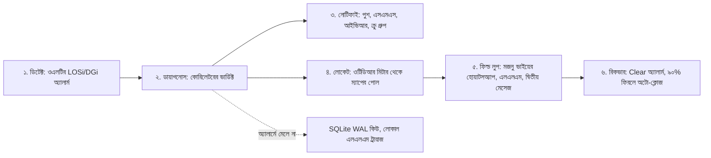
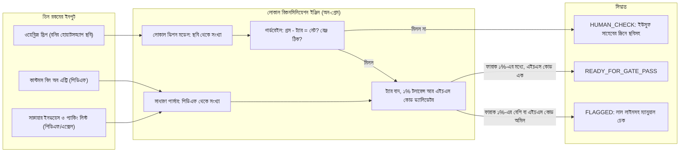

# চ্যাপ্টার ৪: ফিল্ড প্লেবুক ইন অ্যাকশন - হাই-স্টেক রিয়েল কেস স্টাডি

---

### ১. থিওরির বাইরে আসল গ্রাউন্ডের লড়াই

প্রথম তিন চ্যাপ্টারে আমি আপনার টুলবক্সটা সাজিয়ে দিয়েছি। চ্যাপ্টার ১-এ ছিল প্রথম আটচল্লিশ ঘণ্টা, ল্যাপটপ ব্যাগে রেখে শ্যাডো সেশনে বসা, আর কাগুজে এসওপির পেছনে আসল বটলনেক খুঁজে বের করা। চ্যাপ্টার ২-এ টেবিলের নিচের পুরনো পিসিতে, ক্লাউড আর জিপিইউ ছাড়াই, `Ollama` দিয়ে `Qwen 2.5` চালিয়েছি, আর `SQLite WAL` দিয়ে বানিয়েছি একটা হালকা টিকিট কিউ। চ্যাপ্টার ৩-এ ছিল বিশ মিনিটের ডোমেইন স্প্রিন্ট, গোল্ডেন টেস্ট সেটের ইভ্যালুয়েশন হারনেস, আর `GitHub Actions`-এর সেলফ-হিলিং রোলব্যাক পাইপলাইন।

এবার এই সবগুলো টুল একসাথে নিয়ে আসল গ্রাউন্ডে নামার পালা। গলায় ডেপ্লয়-কো ইনকের আইডি কার্ড, পিঠে ল্যাপটপের ব্যাগ।

ল্যাবের ঝামেলা আর ফিল্ডের ঝামেলা এক জিনিস নয়। ফিল্ডে বিপদ এলে একসাথে শত শত ফোন বাজবে, মনিটরে লাল অ্যালার্ম জ্বলবে, গেটের বাইরে ট্রাকের লম্বা লাইন লেগে যাবে, আর প্রতি ঘণ্টার দেরিতে ক্লায়েন্টকে গুনতে হবে বড় অঙ্কের খরচ। এই চ্যাপ্টারে আমরা বাংলাদেশের দুটো হাই-স্টেক ইন্ডাস্ট্রির আসল ময়দানে নামব। প্রথমটা ঢাকার একটা মাঝারি ইন্টারনেট সার্ভিস প্রোভাইডারের (আইএসপি) বৃষ্টির দিনের টিকিট অটোমেশন। এটা শুধু বৃষ্টির দিনের কথা নয়; এটা প্রতিটা দিনের জন্যই প্রযোজ্য, যখন ক্লায়েন্ট বাড়বে। দ্বিতীয়টা চট্টগ্রাম বন্দরের কন্টেইনার খালাসের থ্রি-ওয়ে ইনভয়েস রিকনসিলিয়েশন। পাতার জায়গা কম বলে অন্য ইন্ডাস্ট্রির কেসগুলো আমি বইয়ের অনলাইন অংশে রেখে দিয়েছি।

একটা কথা আগেই বলে রাখি। এখানকার ক্লায়েন্ট, জোন কোড আর সংখ্যাগুলো বোঝানোর জন্য বানানো। আইএসপিটাও কোনো নির্দিষ্ট কোম্পানি নয়; ঢাকার যেকোনো মাঝারি আইএসপির এনওসিতে বসলে এই দৃশ্যই পাবেন। সমস্যার ধরনটা কিন্তু বাস্তব।

প্রতিটা কেস স্টাডিতে আপনি শুধু পাইথন কোডটাই দেখবেন না। আগের তিন চ্যাপ্টারের কোন স্ট্রাটেজিটা কীভাবে জোড়া লেগে পুরো সিস্টেমটা দাঁড় করাচ্ছে, সেটাও ধাপে ধাপে খুলে বলব।

---

### ২. ট্র্যাক এ: ঢাকার বৃষ্টি, আইএসপির ক্যাওস ও রিমার দুটো উইন্ডো

প্রথমেই চলুন ঢাকার একটা মাঝারি ব্রডব্যান্ড আইএসপির হেড অফিসে। চ্যাপ্টার ১-এর নিয়মে আপনি গত দুই দিন ধরে কাস্টমার সাপোর্ট আর এনওসিতে, মানে নেটওয়ার্ক অপারেশন সেন্টারে, স্টাফদের পাশে বসে আছেন। এনওসি হলো আইএসপির সেই ঘর, যেখানে বড় বড় মনিটরে পুরো নেটওয়ার্কের হাল দেখা যাচ্ছে আর ইঞ্জিনিয়াররা চব্বিশ ঘণ্টা শিফটে বসে আছেন। আপনার ল্যাপটপ ব্যাগে বন্ধ, হাতে শুধু একটা নোটপ্যাড।

সাপোর্ট ডেস্কে রিমা নামের একটা মেয়ে। বছর তিনেক ধরে এই চেয়ারে, হেডফোন কানে, সামনে একটা মনিটর, আর সেই মনিটরে দুটো উইন্ডো পাশাপাশি খোলা। বাঁয়ের উইন্ডোটা টিকিটিং সিস্টেম। ফোন, অ্যাপ, হোয়াটসঅ্যাপ আর ফেসবুক পেজ থেকে যত কমপ্লেইন্ট আসছে, সব এখানে একটা করে টিকিট হয়ে জমা হচ্ছে। ডানের উইন্ডোটা এনএমএস, মানে নেটওয়ার্ক ম্যানেজমেন্ট সিস্টেমের ড্যাশবোর্ড। এটা নেটওয়ার্কের যন্ত্রপাতির সাথে কথা বলছে, আর দেখাচ্ছে এই মুহূর্তে কোন কাস্টমারের ডিভাইস অনলাইন, কোনটা অফলাইন, কোথায় কোন অ্যালার্ম জ্বলছে।

সমস্যাটা এখানেই। দুটো উইন্ডো একই স্ক্রিনে, কিন্তু সিস্টেম দুটো একে অপরের সাথে কথা বলছে না। টিকিটিং সফটওয়্যারটা এক ভেন্ডরের, এনএমএস আরেক ভেন্ডরের, আর দুটোর মাঝখানে কেউ কখনো একটা এপিআই জুড়ে দেয়নি। টিকিটিং সিস্টেম জানছে না কোন এলাকায় অ্যালার্ম জ্বলছে, আর এনএমএস জানছে না কোন কাস্টমার কমপ্লেইন্ট করছেন। মাঝখানের ব্রিজটা রিমার চোখ। কেউ লিখল *"ভাই আমার নেট নাই"*, রিমা বাঁয়ের উইন্ডোতে কাস্টমারের আইডি দেখে এলাকা বের করল, তারপর ডানের উইন্ডোতে গিয়ে খুঁজল ওই এলাকায় কোনো অ্যালার্ম আছে কি না। নিজে না বুঝলে হোয়াটসঅ্যাপে এনওসির সোহাগকে জিজ্ঞেস করছে: *"ভাই, ধানমন্ডি সাত নম্বরে কিছু ডাউন আছে?"* এক ঘণ্টায় আপনি এটা চৌদ্দবার গুনলেন।

নোটপ্যাডে লিখে রাখলেন: দুই উইন্ডোর মাঝখানের এই আলট-ট্যাবটাই আসল বটলনেক। সাধারণ দিনে এটা কোনোমতে চলে যাচ্ছে, কারণ দিনে পঞ্চাশ-ষাটটা কমপ্লেইন্ট একজন মানুষ চোখে চোখে মিলিয়ে নিতে পারছে। কিন্তু বৃষ্টির দিনে, যখন এক মিনিটে হাজার কমপ্লেইন্ট আসবে?

তৃতীয় দিন বিকেলে সেটাই দেখার সুযোগ হলো। শ্রাবণের মুষলধারে বৃষ্টি, আর বিকেল ৫টা ১২ মিনিটে ধানমন্ডির সাত মসজিদ রোডে ওয়াসার খোঁড়াখুঁড়ির শাবল মাটির নিচের মেইন ফাইবারে গিয়ে বসল। মেইন ফাইবার মানে সেই মোটা ক্যাবলটা, যেটা আইএসপির পপ অফিস থেকে বেরিয়ে পুরো একটা এলাকার সব বাসাকে ইন্টারনেট দিচ্ছে। ওটা কাটা পড়ার এক সেকেন্ডের মধ্যে ওই এলাকার দশ হাজার বাসার ইন্টারনেট অফ। আর ঠিক তখনই, বৃষ্টির দিনে যা হয়, মিরপুরের কয়েকটা ব্লকে লোডশেডিং নামল।

পরের বিশ মিনিটে কল সেন্টারে হাটবাজার বসে গেল। ফোন একটানা বাজছে, হোয়াটসঅ্যাপ আর ফেসবুকে মিনিটে হাজার মেসেজ আসছে। একটা বাসা থেকেই ফোন, অ্যাপ আর হোয়াটসঅ্যাপ মিলিয়ে চার-পাঁচটা কমপ্লেইন্ট আসছে, কারণ নেট না থাকলে মানুষ প্রথমে একবার ফোন করছেন, লাইন না পেয়ে মোবাইল ডেটা দিয়ে অ্যাপে লিখছেন, তারপর হোয়াটসঅ্যাপেও লিখছেন। তাই দশ হাজার বাসা থেকে সন্ধ্যা নাগাদ টিকিট দাঁড়াল পঞ্চাশ হাজারের কাছাকাছি। পনেরোজন স্টাফ, রিমাসহ, কোনটা রেখে কোনটা ধরবেন বুঝতে পারছেন না।

আর সবাই লিখছেন একই কথা: *"ভাই নেট নাই, লাল বাতি জ্বলছে।"* অথচ এই একই বাক্যের পেছনে ঘটনা চার রকম। ধানমন্ডিতে মেইন ফাইবার কাট; এটা আইএসপির নিজের লাইনের সমস্যা, ক্রু না গেলে ঠিক হবে না। মিরপুরের এক বাসায় কারেন্টই নেই, ভদ্রলোক মোবাইল ডেটা থেকে মেসেজ করছেন; এখানে আইএসপির কিছুই করার নেই, কারেন্ট এলে লাইন নিজেই ফিরবে। মিরপুরেরই আরেক বাসায় বাচ্চারা খেলতে গিয়ে ওএনইউর ফাইবার প্যাচ কর্ড ঢিলে করে ফেলেছে; এখানে একজন টেকনিশিয়ান পাঠাতে হবে, ঠিক ওই একটা বাসায়। আর উত্তরার একজনের লাইন একদম ঠিক আছে, শুধু ওয়াই-ফাই রাউটারটা হ্যাং করে বসে আছে; এটা ফোনেই মিটে যাওয়ার কথা। চার রকম সমস্যা, চার রকম অ্যাকশন, কিন্তু রিমার স্ক্রিনে চারটাই দেখাচ্ছে একই রকম: "নেট নাই, লাল বাতি"।

রিমা যা পারল তাই করল। ধানমন্ডির এক কাস্টমারকে ফোন করে বলল, *"স্যার, রাউটারটা একটু রিস্টার্ট দিয়ে দেখেন তো!"* ভদ্রলোক রিস্টার্ট দিলেন, নেট এল না, কারণ সমস্যাটা তাঁর বাসায় নয়, তিন কিলোমিটার দূরে রাস্তার নিচে। ফোনে যা শোনালেন তা এখানে লেখা যায় না। ওদিকে ডিসপ্যাচ ডেস্ক থেকে যে বাসায় কারেন্ট নেই, সেখানে টেকনিশিয়ানের ভ্যান রওনা দিল; গিয়ে দেখবে কিছুই করার নেই, কারেন্ট এলে এমনিই ঠিক হয়ে যাবে। আর যে বাসায় সত্যিই কর্ড ঢিলে, যেখানে ভ্যানটা যাওয়া দরকার ছিল, সেই টিকিটটা পঞ্চাশ হাজারের ভিড়ে হারিয়ে গেল। ভীতিকর অবস্থা, তাই না?

সবচেয়ে অদ্ভুত ব্যাপারটা টের পেলেন রাত নটায়, এনওসিতে সোহাগের পাশে বসে। ওর স্ক্রিনে ৫টা ১২ মিনিটেই পুরো একটা পোর্ট লাল হয়ে গিয়েছিল। কোন পোর্টের কয়টা ওএনইউ একসাথে অফলাইন হলো, কারা ডাইং গ্যাস্প (এটা কী, সামনেই বলছি) পাঠিয়ে অফ হলো, আর কারা কিছু না পাঠিয়েই সিগন্যাল ড্রপ করল, সব ওএলটির লগে সেকেন্ড ধরে লেখা ছিল। মানে, যে চারটা আলাদা ঘটনা রিমা ফোন করে করে আলাদা করার চেষ্টা করছিল, যন্ত্রটা সেগুলো ৫টা ১২ মিনিটেই আলাদা করে রেখেছিল। পাশের ঘরে রিমা তখন চৌদ্দবার আলট-ট্যাব করছে। যন্ত্রটা সব জানত; শুধু কেউ তাকে জিজ্ঞেস করেনি। এই ট্র্যাকের পুরো গল্পটা আসলে ওই 'একটা প্রশ্ন জিজ্ঞেস করা' শেখার।

!!! warning "নেটওয়ার্ক অপারেশনের প্রধান বটলনেক"
    আইএসপি বা টেলিকম সাপোর্টে সবচেয়ে বড় ক্যাওস তৈরি হয় যখন হার্ডওয়্যারের অ্যালার্ম আর কাস্টমারের কমপ্লেইন্ট দুটো আলাদা সিস্টেমে পড়ে থাকে। মেইন ফাইবার কাটা পড়লে দশ হাজার বাসার জন্য পঞ্চাশ হাজার আলাদা টিকিট খুলে সাপোর্ট টিমকে বসিয়ে রাখা মানে পুরো অপারেশন অচল করে দেয়া। অথচ ওএলটি আগে থেকেই জানে কোন বাসায় কী হয়েছে।

---

### ৩. সোহাগের বিশ মিনিট: ওএলটি আসলে কী বলে

পরদিন সকালে চ্যাপ্টার ৩-এর নিয়মে সোহাগের পাশে বিশ মিনিটের ডোমেইন স্প্রিন্টে বসলেন। সোহাগ বছর ছাব্বিশের ছেলে, এনওসির নাইট শিফট ইনচার্জ, চোখে কালি, কিন্তু নেটওয়ার্কের কথা উঠলে চোখ জ্বলে ওঠে। জিজ্ঞেস করলেন, *"কাল যে পোর্টটা লাল হলো, ওএলটি আসলে তোমাকে কী বলেছিল?"*

সোহাগ হোয়াইটবোর্ডে একটা বক্স আঁকল। *"এটা ওএলটি, আমাদের পপ অফিসের মেইন যন্ত্র। এর একেকটা পন পোর্ট থেকে একটা ফাইবার বেরোয়। রাস্তার ক্যাবিনেটে একটা প্রাইমারি স্প্লিটার, এক-চারে বা এক-আটে ভাগ, তারপর মহল্লার বক্সে সেকেন্ডারি স্প্লিটার, আবার এক-আটে বা এক-ষোলোয়। সব মিলিয়ে এক পোর্টে বত্রিশ-চৌষট্টিটা বাসা। প্রতিটা বাসার দেয়ালে যে ছোট ডিভাইসটা, ওটা ওএনইউ, ওর পেছনেই রাউটার। ওএলটি সারাক্ষণ প্রতিটা ওএনইউর সাথে অপটিক্যাল সিগন্যাল দিয়ে কানেক্টেড থাকে। তাই কে কখন অফলাইন হলো, ওএলটি সবার আগে জানে।"*

*"অফলাইন হলে কী বলে?"*

*"দুই রকম কথা বলে, ভাই। এটাই আসল জিনিস।"* সোহাগ বোর্ডে দুটো লাইন টানল। *"এক, কোনো ওএনইউ থেকে সিগন্যাল আসা বন্ধ হলে ওএলটি ওই ওএনইউর নামে `LOSi` অ্যালার্ম তোলে, লস অব সিগন্যাল, শেষের `i` মানে ওই নির্দিষ্ট ওএনইউ। বাসায় তখন ডিভাইসের `LOS` এলইডি লাল হয়; কাস্টমার যে 'লাল বাতি জ্বলছে' লেখেন, এটা সেটা। দুই, ওএনইউ যদি পাওয়ার হারায়, কারেন্ট গেল বা কেউ সুইচ টিপল, তাহলে অফ হওয়ার আগে ওর ভেতরের ক্যাপাসিটরের কয়েক মিলিসেকেন্ডের চার্জ দিয়ে ওএলটিকে একটা শেষ মেসেজ পাঠিয়ে যায়। আমরা বলি ডাইং গ্যাস্প। ওএলটি লেখে `DGi`। মানে, আমি পাওয়ার হারাচ্ছি, ফাইবারের দোষ নেই।"*

আপনি বললেন, *"তাহলে লোডশেডিং আর ফাইবার কাট আলাদা করা যায়?"*

*"একদম। লোডশেডিংয়ে দুশো বাসা থেকে দুশো `DGi` আসবে। ফাইবার কাটলে একই দুশো বাসা থেকে দুশো `LOSi`, একটাও `DGi` ছাড়া। আর পুরো পোর্ট একসাথে গেলে ওএলটি পোর্ট লেভেলেই `LOS` তোলে।"* তারপর একটু থেমে, *"তবে ভাই, ডাইং গ্যাস্প গ্যারান্টেড না। সস্তা ওএনইউ, পুরনো অ্যাডাপ্টার, বা কেউ মাল্টিপ্লাগের সুইচ টিপে হঠাৎ অফ করলে মেসেজটা যাওয়ার আগেই ডিভাইস মরে যায়। তখন আমরা শুধু `LOSi` দেখি।"* ভেন্ডরভেদে স্ক্রিনে নামটা `Dying Gasp` বা `Power Off`-ও হতে পারে, সেটাও জানাল; কোডে নামটা কনফিগে রাখবেন, হার্ডকোড নয়।

হোয়াইটবোর্ডের কথাগুলো সোজা ভাষায় আরেকবার বলি, কারণ এই ট্র্যাকের বাকি সব কোড এই দুটো শব্দের ওপর দাঁড়িয়ে আছে। ওএলটি পপ অফিসের মূল যন্ত্র, ওএনইউ প্রতিটা বাসার দেয়ালের ছোট বক্স, আর দুটোর মাঝখানে কাচের ফাইবার। ওএলটি প্রতিটা বক্সের সাথে সারাক্ষণ সিগন্যাল আদান-প্রদান করছে, তাই কোনো বক্স সাইলেন্ট হয়ে গেলে ওএলটি সাথে সাথে টের পাচ্ছে। এখন বক্স সাইলেন্ট হওয়ার দুটো কারণ হতে পারে। হয় ফাইবার কেটে গেছে, তাই আলো আর পৌঁছাচ্ছে না; ওএলটি তখন শুধু `LOSi` দেখছে। নয়তো বক্সটার কারেন্ট চলে গেছে; তখন বক্সটা অফ হওয়ার ঠিক আগে একটা শেষ মেসেজ পাঠিয়ে যাচ্ছে, সেটাই ডাইং গ্যাস্প বা `DGi`, আর তারপর `LOSi`। অর্থাৎ `LOSi` দুই ক্ষেত্রেই আসছে, কিন্তু `DGi` আসছে শুধু কারেন্ট গেলে। ফাইবার কাট বনাম লোডশেডিং আলাদা করার পুরো চাবিটা এই একটা পার্থক্যে: `LOSi` আছে, `DGi` নেই, মানে ফাইবারের দোষ।

বিশ মিনিটে পুরো লজিকটা পানির মতো পরিষ্কার হয়ে গেল। হোয়াইটবোর্ডের ছবিটা টেবিলে নামালে এই দাঁড়ায়:

| ওএলটি কী দেখছে | পেছনে আসলে কী হয়েছে | অ্যাকশন |
| :--- | :--- | :--- |
| পোর্টের সব ওএনইউ একসাথে `LOSi`, কারও `DGi` নেই | মেইন ফাইবার কাট (ধানমন্ডি) | ফাইবার স্প্লাইসিং টিম, একবার |
| একটা ওএনইউর `DGi`, তারপর অফলাইন | কারেন্ট নেই, বা ইউজার নিজে অফ করেছেন (মিরপুরের প্রথম বাসা) | কাউকে নয়; এসএমএসে বলুন পাওয়ার চেক করতে |
| একটা ওএনইউর `LOSi`, কিন্তু `DGi` আসেনি | ওএনইউ অন, সিগন্যাল নেই: ড্রপ ক্যাবল বা প্যাচ কর্ড (মিরপুরের দ্বিতীয় বাসা) | আগে "পাওয়ার চেক করুন" এসএমএস, তারপর ফিল্ড টেকনিশিয়ান |
| ওএনইউ দিব্যি অনলাইন, তবু "নেট নাই" | রাউটার, ওয়াই-ফাই, বিলিং (উত্তরা) | এলএলএম ট্রায়াজ, তারপর সাপোর্ট ডেস্ক |

তৃতীয় সারিতে "আগে এসএমএস, তারপর টেকনিশিয়ান" লিখেছি ওই গ্যারান্টির অভাবটার জন্যই। ডাইং গ্যাস্প না আসা মানেই ফাইবারের দোষ নয়; হয়তো বক্সটা মেসেজ পাঠানোর সুযোগই পায়নি। তাই চোখ বন্ধ করে ভ্যান পাঠানোর চেয়ে একটা এসএমএসে "বাসায় কারেন্ট আছে তো?" জিজ্ঞেস করা অনেক সহজ। কোন মডেলের ওএনইউ ডাইং গ্যাস্প পাঠায় আর কোনটা পাঠায় না, সেই তালিকাটা সোহাগের কাছ থেকেই নেবেন। আন্দাজে বসাবেন না।

স্প্রিন্টের শেষে একটা প্রশ্ন করলেন, যেটা পরে সবচেয়ে বড় কাজ হয়ে দাঁড়াল: *"কোন ওএনইউ কোন পোর্টে, কোন কাস্টমার কোন জোনে, এটা কোথায় লেখা?"* সোহাগ একটু লজ্জা পেয়ে একটা এক্সেল ফাইল খুলল। ইনভেন্টরি শিট। প্রতিটা ওএনইউর সিরিয়াল নাম্বারের পাশে কাস্টমার আইডি, প্রতিটা পোর্টের পাশে জোন কোড, যেমন `DHK-DHN-07`, মানে ঢাকা, ধানমন্ডি, সাত নম্বর এলাকা। শেষ আপডেট আঠারো মাস আগে। এই শিটটা কেন এত জরুরি? কারণ ওএলটি শুধু জানছে "পোর্ট সাতের বত্রিশ নাম্বার ওএনইউ অফলাইন"। ওই বত্রিশ নাম্বার বক্সটা কোন কাস্টমারের, তাঁর ফোন নাম্বার কী, তিনি কোন জোনে থাকেন, এসব ওএলটি জানে না; জানে এই এক্সেল শিট। অ্যালার্ম থেকে কাস্টমার পর্যন্ত পৌঁছানোর একমাত্র রাস্তা এটাই। তাই ওই এক্সেল শিটটাই এই পুরো প্রজেক্টের সবচেয়ে দামি ইনপুট; কোডের আগে ওটা ঠিক করানো গেল তিন দিনে, দুজন টেকনিশিয়ানকে দিয়ে। আর যাওয়ার সময় র‍্যাকে ওএলটির পাশে একটা ছোট ডিভাইস চোখে পড়ল। *"ওটা কী?"* *"ওটিডিআর, ভাই। লাইন কাটলে কত মিটারে কাটছে বলে দেয়। বড় স্যার গত বছর কিনেছেন, কেউ এপিআই দিয়ে চালায়নি এখনো।"* একটু পরেই ওটার কথায় আসছি।

---

### ৪. গ্রাহক ফোন করার আগেই: পরের বর্ষায় ওই পাঁচ মিনিট কেমন হবে

এবার কল্পনা করুন পরের বর্ষা। একই রাস্তা, একই শাবল, আবার ৫টা ১২। কিন্তু এবার টিকিটিং সিস্টেম আর এনএমএসের মাঝখানে একটা পাইপলাইন বসানো আছে, টেবিলের নিচের পুরনো পিসিতে, চ্যাপ্টার ২-এর `SQLite WAL` আর সাধারণ পাইথনে। রিমার চোখ যে ব্রিজের কাজটা করছিল, এখন সেটা করছে এই পাইপলাইন। ছয়টা ধাপ, ঘড়ি ধরে বলি, আর প্রতিটা ধাপে বলব কাজটা কে করছে: যন্ত্র, পাইথন, এলএলএম, নাকি মানুষ।

**ধাপ এক, ডিটেক্ট। ৫টা ১২ মিনিট শূন্য সেকেন্ড।** পোর্ট `OLT1/0/7`-এর ৫৮টা ওএনইউ এক সেকেন্ডের মধ্যে `LOSi` পাঠাল, একটাও `DGi` নেই। ওএলটি এটা জানছে, এনএমএস জানছে, কারণ ওএলটি প্রতিটা অ্যালার্ম এনএমএসকে পাঠিয়ে দিচ্ছে। নতুন জিনিস একটাই: এবার এনএমএস সেই অ্যালার্মগুলো সাথে সাথে আমাদের `SQLite` ডেটাবেজের একটা ইভেন্ট টেবিলে লিখছে। ইভেন্ট টেবিল মানে একটা সাধারণ টেবিল, যার প্রতিটা সারিতে লেখা থাকছে কোন পোর্ট, কোন ওএনইউ, কী অ্যালার্ম, কখন। এই ধাপে কোনো বুদ্ধি খাটছে না, কোনো কোডও লিখতে হয়নি; যন্ত্র যা বলছে, সেটা শুধু এক জায়গায় জমা হচ্ছে।

**ধাপ দুই, ডায়াগনোস। দশ সেকেন্ড পর।** একটা ছোট পাইথন ফাংশন, যাকে আমি কোরিলেটর বলছি, ওই ইভেন্ট টেবিল থেকে শেষ ষাট সেকেন্ডের অ্যালার্মগুলো তুলে পোর্ট ধরে গুনছে। ষাট সেকেন্ড কেন? কারণ ফাইবার কাটলে ৫৮টা অ্যালার্ম ঠিক একই মিলিসেকেন্ডে আসছে না, কয়েক সেকেন্ড ছড়িয়ে আসছে; খুব ছোট জানালা নিলে অর্ধেক অ্যালার্ম গোনার বাইরে থেকে যাবে, আর খুব বড় নিলে সকালের পুরনো অ্যালার্ম সন্ধ্যার হিসাবে ঢুকে পড়বে। গুনে দেখা গেল, পোর্টের আশি ভাগের বেশি ওএনইউ ডাইং গ্যাস্প ছাড়াই অফলাইন। সোহাগের নিয়ম বলছে এটা ফাইবারের দোষ। ভার্ডিক্ট: `FIBER_CUT`। কোরিলেটর তখন একটা মাস্টার টিকিট খুলল। মাস্টার টিকিট মানে পুরো পোর্টের জন্য একটাই টিকিট, যার নিচে ওই পোর্টের সব কাস্টমারের কমপ্লেইন্ট জমা হবে; পঞ্চাশ হাজার আলাদা টিকিটের বদলে একটা। আর কারা এই পোর্টের নিচে, সেটা জানতে সে সোহাগের ঠিক করা ইনভেন্টরি আর সিআরএম, মানে কাস্টমার ডেটাবেজ, থেকে কাস্টমার আইডি আর ফোন নাম্বারগুলো টেনে নিল। এই ধাপটা পুরোটা সোজা নিয়মের পাইথন; কোডটা পরের সেকশনে।

**ধাপ তিন, নোটিফাই। পনেরো সেকেন্ড পর।** দশ হাজার কাস্টমারের কাছে প্রথম মেসেজ গেল: *"আপনার এলাকার মেইন ফাইবারে সমস্যা হয়েছে, মেরামত শুরু হচ্ছে।"* খেয়াল করুন, এই মেসেজে কোনো সময় বলা হচ্ছে না, কারণ ক্রু এখনো জানে না কাট কোথায়; ভুল সময় বলার চেয়ে সময় না বলা ভালো। যাঁদের ফোনে আইএসপির অ্যাপ আছে, তাঁরা পুশ নোটিফিকেশন পেলেন, বাকিরা এসএমএস। একই সাথে হেল্পলাইনের আইভিআর, মানে ফোন করলে যে রেকর্ড করা ভয়েস শোনা যায় ("বাংলার জন্য এক চাপুন"), তার প্রথম লাইনটা বদলে গেল। এখন কেউ ফোন করলে এজেন্টের কাছে পৌঁছানোর আগেই শুনছেন "ধানমন্ডিতে মেরামত চলছে", আর বেশিরভাগ মানুষ ওখানেই ফোন রেখে দিচ্ছেন। আর ফাইবার টিমের হোয়াটসঅ্যাপ গ্রুপে একটা অ্যালার্ট পড়ল: পোর্ট সাত, ফাইবার কাট, ৫৮টা বাসা। রিমার ফোন তখনো বাজেনি।

**ধাপ চার, লোকেট। ৫টা ১৩ থেকে ১৫।** ক্রু জানছে ফাইবার কাটা, কিন্তু কোথায়? সাত মসজিদ রোড কয়েক কিলোমিটার লম্বা। এখানে র‍্যাকের ওই ওটিডিআর ডিভাইসটা কাজে লাগছে। এনএমএস ওটাকে এপিআই দিয়ে বলল, এই পোর্টের ফাইবারে একটা টেস্ট চালাও। ডিভাইসটা ফাইবারে একটা লেজার পালস পাঠাল; কাটা জায়গায় গিয়ে আলোটা ধাক্কা খেয়ে ফিরে এল, আর ফিরতে কত সময় লাগল তা থেকে ডিভাইস হিসাব করল দূরত্ব। রেজাল্ট এল: *"৩,০০০ মিটারে ব্রেক।"* কিন্তু ক্রু রাস্তায় মিটার গোনে না, পোল গোনে। তাই আরেকটা ছোট স্ক্রিপ্ট ফাইবার রুটের ম্যাপে সংখ্যাটা বসিয়ে বলল: *"পোল ৩১, লেকের উত্তর পাড়।"* গুগল ম্যাপের লিংকসহ সেটা ক্রুর ফোনে গেল। আগে এই কাজে টিম প্রথমে পপে যেত, হাতে ওটিডিআর লাগাত, তারপর ম্যাপ দেখে পোল খুঁজত, সব মিলিয়ে দেড় ঘণ্টা। এখন দুই মিনিট। এটাও সোজা হিসাবের পাইথন, কোডটা §৬-এ।

**ধাপ পাঁচ, ফিল্ড লুপ। ৫টা ২০ থেকে ৬টা।** ক্রু লিডার মজনু ভাই পোলে উঠে হোয়াটসঅ্যাপে লিখলেন, *"পোল ৩১ এ পৌঁছাইছি, স্প্লাইস শুরু, ৪০ মিনিটের মত লাগবে।"* এই একটা বাক্য মানুষের ভাষায়, বানান যেমন খুশি, আর ঠিক এখানেই পাইপলাইনে প্রথমবার একটা ছোট এলএলএম ঢুকছে। সে বাক্যটা পড়ে দুটো জিনিস বের করল: স্ট্যাটাস (স্প্লাইসিং চলছে) আর সময় (৪০ মিনিট)। তারপর একটা গার্ডরেইল, মানে সোজা নিয়মের চেক, যাচাই করল সময়টা বাস্তবসম্মত কি না; মডেল যদি ভুল করে ৪০০০ মিনিট পড়ত, এখানেই আটকে যেত। যাচাই পেরোনোর পর কাস্টমারদের কাছে দ্বিতীয় মেসেজ গেল: *"আনুমানিক ৪০ মিনিটের মধ্যে সংযোগ স্বাভাবিক হবে।"* পুরো পাইপলাইনে এলএলএম এই একবারই, আর তাও তার কথা সরাসরি কাস্টমারের কাছে যাচ্ছে না, গার্ডরেইল পেরিয়ে যাচ্ছে।

**ধাপ ছয়, রিকভার। ৬টা ৫।** স্প্লাইস শেষ, মানে কাটা ফাইবারের দুই মাথা আবার জোড়া লেগেছে। ওএনইউগুলো একটা একটা করে অনলাইনে ফিরছে, আর ওএলটি প্রতিটার জন্য একটা `Clear` অ্যালার্ম পাঠাচ্ছে, মানে "এই বক্সটা আবার ঠিক আছে"। কোরিলেটর `Clear` গুনছে। পোর্টের নব্বই ভাগ ফিরতেই মাস্টার টিকিট আর তার নিচের সব কমপ্লেইন্ট একসাথে ক্লোজ হলো, কাস্টমারদের কাছে *"সংযোগ ফিরেছে"* মেসেজ গেল, আর বাকি দশ ভাগ, যারা তখনো ফেরেনি, আলাদা করে টেকনিশিয়ানের লাইনে গেল। লগে তিনটা সংখ্যা জমা পড়ল: কাট থেকে প্রথম মেসেজ পর্যন্ত পনেরো সেকেন্ড, কাট থেকে সব ফেরা পর্যন্ত তিপ্পান্ন মিনিট, অকারণ ভ্যান-ট্রিপ শূন্য। চ্যাপ্টার ১-এর ভাষায়, এই তিনটাই আপনার সাকসেস মেট্রিক।

ছয় ধাপ এক নজরে:

| ধাপ | কে করছে | কোড লিখতে হচ্ছে? | এলএলএম? |
| :--- | :--- | :--- | :--- |
| ১. ডিটেক্ট | ওএলটি আর এনএমএস | না, শুধু ইভেন্ট টেবিলে লেখা | না |
| ২. ডায়াগনোস | কোরিলেটর (পাইথন) | হ্যাঁ, কোড ১ | না |
| ৩. নোটিফাই | পুশ, এসএমএস গেটওয়ে, আইভিআর | হ্যাঁ, কয়েকটা এপিআই কল | না |
| ৪. লোকেট | ওটিডিআর আর লোকেটর (পাইথন) | হ্যাঁ, কোড ২ | না |
| ৫. ফিল্ড লুপ | মজনু ভাই আর ছোট এলএলএম | হ্যাঁ, কোড ৪ | হ্যাঁ, এই একবার |
| ৬. রিকভার | কোরিলেটর, `Clear` গুনে | ছোট একটা নিয়ম | না |

লোডশেডিংয়ের দিনে একই পাইপলাইন অন্য পথে হাঁটছে। ধাপ এক-এ ৫৮টা `LOSi`-র জায়গায় আসছে ৩০টা `DGi`, মানে বাসার বক্সগুলো নিজেরাই বলে যাচ্ছে "কারেন্ট গেল"। ধাপ দুই-এ কোরিলেটরের ভার্ডিক্ট তাই `AREA_POWER_OUTAGE`। ধাপ তিন-এ শুধু একটা মেসেজ যাচ্ছে, "বিদ্যুৎ এলে কানেকশন নিজে ফিরবে"। ধাপ চার আর পাঁচ এখানে লাগছেই না: কোনো ওটিডিআর টেস্ট নয়, কোনো ভ্যান নয়, কোনো ক্রু নয়। একটা বাসা একা অফলাইন হলে, `LOSi` আছে কিন্তু `DGi` নেই, ভার্ডিক্ট `DROP_CABLE`; তখন আগে "পাওয়ার চেক করুন" এসএমএস, কাস্টমার "কারেন্ট আছে" বললে তারপর টেকনিশিয়ান। আর যে টিকিট কোনো অ্যালার্মের সাথেই মিলছে না, মানে ওএনইউ দিব্যি অনলাইন তবু কাস্টমার লিখছেন "নেট নাই", উত্তরার ওই হ্যাং করা রাউটার, সেটা চ্যাপ্টার ২-এর `SQLite WAL` কিউ হয়ে `qwen2.5:1.5b`-এর ট্রায়াজে যাচ্ছে। সেখানে মডেল টেক্সট পড়ে ক্যাটাগরি দিচ্ছে `ROUTER|BILLING|OTHER`, আর সেই অনুযায়ী টিকিটটা সাপোর্ট ডেস্কের ঠিক লাইনে পড়ছে। লেবেলের এই তালিকাটা চ্যাপ্টার ৫-এ কনফিগে যাবে।

সোহাগ ডিজাইনটা দেখে প্রথম যে প্রশ্নটা করেছিল: *"ভাই, এআই কোথায়?"* উত্তর: প্রায় কোথাও না। ছয় ধাপের পাঁচটায় এলএলএম নেই। ফাইবার কাট কি না, কোথায় কাট, কাকে মেসেজ যাবে, এসব সিদ্ধান্ত সোজা নিয়মে হচ্ছে, কারণ এখানে একবার হ্যালুসিনেশন মানে দশ হাজার ভুল এসএমএস, আর পরের বার কেউ আইএসপির মেসেজ বিশ্বাস করবে না। এলএলএম আছে শুধু যেখানে মানুষের ভাষা পড়তে হচ্ছে: মজনু ভাইয়ের হোয়াটসঅ্যাপ, আর অ্যালার্মের সাথে না-মেলা কাস্টমার টেক্সট। হিসাবটাও সোজা। চ্যাপ্টার ২-এ দেখেছি, `qwen2.5:1.5b` পুরনো পিসিতে একটা মেসেজ পড়তে এক-দুই সেকেন্ড নিচ্ছে; পঞ্চাশ হাজার টিকিট দেখালে সেটা দাঁড়াচ্ছে ১৪ থেকে ২৮ ঘণ্টায়, মানে বৃষ্টি থামার পরদিন দুপুরেও মডেল টিকিট পড়ছে। কোরিলেটর আগে ছেঁকে নিলে এলএলএমের সামনে বড়জোর তিন-চার হাজার টিকিট, ঘণ্টাখানেকের কাজ। যেটা ওএলটি আগেই জানে, সেটা এলএলএমকে জিজ্ঞেস করে সিপিইউ পোড়ানোর মানে নেই। বোনাস চ্যাপ্টারের ৬০-৩০-১০ সূত্রটা এখানে হাতেনাতে।

!!! info "বাংলাদেশে এটা চলবে? কোনটা আছে, কোনটা নেই"
    ঢাকার মাঝারি আইএসপির এনওসিতে Zabbix বা LibreNMS-এর মতো এনএমএস আছে, আর ওএলটি বেশিরভাগ জায়গায় সি-ডেটা বা ভিসল, বড়গুলোতে বিডিকম, হুয়াওয়ে বা জেডটিই। সবকটাই `LOSi` আর ডাইং গ্যাস্প এসএনএমপি ট্র্যাপ হয়ে এনএমএসে পাঠাচ্ছে, তাই ধাপ এক বিনা খরচে; শুধু সি-ডেটায় ডাইং গ্যাস্প ট্র্যাপ আর ভিসলে এসএনএমপি নিজেই ডিফল্টে বন্ধ থাকে, সিএলআই থেকে একবার চালু করে নিতে হয়। LibreNMS ২০২৬ থেকে ভিসল জিপন ওএলটির অ্যালার্ম ট্র্যাপ সরাসরি বোঝে, আর নতুন ফার্মওয়্যারে রেস্ট এপিআই থাকলে ট্র্যাপ লিসেনারের বদলে সরাসরি এপিআই কলেও ধাপ এক সারা যায়। সবচেয়ে বড় ফাঁক সোহাগের ওই এক্সেল শিট; ধাপ দুই পুরোটা ওটার ওপর দাঁড়িয়ে। বাল্ক এসএমএস বিটিআরসি-লিস্টেড অ্যাগ্রিগেটর দিয়ে পাঠাতে হয়, প্রতি এসএমএস ৩০ থেকে ৫৫ পয়সার মতো; দশ হাজার বাসা মানে এক আউটেজে তিন থেকে পাঁচ হাজার টাকা, তাই অ্যাপ পুশ আর হোয়াটসঅ্যাপ আগে, এসএমএস শুধু যাঁদের অ্যাপ নেই, আর এক আউটেজে কাস্টমার প্রতি একটা। আইভিআর বেশিরভাগ জায়গায় অ্যাস্টেরিস্কের মতো ওপেন সোর্স পিবিএক্সে, প্রথম ভয়েস বদলানো একটা এপিআই কল। অটোমেটিক ওটিডিআর ডিভাইস মাঝারি আইএসপিতে কম; না থাকলে ধাপ চার হাতের ওটিডিআর, বাকি পাঁচ ধাপ তবু অটোমেটিক। ফাইবার রুট গুগল আর্থে আঁকা থাকে বেশিরভাগ জায়গায়। সব মিলিয়ে: দরকারি জিনিস আছে, নেই শুধু জোড়া লাগানোটা। সেটাই এফডিইর কাজ।

ছয় ধাপ এক ছবিতে:



---

### ৫. হ্যান্ডস-অন কোড প্রুফ, কোড ১: পন পোর্ট কোরিলেটর

#### কোড-স্যান্ডউইচ মেথড

**১. কাস্টমারের ঝামেলা:** ফাইবার কাটার সেকেন্ডে ওএলটি থেকে শত শত `LOSi` আর `DGi` একসাথে ঢুকছে, কয়েক সেকেন্ড ছড়িয়ে। এই অ্যালার্ম স্টর্ম থেকে মানুষের হাত ছাড়াই একটা ভার্ডিক্ট বের করতে হবে: মেইন ফাইবার কাট, নাকি লোডশেডিং, নাকি একটা বাসার ড্রপ ক্যাবল। ভুল ভার্ডিক্টের দাম একটা অকারণ ভ্যান-ট্রিপ, নয়তো দশ হাজার ভুল এসএমএস।

**২. মূল কোড:** নিচের পঁচিশ লাইনের ফাংশনটা ৬০ সেকেন্ডের জানালায় এক পন পোর্টের অ্যালার্ম গুনে ভার্ডিক্ট দেবে:

```python
# FDE Field Engine: PON Port Correlator (LOSi/DGi storm -> one root-cause verdict)
WINDOW_SEC, STORM_RATIO, STORM_MIN = 60, 0.8, 5   # থ্রেশহোল্ড তিনটা এনওসি ইঞ্জিনিয়ারের কাছ থেকে, আন্দাজে নয়
PORT_ONUS = {"OLT1/0/7": 64, "OLT1/0/2": 32}       # ইনভেন্টরি: কোন পন পোর্টে কয়টা ওএনইউ

def diagnose_port(port: str, events: list, now: float) -> dict:
    recent = [e for e in events if e["port"] == port and now - e["ts"] <= WINDOW_SEC]
    los = {e["onu"] for e in recent if e["alarm"] == "LOSi"}
    dg = {e["onu"] for e in recent if e["alarm"] == "DGi"}
    silent = los - dg                                      # LOSi আছে, DGi নেই: ফাইবারের দোষ
    storm = max(STORM_MIN, STORM_RATIO * PORT_ONUS[port])  # "একসাথে অনেকগুলো" মানে ঠিক কয়টা
    if len(silent) >= storm:
        return {"port": port, "verdict": "FIBER_CUT", "affected": len(silent), "next": "TRIGGER_OTDR"}
    if len(dg) >= storm:
        return {"port": port, "verdict": "AREA_POWER_OUTAGE", "affected": len(dg), "next": "SMS_ONLY"}
    if silent:
        return {"port": port, "verdict": "DROP_CABLE", "affected": len(silent), "next": "FIELD_TECHNICIAN"}
    return {"port": port, "verdict": "NORMAL", "affected": len(dg), "next": "NONE"}

# বৃষ্টির সন্ধ্যা: ধানমন্ডির পোর্টে ৫৮টা ওএনইউ ডাইং গ্যাস্প ছাড়াই অফলাইন, মিরপুরের পোর্টে ৩০টা ডাইং গ্যাস্প পাঠিয়ে অফ
T = 1_700_000_000.0
events = [{"port": "OLT1/0/7", "onu": f"ONU-{i}", "alarm": "LOSi", "ts": T + i % 20} for i in range(58)]
events += [{"port": "OLT1/0/2", "onu": f"ONU-{i}", "alarm": "DGi", "ts": T + 5} for i in range(30)]
events += [{"port": "OLT1/0/2", "onu": "ONU-99", "alarm": "LOSi", "ts": T - 400}]  # ৬ মিনিট পুরনো, উইন্ডোর বাইরে
for p in PORT_ONUS:
    print(diagnose_port(p, events, now=T + 30))
```

**৩. সিস্টেমের ইমপ্যাক্ট ও কোডের মানে কী:** কোডটা রান করলে আউটপুটে আসবে:

```text
{'port': 'OLT1/0/7', 'verdict': 'FIBER_CUT', 'affected': 58, 'next': 'TRIGGER_OTDR'}
{'port': 'OLT1/0/2', 'verdict': 'AREA_POWER_OUTAGE', 'affected': 30, 'next': 'SMS_ONLY'}
```

কোডটা ওপর থেকে নিচে একবার হেঁটে দেখি। প্রথম দুই লাইনে সেটিংস: ষাট সেকেন্ডের জানালা, আশি ভাগের অনুপাত, পাঁচের ফ্লোর, আর কোন পোর্টে কয়টা ওএনইউ আছে সেই ইনভেন্টরি। ফাংশনের ইনপুট `events` হলো ধাপ এক-এর সেই ইভেন্ট টেবিল, প্রতিটা সারিতে পোর্ট, ওএনইউ, অ্যালার্মের নাম আর সময়। ফাংশনের প্রথম লাইন `recent` শুধু এই পোর্টের আর শেষ ষাট সেকেন্ডের অ্যালার্মগুলো আলাদা করছে। পরের দুই লাইন দুটো সেট বানাচ্ছে: কোন কোন ওএনইউ `LOSi` পাঠিয়েছে, আর কোন কোন ওএনইউ `DGi` পাঠিয়েছে।

তারপর পুরো ফাংশনের প্রাণ, একটা লাইন: `silent = los - dg`। সোহাগ হোয়াইটবোর্ডে যা বলেছিল, এটা তারই অনুবাদ: যাদের `LOSi` এসেছে কিন্তু `DGi` আসেনি, তারাই ফাইবারের দোষে অফলাইন। `DGi` পাঠানো ওএনইউগুলো এই সেট থেকে বাদ পড়ছে, তাই লোডশেডিং কোনোদিন `FIBER_CUT` হবে না। এরপর চারটা ভার্ডিক্ট একটা নির্দিষ্ট ক্রমে: অনেকগুলো সাইলেন্ট হলে `FIBER_CUT`, অনেকগুলো `DGi` হলে `AREA_POWER_OUTAGE`, অল্প কয়েকটা সাইলেন্ট হলে `DROP_CABLE`, আর কিছুই না হলে `NORMAL`। ক্রমটা জরুরি, কারণ ফাইবার কাটের চেকটা সবার আগে না হলে একটা বড় কাট কয়েকশো ছোট ড্রপ ক্যাবল হিসেবে ধরা পড়ত। সোহাগ কোডটা দেখে বলেছিল, *"এটুকুই? আমি ভেবেছিলাম মেশিন লার্নিং লাগবে।"* না, লাগে না। লাগে একজন সোহাগ, যে জানে অ্যালার্মের মানে কী।

`max(STORM_MIN, ...)` লাইনটা একটা ফাঁদ থেকে বাঁচাচ্ছে। "একসাথে অনেকগুলো" মানে ঠিক কয়টা? ৬৪ ওএনইউর পোর্টে ৮০% মানে ৫১; ৫৮টা অফলাইন, ভার্ডিক্ট পরিষ্কার। কিন্তু ৮ ওএনইউর ছোট পোর্টে ৮০% মানে মাত্র ৬-৭টা, আর পাঁচের ফ্লোরটা না থাকলে ওরকম পোর্টে দুটো বাসার ড্রপ ক্যাবল কাটলেই "মেইন ফাইবার কাট" ঘোষণা হয়ে যেত, আর স্প্লাইসিং টিম অকারণে বেরোত। সংখ্যা তিনটা আমার হাতের হিসাব, আপনার সোহাগ থেকে আসল মান নেবেন। টেস্ট ডেটায় ছয় মিনিট পুরনো `ONU-99`-কে ইচ্ছে করে রেখেছি, যাতে দেখেন জানালার বাইরের অ্যালার্ম ভার্ডিক্টে ঢুকছে না। কমপ্যানিয়নের ভার্সনে চতুর্থ একটা ভার্ডিক্ট আছে: ইনভেন্টরিতে প্রতিটা ওএনইউর পাশে তার সেকেন্ডারি স্প্লিটারের নম্বর থাকলে এক বক্সের নিচের আটটা বাসা একসাথে অফলাইন হওয়াটাও আলাদা করে ধরা যাচ্ছে; তখন টিম যাচ্ছে মহল্লার বক্সে, আটটা ভ্যান নয়।

**৪. গিটহাব রেফারেন্স:** কোরিলেটর (`correlator.py`) পাবেন বইয়ের অফিশিয়াল কমপ্যানিয়ন রিপোজিটরির `ch04-isp-routing-worker/` ফোল্ডারে: [https://github.com/raqueeb/fdebook_companion](https://github.com/raqueeb/fdebook_companion)।

---

### ৬. হ্যান্ডস-অন কোড প্রুফ, কোড ২: ওটিডিআরের মিটার থেকে ম্যাপের পোল

#### কোড-স্যান্ডউইচ মেথড

**১. কাস্টমারের ঝামেলা:** ওটিডিআর বলছে "৩,০০০ মিটারে ব্রেক"। মজনু ভাই রাস্তায় মিটার গোনেন না, পোল গোনেন। পপ থেকে ৩,০০০ মিটার মানে কোন রাস্তার কোন পোল, সেটা মানুষের হাত ছাড়াই ওঁর ফোনে ম্যাপ লিংক হয়ে পৌঁছাতে হবে।

**২. মূল কোড:** নিচের স্ক্রিপ্টটা ফাইবার রুটের তালিকায় ওটিডিআরের দূরত্ব বসিয়ে কাছের পোল আর গুগল ম্যাপ লিংক বের করবে:

```python
# FDE Field Engine: OTDR Distance -> GIS Pole Locator (zero dependency)
import bisect
SLACK = 1.04  # ওটিডিআর মাপে কাচের দৈর্ঘ্য, রাস্তার নয়; ক্যাবলের পাক আর জয়েন্ট বক্সের বাড়তি তার মিলিয়ে ৩-৫%, এনওসি থেকে নিন
ROUTE = [  # জিআইএস থেকে নামানো ফাইবার রুট: (পপ থেকে রাস্তার দূরত্ব মিটারে, lat, lon, ল্যান্ডমার্ক)
    (0,    23.7465, 90.3760, "পপ, ধানমন্ডি ২৭"),
    (1200, 23.7430, 90.3800, "পোল ১২, সাত মসজিদ রোড"),
    (2800, 23.7398, 90.3842, "পোল ৩১, লেকের উত্তর পাড়"),
    (4600, 23.7350, 90.3890, "প্রাইমারি স্প্লিটার SB-07, ঝিগাতলা"),
]

def locate(otdr_m: float) -> dict:
    road_m = otdr_m / SLACK
    i = bisect.bisect_right([r[0] for r in ROUTE], road_m) - 1
    if i >= len(ROUTE) - 1:  # প্রাইমারি স্প্লিটারের পরে ওটিডিআর আর কাজ করে না: সিগন্যাল ৪ বা ৮ ভাগে ভাগ হয়ে যায়
        return {"otdr_m": otdr_m, "verdict": "BEYOND_SPLITTER", "nearest": ROUTE[-1][3]}
    (c0, la0, lo0, n0), (c1, la1, lo1, n1) = ROUTE[i], ROUTE[i + 1]
    f = (road_m - c0) / (c1 - c0)
    lat, lon = la0 + f * (la1 - la0), lo0 + f * (lo1 - lo0)
    return {"otdr_m": otdr_m, "road_m": round(road_m), "between": f"{n0} -> {n1}",
            "nearest": n0 if f < 0.5 else n1, "maps": f"https://maps.google.com/?q={lat:.5f},{lon:.5f}"}

print(locate(3000))   # ওটিডিআর রেজাল্ট: "Event: break at 3000 m"
print(locate(5100))   # স্প্লিটার পার হয়ে গেছে
```

**৩. সিস্টেমের ইমপ্যাক্ট ও কোডের মানে কী:** কোডটা রান করলে দেখবেন:

```text
{'otdr_m': 3000, 'road_m': 2885, 'between': 'পোল ৩১, লেকের উত্তর পাড় -> প্রাইমারি স্প্লিটার SB-07, ঝিগাতলা', 'nearest': 'পোল ৩১, লেকের উত্তর পাড়', 'maps': 'https://maps.google.com/?q=23.73957,90.38443'}
{'otdr_m': 5100, 'verdict': 'BEYOND_SPLITTER', 'nearest': 'প্রাইমারি স্প্লিটার SB-07, ঝিগাতলা'}
```

কোডের ভেতরটা দেখি। `ROUTE` তালিকাটা হলো ফাইবার রুটের ম্যাপ, পপ থেকে শুরু করে পোল ধরে ধরে: প্রতিটা সারিতে পপ থেকে রাস্তার দূরত্ব মিটারে, জায়গাটার অক্ষাংশ-দ্রাঘিমাংশ, আর একটা নাম যেটা ক্রু চেনে। `locate()` ফাংশন প্রথমে ওটিডিআরের মিটারকে `SLACK` দিয়ে ভাগ করে রাস্তার মিটারে নামাচ্ছে (কেন, একটু পরেই বলছি)। তারপর `bisect` দিয়ে খুঁজছে এই দূরত্বটা তালিকার কোন দুটো পোলের মাঝখানে পড়ছে; `bisect` পাইথনের বিল্ট-ইন টুল, সাজানো তালিকায় একটা সংখ্যার জায়গা খুঁজে দেয়। দুই পোলের মাঝখানে কতটা এগিয়ে, সেই অনুপাতে অক্ষাংশ-দ্রাঘিমাংশ হিসাব করে গুগল ম্যাপের লিংক বানাচ্ছে, আর কাছের পোলের নামটা বলছে। মজনু ভাইয়ের ফোনে যাচ্ছে শুধু শেষ দুটো জিনিস: পোলের নাম আর ম্যাপের লিংক।

ওটিডিআর জিনিসটা আসলে একটা লেজার টর্চ আর স্টপওয়াচ। ফাইবারে লেজার পালস পাঠায়, কাটা মাথায় ধাক্কা খেয়ে সিগন্যাল রিফ্লেক্ট হয়ে ফিরে আসে, ফিরতে কত সময় লাগল তা থেকে দূরত্ব। র‍্যাকের ওই ডিভাইসটা এর অটোমেটিক ভার্সন: এনএমএসের কমান্ড পেলে যেকোনো মেইন ফাইবারে টেস্ট চালায়, ইন্টারনেটের সিগন্যালের বাইরের একটা ওয়েভলেংথে, তাই লাইভ লাইনের ক্ষতি হয় না। যে আইএসপির এটা নেই, তাদের টিম পপে গিয়ে হাতে ওটিডিআর লাগায় আর সংখ্যাটা এই স্ক্রিপ্টে টাইপ করে; বাকি পাঁচ ধাপ তবু অটোমেটিক।

`SLACK`-এর গল্পটা মজনু ভাইয়ের কাছ থেকে শেখা। প্রথম দিন স্ক্রিপ্ট ছাড়াই ওটিডিআরের ৩,০০০ মিটার ধরে ওঁরা পোল ৩৩-এ গিয়ে দাঁড়িয়েছিলেন, কাট পাননি। কারণ ওটিডিআর মাপে কাচের দৈর্ঘ্য, রাস্তার নয়; ক্যাবলের ভেতরে ফাইবার পাক খেয়ে থাকে, প্রতিটা জয়েন্ট বক্সে কয়েক মিটার বাড়তি তার কয়েল করা থাকে, সব মিলিয়ে কাচ রাস্তার চেয়ে তিন-পাঁচ ভাগ লম্বা। মজনু ভাই বললেন, *"ভাই, মেশিন যা বলে তার থেকে দুই পোল পেছনে খোঁজেন, পাইয়া যাইবেন।"* ওই "দুই পোল পেছনে"-টাই `SLACK = 1.04`। আপনার ক্লায়েন্টের পুরনো দুটো কাট মিলিয়ে সংখ্যাটা ক্যালিব্রেট করে নেবেন।

`BEYOND_SPLITTER` লাইনটা সততার। প্রাইমারি স্প্লিটারে সিগন্যাল চার-আট ভাগে ভাগ হয়ে যায়, তারপর সব শাখার রিফ্লেকশন মিশে ফিরে আসে, ওটিডিআর আর আলাদা করতে পারে না কোন বাসার ক্যাবল কাটা। তখন স্ক্রিপ্ট ভুল পোল বানিয়ে বলে না, "স্প্লিটারের ওপাশে" বলে ছেড়ে দেয়। যে জিনিস ডিভাইস জানে না, কোড তা আন্দাজ করবে না। আর `ROUTE` তালিকাটাই আসল কাজ, কোড নয়: বেশিরভাগ আইএসপির ফাইবার রুট গুগল আর্থে আঁকা থাকে, সেখান থেকে প্রতিটা পোলের পাশে পপ থেকে দূরত্ব বসাতে হবে। যাদের নেই, তাদের প্রথম সপ্তাহের কুইক উইন ওটাই: একজন টেকনিশিয়ানকে দিয়ে পোল ধরে ধরে মাপানো।

**৪. গিটহাব রেফারেন্স:** লোকেটর (`locator.py`) পাবেন কমপ্যানিয়ন রিপোজিটরির `ch04-isp-routing-worker/` ফোল্ডারে: [https://github.com/raqueeb/fdebook_companion](https://github.com/raqueeb/fdebook_companion)।

---

### ৭. মজনু ভাইয়ের হোয়াটসঅ্যাপ, রিকভারি আর শেষ দুটো কোড

পোল ৩১-এ উঠে মজনু ভাই যে মেসেজটা লিখলেন, *"পোল ৩১ এ পৌঁছাইছি ভাই, স্প্লাইস শুরু করছি, ৪০ মিনিটের মত লাগবে"*, ওটা মানুষের ভাষা, বাংলা-বাংলিশ মেশানো, বানান যা খুশি। বৃষ্টিতে পোলে ঝুলে কেউ ফর্মের ড্রপডাউন সিলেক্ট করে না। এই একটা বাক্য থেকে স্ট্যাটাস আর সময় বের করা, এটাই পুরো পাইপলাইনের একমাত্র এলএলএম কল; চ্যাপ্টার ২-এর মতোই লোকাল `Ollama`-তে `qwen2.5:1.5b`, আউটপুট `JSON`। তবে মডেল যা-ই বলুক, কাস্টমারের মেসেজে যাবে শুধু গার্ডরেইল পেরোনো ভ্যালু: স্ট্যাটাস চারটা নির্দিষ্ট শব্দের একটা না হলে `BLOCKED`, ইটিএ ৫ থেকে ৪৮০ মিনিটের বাইরে হলে `null`, আর `null` হলে মেসেজে কোনো সংখ্যাই যাবে না, শুধু "মেরামতের কাজ চলছে"। মজনু ভাই ভয়েস মেসেজ পাঠালে আগে একটা লোকাল স্পিচ-টু-টেক্সট মডেল সেটাকে টেক্সট করবে, তারপর একই পথ।

রিকভারির নিয়মটা কোডে নয়, নীতিতে, আর সেটা সোহাগের কাছ থেকেই শেখা। স্প্লাইস শেষ হলে ওএনইউগুলো একটা একটা করে অনলাইনে ফেরে, ওএলটি প্রতিটার জন্য `Clear` পাঠায়। প্রথম `Clear`-এ টিকিট ক্লোজ করবেন না; একটা বাসা ফিরেছে মানে সব ফেরেনি। পোর্টের নব্বই ভাগ ফিরলে মাস্টার টিকিট আর নিচের সব কমপ্লেইন্ট একসাথে ক্লোজ, "সংযোগ ফিরেছে" মেসেজ, বাকি দশ ভাগ আলাদা `DROP_CABLE` হয়ে টেকনিশিয়ানের লাইনে; বৃষ্টিতে দু-চারটা ড্রপ ক্যাবল সত্যিই ছিঁড়ে যায়। ক্লোজ করার মুহূর্তে লগে তিনটা সংখ্যা: কাট থেকে প্রথম মেসেজ পর্যন্ত সময়, কাট থেকে সব ফেরা পর্যন্ত সময়, আর কত ভ্যান গিয়ে "কিছুই পাইনি" লিখে ফিরল। চ্যাপ্টার ১-এর নিয়মে এই তিনটাই আপনার মাপার মতো সাকসেস মেট্রিক; আগের মাসের সাথে তুলনা করে ক্লায়েন্টকে দেখাবেন, আন্দাজে নয়।

প্রোডাকশনে যাওয়ার আগে সোহাগকে তিনটা কথা বলে এলেন। এক, এসএমএস গেটওয়েতে দশ হাজার কল একসাথে ছেড়ো না, অ্যাগ্রিগেটরের রেট লিমিট জেনে একসাথে চলা কলের সংখ্যা বেঁধে দাও, আর এক আউটেজে কাস্টমার প্রতি একটাই এসএমএস, বাকি আপডেট অ্যাপে; নইলে মাসের এসএমএস বিল বড় স্যারের চোখ কপালে তুলবে। দুই, মাস্টার টিকিট খোলা আছে কি না, সেটা মেমোরিতে নয়, `SQLite`-এ; ওয়ার্কার রিস্টার্ট দিলে যেন একই কাটের জন্য আবার দশ হাজার মেসেজ না যায়। তিন, ছোট মডেল বাংলায় মাঝে মাঝে ভুল করবে; তাই লাইভের আগে চ্যাপ্টার ৩-এর নিয়মে কাস্টমার আর ক্রুর পুরনো মেসেজ দিয়ে গোল্ডেন টেস্ট সেট, ৯০% অ্যাকুরেসি আর ১০০% স্কিমা না এলে ডেপ্লয় নয়, আর ডেপ্লয় চ্যাপ্টার ৩-এর সেলফ-হিলিং পাইপলাইনে। শুধু একটা অনুরোধ, বৃষ্টির আগের রাতে নতুন ভার্সন ডেপ্লয় করো না!

#### কয়েকটা টেকনিক্যাল খুঁটিনাটি, তারপর আরও দুটো কোড

গদ্যে যে নামগুলো ইচ্ছে করে বাদ রেখেছি, সেগুলো এখানে এক জায়গায়, প্রতিটা এক লাইনের মানেসহ। যাঁর দরকার নেই, সোজা পরের কোডে চলে যান।

* **আরএফটিএস (Remote Fiber Test System):** র‍্যাকের ওই অটোমেটিক ওটিডিআর ডিভাইসটার ইন্ডাস্ট্রি নাম। ভেতরে একটা ওটিডিআর আর একটা অপটিক্যাল সুইচ, যেটা এনএমএসের কমান্ডে যেকোনো পোর্টের ফাইবারে টেস্ট পালস পাঠাতে পারছে। কিছু হাই-এন্ড ওএলটিতে এটা পন পোর্টের ভেতরেই থাকে।
* **টেস্টের ওয়েভলেংথ:** টেস্ট পালস যাচ্ছে ১৬২৫ বা ১৬৫০ ন্যানোমিটারে, আর ইন্টারনেটের ডেটা চলছে ১৩১০, ১৪৯০ বা ১৫৫০-এ। আলাদা ওয়েভলেংথ বলেই লাইভ লাইনে টেস্ট চালালে কাস্টমারের ইন্টারনেটের ক্ষতি হচ্ছে না।
* **অ্যালার্ম কীভাবে এনএমএসে আসছে:** ওএলটি অ্যালার্মগুলো পাঠাচ্ছে `SNMP` ট্র্যাপ বা সিসলগ মেসেজ হয়ে; দুটোই নেটওয়ার্ক যন্ত্রপাতির খবর পাঠানোর স্ট্যান্ডার্ড পথ, আর Zabbix বা LibreNMS দুটোই বোঝে।
* **ডাইং গ্যাস্পের আসল নাম:** জিপন স্ট্যান্ডার্ডে এটা একটা `PLOAM` মেসেজ, আর `DGi` নামটা আইটিইউ-র ডকুমেন্টের। ভেন্ডরের স্ক্রিনে `Dying Gasp` বা `Power Off` লেখা থাকতে পারে, তাই নামটা কনফিগে।
* **স্প্লিটারের ওপাশে ওটিডিআর:** প্রতিটা ওএনইউর আগে একটা রিফ্লেক্টর বসালে ওটিডিআর স্প্লিটারের পরেও দেখতে পেত, কিন্তু বাসা প্রতি খরচে পোষাচ্ছে না। তাই কমপ্যানিয়নের কোরিলেটরে `SPLITTER_BRANCH` ভার্ডিক্ট: এক সেকেন্ডারি স্প্লিটারের সব বাসা একসাথে গেলে টিম যাচ্ছে মহল্লার বক্সে।
* **ফাইবার রুটের তালিকা কোথা থেকে:** বেশিরভাগ আইএসপি রুটটা গুগল আর্থে আঁকে; ওখান থেকে কেএমএল ফাইল নামিয়ে প্রতিটা পোলের পাশে পপ থেকে দূরত্ব (চেইনেজ) বসালেই `ROUTE` তালিকা তৈরি।
* **দুটো সেফটি রুল:** এনএমএসের ফিড থেমে গেলে জানালায় কিছু থাকবে না; তখন কোরিলেটর ভার্ডিক্ট দেওয়া বন্ধ রাখছে আর টিকিট সাধারণ ট্রায়াজ লাইনে যাচ্ছে, কারণ ডেটা না থাকা আর "সব ঠিক আছে" এক জিনিস নয়। আর যে ওএনইউ মডেল ডাইং গ্যাস্প পাঠায় না, তার `LOSi` আগে "পাওয়ার চেক করুন" এসএমএস দিয়ে যাচাই হচ্ছে, কাস্টমার "কারেন্ট আছে" বললে তবেই টেকনিশিয়ান।

#### কোড ৩: টিকিট-লেভেলের অ্যাসিনক্রোনাস রাউটার

কোরিলেটর পোর্টের ভার্ডিক্ট দেওয়ার পর রিমার টেবিলের একটা একটা টিকিট কোথায় যাবে, সেটা এই ফাংশন ঠিক করছে, ওএনইউ লেভেলের `DGi`/`LOSi` দেখে। এখানে একটা পারফরম্যান্সের প্রশ্ন আছে। বৃষ্টির দিনে একসাথে হাজার হাজার টিকিট এলে সাধারণ সিনক্রোনাস (Synchronous) পাইথন কোড সিস্টেম ঝুলিয়ে দেবে। সিনক্রোনাস মানে এক কাজ শেষ না হলে পরেরটা শুরু হচ্ছে না: প্রথম কাস্টমারকে এসএমএস পাঠানোর নেটওয়ার্ক কলের উত্তর না আসা পর্যন্ত পরের টিকিট লাইনে দাঁড়িয়ে থাকছে, আর এসএমএস গেটওয়ের উত্তর আসতে আধ সেকেন্ডও লাগতে পারে। হাজার টিকিট মানে আট মিনিট শুধু অপেক্ষা। এর সমাধান পাইথনের `asyncio`। ধরুন রেস্তোরাঁর একজন স্মার্ট ওয়েটার, যিনি এক টেবিলের অর্ডার কিচেনে দিয়ে ওখানে দাঁড়িয়ে থাকছেন না, সাথে সাথে পাশের টেবিলের অর্ডার নিতে চলে যাচ্ছেন, আর কিচেন থেকে খাবার তৈরি হলে তখন ফিরছেন। `asyncio` ঠিক এটাই করছে: যেখানে কোড কোনো উত্তরের জন্য অপেক্ষা করছে (`await`), সেখানে সে অন্য টিকিটের কাজ এগিয়ে রাখছে। তবে একটা সীমা মনে রাখবেন। `asyncio` বাঁচাচ্ছে শুধু অপেক্ষার সময়, যেমন এসএমএস গেটওয়ের উত্তরের অপেক্ষা। এলএলএম চলছে সিপিইউতে, সেখানে অপেক্ষা নেই, আছে হিসাব; তাই `asyncio` ওখানে কোনো জাদু দেখাবে না। এই কারণেই এলএলএমের কাজটা আলাদা `SQLite WAL` কিউয়ে, যেখানে সে নিজের গতিতে একটা একটা করে টিকিট তুলছে। আর এসএমএস গেটওয়ের রেট লিমিট মানতে `asyncio.Semaphore` দিয়ে একসাথে চলা কলের সংখ্যা বেঁধে দেবেন।

```python
# FDE Field Engine: Async ISP Ticket Correlation & Routing Worker (PON + ONU level)
import asyncio

ZONE_STATUS = {"DHK-DHN-07": {"status": "LOS", "eta_min": 45},   # পন পোর্ট লেভেল: কোরিলেটরের ভার্ডিক্ট থেকে আসা ক্যাশ
               "DHK-MIR-02": {"status": "NORMAL", "eta_min": 0}}
ONU_STATUS = {"CUST-5521": "DGi", "CUST-7310": "LOSi", "CUST-8804": "ONLINE"}  # ওএনইউ লেভেল: শেষ অ্যালার্ম
ALERTED_ZONES = set()  # যেসব জোনের অ্যালার্ট ফিল্ড টিমের কাছে চলে গেছে

async def route_ticket(t: dict) -> dict:
    zone = ZONE_STATUS.get(t["zone"], {"status": "NORMAL"})
    await asyncio.sleep(0.05)  # এসএমএস গেটওয়ে বা কিউয়ে লেখার নন-ব্লকিং কলের সিমুলেশন
    if zone["status"] == "LOS":  # পুরো পন পোর্ট অফলাইন: মেইন ফাইবার কাট
        first = t["zone"] not in ALERTED_ZONES  # চেক আর অ্যাডের মাঝে কোনো await নেই
        ALERTED_ZONES.add(t["zone"])
        return {"id": t["id"], "action": "GROUP_UNDER_MASTER_OUTAGE",
                "dispatch": "FIELD_FIBER_TEAM" if first else "ALREADY_DISPATCHED"}
    # জোন রিকভার করলে ALERTED_ZONES খালি করবে এনএমএসের Clear অ্যালার্ম শোনা আলাদা টাস্ক, এই ফাংশন নয়
    onu = ONU_STATUS.get(t["cust"], "ONLINE")
    if onu == "DGi":   # ডাইং গ্যাস্প: বাসায় কারেন্ট নেই বা ইউজার নিজে ওএনইউ অফ করেছেন
        return {"id": t["id"], "action": "SMS_CHECK_POWER", "dispatch": "NO_TECH_NEEDED"}
    if onu == "LOSi":  # ওএনইউ অন, কিন্তু সিগন্যাল আসছে না: বাসার ড্রপ ক্যাবল বা কানেক্টর
        return {"id": t["id"], "action": "DROP_CABLE_FAULT", "dispatch": "FIELD_TECHNICIAN"}
    return {"id": t["id"], "action": "QUEUE_FOR_LLM_TRIAGE", "dispatch": "SQLITE_QUEUE"}  # ওএনইউ অনলাইন: রাউটার বা বিলিং

async def main():
    burst = [{"id": 101, "zone": "DHK-DHN-07", "cust": "CUST-1001"}, {"id": 102, "zone": "DHK-MIR-02", "cust": "CUST-5521"},
             {"id": 103, "zone": "DHK-DHN-07", "cust": "CUST-1002"}, {"id": 104, "zone": "DHK-MIR-02", "cust": "CUST-7310"},
             {"id": 105, "zone": "DHK-MIR-02", "cust": "CUST-8804"}]
    for r in await asyncio.gather(*(route_ticket(t) for t in burst)):
        print(f"Ticket #{r['id']}: {r['action']} -> {r['dispatch']}")

asyncio.run(main())
```

```text
Ticket #101: GROUP_UNDER_MASTER_OUTAGE -> FIELD_FIBER_TEAM
Ticket #102: SMS_CHECK_POWER -> NO_TECH_NEEDED
Ticket #103: GROUP_UNDER_MASTER_OUTAGE -> ALREADY_DISPATCHED
Ticket #104: DROP_CABLE_FAULT -> FIELD_TECHNICIAN
Ticket #105: QUEUE_FOR_LLM_TRIAGE -> SQLITE_QUEUE
```

পাঁচটা টিকিট, পাঁচটা আলাদা গন্তব্য, আর এলএলএম ডাকা হলো মাত্র একবার। একটা একটা করে দেখি। টিকিট ১০১ ধানমন্ডির জোন থেকে, যেখানে কোরিলেটর আগেই `LOS` ভার্ডিক্ট দিয়ে রেখেছে; তাই সে মাস্টার টিকিটের নিচে চলে গেল, আর এই জোনের জন্য এটাই প্রথম টিকিট বলে ফাইবার টিমের কাছে অ্যালার্ট গেল। টিকিট ১০৩-ও একই জোনের; মাস্টারের নিচে গেল ঠিকই, কিন্তু অ্যালার্ট আর গেল না, কারণ জোনটা এরই মধ্যে `ALERTED_ZONES`-এ আছে। টিকিট ১০২ মিরপুরের, জোনে কোনো সমস্যা নেই, কিন্তু এই কাস্টমারের ওএনইউ `DGi` পাঠিয়েছে; মানে বাসায় কারেন্ট নেই, তাই শুধু "পাওয়ার চেক করুন" এসএমএস, কোনো টেকনিশিয়ান নয়। টিকিট ১০৪-এর ওএনইউ `LOSi` পাঠিয়েছে কিন্তু `DGi` নয়; বক্স চালু আছে, সিগন্যাল আসছে না, তাই ড্রপ ক্যাবলের সন্দেহে টেকনিশিয়ান। আর টিকিট ১০৫-এর ওএনইউ দিব্যি অনলাইন, তবু কাস্টমার বলছেন নেট নেই; এটাই উত্তরার রাউটারের কেস, যেটা এলএলএম ট্রায়াজের কিউয়ে গেল।

ক্রমটা জরুরি: ফাংশন আগে জোনের পন পোর্ট দেখছে, তারপর ওএনইউ। কারণ মেইন ফাইবার কাট থাকলে ওই জোনের সব বাসাই `LOSi`; আগে ওএনইউ দেখলে একশো বাসায় একশো টেকনিশিয়ান যেত, একই রাস্তায়। `asyncio.gather` পাঁচটা টিকিটকে একসাথে ইভেন্ট লুপে তুলে দিচ্ছে; একটার এসএমএসের ৫০ মিলিসেকেন্ড অপেক্ষার ফাঁকে বাকিগুলোর চেক হয়ে যাচ্ছে। এটা কনকারেন্সি, প্যারালেলিজম নয়: ইভেন্ট লুপ একটা থ্রেডেই চলছে, এক মুহূর্তে একটাই কোড লাইন এক্সিকিউট হচ্ছে, শুধু অপেক্ষার সময়টা কাজে লাগানো হচ্ছে। এই কারণেই `ALERTED_ZONES`-এ চেক আর অ্যাডের মাঝে কোনো `await` নেই বলে একই জোনের দুটো টিকিট একসাথে "আমিই প্রথম" ভাবতে পারছে না। আর জোন রিকভার করলে সেট থেকে এন্ট্রি মোছার কাজ ইচ্ছে করে এখানে রাখিনি; সেটা করছে ওএলটির `Clear` শোনা আলাদা টাস্ক। নইলে ক্যাশ এক মুহূর্ত এদিক-ওদিক করলেই মজনু ভাই ডুপ্লিকেট অ্যালার্ট পেতেন। রাউটার অ্যালার্টের স্টেট শুধু পড়ছে, বদলাচ্ছে না।

#### কোড ৪: মজনু ভাইয়ের হোয়াটসঅ্যাপ থেকে ইটিএ, লোকাল এলএলএম ও গার্ডরেইল

```python
# FDE Field Engine: Field Crew WhatsApp -> Structured ETA (local LLM with a hard guardrail)
import json, urllib.request
STATUSES = {"ARRIVED", "SPLICING", "DONE", "BLOCKED"}

def parse_crew_update(msg: str) -> dict:
    prompt = f"""Field crew message (Bangla/Banglish): "{msg}"
Return ONLY JSON: {{"status": "ARRIVED|SPLICING|DONE|BLOCKED", "eta_min": integer or null, "note": "short"}}"""
    body = json.dumps({"model": "qwen2.5:1.5b", "prompt": prompt, "stream": False, "format": "json"}).encode()
    req = urllib.request.Request("http://localhost:11434/api/generate", data=body,
                                 headers={"Content-Type": "application/json"})
    with urllib.request.urlopen(req, timeout=10) as r:
        out = json.loads(json.loads(r.read())["response"])
    # গার্ডরেইল: মডেল যা-ই বলুক, কাস্টমারের এসএমএসে যাবে শুধু যাচাই করা ভ্যালু
    status = out.get("status") if out.get("status") in STATUSES else "BLOCKED"
    eta = out.get("eta_min") if isinstance(out.get("eta_min"), int) and 5 <= out["eta_min"] <= 480 else None
    return {"status": status, "eta_min": eta, "note": str(out.get("note", ""))[:80]}

def customer_sms(u: dict) -> str:
    if u["status"] == "DONE":
        return "আপনার এলাকার ফাইবার মেরামত শেষ। সংযোগ ফিরে না এলে ওএনইউ একবার রিস্টার্ট দিন।"
    if u["eta_min"]:
        return f"মেরামতের কাজ চলছে। আনুমানিক {u['eta_min']} মিনিটের মধ্যে সংযোগ স্বাভাবিক হবে।"
    return "মেরামতের কাজ চলছে। সংযোগ দ্রুত স্বাভাবিক হবে।"  # সংখ্যা না জানলে সংখ্যা বসাবেন না

update = parse_crew_update("পোল ৩১ এ পৌঁছাইছি ভাই, স্প্লাইস শুরু করছি, ৪০ মিনিটের মত লাগবে")
print(update, "\nSMS:", customer_sms(update))
```

আপনার ল্যাপটপে `ollama pull qwen2.5:1.5b` করা থাকলে আউটপুট আসবে `{'status': 'SPLICING', 'eta_min': 40, ...}`, আর এসএমএস "মেরামতের কাজ চলছে। আনুমানিক 40 মিনিটের মধ্যে সংযোগ স্বাভাবিক হবে।" কোডে তিনটা জিনিস দেখুন। এক, প্রম্পটে মডেলকে বলা হচ্ছে শুধু `JSON` দিতে, আর স্ট্যাটাসের জন্য চারটা নির্দিষ্ট শব্দের একটা বেছে নিতে; চ্যাপ্টার ২-এর `"format": "json"` এখানেও। দুই, মডেল যা-ই ফেরত দিক, পরের দুই লাইন সেটাকে যাচাই করছে: স্ট্যাটাস ওই চারটার একটা না হলে `BLOCKED`, আর `eta_min` পূর্ণসংখ্যা না হলে বা ৫ থেকে ৪৮০ মিনিটের বাইরে হলে `None`। মডেল যদি `eta_min` হিসেবে `"40 min"` লিখে বসে, বা ৯৯৯ বলে, গার্ডরেইল সেটাকে `None` করে দেবে। তিন, `customer_sms()` ফাংশনে `eta_min` `None` হলে এসএমএসে কোনো সংখ্যাই যাচ্ছে না, শুধু "মেরামতের কাজ চলছে"; সংখ্যা না জানলে সংখ্যা বসাবেন না। বাংলিশ ইটিএ বের করায় `1.5B` মাঝে মাঝে ভুল করবে; চ্যাপ্টার ২-এর কথামতো ৩বি বা ৭বি চালান, আর মজনু ভাইদের পুরনো বিশটা মেসেজ দিয়ে গোল্ডেন সেটে আগে মেপে নিন। কমপ্যানিয়নের `crew_update.py`-তে Ollama না থাকলে `[OFFLINE_FALLBACK]` লিখে একটা বানানো উত্তর আসছে, যাতে স্ক্রিপ্টটা দেখা যায়; বইয়ের কোডে ইচ্ছে করে সেটা রাখিনি।

**গিটহাব রেফারেন্স:** রাউটার (`worker.py`) আর ক্রু-আপডেট পার্সার (`crew_update.py`) পাবেন কমপ্যানিয়ন রিপোজিটরির `ch04-isp-routing-worker/` ফোল্ডারে: [https://github.com/raqueeb/fdebook_companion](https://github.com/raqueeb/fdebook_companion)।

পরের বর্ষায় সত্যিই কী হয়েছিল, সেটা দিয়ে শেষ করি। বিকেলে বৃষ্টি নামল, সন্ধ্যায় বাড্ডায় একটা পোর্ট গেল; এবার শাবল নয়, একটা ট্রাক পোলে ধাক্কা দিয়ে ক্যাবল ছিঁড়েছে। রিমার ফোনে পাঁচটা কল এল, পঞ্চাশ হাজার টিকিট নয়। পাঁচজনই আইভিআরের ঘোষণা না শুনে কেটে দিয়ে এজেন্ট ধরেছিলেন, আর রিমা তাঁদের শুধু বলল, *"স্যার, মেসেজ পেয়েছেন তো? চল্লিশ মিনিটের মধ্যে ফিরবে।"* বাকি সন্ধ্যাটা সে কাটাল উত্তরার মতো রাউটারের টিকিট নিয়ে, যেগুলো এলএলএম ছেঁকে তার লাইনে পাঠিয়েছে। সোহাগ রাত দশটায় হোয়াটসঅ্যাপে একটা স্ক্রিনশট পাঠাল: প্রথম মেসেজ ১৮ সেকেন্ডে, সব ফেরা ৪৭ মিনিটে, অকারণ ভ্যান শূন্য। নিচে লেখা, *"ভাই, আজ আমি নটায় বাসায়।"* রাউটারে রিমোট লগইন করে নিজে নিজে সমস্যা মেটানো এজেন্টের গল্প না হয় আরেক দিন বলব।

---

### ৮. ট্র্যাক বি: চট্টগ্রাম বন্দরের কন্টেইনার জট ও রনির হোয়াটসঅ্যাপ

এবার ঢাকার কল সেন্টার ছেড়ে চলুন দেশের অর্থনীতির সবচেয়ে ব্যস্ত জায়গায় - চট্টগ্রাম বন্দরে।

চারদিকে কড়া রোদ আর ধুলোবালি। বিশ চাকার লম্বা ট্রেইলারের হর্ন বাজছে। ইয়ার্ডে হাজার হাজার কন্টেইনারের স্তূপ। বন্দর নিজে এখন অনেকটাই ডিজিটাল: গেট পাস অনলাইনে, ই-চালান, গেট ফি মোবাইল পেমেন্টে। কিন্তু আগ্রাবাদের সিঅ্যান্ডএফ (C&F) এজেন্টের অফিসের টেবিলে একটা কন্টেইনার ছাড়ানোর আগে এখনো তিনটা আলাদা কাগজের হিসাব মেলাতে হচ্ছে, তিন ফরম্যাটে, তিন জায়গা থেকে আসা। সাপ্লাই চেইনের ভাষায় একে বলে **থ্রি-ওয়ে রিকনসিলিয়েশন (Three-Way Reconciliation)**:

১. **কাস্টমস বিল অব এন্ট্রি (Bill of Entry):** সিঅ্যান্ডএফ এজেন্ট কাস্টমসের অটোমেটেড সিস্টেমে (অ্যাসিকুডা ওয়ার্ল্ড) যে ঘোষণাপত্র জমা দেন। এখানে পণ্যের ঘোষিত মোট ওজন (Gross Weight), দাম আর এইচএস কোড লেখা থাকে। এটা আসে ডিজিটাল পিডিএফে।
২. **সাপ্লায়ারের কমার্শিয়াল ইনভয়েস ও প্যাকিং লিস্ট:** বিদেশি রপ্তানিকারকের পাঠানো বিল আর প্যাকিংয়ের হিসাব। ইনভয়েসে দাম আর পণ্যের বিবরণ, প্যাকিং লিস্টে নিট ওজন (Net Weight) আর প্যাকিংয়ের ওজন। এইচএস কোড (HS Code - পণ্যের আন্তর্জাতিক শ্রেণি নম্বর, যার ওপর শুল্কের হার নির্ভর করে) থাকে ইনভয়েসে বা প্যাকিং লিস্টে। এগুলো ইমেইলে, পিডিএফ বা এক্সেলে।
৩. **ওয়েব্রিজ স্লিপ (Weighbridge Slip):** বন্দরের গেটে ডিজিটাল ওয়েব্রিজে, মানে ট্রাক মাপার বিশাল স্কেলে, মাপা ওজনের স্লিপ। থার্মাল প্রিন্টারে ছাপা একটা কাগজ, ড্রাইভারের হাতে।

তৃতীয় কাগজটায় দুটো ফাঁদ। প্রথমটা হিসাবের: স্কেলে ওঠে ট্রাক আর কন্টেইনারসহ পুরো গাড়ি, শুধু মাল নয়। তাই ট্যার (Tare - ট্রাক আর খালি কন্টেইনারের নিজের ওজন) বাদ না দিলে ওজন কোনোদিনই মিলবে না। দ্বিতীয়টা রাস্তার। স্লিপটা থাকে গেটে, অফিস আগ্রাবাদে, মাঝখানে চট্টগ্রামের জ্যাম। তাই রনি, এজেন্টের গেটের রানার, বছর বাইশের ছেলে, স্লিপের ছবি তুলে হোয়াটসঅ্যাপে অফিসে পাঠায়। ফোনের ছবি, রোদে তোলা, একটু বাঁকা, থার্মাল প্রিন্টের দাগসহ। অফিসে একজন জুনিয়র ক্লার্ক সেই ছবি দেখে সংখ্যাগুলো এক্সেলে টাইপ করেন। দিনে দেড়শো-দুশো স্লিপ। মাসে একটা-দুটো ডিজিট ভুল হয়, আর প্রতিটা ভুল ডিজিট মানে একটা কন্টেইনার অকারণে আটকে থাকা।

এবার আসল প্রবলেমটা কোথায় বাধে, একটা কল্পিত কিন্তু বাস্তবসম্মত হিসাব দিয়ে দেখুন। কাস্টমসের বিল অব এন্ট্রিতে চালানের ঘোষিত মোট ওজন **২৫,০০০ কেজি**। সাপ্লায়ারের কাগজে নিট ওজন ২৪,৭৫০ কেজি আর কাঠের প্যালেট ও প্যাকিংয়ের ওজন ২৫০ কেজি, মোট ২৫,০০০ কেজি। কিন্তু ট্রাকসহ কন্টেইনার যখন বন্দরের ওয়েব্রিজে উঠল, স্লিপে এল ৪০,০৭৫ কেজি। ট্যার ১৫,০০০ কেজি বাদ দিলে মালের ওজন দাঁড়ায় **২৫,০৭৫ কেজি**।

৭৫ কেজির এই ফারাক দেখেই প্রথাগত সফটওয়্যার বা জুনিয়র অডিট ক্লার্ক ফাইলটা আটকে দেন। ফাইল হাতে স্টাফরা এক টেবিল থেকে আরেক টেবিলে দৌড়াচ্ছেন। ওদিকে হেড ক্লার্ক ইউসুফ সাহেব চশমা নাকের ডগায় নামিয়ে ক্যালকুলেটরে একটা একটা করে প্যাকিং লিস্ট আর এইচএস কোড মেলাতে বসেছেন। এভাবে ফাইল ক্লিয়ার হতে তিন-চার দিন পার হয়ে যাচ্ছে। আর বন্দরে কন্টেইনার চার দিন ফ্রি; তারপর ২০ ফুটের বাক্সে দিনে ৬ ডলার, এক সপ্তাহ পর ১২, তিন সপ্তাহ পর ২৪, ৪০ ফুটে দ্বিগুণ, সাথে শিপিং লাইনের নিজের ডেমারেজ। জট বাড়লে বন্দর মাঝে মাঝে চার গুণ পেনাল্টি বসায়। মানে ফাইলে প্রতিটা বাড়তি দিন আমদানিকারকের পকেট থেকে সরাসরি টাকা।

!!! info "সাপ্লাই চেইনের আসল বটলনেক: কাগজের অমিল"
    বন্দরে বা বড় ফ্যাক্টরিতে কন্টেইনার আটকে থাকে সফটওয়্যারের অভাবে নয়। আটকে থাকে তিনটা আলাদা ফরম্যাটের কাগজের (বিল অব এন্ট্রি, সাপ্লায়ারের কাগজ ও ওয়েব্রিজ স্লিপ) ছোটখাটো ওজনের ফারাক সিস্টেম নিজে থেকে বিচার করতে পারে না বলে। আর স্লিপটা যদি ফোনের ছবি হয়ে আসে, তাহলে বিচারের আগে পড়ার সমস্যাও আছে।

---

### ৯. ট্র্যাক বি-এর সমাধান: হেড ক্লার্কের ১%, আর ছবি থেকে সংখ্যা

আপনি সিঅ্যান্ডএফ এজেন্টের অফিসে গিয়ে চ্যাপ্টার ১ ও চ্যাপ্টার ৩-এর নিয়মে ইউসুফ সাহেবের পাশে বসলেন। বিশ মিনিটের ডোমেইন স্প্রিন্টে তাঁকে সোজা একটা প্রশ্ন করলেন, *"চাচা, কাস্টমসের কাগজে ২৫,০০০ কেজি লেখা থাকলে ওয়েব্রিজে কত কেজি পর্যন্ত এদিক-সেদিক হলে আপনারা সেটাকে স্বাভাবিক বলে ছেড়ে দেন?"*

ইউসুফ সাহেব হেসে বললেন, *"বাবা, সমুদ্রের বাতাসে কাঠের প্যালেট ভিজে একটু ভারী হয়, আবার দুটো স্কেলের মাপেও সামান্য তফাত থাকে। আমরা ওয়েব্রিজের ওজন ধরি ট্রাক আর কন্টেইনারের ট্যার বাদ দিয়ে। তারপর ১% পর্যন্ত কম-বেশি হলে আর দুই কাগজে এইচএস কোড এক থাকলে ওটাকে স্বাভাবিক ধরে ফাইল এগিয়ে দিই। কিন্তু এইচএস কোড এক চুলও অমিল হলে, কিংবা ওজন ১%-এর বেশি এদিক-সেদিক হলে ফাইলটা আলাদা করে রাখি। ওটা কাস্টমসের ফিজিক্যাল ইনস্পেকশনে যেতে পারে। দেখো, এটা আমাদের অফিসের নিয়ম, কোনো আইনের বই থেকে বলছি না।"*

দেখুন, এই **"১% টলারেন্স (Tolerance) আর এইচএস কোড ম্যাচিং"**-এর নিয়মটা কোনো প্রোগ্রামিং বইয়ে লেখা নেই। কিন্তু ইউসুফ সাহেবের মুখের এই কয়েকটা কথাই আপনার অটোমেশনের চাবিকাঠি। আর ওই শেষ বাক্যটাও খেয়াল করুন, ওটাই পরের বক্সের কথা।

!!! warning "ছাড়ের হিসাবটা ক্লায়েন্টের নিয়ম, আপনার নয়"
    এই ১% এখানে একজন হেড ক্লার্কের অফিসের নিয়ম। আরেক ক্লায়েন্টে সেটা ০.৫% হতে পারে, কিংবা পণ্যভেদে আলাদা। ডোমেইন স্প্রিন্টে সংখ্যাটা না জেনে কোডে বসাবেন না। আর গেট পাস দেয় বন্দর কর্তৃপক্ষ আর কাস্টমস, আপনার সিস্টেম নয়। আপনার সিস্টেমের কাজ ফাইলটা আগেভাগে যাচাই করে সিঅ্যান্ডএফ টিমকে বলে দেয়া, কোনটা এগোতে পারে আর কোনটা আটকাতে হবে।

স্প্রিন্টের শেষে ইউসুফ সাহেব আরেকটা কথা বললেন, যেটা প্রথমে খেয়াল করিনি। *"ওজনের ছাড় তো বুঝলে। কিন্তু বাবা, আসল গরমিল হয় রনির ছবি থেকে সংখ্যা তোলার সময়। গত মাসে একটা চালান তিন দিন আটকে ছিল, পরে দেখি ছবিতে ২৫,০৭৫ লেখা, আমাদের ছেলে এক্সেলে ২৫,৭৫০ টাইপ করেছে। স্কেলের দোষ না, চোখের দোষ।"*

ধানমন্ডির গল্পের সাথে এখানে মিলটা খেয়াল করুন। ওখানে ওএলটি সব জানত, কেউ জিজ্ঞেস করেনি। এখানে ওয়েব্রিজ ঠিক ওজনটাই ছেপেছে, মাঝখানে একজন মানুষ চোখে পড়ে টাইপ করতে গিয়ে ভুল করেছে। দুই জায়গায় একই নীতি: যন্ত্র যা জানে, যন্ত্রকেই পড়তে দিন, মানুষ শুধু সন্দেহের জায়গায়।

তাই চ্যাপ্টার ২-এর মতো ক্লায়েন্টের লোকাল সার্ভারে পাইপলাইনটা এভাবে সাজালেন:

১. **ডকুমেন্ট থেকে সংখ্যা:** বিল অব এন্ট্রি আর সাপ্লায়ারের পিডিএফ থেকে ওজন, ট্যার আর এইচএস কোড তোলার কাজটা করবে সাধারণ পার্সার, কারণ ওগুলো ডিজিটাল টেক্সট; এলএলএম লাগে না। রনির ছবিটা আলাদা কেস: ওটা টেক্সট নয়, বাঁকা, দাগওয়ালা ফোনের ছবি। সেখানে একটা ছোট লোকাল ভিশন মডেল, মানে যে এলএলএম ছবি দেখতে পারে, ছবিটা পড়ে সংখ্যাগুলো `JSON`-এ তুলে দেবে। বোনাস চ্যাপ্টারে ওসিআর বনাম ভিশন মডেলের যে হাইব্রিড কথাটা আছে, এটা তারই উদাহরণ: ছাপানো পিডিএফে সস্তা পার্সার, রোদে তোলা ছবিতে ভিশন মডেল।
২. **গার্ডরেইল:** মডেল পড়বে, সিদ্ধান্ত নেবে না। মডেলের তোলা প্রতিটা সংখ্যা স্লিপের নিজের হিসাবে যাচাই হবে (গ্রস থেকে ট্যার বাদ দিলে নেট হয় কি না), বাস্তব রেঞ্জে আছে কি না, আর সন্দেহ হলেই ফাইল মানুষের কাছে, মানে ইউসুফ সাহেবের স্ক্রিনে।
৩. **টলারেন্স ভ্যালিডেটর:** ট্যার বাদ দিয়ে ওয়েব্রিজের ওজন, তারপর ইউসুফ সাহেবের বলা ১% ছাড় আর এইচএস কোডের মিল পরীক্ষা। শর্ত মিললে ফাইল `READY_FOR_GATE_PASS`, মানে সিঅ্যান্ডএফ টিমের দিক থেকে অনলাইন গেট পাসের আবেদনের জন্য তৈরি। ফারাক ১%-এর বেশি হলে বা এইচএস কোড না মিললে `FLAGGED`, ক্লার্কের স্ক্রিনে ঠিক কোন লাইনে গরমিল, তা লাল রঙে।

নিচের ডায়াগ্রামে পুরো ফ্লোটা দেখুন:



---

### ১০. হ্যান্ডস-অন কোড প্রুফ, কোড ১: থ্রি-ওয়ে পোর্ট ডকুমেন্ট রিকনসিলার

#### কোড-স্যান্ডউইচ মেথড

**১. কাস্টমারের ঝামেলা:** বিল অব এন্ট্রি, সাপ্লায়ারের কাগজ আর ওয়েব্রিজ স্লিপের ওজন ও এইচএস কোড ম্যানুয়ালি মেলাতে গিয়ে কন্টেইনার বন্দরে আটকে থাকছে, আর প্রতিদিন ডেমারেজ আর স্টোরেজ চার্জ বাড়ছে।

**২. মূল কোড:** নিচের পাইথন স্ক্রিপ্টটা তিনটা কাগজের ডেটা নিয়ে ট্যার বাদ দেবে, ১% টলারেন্স আর এইচএস কোড যাচাই করবে, তারপর মুহূর্তের মধ্যে `READY_FOR_GATE_PASS` বা `FLAGGED` সিদ্ধান্ত দেবে:

```python
# FDE Field Engine: Three-Way Port Document Reconciler
import re
TOLERANCE_PCT = 1  # হেড ক্লার্কের মুখে শোনা নিয়ম, ক্লায়েন্ট ভেদে বদলাবে

def hs6(code: str) -> str:
    return re.sub(r"\D", "", str(code))[:6]  # ডট, ড্যাশ, স্পেস যা-ই থাকুক, শুধু ডিজিটের প্রথম ছয়টা

def reconcile(customs: dict, invoice: dict, slip: dict) -> dict:
    declared = customs["gross_kg"]                       # বিল অব এন্ট্রির ঘোষিত ওজন
    invoiced = invoice["net_kg"] + invoice["packing_kg"]  # নিট + প্যাকিং ওজন
    weighed = slip["scale_kg"] - slip["tare_kg"]          # ট্রাক আর খালি কন্টেইনারের ওজন বাদ

    def within(kg):  # পূর্ণসংখ্যার হিসাব, তাই ফ্লোটিং পয়েন্টের গোলমাল নেই
        return abs(kg - declared) * 100 <= declared * TOLERANCE_PCT

    hs_ok = hs6(customs["hs_code"]) == hs6(invoice["hs_code"])
    ok = within(weighed) and within(invoiced) and hs_ok
    return {"status": "READY_FOR_GATE_PASS" if ok else "FLAGGED",
            "variance_kg": weighed - declared, "hs_match": hs_ok}

customs_doc = {"gross_kg": 25000, "hs_code": "8471.30"}
invoice_doc = {"net_kg": 24750, "packing_kg": 250, "hs_code": "8471.30"}
print(reconcile(customs_doc, invoice_doc, {"scale_kg": 40075, "tare_kg": 15000}))
print(reconcile(customs_doc, invoice_doc, {"scale_kg": 40400, "tare_kg": 15000}))
```

**৩. সিস্টেমের ইমপ্যাক্ট ও কোডের মানে কী:** কোডটা রান করলে আউটপুটে আসবে:

```text
{'status': 'READY_FOR_GATE_PASS', 'variance_kg': 75, 'hs_match': True}
{'status': 'FLAGGED', 'variance_kg': 400, 'hs_match': True}
```

কোডের লজিকটা খেয়াল করুন। হেডকোয়ার্টারে বসে কোনো ডেভেলপার যদি ডোমেইন স্প্রিন্ট ছাড়া এই কোড লিখতেন, তিনি নির্ঘাত লিখতেন `if weighed == declared`। আর ওজন মেলাতে গিয়ে ট্রাকের ওজনটাও ধরে ফেলতেন। তখন প্রতিটা বৈধ কন্টেইনারই আটকে যেত। একজন এফডিই অন-গ্রাউন্ডে বসে ডোমেইন এক্সপার্টের ধারণাটা ঠিকমতো বুঝেছেন বলেই কোডে এসেছে ট্যার বাদ দেয়ার লাইন আর ১% ছাড়। ২৫,০০০ কেজির ১% মানে ২৫০ কেজি। ফারাক ৭৫ কেজি, সীমার ভেতরে, আর এইচএস কোডও (`8471.30`) দুই কাগজে মিলে গেছে। তাই প্রথম চালানটা `READY_FOR_GATE_PASS`। দ্বিতীয়টায় ফারাক ৪০০ কেজি, সীমার বাইরে, তাই সোজা `FLAGGED` হয়ে ইউসুফ সাহেবের মনিটরে চলে গেল। কেউ ট্যাক্স ফাঁকি দেয়ার জন্য ইনভয়েসে অন্য এইচএস কোড বসালেও একই পথে যেত।

দুটো ছোট খুঁটিনাটি। এক, `hs6` ফাংশনটা এইচএস কোড থেকে ডিজিট ছাড়া সব (ডট, ড্যাশ, ফাঁকা জায়গা) ফেলে দিয়ে প্রথম ছয় ডিজিট মেলায়; কাগজে `8471.30`, `8471-30` বা ` 8471.30 ` যেভাবেই লেখা থাকুক। কারণ আন্তর্জাতিক এইচএস কোড ছয় ডিজিটের, আর দেশ নিজের শুল্ক তালিকার জন্য এর পরে আরও ডিজিট জোড়ে। তাই বিল অব এন্ট্রিতে কোড লম্বা আর ইনভয়েসে ছোট থাকতেই পারে। আপনার ক্লায়েন্টের কাগজে ঠিক কোন ফরম্যাট আছে, সেটা ডোমেইন স্প্রিন্টে দেখে নিন। দুই, ওজনের হিসাবটা আমি পূর্ণসংখ্যায় করেছি (`abs(kg - declared) * 100 <= declared * TOLERANCE_PCT`)। তাই ঠিক সীমার ওপর পড়া সংখ্যায় কোনো গোলমাল হবে না। তবে ওয়েব্রিজ আর কাস্টমসের কাগজে দশমিকসহ কেজি (`24750.5`) খুবই সাধারণ; প্রোডাকশনে তখন হয় সব ওজন গ্রামে নিয়ে পূর্ণসংখ্যা রাখবেন, নয়তো `Decimal`, যেটা পরের কোডে আর চ্যাপ্টার ৫-এ দেখাব। চ্যাপ্টার ৩-এর টেস্ট-ফার্স্ট গার্ডরেইলের নিয়মে এখানে দুটো `assert` লিখে ফেলুন: ফারাক ঠিক ২৫০ কেজি হলে `READY_FOR_GATE_PASS`, ২৫১ কেজি হলে `FLAGGED`। সীমার ওপর টেস্ট না থাকলে ছাড়ের হিসাবটা কেউ ভরসা করবে না।

**৪. গিটহাব রেফারেন্স:** সম্পূর্ণ সাপ্লাই চেইন রিকনসিলার স্ক্রিপ্ট (`audit.py`) পাবেন বইয়ের অফিশিয়াল কমপ্যানিয়ন রিপোজিটরিতে: [https://github.com/raqueeb/fdebook_companion](https://github.com/raqueeb/fdebook_companion)।

---

### ১১. হ্যান্ডস-অন কোড প্রুফ, কোড ২: রনির ছবি থেকে সংখ্যা, লোকাল ভিশন মডেল আর শিকল

#### কোড-স্যান্ডউইচ মেথড

**১. কাস্টমারের ঝামেলা:** দিনে দেড়শো-দুশো ওয়েব্রিজ স্লিপের ছবি হোয়াটসঅ্যাপে আসে, রোদে তোলা, বাঁকা, থার্মাল প্রিন্টের দাগসহ। একজন ক্লার্ক চোখে দেখে এক্সেলে টাইপ করেন, মাসে দু-একটা ডিজিট ভুল হয়, আর প্রতিটা ভুল ডিজিট মানে একটা কন্টেইনার তিন দিন ইয়ার্ডে। সাধারণ ওসিআর এই ছবিতে প্রায়ই `0`-কে `8` পড়ে। দরকার এমন কিছু, যা ছবিটা পড়বে, কিন্তু ভুল পড়লে নিজেই ধরা পড়বে।

**২. মূল কোড:** নিচের স্ক্রিপ্টটা লোকাল `Ollama`-তে চলা ভিশন মডেল `qwen2.5vl:3b`-কে ছবিটা দেখিয়ে সংখ্যাগুলো `JSON`-এ তুলবে, তারপর তিনটা গার্ডরেইল পেরোলে তবেই আগের কোডের `reconcile()`-এ পাঠাবে:

```python
# FDE Field Engine: Weighbridge Slip Photo -> Numbers (local vision model + hard guardrails)
import base64, json, urllib.request
from decimal import Decimal, InvalidOperation
PROMPT = ('This is a photo of a truck weighbridge slip. Return ONLY JSON with keys '
          '"container_no", "gross_kg", "tare_kg", "net_kg" (plain digits, null if unreadable).')

def read_slip(image_path: str) -> dict:
    img = base64.b64encode(open(image_path, "rb").read()).decode()
    body = json.dumps({"model": "qwen2.5vl:3b", "prompt": PROMPT, "images": [img],
                       "stream": False, "format": "json"}).encode()
    req = urllib.request.Request("http://localhost:11434/api/generate", data=body,
                                 headers={"Content-Type": "application/json"})
    with urllib.request.urlopen(req, timeout=120) as r:
        return json.loads(json.loads(r.read())["response"])  # মডেল শুধু পড়ে, সিদ্ধান্ত নেয় না

def validate_slip(raw: dict) -> dict:
    try:
        g, t, n = (Decimal(str(raw.get(k))) for k in ("gross_kg", "tare_kg", "net_kg"))
    except (InvalidOperation, TypeError):
        return {"status": "HUMAN_CHECK", "reason": "number unreadable"}
    if g - t != n:                                   # স্লিপের নিজের হিসাব; একটা ডিজিট ভুল পড়লেই ধরা পড়ে
        return {"status": "HUMAN_CHECK", "reason": f"gross-tare={g - t} but net={n}"}
    if not Decimal(20000) <= g <= Decimal(60000):    # কন্টেইনারসহ ট্রাক ২০-৬০ টনের বাইরে হয় না
        return {"status": "HUMAN_CHECK", "reason": f"gross {g} out of range"}
    return {"status": "OK", "scale_kg": int(g), "tare_kg": int(t)}  # সোজা reconcile()-এর slip ইনপুট

print(validate_slip(read_slip("sample_weighbridge_slip.png")))
print(validate_slip({"gross_kg": "40075", "tare_kg": "15000", "net_kg": "25750"}))  # ক্লার্কের সেই ভুল ডিজিট
```

**৩. সিস্টেমের ইমপ্যাক্ট ও কোডের মানে কী:** কমপ্যানিয়ন রিপোর `make_sample_slip.py` চালালে একটা নমুনা স্লিপের ছবি তৈরি হয়; তারপর `ollama pull qwen2.5vl:3b` করা থাকলে স্ক্রিপ্টটা রান করে পাবেন:

```text
{'status': 'OK', 'scale_kg': 40075, 'tare_kg': 15000}
{'status': 'HUMAN_CHECK', 'reason': 'gross-tare=25075 but net=25750'}
```

দ্বিতীয় লাইনটা দেখুন। এটাই ইউসুফ সাহেবের সেই গত মাসের চালান: গ্রস ৪০,০৭৫, ট্যার ১৫,০০০, নেটের ঘরে ২৫,৭৫০। মানুষ এটা টাইপ করে এক্সেলে বসিয়েছিল, কেউ ধরেনি, কন্টেইনার তিন দিন বসে ছিল। স্ক্রিপ্ট এক লাইনে ধরল, কারণ স্লিপটা নিজেই নিজের প্রমাণ বহন করে: গ্রস থেকে ট্যার বাদ দিলে নেট হতেই হবে। ছবি পড়তে গিয়ে মডেল কোনো একটা ডিজিট ভুল করলে এই হিসাব আর মেলে না, আর ফাইলটা সোজা `HUMAN_CHECK` হয়ে ইউসুফ সাহেবের স্ক্রিনে যায়, ছবিসহ। এটা হারের নয়, জেতার পথ। মডেল দিনের দুশো ছবির একশো নব্বইটা নিজে পড়ে ফেলল, আর যে দশটায় সন্দেহ, সেগুলো মানুষ দেখল। আগে মানুষ দুশোটাই দেখত, আর তাও ভুল হতো।

ধানমন্ডির মজনু ভাইয়ের মেসেজের সাথে এখানে কাঠামোটা হুবহু এক। ওখানে এলএলএম বাংলিশ বাক্য পড়ে স্ট্যাটাস আর সময় তোলে, গার্ডরেইল সময়টা বাস্তবসম্মত কি না দেখে। এখানে ভিশন মডেল ছবি পড়ে সংখ্যা তোলে, গার্ডরেইল হিসাব আর রেঞ্জ দেখে। দুই জায়গায় মডেল পড়ে, নিয়ম সিদ্ধান্ত নেয়, আর সন্দেহের জায়গায় মানুষ। `Decimal` এখানে ইচ্ছে করে, কারণ ছবি থেকে `"25075.5"`-ও আসতে পারে, আর টাকা-ওজনের হিসাবে ফ্লোটের ভরসা নেই; চ্যাপ্টার ৫-এ এই একই `Decimal` কনফিগে যাবে।

মডেল নিয়ে দুটো বাস্তব কথা। `qwen2.5vl:3b` তিন জিবির মতো, চ্যাপ্টার ২-এর ওই ৩২ জিবি র‍্যামের পিসিতে সিপিইউতে চলে, এক ছবিতে আধ মিনিটের মতো; দিনে দুশো স্লিপে পোষায়, কারণ রনির ছবি আসার আগেই ট্রাক গেট থেকে অফিসে পৌঁছায় না। ৭বি ভার্সন বেশি নির্ভুল, দ্বিগুণ ধীর; ইউসুফ সাহেবের পুরনো একশোটা ছবি দিয়ে চ্যাপ্টার ৩-এর নিয়মে গোল্ডেন সেট বানিয়ে দুটোই মেপে দেখুন, তারপর বাছুন। আর ছাপানো পিডিএফের জন্য এই মডেল ডাকবেন না; ওখানে সাধারণ পার্সারই যথেষ্ট, আর বোনাস চ্যাপ্টারের কথামতো সেটাই ৯০% কাজ।

**৪. গিটহাব রেফারেন্স:** স্লিপ রিডার (`slip_vision.py`) আর নমুনা ছবি বানানোর স্ক্রিপ্ট (`make_sample_slip.py`) পাবেন কমপ্যানিয়ন রিপোজিটরির `ch04-supply-chain-reconciler/` ফোল্ডারে: [https://github.com/raqueeb/fdebook_companion](https://github.com/raqueeb/fdebook_companion)।

এই দুটো স্ক্রিপ্ট চালু হওয়ার পর বেশিরভাগ সাধারণ চালান ছাড়ের ভেতরেই থাকার কথা, আর ইউসুফ সাহেব তাঁর সময়টা দেবেন শুধু সন্দেহজনক ফাইল আর অস্পষ্ট ছবির পেছনে। কত শতাংশ চালান অটো-পাস হচ্ছে, কত ছবি মানুষের কাছে ফিরছে, সেটা কিন্তু আন্দাজে বলবেন না। প্রথম মাসের লগ থেকে মেপে নিন। ডেমারেজ কতটা কমল, সেই সংখ্যাও ক্লায়েন্টের ফাইন্যান্স টিমের খাতা থেকে আসবে, আপনার কোড থেকে নয়।

---

### ১২. ফিল্ড পলিটিক্স: কোড নিখুঁত, তবু যখন প্রজেক্ট আটকে যায়

দুটো কেস স্টাডির টেকনিক্যাল সমাধান তো দেখলেন। এবার ফিল্ড ইঞ্জিনিয়ারিংয়ের এমন একটা গোপন বাস্তবতার কথা বলি, যা কোনো কম্পিউটার সায়েন্সের সিলেবাসে পড়ানো হয় না।

আপনার পাইথন কোড দুর্দান্ত চলছে, ডায়াগ্রাম নিখুঁত, প্রতিটা টেস্ট গ্রিন। তবু হঠাৎ দেখবেন ক্লায়েন্টের অফিসের একজন মিড-লেভেল ম্যানেজার আপনার কাজে পদে পদে বাধা দিচ্ছেন। আপনি ডেটা চাইলে তিনি তিন দিন ঘোরাচ্ছেন। মিটিংয়ে উল্টোপাল্টা অজুহাত তুলছেন। স্টাফদের আড়ালে বলছেন নতুন সিস্টেমে কাজ না করতে। কেন তিনি এমন করছেন? কোডে বাগ আছে বলে?

মোটেই না। কারণটা পুরোপুরি মনস্তাত্ত্বিক। আমি আপনাকে সাইকোলজি পড়তে বলছি না। তবে ভবিষ্যতের অটোমেটেড ওয়ার্ল্ডে মানুষ কীভাবে চিন্তা করে, আর তাদের মনের ভেতরে ঢোকার স্ট্রাটেজি কী, সেটা আমাদের জানতেই হবে।

একটু ঠান্ডা মাথায় মানুষটার জায়গায় দাঁড়ান। ওই ম্যানেজার হয়তো গত দশ বছর ধরে বন্দরের ফাইল বা গোডাউনের লেজার খাতার ওপর একচ্ছত্র আধিপত্য চালিয়েছেন। কোন ট্রাক আগে ছাড়বে, কোন ফাইল কোথায় আটকে আছে, এই তথ্যগুলো এতদিন শুধু তাঁর মাথায় আর ড্রয়ারের ফাইলে ছিল। অফিসে তাঁর গুরুত্ব আর ক্ষমতার উৎসই ছিল এই তথ্যের একচেটিয়া নিয়ন্ত্রণ। এখন আপনি এসে সব তথ্য এক ক্লিকে স্বচ্ছ ড্যাশবোর্ডে তুলে দিলেন। তাঁর মনে প্রচণ্ড একটা ফিয়ার ঢুকে গেল। তিনি ভাবছেন, *"সব যদি অটোমেটিক হয়ে যায়, তাহলে এমডি সাহেবের কাছে আমার আর দাম থাকবে কী?"* এটা ওনাদের অবস্থান থেকে একটু চিন্তা করুন; মোটেই সুখকর নয়।

এই ফিয়ার থেকেই জন্ম নেয় নীরব অসহযোগিতা। আনাড়ি ইঞ্জিনিয়াররা এই পরিস্থিতিতে ম্যানেজারের সাথে তর্কে জড়ান, কিংবা সিইওর কাছে গিয়ে তাঁর নামে নালিশ করেন। ফল হয় উল্টো। ম্যানেজার তখন কোমর বেঁধে প্রজেক্টটা ব্যর্থ করতে উঠেপড়ে লাগেন।

একজন অভিজ্ঞ এফডিই ওই ম্যানেজারকে কখনোই প্রতিপক্ষ বানাবেন না। তিনি তাঁকে সিস্টেমের **"হিরো"** বানিয়ে দেবেন। মনে রাখবেন, বসকে হিরো বানালে শেষে লাভ আপনারই। আমি সামরিক বাহিনীতে পনেরো বছর, তারপর সরকারে আরও পনেরো বছর কাজ করেছি। মোট ৩০ বছর। আইডিয়া একটাই, আপনাকে কাজ বের করে আনতে হবে।

স্ট্রাটেজিটা খুব সোজা। একদিন বিকেলে ওই ম্যানেজারের কেবিনে গিয়ে একান্তে বলুন, *"স্যার, খেয়াল করলাম প্রতিদিন সন্ধ্যায় এমডি সাহেবকে পুরো দিনের অপারেশন সামারি এক্সেলে বানিয়ে মেইল করতে আপনার দেড় ঘণ্টা সময় চলে যাচ্ছে, আর বাসায় ফিরতে রাত হচ্ছে। আমি সিস্টেমে শুধু আপনার অ্যাকাউন্টের জন্য একটা স্পেশাল বাটন বানিয়ে দিয়েছি। ওটায় ক্লিক করলে আপনার নাম আর ডেজিগনেশনসহ চমৎকার একটা রিপোর্ট এক সেকেন্ডে তৈরি হয়ে যাবে। আপনি শুধু নিজের মেইল থেকে এমডি সাহেবকে পাঠিয়ে দেবেন।"*

উনি আপনার দিকে সন্দেহের দৃষ্টিতে তাকাবেন, তবে গাইগুই করে কাজটা করবেন। ম্যাজিকটা ঘটবে পরদিন। যখন দেখবেন আপনার অটোমেশনের কারণে প্রতিদিন সন্ধ্যা ছটায় তাঁর হাত থেকে ঝকঝকে রিপোর্ট দেখে এমডি সাহেব তাঁর প্রশংসা করছেন, আর নিজেরও দেড় ঘণ্টা সময় বেঁচে যাচ্ছে, তখন তাঁর মনের ফিয়ার কেটে যাবে। দেখবেন, তার পরদিন থেকে তিনিই স্টাফদের ডেকে বলছেন আপনার সিস্টেমে কাজ করতে!

!!! tip "অন-গ্রাউন্ডে মানুষ সামলানোর গোল্ডেন রুল"
    অটোমেশন করতে গিয়ে কখনো কারও সম্মান বা গুরুত্ব কেড়ে নেবেন না। যে মিড-লেভেল ম্যানেজার প্রজেক্টে বাধা দিচ্ছেন, তাঁকে সিইওর কাছে ছোট না করে এমন একটা অটোমেটেড রিপোর্টিং ফিচার উপহার দিন, যা ম্যানেজমেন্টের চোখে তাঁর নিজের ক্রেডিট বাড়িয়ে দেবে। আর কেউ যদি মুখের ওপর বলে "আপনার সিস্টেম কাজ করে না", তাহলে তর্কে না গিয়ে শান্তভাবে সার্ভারের টাইমস্ট্যাম্প লগ আর ডেটা বের করে দেখান। আবেগের চেয়ে ডেটার শক্তি সবসময় বেশি।

!!! info "মানুষ বোঝার সাতটা সাইকোলজি টুল"
    সাইকোলজির বই পড়তে বলছি না। কিন্তু এই বইয়ে যে ট্রিকগুলো দেখালাম, তার প্রতিটার পেছনে একটা নাম আছে, আর সেই নামে রিসার্চ আছে। নামগুলো জানা থাকলে গুগল করে বাকিটা নিজেই পড়ে নিতে পারবেন।

    **১. স্কার্ফ মডেল (SCARF, ডেভিড রক, ২০০৮):** আমাদের ব্রেন পাঁচটা জিনিসে থ্রেট পেলে বাঘ দেখার মতো রিঅ্যাক্ট করে। স্ট্যাটাস: আমার দাম কমছে না তো? সার্টেইনটি: কাল কী হবে? অটোনমি: আমার হাতে কিছু আছে তো? রিলেটেডনেস: এরা আমার লোক, নাকি বাইরের? ফেয়ারনেস: ভাগটা ফেয়ার হচ্ছে তো? ওই মিড-লেভেল ম্যানেজারের স্ট্যাটাস আর সার্টেইনটি, দুটোই আপনার ড্যাশবোর্ড কেড়ে নিয়েছিল। হিরো বাটনটা স্ট্যাটাস ফিরিয়ে দিল, তাই তিনি পাল্টে গেলেন। ফিল্ডে কেউ অকারণে গোঁ ধরলে আগে দেখুন, এই পাঁচটার কোনটায় হিট লেগেছে।

    **২. গেম্বা, মানে যেখানে কাজ হয় সেখানে যান (টয়োটা):** টয়োটার তাইচি ওহনো নতুন ইঞ্জিনিয়ারকে ফ্যাক্টরি ফ্লোরে চক দিয়ে একটা সার্কেল এঁকে তার ভেতরে দাঁড় করিয়ে রাখতেন। ঘণ্টার পর ঘণ্টা, কাজ একটাই, দেখা। জাপানিতে এর নাম গেনচি গেনবুৎসু: নিজে গিয়ে নিজে দেখো। চ্যাপ্টার ১-এর শ্যাডো সেশন ওই চকের সার্কেলটাই।

    **৩. মাস্টার-অ্যাপ্রেন্টিস (কনটেক্সচুয়াল ইনকোয়ারি):** কেউ দেখছে জানলে মানুষ অন্যরকম কাজ করে; রিসার্চে এর নাম হথর্ন এফেক্ট। ওষুধ একটাই: নিজেকে ইন্সপেক্টর না বানিয়ে অ্যাপ্রেন্টিস বানান। চাচা মাস্টার, আপনি শিখতে এসেছেন। "ভাই, একটু দেখিয়ে দেন কীভাবে করেন" বললে মানুষ পারফর্ম করা বন্ধ করে আসল কাজটা দেখায়।

    **৪. চেস্টারটনের ফেন্স:** রাস্তার মাঝখানে একটা ফেন্স দেখে "কী আজব, সরিয়ে ফেলি" বলার আগে জেনে নিন কে, কেন বসিয়েছিল। স্টাফদের অলিখিত শর্টকাট, লাল খাতা, এক্সেল ফাইল, প্রতিটাই একটা ফেন্স। কোন ভাঙা জিনিস ঢাকতে ওটা বসানো, সেটা না জেনে সরালে ভাঙা জিনিসটা আবার বেরিয়ে আসবে।

    **৫. আইকিয়া এফেক্ট (নর্টন, মোচন ও অ্যারিয়েলি, ২০১২):** নিজের হাতে বানানো জিনিসের দাম মানুষের কাছে অনেক বেশি, কাজটা খারাপ হলেও। বিশ মিনিটের ডোমেইন স্প্রিন্টে চাচা নিজের খাতার নাম্বার দিয়ে টেস্ট কেস বানালেন, তাই ফাংশনটা "তোমাদের সফটওয়্যার" থেকে "আমার হিসাব" হয়ে গেল। কনক্লুশনের শ্যাডো পার্টনারও একই কারণে সিস্টেমের ওনারশিপ নেন। ইউজারকে দিয়ে অন্তত একটা স্ক্রু লাগান।

    **৬. বেন ফ্র্যাঙ্কলিন এফেক্ট:** কারও কাছে ছোট একটা ফেভার চাইলে সে আপনাকে আগের চেয়ে বেশি পছন্দ করে, উল্টোটা না। "চাচা, আপনার বিশ মিনিট নেব, খাতাটা একটু দেখাবেন?" এই চাওয়াটাই ট্রাস্টের প্রথম ইট। শর্ত একটাই, চাওয়াটা যেন বোঝা না হয়।

    **৭. ব্রাইট স্পট আর ছোট স্টেপ (চিপ ও ড্যান হিথ, 'সুইচ'):** বদল আনতে চাইলে "কী ভাঙা" না খুঁজে আগে খুঁজুন "কোথায় এর মধ্যেই কাজ হচ্ছে", তারপর সেটা কপি করুন। স্টাফদের শর্টকাটই আপনার ব্রাইট স্পট। আর স্টেপটা এত ছোট রাখুন যে কেউ ভয় না পায়; প্রথম সপ্তাহের কুইক উইন ঠিক এই কারণেই পুরো সিস্টেম না, একটা ওটিপি বাটন।

    আর দুটো নাম আগেই বলেছি। চ্যাপ্টার ১-এর সাইকোলজিক্যাল সেফটি (অ্যামি এডমন্ডসন): ভুল করলে বা প্রশ্ন করলে শাস্তি হবে না, এই ভরসা। আর "ভাই-ভাই" রিলেশন, রবার্ট চালদিনি যাকে বলেন ইউনিটি: একই টিমের মানুষ হওয়া। ডেনিশ ইন্টিগ্রেটরের "কর্নেল ভাই" ওই ইউনিটিরই খেলা।

#### কোড-স্যান্ডউইচ মেথড: মিড-লেভেল ম্যানেজারকে 'হিরো' বানানোর ১-ক্লিক সামারি জেনারেটর

**১. কাস্টমারের ঝামেলা:** অপারেশন ম্যানেজারকে প্রতিদিন সন্ধ্যা ছটায় এমডি সাহেবের কাছে সারা দিনের কন্টেইনার ক্লিয়ারেন্স আর সাশ্রয় হওয়া ডেমারেজের সামারি এক্সেলে বানিয়ে মেইল করতে অনেক সময় নষ্ট করতে হচ্ছে। কাজটা এক ক্লিকে তাঁর নাম আর পদবিসহ তৈরি করে দিলে তাঁর সময়ও বাঁচবে, আর তিনি নিজেই নতুন সিস্টেমের ওনারশিপ নেবেন।

**২. মূল কোড:** নিচের পনেরো লাইনের মতো পাইথন স্ক্রিপ্টটা সারা দিনের রিকনসিলিয়েশন লগ হিসাব করে ম্যানেজারের নামে এমডি সাহেবের কাছে পাঠানোর মতো একটা এক্সিকিউটিভ সামারি বানিয়ে দেবে:

```python
# FDE Stakeholder Aligner: 1-Click Executive Summary for Mid-Level Manager
SAVED_PER_CONTAINER_USD = 150  # ধরে নেয়া মান: ক্লায়েন্টের আসল ডেমারেজ ট্যারিফ থেকে বসাবেন

def build_manager_hero_report(manager_name: str, logs: list) -> str:
    total = len(logs)
    cleared = sum(1 for x in logs if x["status"] == "READY_FOR_GATE_PASS")
    flagged = total - cleared
    saved_usd = cleared * SAVED_PER_CONTAINER_USD

    return (
        f"বিষয়: দৈনিক পোর্ট অপারেশন সামারি | তত্ত্বাবধানে: {manager_name}\n"
        f"- মোট কন্টেইনার প্রসেসড: {total} টি (গেট পাসের জন্য তৈরি: {cleared} টি)\n"
        f"- কাস্টমস অডিটের জন্য ফ্ল্যাগড: {flagged} টি\n"
        f"- আনুমানিক ডেমারেজ সাশ্রয়: ${saved_usd:,}"
    )

daily_logs = [{"status": "READY_FOR_GATE_PASS"}, {"status": "READY_FOR_GATE_PASS"}, {"status": "FLAGGED"}]
print(build_manager_hero_report("কামরুল হাসান, ডেপুটি ম্যানেজার (পোর্ট অপারেশনস)", daily_logs))
```

**৩. সিস্টেমের ইমপ্যাক্ট ও কোডের মানে কী:** কোডটা রান করলে আউটপুটে আসবে:

```text
বিষয়: দৈনিক পোর্ট অপারেশন সামারি | তত্ত্বাবধানে: কামরুল হাসান, ডেপুটি ম্যানেজার (পোর্ট অপারেশনস)
- মোট কন্টেইনার প্রসেসড: 3 টি (গেট পাসের জন্য তৈরি: 2 টি)
- কাস্টমস অডিটের জন্য ফ্ল্যাগড: 1 টি
- আনুমানিক ডেমারেজ সাশ্রয়: $300
```

এই ছোট স্ক্রিপ্টটার মনস্তাত্ত্বিক আর টেকনিক্যাল দিকটা খেয়াল করুন। রিপোর্টের একদম প্রথম লাইনে `তত্ত্বাবধানে: {manager_name}` লেখা আছে, মানে ক্রেডিট যাচ্ছে ওই মিড-লেভেল ম্যানেজারকে, আপনার সফটওয়্যারকে নয়। আর এমডি সাহেব কতগুলো `if-else` চলেছে তা জানতে চান না। তিনি জানতে চান আজ কত ডলার বাঁচল। এই এক ক্লিকের বাটন পাওয়ার পর থেকেই ওই ম্যানেজার সিস্টেমের সবচেয়ে বড় ফ্যান হয়ে যাবেন।

কিন্তু একটা সাবধানবাণী আছে। কোডে ১৫০ ডলারটা আমি ধরে নেয়া মান হিসেবে বসিয়েছি। এমডি সাহেব ওই সংখ্যা ধরে প্রশ্ন করবেন। তাই মানটা ক্লায়েন্টের ফাইন্যান্স টিমের সাথে বসে ঠিক করে নিন। একটা ভুল সংখ্যা ধরা পড়লে ম্যানেজারের ট্রাস্ট যাবে, আপনার ট্রাস্টও যাবে।

**৪. গিটহাব রেফারেন্স:** সম্পূর্ণ কেস স্টাডি আর রিপোর্ট জেনারেটর স্ক্রিপ্ট পাবেন অফিশিয়াল কমপ্যানিয়ন রিপোজিটরিতে: [https://github.com/raqueeb/fdebook_companion](https://github.com/raqueeb/fdebook_companion)।

---

### ১৩. দুই কেস স্টাডির লার্নিং

দুটো কেসের গল্প আলাদা, কিন্তু শিক্ষাটা একই। দুই জায়গাতেই সমাধানের চাবি ছিল ডোমেইন এক্সপার্টের মুখের একটা কথা: সোহাগের "ফাইবার কাটলে `LOSi` আসে, কিন্তু `DGi` আসে না" আর ইউসুফ সাহেবের "১% পর্যন্ত ছাড়, আর গরমিল হয় ছবি থেকে টাইপ করার সময়"। দুই জায়গাতেই যন্ত্র আগে থেকে সব জানত, ওএলটি আর ওয়েব্রিজ; মাঝখানে একজন মানুষ আলট-ট্যাব করছিল বা চোখে দেখে টাইপ করছিল, আর সেখানেই ভুল। দুই জায়গাতেই আগে দাঁড়িয়েছে একটা সোজা নিয়ম, আর এলএলএম বসেছে শুধু সেখানে, যেখানে নিয়ম দিয়ে কুলাচ্ছে না: মজনু ভাইয়ের বাংলিশ হোয়াটসঅ্যাপ, রনির বাঁকা ছবি। আর দুই জায়গাতেই মডেল পড়েছে, নিয়ম সিদ্ধান্ত নিয়েছে, সন্দেহের জায়গায় মানুষ। শেষ কাজটা ছিল প্রযুক্তি নয়, মানুষ: যিনি বাধা দিচ্ছেন, তাঁকে প্রজেক্টের হিরো বানানো।

পরের চ্যাপ্টারে আমরা দেখব, একজন (একক) এফডিইর বাউন্ডারি পার হয়ে কীভাবে একটা পুরো এফডিই টিম বা অর্গানাইজেশন দাঁড় করাতে হয়, কীভাবে ফিল্ডের কাস্টম কোড থেকে কোম্পানির মূল প্রোডাক্ট তৈরি হয় (প্যালান্টির প্যাটার্ন), আর একজন জুনিয়র ডেভেলপার কোন রোডম্যাপ ধরে এই ক্যারিয়ারের শীর্ষে পৌঁছাতে পারেন।
