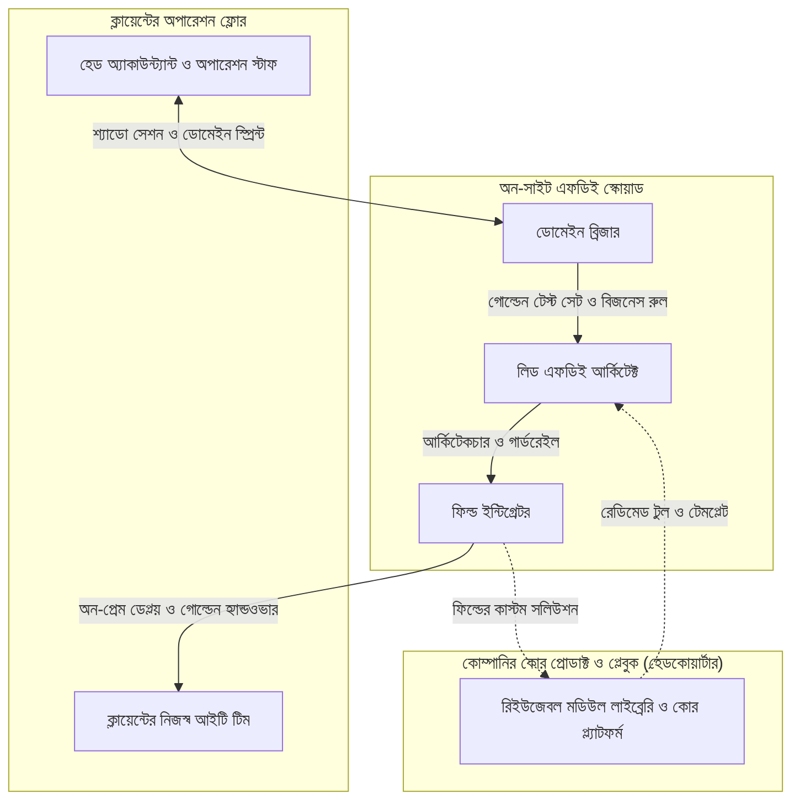

# চ্যাপ্টার ৫: এফডিই অর্গানাইজেশন স্কেলিং ও ক্যারিয়ার রোডম্যাপ

---

### ১. একজন এফডিই থেকে একটা পূর্ণাঙ্গ এফডিই টিম

গত চারটা চ্যাপ্টারে আপনি প্রায় একাই পুরো লড়াইটা লড়েছেন। ক্লায়েন্টের অফিসে ঢুকে প্রথম আটচল্লিশ ঘণ্টায় স্টাফদের ফিয়ার কাটিয়েছেন। টেবিলের নিচের পুরনো ডেল পিসিতে `Ollama` আর `Qwen 2.5` বসিয়েছেন। বিশ মিনিটের ডোমেইন স্প্রিন্টে হেড অ্যাকাউন্ট্যান্ট সাহেবের ভ্যাটের হিসাব ধরেছেন। আর মাঝরাতে সার্ভার ক্র্যাশ করলেও যেন সিস্টেম নিজেই উঠে দাঁড়ায়, সেজন্য সেলফ-হিলিং রোলব্যাক পাইপলাইন বসিয়েছেন।

প্রথম ব্রাঞ্চ এখন গো-লাইভে। হেড অফিসের অডিট টিম এসে ফাইল মিলিয়ে খুশি হয়ে ফিরে গেছে। উনষাট জন স্টাফের বেশিরভাগই নতুন সিস্টেমে কাজ করছেন, আর হেড অ্যাকাউন্ট্যান্ট সাহেবের লাল মলাটের খাতাটা এখন টেবিলের কোণে বন্ধ হয়ে পড়ে আছে। হ্যান্ডওভারের বাকি গল্প কনক্লুশনে বলব।

ঠিক এক সপ্তাহ পর প্রজেক্ট ডিরেক্টর আবার আপনার টেবিলের সামনে এসে বসলেন। মুখে চওড়া হাসি নিয়ে বললেন, *"ভাই, এই ব্রাঞ্চে তো জাদু দেখিয়ে দিলেন। আমাদের একই গ্রুপের বাকি তিনটা শাখাতেও - চট্টগ্রাম পোর্ট, নারায়ণগঞ্জ সিমেন্ট মিল আর গাজীপুর গার্মেন্টস - হুবহু এই সিস্টেমটা চালু করতে হবে। আগামী মাসেই!"*

কথাটা শুনে আপনি দুই সেকেন্ড চুপ করে রইলেন।

তিনটা নতুন ব্রাঞ্চ মানে তিনজন আলাদা হেড অ্যাকাউন্ট্যান্ট, তিনটা আলাদা লাল খাতা, তিন সেট অলিখিত শর্টকাট আর তিনটা পুরনো পিসি। অথচ আপনি মানুষ একজনই। নিজেকে তো আর কপি-পেস্ট করে তিন জায়গায় পাঠানো যাবে না, ঠিক না?

একটা সফল প্রজেক্টের পর আমাদের কোম্পানি **'ডেপ্লয়-কো ইনক'**-এর কাছে যখন এভাবে আরও তিনটা ব্রাঞ্চের কাজ আসে, তখন প্রতিবার স্ক্র্যাচ থেকে কোড লিখলে টিম টিকবে না আর। এই জায়গায় এসে যেকোনো ইঞ্জিনিয়ার বা সফটওয়্যার কোম্পানির সামনে দুটো রাস্তা খোলা থাকে। প্রথম রাস্তা হলো নিজের ঘুম, খাওয়া আর শরীরের বারোটা বাজিয়ে একাই তিন ব্রাঞ্চে দৌড়ানো। দুমাস পর ক্লান্তিতে পুরো প্রজেক্টই ভেঙে পড়বে। দ্বিতীয় রাস্তা হলো নিজের অর্জিত অভিজ্ঞতাটাকে একটা সিস্টেমে ট্রান্সফর্ম করে একটা **এফডিই টিম (FDE Squad)** গড়ে তোলা।

এই চ্যাপ্টারে আমি আপনাকে সেই দ্বিতীয় রাস্তাটা দেখাব। একটা প্রথাগত সফটওয়্যার কোম্পানি কীভাবে প্যাসিভ আউটসোর্সিং ছেড়ে ফিল্ড ইঞ্জিনিয়ারিংয়ে ট্রান্সফর্ম হয়। ফিল্ডের কাস্টম কোড থেকে কীভাবে কোম্পানির কোর প্রোডাক্ট তৈরি হয়। আর একজন নতুন বা জুনিয়র প্রোগ্রামার কীভাবে ধাপে ধাপে নিজেকে ফিল্ড আর্কিটেক্ট হিসেবে গড়ে তুলতে পারেন।

---

### ২. প্যাসিভ আউটসোর্সিং বনাম অ্যাক্টিভ ফিল্ড ইঞ্জিনিয়ারিং

আমাদের দেশের বেশিরভাগ সফটওয়্যার সার্ভিস কোম্পানি এখনো একটা পুরনো মডেলে কাজ করছে। ক্লায়েন্ট একটা রিকোয়ারমেন্ট ডকুমেন্ট পাঠায়, ভেন্ডর কোম্পানি নিজের অফিসে বসে তিন-চার মাস কোড লেখে, তারপর সফটওয়্যারটা ক্লায়েন্টের সার্ভারে তুলে দিয়ে বিল নিয়ে চলে আসে। এই মডেলটার নাম **প্যাসিভ আউটসোর্সিং**।

ইন্ট্রোডাকশনের সেই দৃশ্যটা মনে করুন। ইউএটি (UAT) সাইন-অফ হয়ে গেছে, বিলও পেমেন্ট হয়ে গেছে, প্রতিটা ইউনিট টেস্ট গ্রিন। অথচ ১২০ দিন পর গিয়ে দেখা গেল, উনষাট জন স্টাফের মধ্যে গত ত্রিশ দিনে সিস্টেমে লগইন করেছেন মাত্র চারজন। প্যাসিভ আউটসোর্সিংয়ের শেষ পরিণতি অনেক সময় এটাই হয়। কোড ডেলিভারি হয় ঠিকই, কিন্তু মানুষের রিয়েল প্রবলেম সমাধান হয় না।

**ফিল্ড ইঞ্জিনিয়ারিং** মডেলে সাকসেসের মাপকাঠিটাই আলাদা। এখানে কোড ডেলিভারি দেয়া মানে কাজ শেষ নয়। ক্লায়েন্টের স্টাফরা প্রতিদিন সিস্টেমটা ব্যবহার করে নিজেদের কাজ দ্রুত সারতে পারছেন কি না, সেটাই একমাত্র মাপকাঠি।

তবে অন-গ্রাউন্ডে ইঞ্জিনিয়ার পাঠালেই কাজ হবে না, যদি তাঁর হাতে সিদ্ধান্ত নেয়ার ক্ষমতা, মানে **অটোনমি (Autonomy)**, না থাকে। প্রতিটা ছোটখাটো পরিবর্তনের জন্য যদি ইঞ্জিনিয়ারকে হেড অফিসের প্রজেক্ট ম্যানেজারকে মেইল করে দুই দিন অনুমতির অপেক্ষায় বসে থাকতে হয়, তাহলে তাঁর অন-গ্রাউন্ডে থাকা আর না থাকা সমান কথা। তাই প্রজেক্ট শুরুর দিনই সিদ্ধান্তের বাউন্ডারি পরিষ্কার করে নিতে হবে।

!!! info "সিদ্ধান্তের বাউন্ডারি: কোনটা আপনার হাতে, কোনটা ক্লায়েন্টের হাতে?"
    চ্যাপ্টার ৩-এ আমরা যেমন এআই এজেন্টের জন্য গার্ডরেইল বানিয়েছিলাম, ফিল্ড ইঞ্জিনিয়ারের জন্যও তেমন একটা পরিষ্কার গার্ডরেইল দরকার। কোন পাইথন লাইব্রেরি ব্যবহার হবে, লোকাল সার্ভারে কোন মডেল চলবে, কোন কুইক উইনটা আগে ডেলিভারি হবে - এই টেকনিক্যাল সিদ্ধান্তগুলো ফিল্ড ইঞ্জিনিয়ারের হাতে থাকবে। কিন্তু ক্লায়েন্টের মূল প্রোডাকশন ডেটাবেজের স্কিমা বদলানো, কোনো ডেটা লোকাল নেটওয়ার্কের বাইরে পাঠানো কিংবা প্রজেক্টের বাজেট বাড়ানোর মতো সিদ্ধান্তে ক্লায়েন্টের লিখিত অনুমোদন নিতেই হবে। এই বাউন্ডারি পরিষ্কার থাকলে ইঞ্জিনিয়ার অন-গ্রাউন্ডে বসে নির্ভয়ে দ্রুত কাজ করতে পারবেন।

---

### ৩. এফডিই স্কোয়াড তৈরি: ইকো ও ডেল্টা থেকে আধুনিক স্কোয়াড

শুরুতে আমরা দেখেছি, প্যালান্টির যখন তাদের এফডিই মডেল দাঁড় করাল, তখন টিমগুলোকে মূলত **'ইকো' (Echo)** আর **'ডেল্টা' (Delta)** - এই দুই ভাগে ভাগ করে নেয়া হতো। ইকো টিম ক্লায়েন্টের ডোমেইনের ভেতরের সূক্ষ্ম বিষয়গুলো আর ইউজারের কাজের ফ্লো বুঝত। ডেল্টা টিম কঠিন পরিবেশে কোড লিখে প্রজেক্ট দাঁড় করাত।

গাজীপুর, নারায়ণগঞ্জ আর চট্টগ্রামের মতো একাধিক সাইটে যখন একসাথে কাজ করতে হবে, তখন ঠিক ওই দর্শন থেকেই আমি ছোট ছোট **এফডিই স্কোয়াড** তৈরি করার পক্ষে। একটা আদর্শ স্কোয়াডে তিনটা রোল থাকে। ছোট প্রজেক্টে একজন মানুষই হয়তো দুটো রোল সামলান, কিন্তু কাজের ধরনগুলো আলাদা:

১. **ডোমেইন ব্রিজার (Domain Bridger - ইকো রোল):** ইনি ক্লায়েন্টের ব্যবসার ভাষাটাকে কোডের ভাষায় ট্রান্সলেট করবেন। চ্যাপ্টার ১-এ শ্যাডো সেশন করা, আর চ্যাপ্টার ৩-এ হেড অ্যাকাউন্ট্যান্ট সাহেবের পাশে বসে ভ্যাট-রিবেটের নিয়ম বুঝে টেস্ট কেস লেখা - এগুলো ডোমেইন ব্রিজারের কাজ। তিনি স্টাফদের সাথে চা খেয়ে ট্রাস্ট তৈরি করবেন, তাঁদের অলিখিত শর্টকাট ডিসকাভারি করবেন, আর সেগুলোকে পরিষ্কার ইউজার স্টোরি ও গোল্ডেন টেস্ট সেটে ট্রান্সফর্ম করবেন।
২. **ফিল্ড ইন্টিগ্রেটর (Field Integrator - ডেল্টা রোল):** ইনি কঠিন পরিবেশে হাতে-কলমে কোড লিখে পাইপলাইন জোড়া লাগানোর কারিগর। চ্যাপ্টার ২-এর মতো পুরনো ডেল পিসিতে `Ollama` ও `SQLite WAL` সেটআপ করা, চ্যাপ্টার ৪-এর মতো ওএলটির অ্যালার্ম ফিড বা ওয়েব্রিজ স্লিপের ডেটার সাথে পাইথন স্ক্রিপ্টের সংযোগ দেয়া, আর সেলফ-হিলিং সিআই/সিডি পাইপলাইন ডেপ্লয় করা তাঁর মূল দায়িত্ব।
৩. **লিড এফডিই আর্কিটেক্ট (Lead FDE Architect):** ইনি পুরো সিস্টেমের ছক কষবেন আর একাধিক সাইটের কাজ তদারকি করবেন। কোন প্রবলেমটা সাধারণ `if-else` লজিকে মিটবে আর কোনটার জন্য লোকাল এলএলএম লাগবে, এজেন্টের গার্ডরেইল কী হবে, ক্লায়েন্টের ম্যানেজমেন্টের সাথে স্কোপ ডিফেন্স কন্ট্রাক্ট কীভাবে থাকবে - এই স্ট্রাটেজিক সিদ্ধান্তগুলো তিনি নেবেন।

নিচের ডায়াগ্রামে দেখুন, একটা এফডিই স্কোয়াড ক্লায়েন্টের সাইট আর নিজেদের হেড অফিসের মধ্যে কীভাবে সমন্বয় করে কাজ করবে:



---

### ৪. ফিল্ড-টু-কোর প্রোডাক্ট ফিডব্যাক লুপ: প্যালান্টির প্যাটার্ন

ডায়াগ্রামের নিচের ডটেড লাইন দুটোর দিকে একটু বিশেষ নজর দিন। ওখানেই লুকিয়ে আছে প্যালান্টিরের মতো কোম্পানির এফডিই মডেলের একটা বড় ধারণা, যার নাম **ফিল্ড-টু-কোর প্রোডাক্ট ফিডব্যাক লুপ (Field-to-Core Feedback Loop)**। ফিল্ডে শেখা জিনিস ফিরে যাবে প্রোডাক্টে, আর প্রোডাক্টের রেডিমেড মডিউল আবার ফিরে আসবে ফিল্ডে। এগুলো আমি নিজেও ব্যবহার করে এসেছি সরকারে থাকতে।

সাধারণ সার্ভিস কোম্পানি কেন সহজে প্রোডাক্ট কোম্পানি হতে পারে না, জানেন? কারণ তারা একটা ক্লায়েন্টের জন্য যে কোডটা লেখে, প্রজেক্ট শেষ হলে সেটা ওই ক্লায়েন্টের সার্ভারেই ফেলে আসে। পরের মাসে আরেকটা ক্লায়েন্টের কাছে গিয়ে আবার স্ক্র্যাচ থেকে একই ধরনের কোড লেখে।

একটা স্মার্ট এফডিই অর্গানাইজেশন কাজ করে উল্টো নিয়মে। এফডিই যখন চট্টগ্রাম বন্দরের জন্য থ্রি-ওয়ে রিকনসিলিয়েশন স্ক্রিপ্ট বা ঢাকার আইএসপির জন্য লোকাল ট্রায়াজ ইঞ্জিন বানাবেন, কাজ শেষে তিনি নিজেকে দুটো প্রশ্ন করবেন:

১. এই কোডের কোন অংশটুকু শুধু এই ক্লায়েন্টের নিজস্ব নিয়ম? যেমন ১% টলারেন্সের সংখ্যা, কাগজের কলামের নাম বা জোন কোড।
২. আর কোন অংশটুকু দেশের আরও পঞ্চাশটা কোম্পানির একই কাজে লাগবে? যেমন লোকাল `Ollama` কলিং র‍্যাপার, `SQLite WAL` কিউ, কিংবা তিনটা কাগজ মেলানোর মূল ইঞ্জিন।

এরপর তিনি প্রথম অংশটুকু কনফিগ ফাইলে রাখবেন, আর দ্বিতীয় অংশটুকু পরিষ্কার করে কোম্পানির হেডকোয়ার্টারের কোর ইঞ্জিনিয়ারিং টিমের কাছে পাঠিয়ে দেবেন। কোর টিম তখন ফিল্ড-টেস্টেড কোডটাকে একটা স্ট্যান্ডার্ড, রিইউজেবল মডিউলে ট্রান্সফর্ম করে কোম্পানির মূল লাইব্রেরিতে যুক্ত করবে।

ফলাফল কী দাঁড়াবে? ধরুন, প্রথম ব্রাঞ্চে সিস্টেম দাঁড় করাতে আপনার লেগেছিল দুই সপ্তাহ। কোর লাইব্রেরি তৈরি থাকলে দ্বিতীয় ব্রাঞ্চে রেডিমেড মডিউল নামিয়ে কনফিগ বদলাতে আর টেস্ট চালাতে লাগতে পারে দুই-তিন দিন। এই সংখ্যাটা আমার আন্দাজের উদাহরণ। আপনার ক্লায়েন্টে ঠিক কত লাগছে, সেটা প্রথম দুটো ব্রাঞ্চের লগ থেকে মেপে নিন। এভাবে দশটা ক্লায়েন্টের অন-গ্রাউন্ডে কাজ করার পর দেখা যাবে, কোম্পানির হাতে এমন একটা এন্টারপ্রাইজ প্ল্যাটফর্ম তৈরি হয়ে গেছে, যা ঘরে বসে কল্পনা করা যেত না। একজন এফডিই তখন শুধু একটা প্রজেক্ট ডেলিভারি দেবেন না, তিনি কোম্পানির প্রোডাক্ট রোডম্যাপের কাঁচামালও জোগাবেন।

!!! info "ফিল্ড-টু-কোর লুপের শক্তি"
    অন-গ্রাউন্ডে বসে লেখা কাস্টম স্ক্রিপ্ট যেন ক্লায়েন্টের সার্ভারেই হারিয়ে না যায়। প্রতিটা প্রজেক্ট থেকে জেনেরিক লজিকটুকু আলাদা করে কোম্পানির কোর প্ল্যাটফর্মে যুক্ত করুন। এতে পরের ডেপ্লয়মেন্টের সময় অনেকটাই কমে আসে, আর কাস্টম সার্ভিস থেকে জন্ম নেয় স্কেলেবল প্রোডাক্ট।

!!! warning "কোরে তোলার আগে তিনটা জিনিস দেখে নিন"
    প্রথমত, কোডটা কোরে তোলার অনুমতি ক্লায়েন্টের সাথে চুক্তিতে আছে কি না। কাস্টম কোডের মালিকানা আর পুনর্ব্যবহারের শর্ত আগেই পরিষ্কার করে নিন। দ্বিতীয়ত, কোরে যাবে শুধু জেনেরিক লজিক। ক্লায়েন্টের ডেটা, পাসওয়ার্ড, আসল ফাইলের নাম বা জোন কোড কোনোভাবেই যাবে না। তৃতীয়ত, কোর লাইব্রেরি বদলালে সব ক্লায়েন্টেই বদলায়। তাই প্রতিটা নতুন ভার্সন ছাড়ার আগে চ্যাপ্টার ৩-এর গোল্ডেন টেস্ট সেট দিয়ে প্রতিটা ক্লায়েন্টের কনফিগে টেস্ট চালান।

#### কোড-স্যান্ডউইচ মেথড: ফিল্ড-টু-কোর কনফিগ ডিকাপলার (প্যালান্টির প্যাটার্ন)

**১. আসল সংকট:** চ্যাপ্টার ৪-এ বন্দরের হেড ক্লার্ক ওজনের ছাড় বলেছিলেন ১%। কল্পনা করুন, নারায়ণগঞ্জের একটা সিমেন্ট ফ্যাক্টরির ছাড় ০.৫%, আর গাজীপুরের একটা গার্মেন্টসের ২%। প্রতিটা ক্লায়েন্টের জন্য আলাদা পাইথন ফাইল কপি-পেস্ট করলে দশটা ক্লায়েন্টের পর কোডবেস মেইনটেইন করা অসম্ভব হবে। সমাধান হলো ক্লায়েন্টের নিজস্ব সংখ্যাগুলো কনফিগে সরিয়ে একটা স্ট্যান্ডার্ড কোর মডিউল বানানো।

**২. মূল কোড:** নিচের কুড়ি লাইনের মতো পাইথন কোডটা চ্যাপ্টার ৪-এর রিকনসিলারকে ভেঙে দেখাবে, ক্লায়েন্টের নিজস্ব সংখ্যা (`tolerance_pct`) কীভাবে মূল ইঞ্জিন (`core_reconcile`) থেকে আলাদা হয়ে কনফিগে চলে যায়:

```python
# FDE Field-to-Core Pattern: Reusable Core Engine + Client Configs
from decimal import Decimal

def core_reconcile(customs: dict, invoice: dict, slip: dict, cfg: dict) -> dict:
    declared = Decimal(customs["gross_kg"])
    limit = declared * Decimal(cfg["tolerance_pct"]) / 100    # ছাড়ের সীমা আসছে কনফিগ থেকে
    weighed = Decimal(slip["scale_kg"] - slip["tare_kg"])      # ট্রাক আর কন্টেইনারের ট্যার বাদ
    invoiced = Decimal(invoice["net_kg"] + invoice["packing_kg"])
    hs_ok = customs["hs_code"].replace(".", "")[:6] == invoice["hs_code"].replace(".", "")[:6]
    ok = abs(weighed - declared) <= limit and abs(invoiced - declared) <= limit and hs_ok
    return {"client": cfg["name"], "status": "READY_FOR_GATE_PASS" if ok else "FLAGGED"}

# কোর কোডে হাত না দিয়ে শুধু কনফিগ বদলেই তিনটা ক্লায়েন্টে ডেপ্লয়
CLIENT_CONFIGS = [
    {"name": "ctg_port_cnf", "tolerance_pct": "1"},
    {"name": "ngj_cement", "tolerance_pct": "0.5"},
    {"name": "gzp_garments", "tolerance_pct": "2"},
]
customs_doc = {"gross_kg": 25000, "hs_code": "8471.30"}
invoice_doc = {"net_kg": 24750, "packing_kg": 250, "hs_code": "8471.30"}
slip_doc = {"scale_kg": 40200, "tare_kg": 15000}
for cfg in CLIENT_CONFIGS:
    print(core_reconcile(customs_doc, invoice_doc, slip_doc, cfg))
```

**৩. সিস্টেমের ইমপ্যাক্ট ও কোডের মানে কী:** স্ক্রিপ্টটা রান করলে আউটপুটে দেখবেন:

```text
{'client': 'ctg_port_cnf', 'status': 'READY_FOR_GATE_PASS'}
{'client': 'ngj_cement', 'status': 'FLAGGED'}
{'client': 'gzp_garments', 'status': 'READY_FOR_GATE_PASS'}
```

কোডটার ভেতরে ফিল্ড-টু-কোর দর্শনটা পরিষ্কার দেখা যাচ্ছে। চ্যাপ্টার ৪-এর `reconcile` ফাংশনে `TOLERANCE_PCT = 1` লাইনটা ছিল ওই ক্লায়েন্টের নিজস্ব নিয়ম। এখানে সেই এক লাইন কোর ইঞ্জিন থেকে বেরিয়ে `cfg["tolerance_pct"]` হয়ে গেছে। মূল ফাংশনের ভেতরে কোনো ক্লায়েন্টের নাম বা `1%` হার্ডকোড করা নেই, তাই এটা হেডকোয়ার্টারের কোর লাইব্রেরিতে বসতে পারবে।

একই চালান, ওয়েব্রিজের হিসাবে মালের ওজন ২৫,২০০ কেজি, ঘোষিত ওজনের চেয়ে ২০০ কেজি বেশি। চট্টগ্রামের ক্লায়েন্টে ১% ছাড়ের সীমা ২৫০ কেজি, তাই `READY_FOR_GATE_PASS`। নারায়ণগঞ্জে ০.৫% মানে সীমা ১২৫ কেজি, তাই একই চালান `FLAGGED`। গাজীপুরে ২% মানে ৫০০ কেজি, তাই আবার `READY_FOR_GATE_PASS`। মূল ইঞ্জিনের এক লাইন কোডও নতুন করে লিখতে হয়নি।

একটা ছোট খুঁটিনাটি। চ্যাপ্টার ৪-এ আমি পূর্ণসংখ্যা দিয়ে হিসাব করেছিলাম, যাতে ফ্লোটিং পয়েন্টের গোলমাল না আসে। ০.৫%-এর মতো দশমিক ছাড় কনফিগে এলে সবচেয়ে নিরাপদ হলো `Decimal`। তাই এখানে সংখ্যাগুলো কনফিগে লেখা হয়েছে টেক্সট হিসেবে (`"0.5"`)। আসল প্রোডাক্টে এই কনফিগ থাকবে `YAML` বা `JSON` ফাইলে, আর প্রতিটা ক্লায়েন্টের জন্য একটা করে।

**৪. গিটহাব রেফারেন্স:** ফিল্ড-টু-কোর মডিউল (`field_to_core_module.py`) পাবেন বইয়ের অফিশিয়াল কমপ্যানিয়ন রিপোজিটরির `ch05-org-scaling/` ফোল্ডারে: [https://github.com/raqueeb/fdebook_companion](https://github.com/raqueeb/fdebook_companion)।

---

### ৫. বাংলাদেশের পাঁচটা ইন্ডাস্ট্রিতে এফডিই কাজের সুযোগ

অনেকে ভাবেন ফরওয়ার্ড ডেপ্লয়েড ইঞ্জিনিয়ারিং বোধহয় শুধু সিলিকন ভ্যালির বড় কোম্পানির কাজ। অথচ একটু চোখ মেলে তাকালেই দেখবেন, আমাদের প্রধান ইন্ডাস্ট্রিগুলোতেই এফডিইদের জন্য অনেক কাজ পড়ে আছে। চ্যাপ্টার ৪-এ আইএসপি আর বন্দরের কেস স্টাডি দেখেছেন। বাকি ইন্ডাস্ট্রির বিস্তারিত কেস আমি বইয়ের অনলাইন অংশে রেখেছি। তার আগে এখানে আমাদের চারপাশের আরও পাঁচটা চেনা খাতের ছোট ছোট স্কেচ দিলাম:

**১. তৈরি পোশাক কারখানা (আরএমজি ও টেক্সটাইল):** গার্মেন্টসের সুইং ফ্লোরে কোয়ালিটি ইন্সপেক্টররা সারাদিন লাইনে ঘুরে কাগজের শিটে লিখে রাখেন কোন শার্টে সেলাই বাঁকা হয়েছে বা কোথায় মাপ ভুল। বিকেলে একজন ডেটা এন্ট্রি অপারেটর সেই কাগজ দেখে এক্সেলে তোলেন। পরদিন সকালে ফ্যাক্টরি ম্যানেজার যখন রিপোর্টে দেখেন যে ৩ নম্বর লাইনে সমস্যা ছিল, ততক্ষণে হয়তো আরও কয়েকশো পিস কাপড় নষ্ট হয়ে গেছে। একজন এফডিই ওই ফ্লোরে গিয়ে কারখানার লোকাল নেটওয়ার্কে একটা ট্যাবলেট-ভিত্তিক ট্র্যাকার আর লাইভ ড্যাশবোর্ড বসিয়ে দিতে পারেন। বায়ারের গোপন ডিজাইন ক্লাউডে না পাঠিয়েই ফ্লোর ম্যানেজার তখন রিয়েল-টাইমে দেখতে পাবেন কোন লাইনে ডিফেক্ট বাড়ছে।

**২. ব্যাংক ও ফিন্যান্সিয়াল প্রতিষ্ঠান:** ব্যাংকে একটা এসএমই (SME) লোনের ফাইল এলে অফিসারকে কাস্টমারের এনআইডি, ট্রেড লাইসেন্স, ব্যাংক স্টেটমেন্ট আর ট্যাক্স রিটার্নের পাতার পর পাতা কাগজ হাতে মিলিয়ে দেখতে হচ্ছে। এই ডেটা পাবলিক ক্লাউডে পাঠানো অনেক ব্যাংকের জন্য কঠিন, কোথাও হয়তো নিষিদ্ধ। বাংলাদেশ ব্যাংকের গাইডলাইন আর নিজেদের কমপ্লায়েন্স টিমের সাথে বসে এটা আগে নিশ্চিত করে নেবেন। এখানে একজন এফডিই ব্যাংকের নিজস্ব অন-প্রেম সার্ভারে লোকাল ওসিআর (OCR) আর ছোট এলএলএম বসিয়ে একটা অটোমেটেড চেকলিস্ট ইঞ্জিন বানাতে পারেন। সেটা কয়েক মিনিটের মধ্যে নামের বানান, জন্মতারিখ আর টাকার অঙ্কের অসঙ্গতিগুলো হাইলাইট করে দেবে। লোন অনুমোদনের সিদ্ধান্ত অবশ্যই মানুষের হাতেই থাকবে।

**৩. হাসপাতাল ও ডায়াগনস্টিক সেন্টার:** হাসপাতালের রিসেপশন আর রিপোর্ট ডেলিভারি কাউন্টারে সবসময় ভিড় আর ক্যাওস। রোগীর রিপোর্ট তৈরি হয়েছে কি না, ডাক্তার কখন বসবেন, কোন ফাইল কোথায় গেছে, এসব খুঁজতেই স্টাফরা হিমশিম খাচ্ছেন। ডাক্তারের চিকিৎসার সিদ্ধান্তে হাত না দিয়েও একজন এফডিই হাসপাতালের লোকাল সার্ভারে ল্যাব মেশিনের আউটপুটের সাথে অটোমেটেড এসএমএস আর সিরিয়াল ম্যানেজমেন্ট পাইপলাইন জুড়ে দিতে পারেন। ল্যাব মেশিন সাধারণত ASTM বা HL7 ফরম্যাটে রেজাল্ট পাঠায়। ক্লায়েন্টের আইটি টিমের কাছ থেকে ঠিক কোনটা চলছে, সেটা জেনে নিন। এসএমএসে শুধু যাবে "আপনার রিপোর্ট তৈরি হয়েছে", রিপোর্টের ফলাফল নয়।

**৪. সরকারি দপ্তর ও নাগরিক সেবা:** সরকারি অফিসে ডিজিটাল পোর্টাল থাকার পরও সমান্তরালভাবে অনেক সময় কাগজের ফাইল চলে। চ্যাপ্টার ১-এর এসওপি বনাম গ্রাউন্ড রিয়েলিটির ফারাক এখানে সবচেয়ে বড়। এক ধাক্কায় পুরো সিস্টেম বদলাতে না গিয়ে ছোট কুইক উইন দিয়ে শুরু করা ভালো। যেমন ফাইল ট্র্যাকিং, কিংবা চ্যাপ্টার ৪-এর মতো এক ক্লিকে মাসিক সামারি রিপোর্ট তৈরির অটোমেশন। ডেটা অফিসের নিজস্ব সার্ভারে, দেশের ভেতরেই থাকবে।

**৫. ই-কমার্স ও লজিস্টিকস কুরিয়ার:** হাজার হাজার পার্সেল ডেলিভারির সময় কাস্টমাররা ফেসবুক পেজে আর চ্যাটবক্সে বাংলা-ইংরেজি মিশিয়ে (বাংলিশে) লিখছেন, *"ভাই আমার অর্ডারটা কালকে আসার কথা ছিল, এখনো ডেলিভারি ম্যান ফোন দিল না কেন?"* এই মেসেজে কিন্তু অর্ডার আইডি নেই। তাই চ্যাপ্টার ২-এর লোকাল এলএলএম ট্রায়াজ শুধু বুঝবে, এটা ডেলিভারি দেরির অভিযোগ। অর্ডার খুঁজে বের করতে হবে মেসেজ পাঠানোর ফোন নম্বর বা কাস্টমারের প্রোফাইল দিয়ে। আর মেসেজে যদি কোডসহ আইডি থাকেই, সেটা তোলার কাজটা করবে রেগুলার এক্সপ্রেশনের মতো ডিটারমিনিস্টিক কোড, এলএলএম নয়। তারপর চ্যাপ্টার ৪-এর ওয়েবহুক রাউটারের ধাঁচে কুরিয়ার হাবের ডেটাবেজ মিলিয়ে স্বয়ংক্রিয় রিপ্লাই আর অ্যাকশন ট্রিগার করা যাবে।

খেয়াল করে দেখুন, এই পাঁচটা খাতের প্রায় প্রতিটাতেই মূল সমস্যা এক। ডেটা আছে, কিন্তু অগোছালো অবস্থায়। আর ক্লাউড বিলের ভয় বা প্রাইভেসির কারণে তারা প্রথাগত ক্লাউড সলিউশনে যেতে পারছে না। একজন এফডিইর জন্য এর চেয়ে বড় সুযোগ আর কী হতে পারে?

---

### ৬. একজন এফডিইর তিনমুখী দক্ষতা (স্কিল সেট)

নতুন যাঁরা এই লাইনে আসতে চান, তাঁদের মনে প্রশ্ন আসবে, একজন ভালো এফডিই হতে ঠিক কী কী শিখতে হবে? শুধু পাইথন বা রিঅ্যাক্ট জানলেই কি চলবে? ইন্ট্রোডাকশনে আমি বলেছিলাম, ফুল স্ট্যাকের ওপরে এফডিইকে আরও কয়েকটা লেয়ার বাড়তি সামলাতে হয়। এবার সেটা আপনার নিজের দক্ষতার ভাষায় বলি। এফডিই হতে হলে তিনটা আলাদা জগতের দক্ষতা নিজের ভেতর মেলাতে হবে।

**প্রথমত, সলিড কমান্ড লাইন ও কোর ইঞ্জিনিয়ারিং:** অন-গ্রাউন্ডে সবসময় সুন্দর গ্রাফিক্যাল ইন্টারফেস পাবেন না। ক্লায়েন্টের পুরনো সার্ভারে হয় উবুন্টু লিনাক্স চলবে, নয়তো পুরনো উইন্ডোজ সার্ভার। তাই লিনাক্স টার্মিনাল, শেল স্ক্রিপ্টিং, `cron`, লোকাল নেটওয়ার্কিং (আইপি, পোর্ট, ফায়ারওয়াল), ডকার আর `SQLite` বা `PostgreSQL`-এর মতো ডেটাবেজে আপনার হাত একদম পাকা হতে হবে।

আমার নিজের কম্পিউটার লাইফের শুরুটা হয়েছিল ইউনিক্স (Unix) দিয়ে। অফিসে চালাতাম সান সোলারিস (Sun Solaris), আর বাসায় নিজের পিসিতে ফ্রিবিএসডি (FreeBSD)। কাজ করতে করতে একদিন বুঝলাম, একই কাজ প্রতিদিন হাতে না করে যন্ত্রকে দিয়ে কামলা খাটাতে হলে শেল স্ক্রিপ্টিং শিখতেই হবে। সত্যি বলতে, আমার সেই 'ফাঁকিবাজির' হ্যাবিটটাই আমাকে পরে পাইথন, অটোমেশন আর আজকের এআই এজেন্ট পর্যন্ত টেনে এনেছে। এই বইয়ের প্রতিটা চ্যাপ্টারের মূল শক্তি কিন্তু লুকিয়ে আছে ওই টার্মিনাল আর কমান্ড লাইনের ভেতরেই।

**দ্বিতীয়ত, লোকাল এআই ও ডেটা পাইপলাইন অর্কেস্ট্রেশন:** অগোছালো ডেটা তুলে আনা (Extract), পরিষ্কার ফরম্যাটে সাজানো (Transform), তারপর ডেটাবেজে ঢোকানো (Load) - সংক্ষেপে একে বলে ইটিএল (ETL)। সাথে জানতে হবে `Ollama` দিয়ে লোকাল মডেল চালানো, চ্যাপ্টার ২-এর মতো `JSON` আউটপুট লক করা, ইভ্যালুয়েশন হারনেস লেখা, আর এআই কোডিং এজেন্টকে (ডিপসিক, ওপেনকোড হারনেস বা ক্লাইন) গার্ডরেইলের ভেতরে রেখে দ্রুত কোড লেখানো। আউটপুটের স্কিমা আরও কড়াভাবে যাচাই করতে চাইলে `Pydantic` কাজে লাগবে।

**তৃতীয়ত, মানুষের মনস্তত্ত্ব ও ডোমেইন বোঝার ধৈর্য:** এটাই সবচেয়ে বিরল দক্ষতা। কোড অনেকেই লিখতে পারেন। কিন্তু হেড অ্যাকাউন্ট্যান্ট বা পোর্ট ক্লার্কের পাশে এক ঘণ্টা চুপচাপ বসে তাঁর কাজের কষ্টটা বোঝার ধৈর্য খুব কম ইঞ্জিনিয়ারের আছে। স্টাফদের ফিয়ার কাটানো, মিড-লেভেল ম্যানেজারের ইগো সামলানো, আর ক্লায়েন্টের সাথে সাকসেস মেট্রিক নিয়ে পরিষ্কার কথা বলার ক্ষমতাই একজন সাধারণ কোডারকে এফডিই আর্কিটেক্ট বানায়।

!!! tip "নিজেকে যাচাই করার এক মিনিটের টেস্ট"
    নিজেকে একটা সহজ প্রশ্ন করুন: আমি কি কোনো কথা না বলে, কোনো উপদেশ না দিয়ে একজন নন-টেকনিক্যাল স্টাফের ডেস্কের পাশে টানা এক ঘণ্টা চুপচাপ বসে শুধু তাঁর কাজ দেখতে পারব? উত্তর "হ্যাঁ" হলে আপনার ভেতরে একজন দুর্দান্ত এফডিই হওয়ার বীজ আছে। আর যদি মনে হয় "এক ঘণ্টা বসে থেকে কী লাভ, আমি তো দশ মিনিটে কোড লিখে ফেলব", তাহলে পরের দিনই এই চুপ করে দেখার চর্চাটা শুরু করুন।

---

### ৭. জুনিয়র ডেভেলপার থেকে ফিল্ড আর্কিটেক্ট: ৫ ধাপের ক্যারিয়ার রোডম্যাপ

আপনি যদি আজ ইউনিভার্সিটির স্টুডেন্ট বা জুনিয়র সফটওয়্যার ডেভেলপার হন, তাহলে আগামী ছয় মাস থেকে এক বছরে নিজেকে যতটা এগিয়ে নিতে পারবেন, তার জন্য নিচের পাঁচটা ধাপ ধরে এগোতে পারেন। নতুন প্রজন্ম বাঁচলে দেশও বাঁচবে।

* **ধাপ ১ (কমান্ড লাইন ও পাইথনে হাত পাকানো):** নিজের প্রতিদিনের যেকোনো বোরিং কাজ, যেমন ফাইল রিনেম করা, এক্সেল থেকে পিডিএফ বানানো বা লগ পার্স করা, পাইথন ও ব্যাশ স্ক্রিপ্ট দিয়ে অটোমেট করার হ্যাবিট গড়ুন।
* **ধাপ ২ (নিজের ল্যাপটপে লোকাল এআই ল্যাব):** বইয়ের গিটহাব রিপোজিটরি ক্লোন করুন। পাইথন ৩.১০ বা তার পরের ভার্সন লাগবে। `Ollama` ইনস্টল করে `ollama pull qwen2.5:1.5b` চালালে মডেলটা নেমে আসবে। চ্যাপ্টার ২-এর হিসাবে এটা চলতে ১.৫ থেকে ২ জিবির মতো র‍্যাম লাগে, তাই সাধারণ ল্যাপটপেই চলবে। চ্যাপ্টার ২, ৩ ও ৪-এর স্ক্রিপ্টগুলো চালিয়ে দেখুন আর নিজের মতো মডিফাই করুন।
* **ধাপ ৩ (পাশের মানুষের একটা রিয়েল প্রবলেম সমাধান):** বড় কর্পোরেট ক্লায়েন্টের জন্য অপেক্ষা করবেন না। আপনার বাবার দোকান, পাড়ার ডায়াগনস্টিক সেন্টার, পরিচিত কারও ছোট ই-কমার্স পেজ বা নিজের ডিপার্টমেন্টের অফিস, যেকোনো একটা জায়গায় গিয়ে চ্যাপ্টার ১-এর মতো শ্যাডো সেশন করুন। তাঁদের As-Is আর To-Be ডায়াগ্রাম আঁকুন, আর এক সপ্তাহে একটা ছোট অটোমেশন বানিয়ে দিন। শুরুর আগে অনুমতি নিন, আর অন্যের আসল ডেটা নিজের কাছে কপি করে রাখবেন না।
* **ধাপ ৪ (কেস স্টাডি পোর্টফোলিও তৈরি):** সাধারণ ডেভেলপাররা গিটহাবে শুধু কোড রাখেন। আপনি `README.md`-তে রাখবেন পুরো ফিল্ড স্টোরি: কাস্টমারের আগে কী সমস্যা ছিল (As-Is), কত মিনিট নষ্ট হতো, আপনি কী আর্কিটেকচার বসালেন (To-Be), আর এখন কত মিনিট লাগছে। ক্লায়েন্টের নাম আর আসল ডেটা বাদ দিয়ে, অনুমতি নিয়ে লিখবেন। যেকোনো হায়ারিং ম্যানেজার বা সিটিও এই এক পাতার কেস স্টাডি দেখলেই আপনাকে আলাদা করে চিনে নেবেন।
* **ধাপ ৫ (স্কোয়াডে যোগদান ও প্লেবুক তৈরি):** কোনো টেক বা এআই কোম্পানিতে সলিউশন ইঞ্জিনিয়ার, অ্যাপ্লাইড এআই ইঞ্জিনিয়ার বা এফডিই হিসেবে কাজ শুরু করুন। প্রতিটা প্রজেক্টের লার্নিং দিয়ে একটা রিইউজেবল লাইব্রেরি আর নিজের প্লেবুক গড়ে তুলুন।

---

### ৮. হ্যান্ডস-অন কোড প্রুফ: প্রথম সপ্তাহের "কুইক উইন" বাছাইয়ের অ্যালগরিদম

নতুন এফডিইরা অন-গ্রাউন্ডে গিয়ে একটা কমন দ্বিধায় পড়েন। শ্যাডো সেশন শেষে দেখা যায়, ক্লায়েন্টের অফিসে দশটা আলাদা সমস্যা। কিন্তু প্রথম সপ্তাহের ট্রাস্ট জেতার জন্য আপনার হাতে সময় মাত্র পাঁচ-সাত দিন। কোন কাজটা আগে ধরবেন?

#### কোড-স্যান্ডউইচ মেথড

**১. সত্যিকারের সংকট:** ডিসকাভারি পর্ব শেষে আপনার নোটবুকে চার-পাঁচটা বড় বটলনেকের তালিকা জমেছে। ভুল করে যদি এমন একটা জটিল কাজ প্রথমেই হাতে নেন, যার বিজনেস রুলই পরিষ্কার নয়, তাহলে প্রথম সপ্তাহেই প্রজেক্ট আটকে যাবে আর ক্লায়েন্টের আস্থা হারাবেন। তাই ডেটার ভিত্তিতে সবচেয়ে নিরাপদ আর হাই-ইমপ্যাক্ট কাজটা বাছাই করা দরকার।

**২. মূল কোড:** নিচের পাইথন স্ক্রিপ্টটা প্রতিটা কাজের দৈনিক সময়ের অপচয় আর নিয়মের স্পষ্টতা (`rules_clear`) হিসাব করে প্রথম সপ্তাহের কুইক উইনগুলোর একটা র‍্যাংকিং তৈরি করবে:

```python
# FDE Field Tool: First-Week Quick-Win Prioritization Scorer
discovered_tasks = [
    {"name": "ম্যানেজারের ফিজিক্যাল সইয়ের অপেক্ষা", "daily_freq": 2, "mins_each": 60, "rules_clear": True},
    {"name": "সন্ধ্যার এক্সেল সামারি রিপোর্ট তৈরি", "daily_freq": 1, "mins_each": 90, "rules_clear": True},
    {"name": "কাগুজে চালান ও গেট পাসের জটিল মিলানো", "daily_freq": 15, "mins_each": 8, "rules_clear": False},
    {"name": "ভ্যাট ও রিবেটের ম্যানুয়াল ক্যালকুলেশন", "daily_freq": 2, "mins_each": 30, "rules_clear": True},
]

def calculate_quick_win_score(task: dict) -> float:
    daily_wasted_mins = task["daily_freq"] * task["mins_each"]
    # নিয়ম অস্পষ্ট হলে প্রথম সপ্তাহে ঝুঁকি বেশি, তাই স্কোর ৭০% কমানো (০.৩ আমার হাতের হিসাব)
    risk_multiplier = 1.0 if task["rules_clear"] else 0.3
    return round(daily_wasted_mins * risk_multiplier, 1)

ranked_tasks = sorted(discovered_tasks, key=calculate_quick_win_score, reverse=True)
for t in ranked_tasks:
    print(f"Score: {calculate_quick_win_score(t):5.1f} | Task: {t['name']}")
```

**৩. সিস্টেমের ইমপ্যাক্ট ও কোডের মানে কী:** স্ক্রিপ্টটা রান করলে নিচের ক্রমটা পাবেন:

```text
Score: 120.0 | Task: ম্যানেজারের ফিজিক্যাল সইয়ের অপেক্ষা
Score:  90.0 | Task: সন্ধ্যার এক্সেল সামারি রিপোর্ট তৈরি
Score:  60.0 | Task: ভ্যাট ও রিবেটের ম্যানুয়াল ক্যালকুলেশন
Score:  36.0 | Task: কাগুজে চালান ও গেট পাসের জটিল মিলানো
```

কোডটার ভেতরের আসল বুদ্ধিটা খেয়াল করুন। শুধু মোট সময়ের অপচয় গুণ করলে *"কাগুজে চালান ও গেট পাসের মিলানো"* কাজটাতেও দিনে ১২০ মিনিট (`15 * 8`) নষ্ট হয়। কিন্তু শ্যাডো সেশনে আপনি দেখেছেন, ওই কাজটার কোনো নির্দিষ্ট নিয়ম নেই (`rules_clear: False`), একেক স্টাফ একেকভাবে করেন। প্রথম সপ্তাহেই ওই অগোছালো কাজে হাত দিলে নিয়ম ঠিক করতেই পনেরো দিন চলে যেতে পারে। তাই `risk_multiplier = 0.3` দিয়ে ওটার স্কোর ৩৬-এ নামিয়ে দেয়া হয়েছে। ডোমেইন স্প্রিন্টে নিয়মগুলো পরিষ্কার হয়ে গেলে ওই কাজটাই দ্বিতীয় ধাপে আপনার বড় প্রজেক্ট হবে, যেমন চ্যাপ্টার ৪-এর থ্রি-ওয়ে রিকনসিলিয়েশন।

অন্যদিকে *"ম্যানেজারের ফিজিক্যাল সই"* (১২০ মিনিট) আর চ্যাপ্টার ৪-এর বন্দরের ম্যানেজারের মতো *"সন্ধ্যার এক্সেল সামারি"* (৯০ মিনিট), এই দুটোর নিয়ম একদম পরিষ্কার (`rules_clear: True`)। চ্যাপ্টার ১-এর ওটিপি অ্যাপ্রুভাল ঠিক ওই সইয়ের অপেক্ষাটাই কমিয়েছিল। প্রথম সপ্তাহে এই দুটোকে অটোমেট করলে ঝুঁকি ছাড়াই অফিসে হইচই পড়ে যাবে। গুণক ০.৩ আমার হাতের হিসাব, ক্লায়েন্ট ভেদে বদলে নেবেন। আর `rules_clear` ঠিক করবেন শ্যাডো সেশনের পর, আন্দাজে নয়।

**৪. গিটহাব রেফারেন্স:** কুইক-উইন স্কোরার (`quick_win_scorer.py`) পাবেন বইয়ের অফিশিয়াল কমপ্যানিয়ন রিপোজিটরির `ch05-org-scaling/` ফোল্ডারে: [https://github.com/raqueeb/fdebook_companion](https://github.com/raqueeb/fdebook_companion)।

---

### ৯. অর্গানাইজেশন ও ক্যারিয়ারের সামারি

একজন (একক) ইঞ্জিনিয়ার থেকে যখন টিম বা কোম্পানির লেভেলে চিন্তা করবেন, তখন সবসময় সিস্টেম গড়ার দিকে মনোযোগ দিতে হবে। কোনো প্রজেক্ট যেন একজন সুপারস্টার ইঞ্জিনিয়ারের মাথার ওপর দাঁড়িয়ে না থাকে। অন-গ্রাউন্ডে যা শিখছেন, প্লেবুকে লিখে রাখুন। কাস্টম কোড থেকে রিইউজেবল মডিউল বানিয়ে কোম্পানির কোর প্ল্যাটফর্মে জমা করুন, যাতে পরের ব্রাঞ্চে একজন জুনিয়র ইঞ্জিনিয়ার গিয়েও কম সময়ে সিস্টেম দাঁড় করাতে পারেন।

নিজের ক্যারিয়ার গড়ার সময় একটা কথা মনে রাখবেন। চাকরির বাজারে এখন শুধু সিনট্যাক্স জানা কোডারের অভাব নেই। অভাব হলো এমন ইঞ্জিনিয়ারের, যিনি কাস্টমারের অপারেশন ফ্লোরে নেমে ক্যাওস থামাতে পারেন।

বইয়ের একদম শেষ প্রান্তে চলে এসেছি আমরা। পরের অংশ কনক্লুশনে দেখব, প্রজেক্ট শেষ করার সবচেয়ে জরুরি ধাপ: কীভাবে ক্লায়েন্টের নিজস্ব টিমের হাতে চাবি বুঝিয়ে দিয়ে **গোল্ডেন হ্যান্ডওভার** করতে হয়, গো-লাইভের পর প্রথম তিন সপ্তাহের **হাইপার-কেয়ার** কীভাবে চালাতে হয়। এখানে একটা বিষয় একটু এক্সপ্লোর বা রিসার্চ করবেন - দুনিয়া কেন আবার অন-প্রেম এজের দিকে ফিরে আসছে, আর দুমাস পর সেই হেড অ্যাকাউন্ট্যান্ট সাহেবের লাল মলাটের খাতাটার কী হলো।
