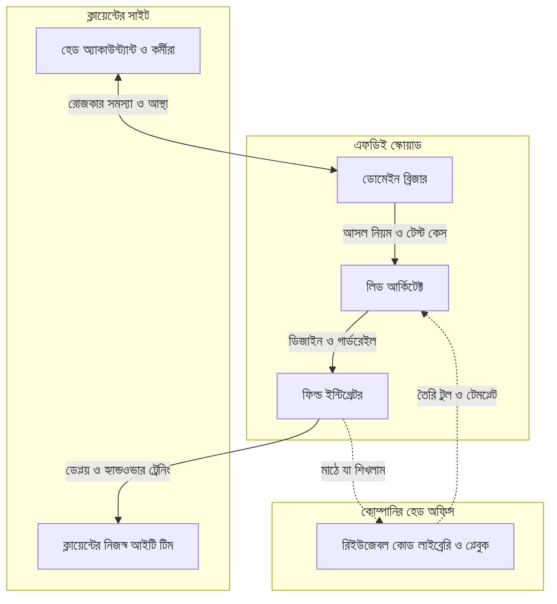

# চ্যাপ্টার ৫: এফডিই অর্গানাইজেশন স্কেলিং ও ক্যারিয়ার রোডম্যাপ

---

### ১. একজন এফডিই থেকে একটা এফডিই টিম

গত চার চ্যাপ্টারে আপনি প্রায় একাই লড়েছেন। ক্লায়েন্টের অফিসে ভয় কাটিয়েছেন, টেবিলের নিচের ধুলোমাখা সার্ভারে লোকাল মডেল চালিয়েছেন, বিশ মিনিটের স্প্রিন্টে ভ্যাটের হিসাব মিলিয়েছেন, আর বৃষ্টির রাতে সিস্টেমকে নিজে নিজে আগের অবস্থায় ফিরে যেতে শিখিয়েছেন।

প্রজেক্ট সফল। অডিট টিম এসেছিল, ফাইল মিলেছে। হেড অ্যাকাউন্ট্যান্ট সাহেবের লাল মলাটের খাতাটা এখন ড্রয়ারে ঘুমাচ্ছে।

এক সপ্তাহ পর প্রজেক্ট ডিরেক্টর আবার আপনার টেবিলে এসে বসলেন। মুখে সেই চেনা হাসি। "ভাই, আরও তিনটা ব্রাঞ্চে এটা চাই। আগামী মাসেই।"

আপনি দুই সেকেন্ড চুপ করে রইলেন।

তিনটা ব্রাঞ্চ মানে তিনটা আলাদা হেড অ্যাকাউন্ট্যান্ট, তিনটা আলাদা লাল খাতা। মানে নতুন করে তিন সেট শ্যাডো সেশন, তিন সেট অলিখিত শর্টকাট, তিনটা ধুলোমাখা সার্ভার। আর আপনি একজনই মানুষ। আপনাকে তো আর দুই কপি করা যায় না।

এখান থেকে দুটো পথ খোলা। একটা হলো নিজের ঘুম আর শরীরের বিনিময়ে একাই সব সামলানোর চেষ্টা। কয়েক মাস চলে, তারপর ক্লান্তিতে সব ভেঙে পড়ে। আরেকটা পথ হলো একটা টিম বানানো, যেখানে আপনার শেখা জিনিসগুলো অন্যরাও কাজে লাগাতে পারে।

এই চ্যাপ্টারে সেই দ্বিতীয় পথটাই দেখব। কোম্পানি কিভাবে নিজেকে বদলে এফডিই অপারেশন চালু করবে, দলে কে কী করবে, বাংলাদেশের কোন কোন ইন্ডাস্ট্রিতে এই কাজ ঢুকে পড়ছে, আর একজন জুনিয়র ইঞ্জিনিয়ার কোন পথ ধরে এই পেশায় আসবেন।

---

### ২. প্যাসিভ আউটসোর্সিং থেকে ফিল্ড ইঞ্জিনিয়ারিং

বেশিরভাগ সার্ভিস কোম্পানি এখনো একটা পুরনো মডেলে চলে। ক্লায়েন্ট একটা রিকোয়ারমেন্ট ডকুমেন্ট দেয়। কোম্পানি নিজের অফিসে বসে তিন মাস কাজ করে। তারপর সফটওয়্যার ক্লায়েন্টের হাতে তুলে দিয়ে সরে আসে। আমরা একে বলছি প্যাসিভ আউটসোর্সিং।

ইন্ট্রোর সেই গল্পটা মনে আছে? কোড নিখুঁত, টেস্ট সব সবুজ, অথচ ত্রিশ দিনে লগইন করেছেন মাত্র চারজন। এই মডেলের শেষটা বেশিরভাগ সময় ওরকমই হয়। কাজ ডেলিভারি হয়, কিন্তু কাজ চলে না।

ফিল্ড ইঞ্জিনিয়ারিংয়ের মডেলে হিসাবটা অন্যরকম। এখানে কোম্পানির সাফল্য মাপা হয় একটা প্রশ্ন দিয়ে: ক্লায়েন্টের কর্মীরা কি রোজ কাজটা ব্যবহার করছেন? ইঞ্জিনিয়াররা বসে থাকেন ক্লায়েন্টের সাইটে, চ্যাপ্টার ১-এর শ্যাডো সেশন আর চ্যাপ্টার ৩-এর ডোমেইন স্প্রিন্টের মতো কাজ করেন, আর যতক্ষণ না সিস্টেমটা সত্যিই চলছে, ততক্ষণ ফেরেন না।

এই বদলের একটা জরুরি শর্ত আছে।

সাইটে বসা ইঞ্জিনিয়ারের হাতে সিদ্ধান্ত নেওয়ার স্বাধীনতা থাকতে হবে। প্রতিটা ছোট সিদ্ধান্তের জন্য যদি হেড অফিসে ফোন করে অনুমতি নিতে হয়, তাহলে আপনি আসলে ফিল্ডে নেই, শুধু শরীরটা ওখানে। তাহলে স্বাধীনতার সীমা কোথায়? সেটা প্রজেক্ট শুরুর আগেই ক্লায়েন্টের সাথে বসে লিখে রাখুন।

!!! info "সিদ্ধান্তের সীমানা: কোনটা আপনার, কোনটা ক্লায়েন্টের"
    শুরুতেই একটা পাতায় লিখে নিন, ফিল্ডে কোন সিদ্ধান্ত আপনি নিজে নেবেন, আর কোনটার জন্য ক্লায়েন্টের লিখিত অনুমতি লাগবে। কোন টুল বা লাইব্রেরি ব্যবহার হবে, কোন ফিচার আগে আসবে, এগুলো আপনার। কিন্তু ক্লায়েন্টের মূল ডেটাবেজ বদলানো, কোনো ডেটা বাইরের সার্ভারে পাঠানো কিংবা প্রজেক্টের খরচ বাড়ানোর মতো বড় সিদ্ধান্ত ক্লায়েন্টের অনুমতি ছাড়া নয়। চ্যাপ্টার ৩-এ এআই এজেন্টের জন্য যেমন গার্ডরেইল বানিয়েছিলাম, এটা ইঞ্জিনিয়ারের জন্য সেই গার্ডরেইল। সীমানা পরিষ্কার থাকলে দুই পক্ষই নির্ভয়ে কাজ করতে পারে।

---

### ৩. এফডিই স্কোয়াড: তিনজন, তিন রকম কাজ

একটা স্ট্যান্ডার্ড এফডিই স্কোয়াডে সাধারণত তিনটা রোল থাকে। একজন মানুষ কখনো দুটো রোলও সামলান, বিশেষ করে ছোট প্রজেক্টে। কিন্তু কাজগুলো আলাদা, তাই আলাদা করেই বুঝে নিই।

**ডোমেইন ব্রিজার** হলেন সেই মানুষ, যিনি ক্লায়েন্টের ভাষায় কথা বলতে পারেন। চ্যাপ্টার ৩-এ আপনি যখন হেড অ্যাকাউন্ট্যান্ট সাহেবের পাশে টুল টেনে বসে ভ্যাটের স্ল্যাব বুঝলেন, তখন আপনি ছিলেন ডোমেইন ব্রিজার। তাঁর কাজ কর্মীদের আস্থা জেতা, অলিখিত নিয়মগুলো খুঁজে বের করা, আর সেগুলোকে এমন টেস্ট কেসে বদলে দেওয়া, যা ইঞ্জিনিয়াররা ধরতে পারেন। এই রোলে কেউ কেউ আসেন ব্যবসার দিক থেকে, কিছুটা টেক শিখে। কেউ আসেন টেকের দিক থেকে, ব্যবসাটা শিখে।

**ফিল্ড ইন্টিগ্রেটর** হলেন হাতে-কলমে জোড়া লাগানোর মানুষ। চ্যাপ্টার ২-এর ধুলোমাখা সার্ভারে Ollama বসানো, ডেটা পাইপলাইন দাঁড় করানো, ওয়্যারহাউসের স্ক্যানারের সাথে সফটওয়্যার জুড়ে দেওয়া, এসবই তাঁর কাজ। ডেপ্লয় করা আর ক্লায়েন্টের নিজস্ব টিমকে ট্রেনিং দেওয়াও তাঁর দায়িত্ব।

**লিড আর্কিটেক্ট** পুরো ছবিটা দেখেন। কোন সমস্যা লোকালে সমাধান হবে, কোনটা অন্যভাবে, এআই এজেন্টের গার্ডরেইল কোথায় বসবে, সিস্টেম ভাঙলে ফিরে যাওয়ার রাস্তা কী, এই সিদ্ধান্তগুলো তাঁর। ক্লায়েন্টের ম্যানেজমেন্টের সাথে ঝুঁকির কথাও তিনি সরাসরি বলেন।

নিচের ডায়াগ্রামে দেখুন, তিনজন কিভাবে একে অপরের সাথে আর ক্লায়েন্টের সাথে জুড়ে থাকেন:



ডায়াগ্রামের নিচের দিকের বিন্দু-বিন্দু লাইনটা খেয়াল করুন। মাঠে যা শেখা হলো, সেটা আবার হেড অফিসের প্লেবুকে ফিরে আসে। এটাই আপনাকে "দুই কপি" করে ফেলে। প্রথম ব্রাঞ্চের ধুলোমাখা সার্ভারের অভিজ্ঞতা দ্বিতীয় ব্রাঞ্চে কাজে লাগবে, তৃতীয় ব্রাঞ্চে আরও দ্রুত। এই জমানো জ্ঞানই কোম্পানির আসল সম্পদ।

---

### ৪. এফডিই শুধু এআই কোম্পানির ব্যাপার নয়

ফরওয়ার্ড ডেপ্লয়েড ইঞ্জিনিয়ারের ধারণা নতুন না। পালান্টির (Palantir) মতো কোম্পানি বহু বছর ধরে ইঞ্জিনিয়ারদের সরাসরি সরকারি দপ্তর আর বড় প্রতিষ্ঠানের ভেতরে বসিয়ে কাজ করিয়েছে। কিন্তু এআইয়ের জোয়ারের পর ধারণাটা ছড়িয়ে পড়েছে সব দিকে। ইন্ডিডের একটা প্রতিবেদন বলছে, ভারতে ২০২৬ সালের জুনে এফডিই পদের বিজ্ঞাপন আগের বছরের তুলনায় প্রায় ঊনিশ গুণ বেড়েছে। বিশ্বের অন্য জায়গাতেও এই ধারাটা একই। কারণটা সোজা। কোম্পানিগুলো এআই কিনছে, কিন্তু কিনে আর চালাতে পারছে না। ইন্ট্রোর সেই চারজনের লগইনের গল্প এখন সারা দুনিয়ার গল্প।

একটা সতর্কতাও আছে। এফডিই এখন আর একটা পদ না, একটা পরিবার। কোথাও নাম "অ্যাপ্লাইড এআই ইঞ্জিনিয়ার", কোথাও "ডেপ্লয়মেন্ট ইঞ্জিনিয়ার", কোথাও "সলিউশন আর্কিটেক্ট"। কিছু জায়গায় নামটা চকচকে, কিন্তু কাজটা আসলে সাধারণ কাস্টমার সাপোর্ট।

!!! warning "নামে ভুলবেন না, কাজ দেখুন"
    চাকরির বিজ্ঞাপনে "ফরওয়ার্ড ডেপ্লয়েড" লেখা থাকলেই সেটা এফডিই না। তিনটা প্রশ্ন করে নিন। আপনি কি ক্লায়েন্টের সাইটে বসে কর্মীদের সাথে সরাসরি কাজ করবেন? আপনি কি নিজে কোড লিখে ডেপ্লয় করবেন? আর কাজটা ক্লায়েন্টের হাতে সত্যিই চলছে কি না, তার দায় কি আপনার ওপর থাকবে? তিনটার উত্তর হ্যাঁ হলে সেটা সত্যিকারের ফিল্ড ইঞ্জিনিয়ারিং। না হলে নামের চমকে ভুলবেন না।

---

### ৫. বাংলাদেশের পাঁচ ইন্ডাস্ট্রিতে এফডিই কিভাবে কাজ করতে পারে

আগের চ্যাপ্টারে আইএসপি আর বন্দরের গল্প শুনেছেন। এবার আরও পাঁচটা চেনা ইন্ডাস্ট্রির দিকে তাকাই। নিচের দৃশ্যগুলো উদাহরণ হিসেবে সাজানো, কোনো নির্দিষ্ট প্রতিষ্ঠানের গল্প নয়। কিন্তু সমস্যাগুলো আমাদের আশেপাশে রোজ ঘটে। প্রতিটা দৃশ্যেই একই ধাপ: আগে শ্যাডো সেশন, তারপর ডোমেইন স্প্রিন্ট, তারপর লোকাল সমাধান।

**তৈরি পোশাক কারখানা।** কোয়ালিটি ইন্সপেক্টর সারাদিন লাইনে লাইনে ঘুরে কাগজে ত্রুটি লিখে রাখেন। কোন সেলাইয়ে ফোঁড় ছুটেছে, কোথায় মাপ ঠিক নেই। দিনের শেষে একজন সেই কাগজ দেখে কম্পিউটারে তোলেন। পরদিন সকালে যখন বোঝা যায় গতকাল কোন লাইনে সমস্যা বেশি ছিল, তখন সেই সমস্যায় আরও এক দিনের কাপড় কাটা হয়ে গেছে। এফডিই ইন্সপেক্টরের পাশে বসে দেখবেন তিনি কোন কোন ত্রুটি সবচেয়ে বেশি লেখেন। এরপর ট্যাবলেটে এক ট্যাপে ত্রুটির ধরন লেখার ব্যবস্থা, আর কারখানার ভেতরের সার্ভারে লাইন ধরে ত্রুটির হার সাথে সাথে দেখার ড্যাশবোর্ড। ক্রেতার ডিজাইনের গোপনীয়তা থাকে বলে ডেটা কারখানার বাইরে যাবে না, ঠিক চ্যাপ্টার ২-এর মতো।

**ব্যাংক ও মোবাইল ফিন্যান্সিয়াল সার্ভিস।** একজন অফিসার ঋণের ফাইল খুলে এনআইডির কপি, ট্রেড লাইসেন্স আর ব্যাংক স্টেটমেন্ট একটা একটা করে মিলিয়ে দেখছেন। কাগজ হারালে, নম্বর অমিল হলে আবার ফাইল ফেরত যায়। এফডিই সমাধান একটা লোকাল ডকুমেন্ট পার্সার, যা কাগজগুলো পড়ে একটা চেকলিস্ট বানিয়ে দেয়: কোনটা আছে, কোনটা নেই, কোথায় নম্বর মিলছে না। কিন্তু ঋণ দেওয়া হবে কি না, সেই সিদ্ধান্তটা থাকে মানুষের হাতেই। চ্যাপ্টার ৪-এর বন্দরের কোডের মতো, সন্দেহ থাকলে মেশিন মানুষকে ডাকে। আর সব ডেটা ব্যাংকের নিজের সার্ভারের ভেতরে।

**হাসপাতাল ও ডায়াগনস্টিক সেন্টার।** রিসেপশনের টেবিলে ফোন বেজেই চলেছে। রিসেপশনিস্ট একটা খাতায় অ্যাপয়েন্টমেন্ট লিখছেন, আরেক হাতে রিপোর্টের ফাইল খুঁজছেন। এফডিই এখানে প্রশাসনিক কাজগুলোকে ধরবেন। অ্যাপয়েন্টমেন্টের সময় মেলানো, রিপোর্ট তৈরি হলে রোগীর ফোনে এসএমএস পাঠানো, কাল যাঁদের সময় আছে তাঁদের মনে করিয়ে দেওয়া। রোগীর তথ্য স্পর্শকাতর, তাই সবকিছু হাসপাতালের নিজস্ব সার্ভারে চলবে। একটা সীমারেখা এখানে খুব জরুরি। ডাক্তারের চিকিৎসার সিদ্ধান্তে এফডিই কখনো হাত দেবেন না। তাঁর কাজ রিসেপশনের জট খোলা।

**সরকারি সেবা।** যাঁরা সরকারি অফিসে কাজ করেছেন, তাঁরা জানেন, ডিজিটাল পোর্টালের পাশাপাশি কাগজের ফাইলও চলে। একটা আবেদন কোন টেবিলে কতদিন আটকে আছে, সেটা কেউ ঠিকমতো জানে না। চ্যাপ্টার ১-এর এসওপি আর বাস্তবতার ফারাকটা এখানে সবচেয়ে বড়। এফডিই শুরু করবেন ছোট একটা কুইক উইন দিয়ে, যেমন ফাইলের গতিপথ ট্র্যাক করার একটা সাধারণ ড্যাশবোর্ড। নাগরিকের তথ্য সংবেদনশীল, তাই অফিসের লোকাল সার্ভারেই সব। আর এখানে ম্যানেজারদের ভয় আর অসহযোগের সম্ভাবনা সবচেয়ে বেশি, তাই চ্যাপ্টার ৪-এর রাজনীতির শিক্ষাটা কাজে লাগবে।

**ই-কমার্স ও কুরিয়ার।** ডেলিভারি দেরি হলে, পণ্য ফেরত গেলে, গ্রাহক মেসেজ করেন। কখনো বাংলায়, কখনো ইংরেজিতে, কখনো দুটো মিশিয়ে, "ভাই আমার অর্ডারটা এখনো রিচ করে নাই"। সাপোর্ট টিম হাজার হাজার মেসেজ পড়ে ঠিক করে কোনটা কুরিয়ারের দোষ, কোনটা গুদামের। চ্যাপ্টার ২-এর লোকাল ট্রায়াজ ইঞ্জিনটা এখানে প্রায় হুবহু কাজে লাগে। মেসেজ পড়ে ক্যাটাগরি আর জরুরির মাত্রা ঠিক করে দেয়, তারপর সংশ্লিষ্ট টিমের ফোনে পৌঁছে দেয়।

পাঁচটা দৃশ্যে একটা মিল দেখতে পাচ্ছেন কি? প্রতিটা জায়গায় সমস্যা মূলত একটাই। তথ্য আছে, কিন্তু ভুল জায়গায়, ভুল চেহারায়, ভুল সময়ে। আর প্রতিটা জায়গায় সমাধানের শুরুটা একই, কারও পাশে চুপচাপ বসে দেখা।

---

### ৬. এফডিই স্কিল ট্রায়াঙ্গল

এই কাজে নামতে চাইলে তিনটা কোণা মজবুত করতে হবে। কোনো একটা কোণা দুর্বল হলে ত্রিভুজটা কাত হয়ে যায়।

**প্রথম কোণা: টেকনিক্যাল ভিত্তি।** শুধু কোডিং জানলে চলবে না। লিনাক্সের কমান্ড লাইনে স্বচ্ছন্দ হতে হবে। লোকাল নেটওয়ার্কিংয়ের বুনিয়াদি ধারণা লাগবে, কারণ ক্লায়েন্টের সাইটে ইন্টারনেট প্রায়ই বন্ধ থাকে আর সার্ভারের সাথে কিভাবে কথা বলতে হয়, সেটা জানতে হয়। ডেটাবেজের মৌলিক বোঝাপড়া চাই, যেমন SQLite বা PostgreSQL।

আমার নিজের শুরুটা ছিল ইউনিক্স দিয়ে। অফিসে সান সোলারিস, বাসায় ফ্রিবিএসডি। কাজ করতে করতে একদিন বুঝলাম, যন্ত্রকে দিয়ে কামলা খাটাতে হলে শেল স্ক্রিপ্টিং শিখতেই হবে। সেই ফাঁকিবাজির অভ্যাসটাই আমাকে পাইথন আর এআই পর্যন্ত টেনে এনেছে। এই বইয়ের প্রতিটা চ্যাপ্টারের ভিত্তি ওই কমান্ড লাইনেই।

**দ্বিতীয় কোণা: সিস্টেম আর পাইপলাইন।** এখানে দরকার ছোট ডেটা পাইপলাইন বানানোর হাত, যাকে ইটিএল (ETL) বলে। মানে ডেটা এক জায়গা থেকে তুলে আনা (Extract), পরিষ্কার করে সাজানো (Transform), আর নিজের জায়গায় বসানো (Load)। সাথে চ্যাপ্টার ২-এর মতো অন-প্রেম সার্ভারে লোকাল মডেল চালানোর অভিজ্ঞতা, আর চ্যাপ্টার ৩-এর মতো এআই কোডিং এজেন্টকে গার্ডরেইলের ভেতরে রাখার দক্ষতা।

**তৃতীয় কোণা: সফট স্কিল।** এটাই সবচেয়ে কঠিন, আর সবচেয়ে কম শেখানো হয়। মানুষের মনস্তত্ত্ব বোঝা, মানে চ্যাপ্টার ১-এর প্রথম আটচল্লিশ ঘণ্টার ভয় আর চ্যাপ্টার ৪-এর মিড-লেভেল ম্যানেজারের নীরব অসহযোগ। মন দিয়ে শোনা, মানে কর্মীর কপাল কুঁচকে যাওয়ার মুহূর্তটা ধরতে পারা। আর নেগোসিয়েশন, অর্থাৎ ক্লায়েন্টের সাথে সময়, খরচ আর সীমানা নিয়ে সৎভাবে দরকষাকষি করার ক্ষমতা। যে কাজটা প্রথম সপ্তাহে সম্ভব না, সেটা পরিষ্কার বলে দেওয়াও এই দক্ষতারই অংশ।

!!! tip "স্কিল যাচাইয়ের সহজ পরীক্ষা"
    নিজেকে একটা প্রশ্ন করুন: আমি কি একজন অ্যাকাউন্ট্যান্টের পাশে এক ঘণ্টা চুপচাপ বসে থাকতে পারব, কিছু ঠিক না করে, কোনো মন্তব্য না করে, শুধু দেখার জন্য? উত্তর যদি "পারব" হয়, আপনার তৃতীয় কোণা ভালো অবস্থায় আছে। যদি মনে হয় "এক ঘণ্টা তো অনেক সময়, আমি আগে কোড লিখে ফেলতাম", তাহলে ওখান থেকেই শুরু করুন।

---

### ৭. জুনিয়র ডেভেলপার থেকে ফিল্ড আর্কিটেক্ট: ধাপে ধাপে রোডম্যাপ

এবার সেই প্রশ্ন, যেটা সবচেয়ে বেশি আসে। আমি এখন একজন জুনিয়র সফটওয়্যার ইঞ্জিনিয়ার। এফডিই হব কিভাবে?

একটা কথা আগে বলে রাখি। রাতারাতি কেউ ফিল্ড আর্কিটেক্ট হয় না। কিন্তু পথটা পরিষ্কার, আর প্রতিটা ধাপে কী করতে হবে সেটাও সোজা।

**ধাপ ১: কমান্ড লাইন আর পাইথনে হাত পাকান।** লিনাক্স, শেল স্ক্রিপ্টিং, পাইথন, নেটওয়ার্কিংয়ের বেসিক। প্রতিদিন নিজের একটা বিরক্তিকর কাজ স্ক্রিপ্ট দিয়ে করানোর চেষ্টা করুন। ফাঁকিবাজ হওয়া এখানে গুণ।

**ধাপ ২: নিজের একটা ছোট ল্যাব বানান।** একটা পুরনো ল্যাপটপে Ollama বসিয়ে ছোট মডেল চালান। চ্যাপ্টার ২-এর ট্রায়াজ ইঞ্জিনটা নিজে বানিয়ে দেখুন। চ্যাপ্টার ৩-এর সেলফ-হিলিং পাইপলাইন নিজের একটা প্রজেক্টে বসান।

**ধাপ ৩: একটা সত্যিকারের মানুষের সমস্যা খুঁজে নিন।** পরিবারের কারও ছোট ব্যবসা, পাড়ার ক্লিনিক, স্কুলের অফিস। যেকোনো জায়গা, যেখানে মানুষ রোজ কোনো বিরক্তিকর কাজ হাতে করছেন। চ্যাপ্টার ১-এর শ্যাডো সেশন করুন। As-Is আর To-Be ডায়াগ্রাম আঁকুন। প্রথম সপ্তাহে একটা ছোট জয় দেখান।

**ধাপ ৪: কোনো স্কোয়াডে ঢুকুন।** কোনো কোম্পানির এফডিই বা সলিউশন টিমে ডোমেইন ব্রিজার বা ফিল্ড ইন্টিগ্রেটরের কাজ নিন। এখানে শেখার গতি সবচেয়ে বেশি, কারণ রোজ একটা না একটা নতুন ক্যাওসের মুখোমুখি হবেন। প্রতিটা প্রজেক্টের শেষে গোল্ডেন হ্যান্ডওভার করার অভ্যাস করুন।

**ধাপ ৫: ফিল্ড আর্কিটেক্ট হয়ে উঠুন।** এখানে এসে আপনার কাজ শুধু কোড বা কর্মীর সাথে বসা নয়। আপনি প্লেবুক বানান, জুনিয়রদের শেখান, ক্লায়েন্টের ম্যানেজমেন্টকে ঝুঁকির কথা সৎভাবে বলতে পারেন।

আপনার পোর্টফোলিওর জন্য সবচেয়ে ভালো প্রমাণ হলো একটা সত্যিকারের গল্প। একটা গিটহাব রিপোজিটরি বানান, তাতে আপনার ছোট প্রজেক্টের As-Is আর To-Be ডায়াগ্রাম থাকুক, কোড থাকুক, আর থাকুক একপাতার একটা লেখা: কী ভেবেছিলাম, মাঠে এসে কী পেলাম, কী বদলাল। কোড পড়ে অনেক ইঞ্জিনিয়ার চমৎকৃত হবেন, কিন্তু এই গল্প পড়ে একজন হায়ারিং ম্যানেজার ঠিকই বুঝে নেবেন আপনি মাঠে নামতে পারেন।

#### কোড-স্যান্ডউইচ মেথড: প্রথম সপ্তাহের কুইক উইন বাছাই

**১. মাঠের সংকট:** শ্যাডো সেশন শেষে আপনার খাতায় দশটা সমস্যা। হাতে সময় মাত্র এক সপ্তাহ। কোনটা দিয়ে শুরু করবেন? ভুল সমস্যা বাছলে ক্লায়েন্টের আস্থা জেতার সুযোগ হারাবেন।

**২. মূল কোড:** নিচের ছোট স্ক্রিপ্টটা প্রতিটা কাজের রোজকার অপচয় আর নিয়মের স্পষ্টতা দেখে একটা স্কোর দেয়:

```python
# FDE Field Tool: প্রথম সপ্তাহের কুইক উইন বাছাই
tasks = [
    {"name": "ম্যানেজারের সইয়ের অপেক্ষা", "times_per_day": 20, "minutes_each": 6, "rules_clear": True},
    {"name": "সন্ধ্যার এক্সেল সামারি", "times_per_day": 1, "minutes_each": 90, "rules_clear": True},
    {"name": "চালান ও গেট পাসের হাতে মিলানো", "times_per_day": 15, "minutes_each": 8, "rules_clear": False},
    {"name": "ভ্যাটের হিসাব ক্যালকুলেটরে", "times_per_day": 1, "minutes_each": 30, "rules_clear": True},
]

def quick_win_score(t):
    wasted = t["times_per_day"] * t["minutes_each"]       # রোজ কত মিনিট নষ্ট হয়
    return wasted if t["rules_clear"] else wasted * 0.3   # নিয়ম অস্পষ্ট হলে ঝুঁকি বেশি

for t in sorted(tasks, key=quick_win_score, reverse=True):
    print(f"{quick_win_score(t):6.1f}  {t['name']}")
```

**৩. সিস্টেমের বাস্তব বদল:** চালালে এরকম তালিকা আসবে:

```text
 120.0  ম্যানেজারের সইয়ের অপেক্ষা
  90.0  সন্ধ্যার এক্সেল সামারি
  36.0  চালান ও গেট পাসের হাতে মিলানো
  30.0  ভ্যাটের হিসাব ক্যালকুলেটরে
```

কোডটা সোজা একটা হিসাব। রোজ কতবার, প্রতিবার কত মিনিট, গুণ করলে রোজকার অপচয় বেরিয়ে আসে। কিন্তু যে কাজের নিয়ম অস্পষ্ট, যেমন চালান আর গেট পাসের মিলানো, যেখানে এক-এক কর্মী এক-এক নিয়মে চলেন, সেটার স্কোর কমিয়ে দেওয়া হয়েছে। প্রথম সপ্তাহে ঝুঁকি নেওয়ার সময় নয়। যে কাজের নিয়ম পরিষ্কার আর অপচয় বেশি, সেটাই আপনার প্রথম জয়। এই উদাহরণে সেটা ম্যানেজারের সইয়ের ধাপ, যেটা চ্যাপ্টার ১-এ ওটিপি দিয়ে আমরা অটোমেট করেছিলাম। সংখ্যাগুলো কাল্পনিক, কিন্তু পদ্ধতিটা আপনার নিজের মাঠের সংখ্যা বসিয়ে ব্যবহার করতে পারেন।

**৪. গিটহাব রিপোজিটরি লিংক:** স্কোরার স্ক্রিপ্ট আর ফিল্ড ডিসকভারি অডিট শিটের টেমপ্লেট পাবেন বইয়ের অফিশিয়াল রিপোজিটরিতে: [https://github.com/aiwithr/fde_book](https://github.com/aiwithr/fde_book)।

---

### ৮. ফিল্ড রুলস: স্কেল আর ক্যারিয়ারের তিন মূলনীতি

!!! success "ফিল্ড রুলস: এফডিই অর্গানাইজেশন ও ক্যারিয়ারের তিন মূলনীতি"
    * **মূলনীতি ১: নায়ক নয়, স্কোয়াড বানান।**  
      একজন সুপারস্টার ইঞ্জিনিয়ারের ওপর পুরো ব্যবসা দাঁড় করালে তিনি ক্লান্ত হয়ে গেলে সব ভেঙে পড়ে। জ্ঞানটা প্লেবুকে লিখে রাখুন, কোড লাইব্রেরিতে জমান, যাতে পরের ব্রাঞ্চে অন্য কেউ গিয়েও একই মান দিতে পারে।
    * **মূলনীতি ২: প্রতিটা প্রজেক্ট শেষ করুন গোল্ডেন হ্যান্ডওভার দিয়ে।**  
      আপনি সাইট ছেড়ে চলে আসার পরও যেন ক্লায়েন্টের নিজস্ব টিম সিস্টেম চালাতে পারে। যেদিন ক্লায়েন্ট আপনাকে ছাড়াই কাজ চালাতে পারবেন, সেদিনই আপনি সত্যিকারের সফল।
    * **মূলনীতি ৩: প্রতিটা মাঠের অভিজ্ঞতা লিখে রাখুন।**  
      কী ভেবেছিলেন, কী পেলেন, কোথায় ভুল করলেন। এই লেখা শুধু আপনার না, আপনার পরের জুনিয়রের জন্য সবচেয়ে দামি পাঠ্যবই। আর আপনার পোর্টফোলিওর সবচেয়ে সৎ সাক্ষ্য।

পরের অংশে আমরা পুরো যাত্রাটা একবার গুছিয়ে দেখব। এফডিই-এর গোল্ডেন হ্যান্ডওভার স্ট্যান্ডার্ড, কেন দুনিয়া আবার অন-প্রেম এজের দিকে ফিরে যাচ্ছে, আর আপনার হাতে রাখার মতো ফিল্ড চেকলিস্ট।

---

!!! question "কথা বলতে চান?"
    আমাকে WhatsApp এ মেসেজ করতে পারেন: [+8801713095767](https://wa.me/+8801713095767)। আমি যেহেতু রোবট, কল থেকে মেসেজেই বেশি অভ্যস্ত। আমার সব আলাপ [মিডিয়াম](https://medium.com/@raqueeb), [ফেসবুক](https://www.facebook.com/raqueeb) আর [লিংকডইনে](https://www.linkedin.com/in/raqueeb/) পাবেন। ভিডিও দেখতে চাইলে আছে [ইউটিউব](https://www.youtube.com/@raqueeb)।

    আমার মাথায় আর কী কী ঘোরে, সেটাও পাবেন [এখানে](https://medium.com/@raqueeb/print-media-write-ups-2024-25-f2896ce92f7b)।
