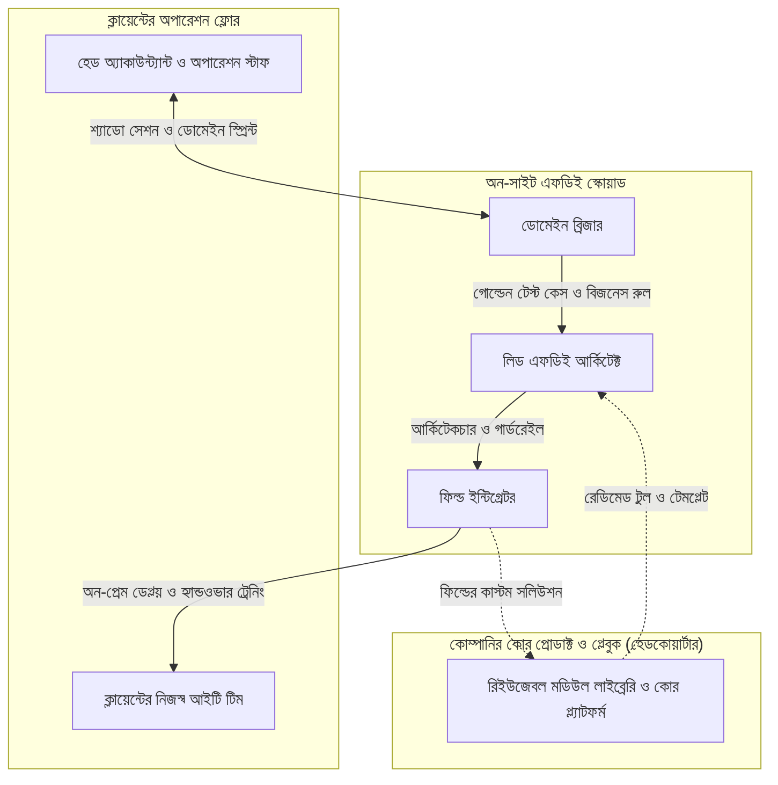

# চ্যাপ্টার ৫: এফডিই অর্গানাইজেশন স্কেলিং ও ক্যারিয়ার রোডম্যাপ

---

### ১. একজন এফডিই থেকে একটা পূর্ণাঙ্গ এফডিই টিম

গত চারটা চ্যাপ্টারে আপনি প্রায় একাই পুরো যুদ্ধটা লড়েছেন। ক্লায়েন্টের অফিসে গিয়ে প্রথম আটচল্লিশ ঘণ্টায় স্টাফদের মনের ফিয়ার দূর করেছেন, টেবিলের নিচের ধুলোমাখা ডেল সার্ভারে লোকাল এলএলএম চালিয়েছেন, বিশ মিনিটের ডোমেইন স্প্রিন্টে হেড অ্যাকাউন্ট্যান্ট সাহেবের ভ্যাটের হিসাব মিলিয়েছেন, আর মাঝরাতে সার্ভার যেন ক্র্যাশ না করে সেজন্য সেলফ-হিলিং রোলব্যাক পাইপলাইন বসিয়েছেন।

প্রজেক্ট এখন পুরোপুরি সাকসেসফুল। হেড অফিসের অডিট টিম এসে সব ফাইল মিলিয়ে দেখে খুশি হয়ে ফিরে গেছে। উনষাট জন স্টাফের মধ্যে এখন সবাই নতুন সিস্টেমে কাজ করছেন, আর হেড অ্যাকাউন্ট্যান্ট সাহেবের সেই লাল মলাটের খাতাটা এখন ড্রয়ারের ভেতর বিশ্রাম নিচ্ছে।

ঠিক এক সপ্তাহ পর প্রজেক্ট ডিরেক্টর আবার আপনার টেবিলের সামনে এসে বসলেন। মুখে চওড়া হাসি নিয়ে বললেন, "ভাই, এই ব্রাঞ্চে তো জাদু দেখিয়ে দিলেন। আমাদের গাজীপুর, নারায়ণগঞ্জ আর চট্টগ্রামের বাকি তিনটা ব্রাঞ্চেও হুবহু এই সিস্টেমটা চালু করতে হবে। আগামী মাসেই!"

কথাটা শুনে আপনি দুই সেকেন্ড চুপ করে রইলেন।

তিনটা নতুন ব্রাঞ্চ মানে তিনজন আলাদা হেড অ্যাকাউন্ট্যান্ট, তিনটা আলাদা লাল খাতা, তিন সেট অলিখিত শর্টকাট আর তিনটা ধুলোমাখা সার্ভার। অথচ আপনি মানুষ তো একজনই! নিজেকে তো আর কপি-পেস্ট করে তিন জায়গায় পাঠাতে পারবেন না।

এই জায়গায় এসে যেকোনো ইঞ্জিনিয়ার বা সফটওয়্যার কোম্পানির সামনে দুটো রাস্তা খোলা থাকে। প্রথম রাস্তা হলো নিজের ঘুম, খাওয়া আর শরীরের বারোটা বাজিয়ে একাই তিন ব্রাঞ্চে দৌড়াদৌড়ি করা - যাতে দুমাস পর ক্লান্তিতে পুরো প্রজেক্টই ভেঙে পড়ে। আর দ্বিতীয় রাস্তা হলো নিজের অর্জিত অভিজ্ঞতাটাকে একটা সিস্টেমে রূপান্তর করে একটা **এফডিই টিম (FDE Squad)** গড়ে তোলা।

এই চ্যাপ্টারে আমরা সেই দ্বিতীয় রাস্তাটাই দেখব। কিভাবে একটা প্রথাগত সফটওয়্যার কোম্পানি প্যাসিভ আউটসোর্সিং ছেড়ে ফিল্ড ইঞ্জিনিয়ারিংয়ে রূপান্তরিত হতে পারে, কিভাবে ফিল্ডের কাস্টম কোড থেকে কোম্পানির কোর প্রোডাক্ট তৈরি হয়, এবং একজন নতুন বা জুনিয়র প্রোগ্রামার কিভাবে ধাপে ধাপে নিজেকে একজন শীর্ষ ফিল্ড আর্কিটেক্ট হিসেবে গড়ে তুলতে পারেন।

---

### ২. প্যাসিভ আউটসোর্সিং বনাম অ্যাক্টিভ ফিল্ড ইঞ্জিনিয়ারিং

আমাদের দেশের বেশিরভাগ সফটওয়্যার সার্ভিস কোম্পানি এখনো একটা পুরনো মডেলে কাজ করে। ক্লায়েন্ট একটা রিকোয়ারমেন্ট ডকুমেন্ট পাঠায়, ভেন্ডর কোম্পানি নিজের অফিসে বসে তিন-চার মাস কোড লেখে, তারপর সফটওয়্যারটা ক্লায়েন্টের সার্ভারে তুলে দিয়ে বিল নিয়ে চলে আসে। এই মডেলটাকে আমরা বলি **প্যাসিভ আউটসোর্সিং**।

ইন্ট্রোডাকশনের সেই দৃশ্যটা মনে করুন। হেডকোয়ার্টারে প্রতিটা ইউনিট টেস্ট গ্রিন, ইউএটি সাইন-অফও হয়ে গেছে, অথচ নব্বই দিন পর দেখা গেল উনষাট জন স্টাফের মধ্যে লগইন করেছেন মাত্র চারজন! প্যাসিভ আউটসোর্সিংয়ের শেষ পরিণতি বেশিরভাগ সময় এটাই হয়। কোড ডেলিভারি হয় ঠিকই, কিন্তু মানুষের রিয়েল প্রবলেম সমাধান হয় না।

অন্যদিকে **ফিল্ড ইঞ্জিনিয়ারিং** মডেলে সাকসেসের মাপকাঠিটাই আলাদা। এখানে কোড ডেলিভারি দেওয়া মানে কাজ শেষ হওয়া নয়; ক্লায়েন্টের স্টাফরা প্রতিদিন সিস্টেমটা ব্যবহার করে নিজেদের কাজ দ্রুত সারতে পারছেন কি না, সেটাই একমাত্র মাপকাঠি।

তবে ফিল্ডে ইঞ্জিনিয়ার পাঠালেই তো আর কাজ হবে না, যদি না তাঁর হাতে সিদ্ধান্ত নেওয়ার ক্ষমতা বা **অটোনমি (Autonomy)** থাকে। ফিল্ডে বসে প্রতিটা ছোটখাটো পরিবর্তনের জন্য যদি ইঞ্জিনিয়ারকে হেড অফিসের প্রজেক্ট ম্যানেজারের কাছে মেইল করে দুই দিন অনুমতির অপেক্ষায় বসে থাকতে হয়, তবে তাঁর ফিল্ডে থাকা আর না থাকা সমান কথা। তাই প্রজেক্ট শুরুর দিনই ইঞ্জিনিয়ারের সিদ্ধান্তের বাউন্ডারি পরিষ্কার করে নিতে হয়।

!!! info "সিদ্ধান্তের বাউন্ডারি: কোনটা আপনার হাতে, কোনটা ক্লায়েন্টের হাতে?"
    চ্যাপ্টার ৩-এ আমরা যেমন এআই এজেন্টের জন্য গার্ডরেইল বানিয়েছিলাম, ফিল্ড ইঞ্জিনিয়ারের জন্যও তেমন একটা পরিষ্কার গার্ডরেইল দরকার। কোন পাইথন লাইব্রেরি ব্যবহার হবে, লোকাল সার্ভারে কোন মডেল চলবে, কোন কুইক উইনটা আগে ডেলিভারি হবে - এই টেকনিক্যাল সিদ্ধান্তগুলো নেওয়ার একশো ভাগ স্বাধীনতা থাকবে ফিল্ড ইঞ্জিনিয়ারের হাতে। কিন্তু ক্লায়েন্টের মূল প্রোডাকশন ডেটাবেজের স্কিমা বদলানো, কোনো ডেটা লোকাল নেটওয়ার্কের বাইরে পাঠানো কিংবা প্রজেক্টের বাজেট বাড়ানোর মতো সিদ্ধান্তে অবশ্যই ক্লায়েন্টের লিখিত অনুমোদন নিতে হবে। এই বাউন্ডারি পরিষ্কার থাকলে ইঞ্জিনিয়ার ফিল্ডে বসে নির্ভয়ে দ্রুত কাজ করতে পারেন।

---

### ৩. এফডিই স্কোয়াডের গঠন: ইকো ও ডেল্টা থেকে আধুনিক স্কোয়াড

হোমপেজে আমরা দেখেছি, প্যালান্টির যখন মিলিটারি ফিল্ডে এফডিই মডেল চালু করেছিল, তখন তারা টিমগুলোকে মূলত **'ইকো' (Echo)** এবং **'ডেল্টা' (Delta)** - এই দুই ভাগে ভাগ করে নিত। এই টিমগুলো ফিল্ডে 'এমবেডিং' হয়ে কাজ নামাত - ইকো টিম ক্লায়েন্টের ডোমেইনের ভেতরের সূক্ষ্ম বিষয়গুলো আর ইউজারের কাজের প্রবাহ বুঝত, আর ডেল্টা টিম যেকোনো প্রতিকূল পরিবেশে রাফ অ্যান্ড টাফ কোড লিখে প্রজেক্টের সাকসেস নিশ্চিত করত।

গাজীপুর, নারায়ণগঞ্জ আর চট্টগ্রামের মতো একাধিক সাইটে যখন আমরা একসাথে কাজ করি, তখন ঠিক ওই দর্শন থেকেই আমরা ছোট ছোট **এফডিই স্কোয়াড** তৈরি করি। একটা আদর্শ স্কোয়াডে তিন ধরনের রোল বা ভূমিকা থাকে (ছোট প্রজেক্টে একজন মানুষই হয়তো দুটো রোল সামলান, কিন্তু কাজের ধরনগুলো আলাদা):

১. **ডোমেইন ব্রিজার (Domain Bridger - ইকো রোল):** ইনি হলেন সেই মানুষ, যিনি কাস্টমারের ব্যবসার ভাষাটাকে কোডের ভাষায় অনুবাদ করতে পারেন। চ্যাপ্টার ১-এ শ্যাডো সেশন করা এবং চ্যাপ্টার ৩-এ হেড অ্যাকাউন্ট্যান্ট সাহেবের পাশে বসে ভ্যাট-রিবেটের নিয়ম বুঝে টেস্ট কেস লেখা - এগুলো ডোমেইন ব্রিজারের কাজ। তিনি স্টাফদের সাথে চা খেয়ে ট্রাস্ট তৈরি করেন, তাঁদের অলিখিত শর্টকাট ডিসকাভারি করেন এবং সেগুলোকে পরিষ্কার ইউজার স্টোরি ও গোল্ডেন টেস্ট ডেটায় রূপান্তর করেন।
২. **ফিল্ড ইন্টিগ্রেটর (Field Integrator - ডেল্টা রোল):** ইনি হলেন প্রতিকূল পরিবেশে হাতে-কলমে কোড লিখে পাইপলাইন জোড়া লাগানোর কারিগর। চ্যাপ্টার ২-এর মতো পুরনো ডেল সার্ভারে `Ollama` ও `SQLite WAL` সেটআপ করা, চ্যাপ্টার ৪-এর মতো ওএলটি সুইচ বা ওয়েব্রিজ স্কেলের সাথে পাইথন স্ক্রিপ্টের সংযোগ দেওয়া এবং সেলফ-হিলিং সিআই/সিডি পাইপলাইন ডেপ্লয় করা তাঁর মূল দায়িত্ব।
৩. **লিড এফডিই আর্কিটেক্ট (Lead FDE Architect):** ইনি পুরো সিস্টেমের ছক কষেন এবং একাধিক সাইটের কাজ তদারকি করেন। কোন প্রবলেমটা সাধারণ ইফ-এলস (`if-else`) লজিক দিয়ে মিটবে আর কোনটার জন্য লোকাল এলএলএম লাগবে, এআই এজেন্টের গার্ডরেইল কী হবে এবং ক্লায়েন্টের ম্যানেজমেন্টের সাথে স্কোপ ডিফেন্স কন্ট্রাক্ট কিভাবে থাকবে - এই কৌশলগত সিদ্ধান্তগুলো তিনি নেন।

নিচের মারমেইড ডায়াগ্রামে দেখুন কিভাবে একটা এফডিই স্কোয়াড ক্লায়েন্টের সাইট এবং নিজেদের হেড অফিসের মধ্যে সমন্বয় করে কাজ করে:



---

### ৪. ফিল্ড-টু-কোর প্রোডাক্ট ফিডব্যাক লুপ: প্যালান্টিয়ার প্যাটার্ন

ওপরের ডায়াগ্রামের একদম নিচের ডটেড লাইন দুটোর দিকে একটু বিশেষ নজর দিন। ওখানেই লুকিয়ে আছে আধুনিক বিশ্বের সবচেয়ে সফল এআই ও ডেটা কোম্পানিগুলোর (যেমন Palantir) গোপন মন্ত্র - যার নাম **ফিল্ড-টু-কোর প্রোডাক্ট ফিডব্যাক লুপ (Field-to-Core Feedback Loop)**।

সাধারণ সার্ভিস কোম্পানি কেন বড় প্রোডাক্ট কোম্পানি হতে পারে না জানেন? কারণ তারা একটা ক্লায়েন্টের জন্য যে কোডটা লেখে, প্রজেক্ট শেষ হলে সেই কোডটা ওই ক্লায়েন্টের সার্ভারেই ফেলে আসে। পরের মাসে আরেকটা ক্লায়েন্টের কাছে গিয়ে আবার শূন্য থেকে একই ধরনের কোড লেখে।

কিন্তু একটা স্মার্ট এফডিই অর্গানাইজেশন কাজ করে উল্টো নিয়মে। যখন একজন এফডিই চট্টগ্রাম বন্দরের জন্য থ্রি-ওয়ে ইনভয়েস রিকনসিলিয়েশন স্ক্রিপ্ট বা ঢাকার আইএসপির জন্য লোকাল ট্রায়াজ ইঞ্জিন বানান, তখন কাজ শেষে তিনি নিজেকে দুটো প্রশ্ন করেন:
১. এই কোডের কোন অংশটুকু শুধুমাত্র এই নির্দিষ্ট ক্লায়েন্টের নিজস্ব নিয়ম (যেমন নির্দিষ্ট কলামের নাম বা ১% টলারেন্স সংখ্যা)?
২. আর কোন অংশটুকু দেশের আরও পঞ্চাশটা কোম্পানির একই কাজে লাগবে (যেমন লোকাল `Ollama` কলিং র‍্যাপার, `SQLite WAL` কিউ, কিংবা তিনটা ডকুমেন্ট মেলানোর মূল ইঞ্জিন)?

এরপর তিনি প্রথম অংশটুকু কনফিগারেশন ফাইলে রেখে, দ্বিতীয় অংশটুকু পরিষ্কার করে কোম্পানির হেডকোয়ার্টারের কোর ইঞ্জিনিয়ারিং টিমের কাছে পাঠিয়ে দেন। কোর টিম তখন সেই ফিল্ড-টেস্টেড কোডটাকে একটা স্ট্যান্ডার্ড, রিইউজেবল প্রোডাক্ট মডিউলে রূপান্তর করে কোম্পানির মূল লাইব্রেরিতে যুক্ত করে নেয়।

ফলাফল কী হয়? প্রথম ব্রাঞ্চে যে সিস্টেম দাঁড় করাতে আপনার দুই সপ্তাহ লেগেছিল, দ্বিতীয় ব্রাঞ্চে গিয়ে কোর লাইব্রেরি থেকে রেডিমেড মডিউল নামিয়ে শুধু কনফিগারেশন বদলে দিতে সময় লাগে মাত্র দুই দিন! এভাবে দশটা ক্লায়েন্টের ফিল্ডে কাজ করার পর দেখা যায়, আপনার কোম্পানির হাতে এমন একটা শক্তিশালী এন্টারপ্রাইজ প্ল্যাটফর্ম তৈরি হয়ে গেছে, যা ঘরে বসে কল্পনাও করা যেত না। একজন এফডিই এভাবেই শুধু একটা প্রজেক্ট ডেলিভারি দেন না, তিনি পুরো কোম্পানির প্রোডাক্ট রোডম্যাপ তৈরি করে দেন।

!!! info "ফিল্ড-টু-কোর লুপের শক্তি"
    ফিল্ডে বসে লেখা কাস্টম স্ক্রিপ্ট যেন ক্লায়েন্টের সার্ভারেই হারিয়ে না যায়। প্রতিটা প্রজেক্ট থেকে জেনেরিক লজিকটুকু আলাদা করে কোম্পানির কোর প্ল্যাটফর্মে যুক্ত করুন। এতে পরের ডেপ্লয়মেন্টের সময় অর্ধেকে নেমে আসে এবং কাস্টম সার্ভিস থেকে জন্ম নেয় স্কেলেবল প্রোডাক্ট।

#### কোড-স্যান্ডউইচ মেথড: ফিল্ড-টু-কোর কনফিগ ডিকাপলার (Palantir Pattern)

**১. কাস্টমারের বাস্তব সংকট:** চট্টগ্রাম বন্দরে ওজনের ছাড় ১%, কিন্তু নারায়ণগঞ্জের সিমেন্ট ফ্যাক্টরিতে ছাড় ০.৫% আর গাজীপুরের গার্মেন্টসে ২%। প্রতিটা ব্রাঞ্চের জন্য আলাদা আলাদা পাইথন কোড কপি-পেস্ট করলে দশটা ক্লায়েন্টের পর কোডবেস মেইনটেইন করা অসম্ভব হয়ে পড়ে। তাই ফিল্ডের কাস্টম সংখ্যাগুলোকে কনফিগে সরিয়ে একটা স্ট্যান্ডার্ড কোর মডিউল বানানো দরকার।

**২. মূল কোড:** নিচের ষোলো লাইনের পাইথন কোডটি দেখায় কিভাবে ব্রাঞ্চ-ভিত্তিক কাস্টম নিয়মকে (`BRANCH_CONFIGS`) মূল ইঞ্জিন (`CoreReconcilerEngine`) থেকে আলাদা করে কোম্পানির কোর প্রোডাক্টে উন্নীত করা হয়:

```python
# FDE Field-to-Core Pattern: Reusable Core Engine + Branch Configs
class CoreReconcilerEngine:
    def __init__(self, branch_cfg: dict):
        self.branch = branch_cfg["name"]
        self.tol_pct = branch_cfg["tolerance_pct"]

    def verify(self, declared_kg: float, actual_kg: float) -> dict:
        max_diff = declared_kg * (self.tol_pct / 100.0)
        passed = abs(actual_kg - declared_kg) <= max_diff
        return {"branch": self.branch, "status": "APPROVED" if passed else "FLAGGED"}

# কোর কোডে হাত না দিয়ে শুধু কনফিগ বদলেই ৩টি ভিন্ন ব্রাঞ্চে ডেপ্লয়মেন্ট
BRANCH_CONFIGS = [
    {"name": "Chattogram_Port", "tolerance_pct": 1.0},
    {"name": "Narayanganj_Cement", "tolerance_pct": 0.5}
]
for cfg in BRANCH_CONFIGS:
    print(CoreReconcilerEngine(cfg).verify(declared_kg=50000, actual_kg=50350))
```

**৩. সিস্টেমের বাস্তব ইমপ্যাক্ট ও কোডের ব্যাখ্যা:** স্ক্রিপ্টটা রান করলে আউটপুটে দেখবেন:

```text
{'branch': 'Chattogram_Port', 'status': 'APPROVED'}
{'branch': 'Narayanganj_Cement', 'status': 'FLAGGED'}
```

কোডটার ভেতরে প্যালান্টিরের ফিল্ড-টু-কোর দর্শনটা পরিষ্কার ফুটে উঠেছে:
* **কোর ইঞ্জিন অপরিবর্তিত (`CoreReconcilerEngine`):** মূল ক্লাসটার ভেতরে কোনো ক্লায়েন্টের নাম বা `0.01` হার্ডকোড করা নেই। এটি হেডকোয়ার্টারের কোর প্ল্যাটফর্ম লাইব্রেরিতে থাকে।
* **দুই দিনে নতুন ব্রাঞ্চ লাইভ (`BRANCH_CONFIGS`):** একই ৫০,৩৫০ কেজির চালান চট্টগ্রাম বন্দরে ১% টলারেন্সে (৫০০ কেজি ছাড়) `APPROVED` হচ্ছে, কিন্তু নারায়ণগঞ্জ সিমেন্ট ফ্যাক্টরিতে ০.৫% টলারেন্সে (২৫০ কেজি ছাড়) অটোমেটিক `FLAGGED` হচ্ছে - অথচ আমাদের মূল ইঞ্জিনের এক লাইন কোডও নতুন করে লিখতে হয়নি!

**৪. গিটহাব রেফারেন্স:** ফিল্ড-টু-কোর আর্কিটেকচার টেমপ্লেট পাবেন অফিশিয়াল কমপ্যানিয়ন রিপোজিটরিতে: [https://github.com/raqueeb/fdebook_companion](https://github.com/raqueeb/fdebook_companion)।

---

### ৫. বাংলাদেশের পাঁচটি ইন্ডাস্ট্রিতে এফডিই কাজের বিশাল সুযোগ

অনেকে ভাবেন ফরওয়ার্ড ডেপ্লয়েড ইঞ্জিনিয়ারিং বোধহয় শুধু সিলিকন ভ্যালির বড় কোম্পানির কাজ। অথচ একটু চোখ মেলে তাকালেই দেখবেন, আমাদের বাংলাদেশের প্রতিটা প্রধান ইন্ডাস্ট্রিতে এই মুহূর্তে এফডিইদের কাজের কী বিশাল ক্ষেত্র পড়ে আছে! চ্যাপ্টার ৪-এ তো আমরা আইএসপি আর বন্দরের কেস স্টাডি দেখলাম। এবার আমাদের চারপাশের আরও পাঁচটা চেনা খাতের দিকে তাকানো যাক:

**১. তৈরি পোশাক কারখানা (RMG ও টেক্সটাইল):** গার্মেন্টসের সুইং ফ্লোরে কোয়ালিটি ইন্সপেক্টররা সারাদিন লাইনে ঘুরে ঘুরে কাগজের শিটে লিখে রাখেন কোন শার্টে সেলাই বাঁকা হয়েছে বা কোথায় মাপ ভুল। বিকেলে একজন ডেটা এন্ট্রি অপারেটর সেই কাগজ দেখে এক্সেলে তোলেন। পরদিন সকালে যখন ফ্যাক্টরি ম্যানেজার রিপোর্ট পান যে ৩ নম্বর লাইনে সমস্যা ছিল, ততক্ষণে আরও হাজার পিস কাপড় নষ্ট হয়ে গেছে। একজন এফডিই ওই ফ্লোরে গিয়ে কারখানার লোকাল ওয়াইফাই ও লোকাল সার্ভারে একটা সিম্পল ট্যাবলেট-ভিত্তিক ট্র্যাকার ও লাইভ ড্যাশবোর্ড বসিয়ে দিতে পারেন - যাতে কোনো বায়ারের গোপন ডিজাইন ক্লাউডে না পাঠিয়েই ফ্লোর ম্যানেজার রিয়েল-টাইমে দেখতে পান কোন লাইনে ডিফেক্ট বাড়ছে।

**২. ব্যাংক ও ফিন্যান্সিয়াল প্রতিষ্ঠান:** ব্যাংকে একটা এসএমই (SME) লোনের ফাইল এলে অফিসারকে কাস্টমারের এনআইডি, ট্রেড লাইসেন্স, ব্যাংক স্টেটমেন্ট আর ট্যাক্স রিটার্নের পাতার পর পাতা কাগজ হাতে মিলিয়ে দেখতে হয়। বাংলাদেশ ব্যাংকের কড়া কমপ্লায়েন্সের কারণে এই ডেটা কোনো পাবলিক ক্লাউডে পাঠানো অসম্ভব। এখানে একজন এফডিই ব্যাংকের নিজস্ব অন-প্রেম সার্ভারে লোকাল ওসিআর (OCR) ও ছোট এলএলএম বসিয়ে একটা অটোমেটেড চেকলিস্ট ইঞ্জিন বানিয়ে দিতে পারেন, যা পাঁচ মিনিটে সব কাগজের নামের বানান, জন্মতারিখ ও টাকার অঙ্ক মিলিয়ে অসঙ্গতিগুলো হাইলাইট করে দেবে।

**৩. হাসপাতাল ও ডায়াগনস্টিক সেন্টার:** আমাদের দেশের হাসপাতালগুলোর রিসেপশন ও রিপোর্ট ডেলিভারি কাউন্টারে সবসময় প্রচণ্ড ভিড় ও ক্যাওস থাকে। রোগীর টেস্ট রিপোর্ট রেডি হয়েছে কি না, ডাক্তার কখন বসবেন, কোন ফাইল কোথায় গেছে - তা খুঁজতেই স্টাফরা হিমশিম খান। এখানে ডাক্তারের চিকিৎসার সিদ্ধান্তে হাত না দিয়েও একজন এফডিই হাসপাতালের লোকাল সার্ভারে ল্যাব মেশিনের আউটপুটের সাথে অটোমেটেড এসএমএস ও সিরিয়াল ম্যানেজমেন্ট পাইপলাইন জুড়ে দিয়ে হাজার হাজার রোগীর ভোগান্তি কমিয়ে দিতে পারেন।

**৪. সরকারি দপ্তর ও নাগরিক সেবা:** সরকারি অফিসগুলোতে ডিজিটাল পোর্টাল থাকার পরও অনেক সময় সমান্তরালভাবে কাগজের ফাইল চলে। চ্যাপ্টার ১-এর এসওপি বনাম গ্রাউন্ড রিয়েলিটির পার্থক্য এখানে সবচেয়ে প্রকট। এখানে এক ধাক্কায় পুরো সিস্টেম বদলাতে না গিয়ে চ্যাপ্টার ৪-এর কৌশলে কর্মকর্তাদের সুবিধার জন্য ছোট কুইক উইন - যেমন ফাইল ট্র্যাকিং ও এক ক্লিকে মাসিক সামারি রিপোর্ট তৈরির অটোমেশন দিয়ে দারুণ কাজ করা যায়।

**৫. ই-কমার্স ও লজিস্টিকস কুরিয়ার:** হাজার হাজার পার্সেল ডেলিভারির সময় কাস্টমাররা ফেসবুক পেজে আর চ্যাটবক্সে বাংলা-ইংরেজি মিশিয়ে (বাংলিশে) লেখেন - *"ভাই আমার অর্ডারটা কালকে আসার কথা ছিল, এখনো ডেলিভারি ম্যান ফোন দিল না কেন?"* চ্যাপ্টার ২-এর লোকাল এলএলএম ট্রায়াজ ইঞ্জিন এবং চ্যাপ্টার ৪-এর ওয়েবহুক রাউটার ব্যবহার করে এই মেসেজগুলো থেকে অর্ডার আইডি বের করে সরাসরি কুরিয়ার হাবের ডেটাবেজের সাথে মিলিয়ে স্বয়ংক্রিয় রিপ্লাই ও অ্যাকশন ট্রিগার করা যায়।

খেয়াল করে দেখুন, এই পাঁচটা ইন্ডাস্ট্রির প্রতিটাতেই মূল সমস্যাটা এক - ডেটা আছে, কিন্তু অগোছালো অবস্থায়; আর ক্লাউড বিলের ভয় বা প্রাইভেসির কারণে তারা প্রথাগত ক্লাউড সলিউশনে যেতে পারছে না। একজন এফডিইর জন্য এর চেয়ে বড় সুযোগ আর কী হতে পারে?

---

### ৬. একজন এফডিইর তিনমুখী দক্ষতা (Skill Set)

নতুন যাঁরা এই লাইনে আসতে চান, তাঁদের মনে প্রশ্ন আসে - একজন ভালো এফডিই হতে গেলে ঠিক কী কী শিখতে হবে? কেবল পাইথন বা রিঅ্যাক্ট জানলেই কি চলবে? 

সত্যি কথা বলতে, এফডিই হওয়ার জন্য আপনাকে তিনটা ভিন্ন জগতের দক্ষতা নিজের ভেতর মেলাতে হবে:

**প্রথমত, সলিড কমান্ড লাইন ও কোর ইঞ্জিনিয়ারিং:** ফিল্ডে গেলে আপনি সবসময় সুন্দর গ্রাফিক্যাল ইন্টারফেস পাবেন না। ক্লায়েন্টের ধুলোমাখা সার্ভারে হয় উবুন্টু লিনাক্স চলবে, নয়তো পুরনো উইন্ডোজ সার্ভার। তাই লিনাক্স টার্মিনাল, শেল স্ক্রিপ্টিং, লোকাল নেটওয়ার্কিং (আইপি, পোর্ট, ফায়ারওয়াল), ডকার এবং `SQLite` বা `PostgreSQL` ডেটাবেজে আপনার হাত একদম পাকা হতে হবে।

আমার নিজের কম্পিউটার লাইফের শুরুটা হয়েছিল ইউনিক্স (Unix) দিয়ে। অফিসে চালাতাম সান সোলারিস (Sun Solaris), আর বাসায় নিজের পিসিতে ফ্রিবিএসডি (FreeBSD)। কাজ করতে করতে একদিন বুঝলাম, একই কাজ প্রতিদিন হাতে না করে যন্ত্রকে দিয়ে কামলা খাটাতে হলে শেল স্ক্রিপ্টিং শিখতেই হবে। সত্যি বলতে, আমার সেই "ফাঁকিবাজির" হ্যাবিটটাই আমাকে পরে পাইথন, অটোমেশন আর আজকের এআই এজেন্ট পর্যন্ত টেনে এনেছে। এই বইয়ের প্রতিটা চ্যাপ্টারের মূল শক্তি কিন্তু লুকিয়ে আছে ওই টার্মিনাল আর কমান্ড লাইনের ভেতরেই।

**দ্বিতীয়ত, লোকাল এআই ও ডেটা পাইপলাইন অর্কেস্ট্রেশন:** আপনাকে জানতে হবে কিভাবে অগোছালো ডেটা তুলে এনে (Extract), পরিষ্কার ফরম্যাটে সাজিয়ে (Transform), ডেটাবেজে ঢোকাতে হয় (Load) - যাকে সংক্ষেপে ইটিএল (ETL) বলে। সাথে জানতে হবে `Ollama` দিয়ে লোকাল মডেল চালানো, `Pydantic` দিয়ে স্কিমা লক করা, ইভ্যালুয়েশন হারনেস লেখা এবং এআই কোডিং এজেন্টকে (ডিপসিক, ওপেনকোড হারনেস বা ক্লাইন) গার্ডরেইলের ভেতরে রেখে দ্রুত কোড লেখানো।

**তৃতীয়ত, মানুষের মনস্তত্ত্ব ও ডোমেইন বোঝার ধৈর্য:** এটাই সবচেয়ে বিরল দক্ষতা। কোড অনেকেই লিখতে পারেন, কিন্তু একজন হেড অ্যাকাউন্ট্যান্ট বা পোর্ট ক্লার্কের পাশে এক ঘণ্টা চুপচাপ বসে তাঁর কাজের কষ্টটা অনুভব করার ধৈর্য খুব কম ইঞ্জিনিয়ারের থাকে। স্টাফদের ফিয়ার কাটানো, মিড-লেভেল ম্যানেজারের ইগো সামলানো এবং ক্লায়েন্টের সাথে সাকসেস মেট্রিক নিয়ে পরিষ্কার কথা বলার ক্ষমতাই একজন সাধারণ কোডারকে এফডিই আর্কিটেক্টে পরিণত করে।

!!! tip "নিজেকে যাচাই করার এক মিনিটের টেস্ট"
    নিজেকে একটা সহজ প্রশ্ন করুন: আমি কি কোনো কথা না বলে, কোনো উপদেশ না দিয়ে একজন নন-টেকনিক্যাল স্টাফের ডেস্কের পাশে টানা এক ঘণ্টা চুপচাপ বসে শুধু তাঁর কাজ দেখতে পারব? যদি উত্তর "হ্যাঁ" হয়, তবে আপনার ভেতরে একজন দুর্দান্ত এফডিই হওয়ার বীজ আছে। আর যদি মনে হয় "এক ঘণ্টা বসে থেকে কী লাভ, আমি তো দশ মিনিটে কোড লিখে ফেলব", তবে পরের দিনই এই চুপ করে শোনার চর্চাটা শুরু করুন।

---

### ৭. জুনিয়র ডেভেলপার থেকে ফিল্ড আর্কিটেক্ট: ৫ ধাপের ক্যারিয়ার রোডম্যাপ

আপনি যদি আজ একজন বিশ্ববিদ্যালয়ের শিক্ষার্থী বা জুনিয়র সফটওয়্যার ডেভেলপার হন, তবে আগামী ছয় মাস থেকে এক বছরের মধ্যে নিজেকে এফডিই হিসেবে তৈরি করার জন্য নিচের পাঁচটা ধাপ অনুসরণ করুন:

* **ধাপ ১ (কমান্ড লাইন ও পাইথনে হাত পাকানো):** নিজের প্রতিদিনের যেকোনো বোরিং কাজ - যেমন ফাইল রিনেম করা, এক্সেল থেকে পিডিএফ বানানো বা লগ পার্স করা - পাইথন ও ব্যাশ স্ক্রিপ্ট দিয়ে অটোমেট করার হ্যাবিট গড়ুন।
* **ধাপ ২ (নিজের ল্যাপটপে লোকাল এআই ল্যাব):** এই বইয়ের গিটহাব রিপোজিটরি ক্লোন করুন। নিজের ল্যাপটপে `Ollama` এবং `qwen2.5:1.5b` ইনস্টল করে চ্যাপ্টার ২, ৩ ও ৪-এর প্রতিটা স্ক্রিপ্ট চালিয়ে দেখুন এবং কোডগুলো নিজের মতো মডিফাই করুন।
* **ধাপ ৩ (পাশের মানুষের একটা রিয়েল প্রবলেম সমাধান):** বড় কর্পোরেট ক্লায়েন্টের জন্য অপেক্ষা করবেন না। আপনার বাবার দোকান, পাড়ার ডায়াগনস্টিক সেন্টার, পরিচিত কারও ছোট ই-কমার্স পেজ বা নিজের ডিপার্টমেন্টের অফিস - যেকোনো একটা জায়গায় গিয়ে চ্যাপ্টার ১-এর মতো শ্যাডো সেশন করুন। তাঁদের As-Is এবং To-Be ডায়াগ্রাম আঁকুন এবং এক সপ্তাহে একটা ছোট অটোমেশন বানিয়ে দিন।
* **ধাপ ৪ (কেস স্টাডি পোর্টফোলিও তৈরি):** সাধারণ ডেভেলপাররা গিটহাবে শুধু কোড রাখেন। আপনি গিটহাবের `README.md` ফাইলে রাখবেন পুরো ফিল্ড স্টোরি - কাস্টমারের আগে কী সমস্যা ছিল (As-Is), কত মিনিট নষ্ট হতো, আপনি কী আর্কিটেকচার বসালেন (To-Be) এবং এখন কত মিনিট লাগছে। যেকোনো হায়ারিং ম্যানেজার বা সিটিও এই এক পাতার কেস স্টাডি দেখামাত্র আপনাকে আলাদা করে চিনে নেবেন।
* **ধাপ ৫ (স্কোয়াডে যোগদান ও প্লেবুক তৈরি):** কোনো টেক বা এআই কোম্পানিতে সলিউশন ইঞ্জিনিয়ার, অ্যাপ্লাইড এআই ইঞ্জিনিয়ার বা এফডিই হিসেবে কাজ শুরু করুন এবং নিজের প্রতিটা প্রজেক্টের লার্নিং দিয়ে রিইউজেবল লাইব্রেরি গড়ে তুলুন।

---

### ৮. হ্যান্ডস-অন কোড প্রুফ: প্রথম সপ্তাহের "কুইক উইন" বাছাইয়ের অ্যালগরিদম

নতুন এফডিইরা ফিল্ডে গিয়ে একটা কমন দ্বিধায় পড়েন। শ্যাডো সেশন করার পর দেখা যায় ক্লায়েন্টের অফিসে দশটা আলাদা সমস্যা আছে। কিন্তু আপনার হাতে প্রথম সপ্তাহের ট্রাস্ট জেতার জন্য সময় আছে মাত্র পাঁচ-সাত দিন। কোন কাজটা আগে ধরবেন?

#### কোড-স্যান্ডউইচ মেথড

**১. কাস্টমারের বাস্তব সংকট:** ডিসকাভারি পর্ব শেষে আপনার নোটবুকে চার-পাঁচটা বড় বটলনেকের তালিকা জমা হয়েছে। যদি ভুল করে এমন কোনো জটিল কাজ প্রথমেই হাতে নেন যার বিজনেস রুলসই পরিষ্কার নয়, তবে প্রথম সপ্তাহেই প্রজেক্ট আটকে যাবে এবং ক্লায়েন্টের আস্থা হারাবেন। তাই ডেটার ভিত্তিতে সবচেয়ে নিরাপদ ও হাই-ইমপ্যাক্ট কাজটা বাছাই করা দরকার।

**২. মূল কোড:** নিচের পাইথন স্ক্রিপ্টটি প্রতিটা কাজের দৈনিক সময়ের অপচয় এবং তার নিয়মের স্পষ্টতা (`rules_clear`) হিসাব করে প্রথম সপ্তাহের কুইক উইনগুলোর একটা র‍্যাংকিং তৈরি করে দেয়:

```python
# FDE Field Tool: First-Week Quick-Win Prioritization Scorer
discovered_tasks = [
    {"name": "ম্যানেজারের ফিজিক্যাল সইয়ের অপেক্ষা", "daily_freq": 20, "mins_each": 6, "rules_clear": True},
    {"name": "সন্ধ্যার এক্সেল সামারি রিপোর্ট তৈরি", "daily_freq": 1, "mins_each": 90, "rules_clear": True},
    {"name": "কাগুজে চালান ও গেট পাসের জটিল মিলানো", "daily_freq": 15, "mins_each": 8, "rules_clear": False},
    {"name": "ভ্যাট ও রিবেটের ম্যানুয়াল ক্যালকুলেশন", "daily_freq": 2, "mins_each": 30, "rules_clear": True},
]

def calculate_quick_win_score(task: dict) -> float:
    daily_wasted_mins = task["daily_freq"] * task["mins_each"]
    # বিজনেস রুল অস্পষ্ট হলে প্রথম সপ্তাহে ঝুঁকি বেশি, তাই স্কোর ৭০% কমিয়ে দেওয়া হয়
    risk_multiplier = 1.0 if task["rules_clear"] else 0.3
    return round(daily_wasted_mins * risk_multiplier, 1)

ranked_tasks = sorted(discovered_tasks, key=calculate_quick_win_score, reverse=True)
for t in ranked_tasks:
    print(f"Score: {calculate_quick_win_score(t):5.1f} | Task: {t['name']}")
```

**৩. সিস্টেমের বাস্তব ইমপ্যাক্ট:** স্ক্রিপ্টটা রান করলে নিচের ক্রমটা পাবেন:

```text
Score: 120.0 | Task: ম্যানেজারের ফিজিক্যাল সইয়ের অপেক্ষা
Score:  90.0 | Task: সন্ধ্যার এক্সেল সামারি রিপোর্ট তৈরি
Score:  60.0 | Task: ভ্যাট ও রিবেটের ম্যানুয়াল ক্যালকুলেশন
Score:  36.0 | Task: কাগুজে চালান ও গেট পাসের জটিল মিলানো
```

কোডটার ভেতরের আসল বুদ্ধিটা খেয়াল করুন। শুধু মোট সময়ের অপচয় গুণ করলে *"কাগুজে চালান ও গেট পাসের মিলানো"* কাজটাতেও দিনে ১২০ মিনিট (`15 * 8`) নষ্ট হয়। কিন্তু শ্যাডো সেশনে আপনি দেখেছেন ওই কাজটার কোনো নির্দিষ্ট নিয়ম নেই (`rules_clear: False`) - একেক স্টাফ একেকভাবে করেন। প্রথম সপ্তাহেই আপনি যদি ওই অগোছালো কাজে হাত দেন, তবে নিয়ম ঠিক করতেই পনেরো দিন চলে যাবে! তাই `risk_multiplier = 0.3` দিয়ে ওটার স্কোর কমিয়ে ৩৬-এ নামিয়ে দেওয়া হয়েছে।

অন্যদিকে *"ম্যানেজারের ফিজিক্যাল সই"* (১২০ মিনিট) এবং চ্যাপ্টার ৪-এর সেই মিড-লেভেল ম্যানেজারের *"সন্ধ্যার এক্সেল সামারি"* (৯০ মিনিট) - এই দুটোর নিয়ম একদম পরিষ্কার (`rules_clear: True`)। তাই প্রথম সপ্তাহে এই দুটোকে অটোমেট করলে কোনো ঝুঁকি ছাড়াই অফিসে হইচই পড়ে যাবে।

**৪. গিটহাব রেফারেন্স:** কুইক-উইন স্কোরার ও ফিল্ড অ্যাসেসমেন্ট টুল পাবেন বইয়ের অফিশিয়াল কমপ্যানিয়ন রিপোজিটরিতে: [https://github.com/raqueeb/fdebook_companion](https://github.com/raqueeb/fdebook_companion)।

---

### ৯. অর্গানাইজেশন ও ক্যারিয়ারের সারসংক্ষেপ

একজন একক ইঞ্জিনিয়ার থেকে যখন টিম বা কোম্পানির লেভেলে চিন্তা করবেন, তখন সবসময় সিস্টেম গড়ার দিকে মনোযোগ দেবেন। 

কোনো প্রজেক্ট যেন একজন সুপারস্টার ইঞ্জিনিয়ারের মাথার ওপর নির্ভর করে না থাকে। ফিল্ডে যা শিখছেন, তা প্লেবুকে লিখে রাখুন এবং কাস্টম কোড থেকে রিইউজেবল মডিউল বানিয়ে কোম্পানির কোর প্ল্যাটফর্মে জমা করুন, যাতে পরের ব্রাঞ্চে একজন জুনিয়র ইঞ্জিনিয়ার গিয়েও অর্ধেক সময়ে সিস্টেম দাঁড় করাতে পারেন। আর নিজের ক্যারিয়ার গড়ার সময় মনে রাখবেন, চাকরির বাজারে এখন শুধু সিনট্যাক্স জানা কোডারের অভাব নেই; অভাব হলো এমন ইঞ্জিনিয়ারের, যিনি কাস্টমারের অপারেশন ফ্লোরে নেমে ক্যাওস থামাতে পারেন।

বইয়ের একদম শেষ প্রান্তে চলে এসেছি আমরা। পরের অংশে, অর্থাৎ কনক্লুশনে আমরা দেখব প্রজেক্ট শেষ করার সবচেয়ে গুরুত্বপূর্ণ ধাপ - কিভাবে ক্লায়েন্টের নিজস্ব টিমের হাতে চাবি বুঝিয়ে দিয়ে **গোল্ডেন হ্যান্ডওভার** করতে হয়, প্রথম তিন সপ্তাহের **হাইপার-কেয়ার** কিভাবে চালাতে হয়, এবং দুমাস পর সেই হেড অ্যাকাউন্ট্যান্ট সাহেবের লাল মলাটের খাতাটার কী হলো।

---

!!! question "আমার সাথে কথা বলতে চান?"
    আমাকে WhatsApp এ মেসেজ করতে পারেন: [+8801713095767](https://wa.me/+8801713095767)। আমি যেহেতু রোবট, কল থেকে মেসেজেই বেশি অভ্যস্ত। আমার সব আলাপ [মিডিয়াম](https://medium.com/@raqueeb), [ফেসবুক](https://www.facebook.com/raqueeb) আর [লিংকডইনে](https://www.linkedin.com/in/raqueeb/) পাবেন। ভিডিও দেখতে চাইলে আছে [ইউটিউব](https://www.youtube.com/@raqueeb)।

    আমার মাথায় আর কী কী ঘোরে, সেটাও পাবেন [এখানে](https://medium.com/@raqueeb/print-media-write-ups-2024-25-f2896ce92f7b)।

    এখানে পাবেন আমার লেখা [বিভিন্ন রিসোর্স](https://aiwithr.github.io/resources/), [আমি কে](https://aiwithr.github.io/about/) এবং প্রিন্ট মিডিয়াতে আমার [কিছু লেখা](https://aiwithr.github.io/print/)।
