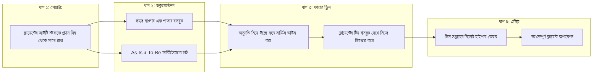

# কনক্লুশন: পারফেক্ট হ্যান্ডওভার ও ফিউচার প্রুফিং

---

### ১. আপনি চলে যাওয়ার পরের দিনটা ও গোল্ডেন হ্যান্ডওভার

বইয়ের একদম শেষ প্রান্তে চলে এসেছি। এতক্ষণ ধরে ডিসকাভারি, লোকাল আর্কিটেকচার, এআই এজেন্ট, কেস স্টাডি আর স্কোয়াড নিয়ে যত কথা বলেছি, তার সবকিছুর চূড়ান্ত পরীক্ষা হয় একটা প্রশ্নে: **আপনি ক্লায়েন্টের অফিস ছেড়ে চলে আসার কয়েক মাস পর সিস্টেমটা কেমন চলছে?**

একজন ফরওয়ার্ড ডেপ্লয়েড ইঞ্জিনিয়ারের আসল সাকসেস ডেপ্লয়মেন্টের দিন দিয়ে মাপা যায় না, কোডের লাইন সংখ্যা দিয়েও না। এমন একটা সিস্টেম বানিয়ে দিয়ে এলেন, যেটা চালাতে প্রতিদিন আপনাকে ফোন করতে হচ্ছে? তাহলে সমস্যার সমাধান আপনি করেননি। আপনি নিজেই সিস্টেমের নতুন বটলনেক হয়ে গেছেন।

চ্যাপ্টার ৫-এর সেই প্রথম ব্রাঞ্চে আজ হ্যান্ডওভারের দিন। কাল থেকে আপনার আর এই অফিসে আসার কথা নেই। ক্লায়েন্টের হেড অব আইটি সোহেল সাহেব, যিনি শুরুর দিকে চায়ের কাপ হাতে এসে আপনাকে টেবিলের নিচের পুরনো ডেল পিসিটা দেখিয়েছিলেন, আজ আপনার পাশের চেয়ারে বসে আছেন। আপনি ল্যাপটপটা তাঁর দিকে ঘুরিয়ে দিয়ে বললেন, *"ভাই, আজ থেকে স্টিয়ারিং আপনার হাতে। টার্মিনালটা আপনি চালান, আমি শুধু পেছনে বসে দেখব।"*

তিনি মুচকি হেসে কিবোর্ডে হাত রাখলেন, আর কোনো দ্বিধা ছাড়াই কমান্ড চালালেন। ঠিক সেই মুহূর্তে আপনি বুঝলেন, প্রজেক্টটা সত্যিকারের সাকসেস পেয়েছে। কোড লেখা শেষ হয়েছে বলে নয়। ক্লায়েন্টের নিজের মানুষ সিস্টেমটার ওনারশিপ কাঁধে তুলে নিয়েছেন বলে।

এই পুরো প্রক্রিয়ার নাম **গোল্ডেন হ্যান্ডওভার (Golden Handover)**। এটা প্রজেক্টের শেষ দিনের কোনো আনুষ্ঠানিকতা নয়। এর কাজ শুরু হয় অন-গ্রাউন্ডে নামার প্রথম সপ্তাহ থেকেই, আর সেটা শুরু হয় একজন শ্যাডো পার্টনার দিয়ে। ক্লায়েন্টের নিজস্ব আইটি টিম থেকে একজন তরুণ ইঞ্জিনিয়ারকে বেছে নিন, যিনি প্রতিদিন আপনার পাশে বসবেন। চ্যাপ্টার ১-এ আপনি যেমন স্টাফদের ছায়া হয়ে তাঁদের কাজ দেখেছিলেন, এবার এই ইঞ্জিনিয়ার আপনার ছায়া হয়ে দেখবেন আপনি কীভাবে কাজ করেন। আপনি কেন `SQLite WAL` মোড চালু করলেন, কেন `Ollama`-র প্রম্পট এভাবে লিখলেন, কেন জোন কোড ধরে টিকিট আলাদা করলেন, সবই তিনি দেখবেন, বুঝবেন, আর একসময় নিজেই প্রশ্ন করতে শুরু করবেন।

দ্বিতীয় জিনিস এক পাতার রানবুক। প্রজেক্ট শেষে পঞ্চাশ পাতার টেকনিক্যাল ডকুমেন্টেশন কেউ পড়ে না। তাই একদম সহজ বাংলায় মাত্র এক পাতার একটা **রানবুক (Runbook)** লিখে সার্ভার রুমের দেয়ালে বা ডেস্কের সামনে সেঁটে দিন। সেখানে চারটা জিনিস পরিষ্কার লেখা থাকবে। সিস্টেম কীভাবে চালু আর রিস্টার্ট করতে হয়। লগ ফাইল কোন ফোল্ডারে থাকে। সার্ভার হ্যাং করলে প্রথম তিনটা কমান্ড কী চালাতে হবে। আর কখন আপনাকে ফোন করতে হবে। মনে রাখবেন, এই পাতাটা পড়বেন এমন একজন মানুষ, যিনি রাত দুইটায় ফোনের অ্যালার্ম শুনে ঘুমচোখে টার্মিনালের সামনে বসেছেন।

তৃতীয় জিনিস লাইভ ফায়ার ড্রিল। অফিস ছাড়ার দুদিন আগে ক্লায়েন্টের অনুমতি নিয়ে, ব্যবসার ভিড়ের সময় এড়িয়ে আর ডেটাবেজের ব্যাকআপ হাতে রেখে, ইচ্ছে করে সিস্টেমের একটা অংশ বন্ধ করে দিন। ধরুন আপনি `Ollama` সার্ভিসটা থামিয়ে দিলেন। এবার হাত গুটিয়ে পেছনে বসে দেখুন, ক্লায়েন্টের আইটি ইঞ্জিনিয়ার আপনার রানবুক দেখে নিজে নিজে সিস্টেমটা আবার তুলতে পারছেন কি না। আরেকটা ড্রিলে ইচ্ছে করে একটা ভাঙা কমিট পুশ করুন। চ্যাপ্টার ৩-এর সেলফ-হিলিং পাইপলাইন `/healthz` ফেইল করতে দেখে নিজেই আগের ভালো কমিটে ফিরে যাচ্ছে কি না, সেটা চোখে দেখে নিন। ওই চ্যাপ্টারের সতর্কবার্তাটা এখানেও মনে রাখবেন। রোলব্যাক কোড ফেরায়, ডেটাবেজের বদল ফেরায় না। তাই ড্রিলের আগের ব্যাকআপটা জরুরি।

চতুর্থ জিনিস ধাপে ধাপে সরে আসা। হ্যান্ডওভারের পর হুট করে যোগাযোগ বন্ধ করে দেবেন না। প্রথম দু-তিন সপ্তাহ দূর থেকে লগের ওপর নজর রাখুন, তারপর শুধু জরুরি ফোনের জন্য অ্যাভেইলেবল থাকুন। একদিন দেখবেন, পুরো মাসে আপনার ফোনে একটাও কল আসেনি। সেদিনই বুঝবেন আপনার হ্যান্ডওভার ষোলো আনা সফল।

নিচের ডায়াগ্রামে চারটা ধাপ একসাথে দেখুন:



!!! warning "নিজেকে অপরিহার্য বানানোর ফাঁদে পা দেবেন না"
    অনেক ভেন্ডর ইচ্ছে করে কোড আর সার্ভারের পাসওয়ার্ড গোপন রাখেন, যাতে ক্লায়েন্ট সারা জীবন তাঁদের ওপর নির্ভরশীল হয়ে থাকেন। এতে সাময়িক কিছু টাকা পাওয়া যায়, কিন্তু ক্লায়েন্টের শ্রদ্ধা পাওয়া যায় না। একজন এফডিইর দর্শন ঠিক উল্টো। আপনার মাথার ভেতরে কোনো "গোপন মন্ত্র" রাখবেন না। সবকিছু সহজ করে লিখে দিন, ক্লায়েন্টের টিমকে হাতে ধরে শিখিয়ে দিন। যেদিন ক্লায়েন্ট আপনাকে ছাড়াই সিস্টেম চালাতে পারবেন, দেখবেন পরের নতুন প্রজেক্টের জন্য তিনি সবার আগে আপনাকেই ডাকছেন।

---

### ২. অটোমেটেড হেলথ চেক: সিস্টেম যখন সাইলেন্টলি মরে যায়

অন-গ্রাউন্ডে ডেপ্লয় করা সিস্টেমের সবচেয়ে বড় শত্রু নিঃশব্দ ফেইলিউর (Silent Failure)। একটা দৃশ্য ভাবুন। আপনি চলে আসার কয়েক মাস পর সার্ভারের হার্ডডিস্ক লগ ফাইলে ভরে ৯৯% হয়ে গেল। কিংবা লোডশেডিংয়ের পর পিসি রিস্টার্ট নিল, কিন্তু ব্যাকগ্রাউন্ডের লোকাল এআই মডেল `Ollama` আর চালু হলো না। কেউ কিছু টের পেল না। দুদিন পর যখন স্টাফরা দেখলেন টিকিট বাছাই হচ্ছে না, ততক্ষণে হাজারটা কাজ জমে গেছে।

এই বিপদ ঠেকাতে সাইট ছাড়ার আগে সার্ভারে একটা ছোট **সেফটি গার্ড স্ক্রিপ্ট (Health Check)** বসিয়ে আসতে হবে। কাজটা খুব সিম্পল। প্রতি পাঁচ মিনিট পরপর সে নিজে থেকে পুরো সিস্টেমের নাড়ি টিপে দেখবে সব ঠিক আছে কি না।

#### কোড-স্যান্ডউইচ মেথড

**১. কাস্টমারের ঝামেলা:** অন-প্রেম সার্ভারে কোনো ডেভঅপস ইঞ্জিনিয়ার চব্বিশ ঘণ্টা মনিটর খুলে বসে থাকেন না। তাই ডিস্ক ভরে গেলে, পাইথন অ্যাপ আটকে গেলে বা লোকাল এলএলএম সার্ভিস বন্ধ হয়ে গেলে স্টাফরা বিপদে পড়ার আগেই যেন আইটি টিমের কাছে সতর্কবার্তা চলে যায়, সেই ব্যবস্থা দরকার।

**২. মূল কোড:** নিচের কুড়ি-বাইশ লাইনের পাইথন স্ক্রিপ্টটা কোনো বাড়তি লাইব্রেরি ছাড়াই সার্ভারের ডিস্ক স্পেস, মূল অ্যাপের `/healthz` আর `Ollama`-তে `qwen2.5:1.5b` মডেলের উপস্থিতি একসাথে পরীক্ষা করবে:

```python
# FDE Field Tool: Automated On-Prem Health Check (Run every 5 mins via cron)
import json, shutil, time, urllib.request

def fetch(url: str):
    try:
        with urllib.request.urlopen(url, timeout=3) as r:
            return r.status, r.read()
    except Exception:
        return None, b""

def diagnose() -> list:
    alerts, disk = [], shutil.disk_usage("/")  # ডেটা অন্য পার্টিশনে থাকলে সেই পাথ দিন
    if disk.used / disk.total > 0.85:
        alerts.append("WARNING: সার্ভারের ডিস্ক ৮৫%-এর বেশি ভরে গেছে")
    if fetch("http://localhost:8000/healthz")[0] != 200:
        alerts.append("CRITICAL: মূল পাইথন অ্যাপ রেসপন্ড করছে না")
    code, body = fetch("http://localhost:11434/api/tags")
    if code != 200:
        alerts.append("CRITICAL: লোকাল এআই (Ollama) বন্ধ হয়ে আছে")
    elif "qwen2.5:1.5b" not in [m["name"] for m in json.loads(body)["models"]]:
        alerts.append("CRITICAL: Ollama চালু আছে, কিন্তু qwen2.5:1.5b মডেল নেই")
    return alerts

issues = diagnose()  # issues থাকলে এখানে এসএমএস গেটওয়ে বা হোয়াটসঅ্যাপ ওয়েবহুক জুড়ুন
print(f"{time.strftime('%Y-%m-%d %H:%M')} - " + (" | ".join(issues) or "OK: সব সিস্টেম সচল"))
```

লিনাক্স সার্ভারে স্ক্রিপ্টটা প্রতি পাঁচ মিনিট পরপর নিজে নিজে চালানোর জন্য টার্মিনালে `crontab -e` দিয়ে শুধু নিচের এক লাইন যোগ করে দিন:

```bash
*/5 * * * * /usr/bin/python3 /opt/fde/health_check.py >> /var/log/fde_health.log 2>&1
```

**৩. সিস্টেমের ইমপ্যাক্ট ও কোডের মানে কী:** সবকিছু ঠিকঠাক চললে `/var/log/fde_health.log` ফাইলে নীরবে এই লাইন জমা হতে থাকবে:

```text
2026-11-03 14:05 - OK: সব সিস্টেম সচল
```

কিন্তু যেই মুহূর্তে ডিস্ক ৮৫%-এর বেশি ভরবে কিংবা `Ollama` বসে যাবে, সাথে সাথে লগে ধরা পড়বে:

```text
2026-11-03 14:10 - CRITICAL: লোকাল এআই (Ollama) বন্ধ হয়ে আছে
```

খেয়াল করুন, আমি শুধু `Ollama` চালু আছে কি না দেখিনি, মডেলটা নামানো আছে কি না সেটাও দেখেছি। কারণ সার্ভিস চালু থেকেও মডেল না থাকলে চ্যাপ্টার ২-এর ট্রায়াজ চুপচাপ ফেইল করে, আর ওপর থেকে সব ঠিক মনে হয়। কোডের শেষের দিকে `issues` লাইনের পাশে আমি কমেন্ট রেখে দিয়েছি। প্রোডাকশনে ওখানেই চ্যাপ্টার ৪-এর এসএমএস গেটওয়ে বা হোয়াটসঅ্যাপ ওয়েবহুকটা জুড়ে দেবেন। এখানে ফিল্ডের একটা জরুরি টিপস আছে: **"সব ঠিক আছে" মেসেজ কখনোই এসএমএসে পাঠাবেন না!** পাঁচ মিনিট পরপর চালালে দিনে ২৮৮টা চেক হবে। দুইশো-তিনশোটা "সব ঠিক আছে" মেসেজ গেলে আইটি ম্যানেজার বিরক্ত হয়ে নোটিফিকেশন মিউট করে দেবেন, আর যেদিন সত্যিকারের বিপদ আসবে সেদিন কেউ দেখবে না। এসএমএস যাবে শুধু `issues` তালিকায় আসল সমস্যা থাকলে। আর একই সমস্যার জন্য প্রতি পাঁচ মিনিটে আবার এসএমএস নয়। চ্যাপ্টার ৪-এর করিলেটর যেভাবে খোলা ইনসিডেন্টের তালিকা রাখে, সেরকম একটা ছোট ট্র্যাকার রাখুন, যাতে একবার জানানো হয়ে গেলে ওই সমস্যা সমাধান না হওয়া পর্যন্ত আর না যায়।

আরেকটা সীমাবদ্ধতা মাথায় রাখুন। স্ক্রিপ্টটা ওই একই পিসিতে চলছে। পুরো পিসিই যদি বন্ধ হয়ে যায়, স্ক্রিপ্টও চুপ। তাই ক্লায়েন্টের অন্য একটা মেশিন থেকে এই সার্ভারকে পিং করার একটা ব্যবস্থাও রাখবেন। লগ ফাইলের নিজের জন্য দুশ্চিন্তার কিছু নেই, দিনে ২৮৮ লাইন ডিস্ক ভরাতে অনেক সময় নেবে।

**৪. গিটহাব রেফারেন্স:** হেলথ চেক স্ক্রিপ্ট (`health_check.py`) পাবেন বইয়ের অফিশিয়াল কমপ্যানিয়ন রিপোজিটরির `conclusion-handover/` ফোল্ডারে: [https://github.com/raqueeb/fdebook_companion](https://github.com/raqueeb/fdebook_companion)।

---

### ৩. গো-লাইভের পর প্রথম তিন সপ্তাহের হাইপার-কেয়ার: কাস্টমার ডাকার আগেই সারুন

অনেক সফটওয়্যার টিম প্রজেক্ট লাইভ করার দিন কেক কেটে হাততালি দিয়ে ভাবে যুদ্ধ শেষ। পরদিন থেকেই তারা অন্য ক্লায়েন্টের প্রজেক্টে ডুব দেয়। এই একটা ভুলের কারণে অনেক ভালো সফটওয়্যার ডেপ্লয়মেন্টের পরের মাসেই মরে যায়।

মনে রাখবেন, সিস্টেম লাইভ হওয়ার পরের প্রথম দুই-তিন সপ্তাহ যেকোনো অটোমেশন প্রজেক্টের সবচেয়ে নাজুক সময়। আইটি প্রজেক্টের ভাষায় এই সময়টার নাম **হাইপার-কেয়ার (Hyper-Care)**।

কেন এই তিন সপ্তাহ এত গুরুত্বপূর্ণ? কারণ অপারেশনের স্টাফরা এই সময়টাতেই প্রথমবার তাঁদের পুরনো লাল খাতা আর এক্সেলের কমফোর্ট জোন ছেড়ে আপনার নতুন সিস্টেমে কাজ শুরু করেছেন। তাঁদের মনের কোণে তখনো সূক্ষ্ম একটা সন্দেহ কাজ করছে। এই অবস্থায় হঠাৎ কোনো ছোট গ্লিচ দেখা দিলে স্টাফ বিরক্ত হয়ে ফোন করে বলবেন, *"ভাই, আজকেও তো আপনাদের সফটওয়্যার আটকে গেছে!"* তাহলে তাঁর বিশ্বাসটা সাথে সাথে ভেঙে যাবে। তিনি পাশের কলিগকে বলবেন, *"বলেছিলাম না? এসব কম্পিউটারের সিস্টেমে কাজ হয় না, আগের খাতাটাই ভালো ছিল!"*

একজন অভিজ্ঞ এফডিই তাই গো-লাইভ ও অন-সাইট হ্যান্ডওভারের পর প্রথম তিন সপ্তাহ দূর থেকেই সিস্টেমটার ওপর কড়া নজর রাখবেন। প্রতিদিন সকালে আর বিকেলে তিনি তিনটা জিনিস দেখবেন। হেলথ চেকের লগ। চ্যাপ্টার ৩-এর গোল্ডেন টেস্ট সেট আবার চালিয়ে ক্যাটাগরি অ্যাকুরেসি ৯০% আর স্কিমা ভ্যালিডিটি ১০০% থাকছে কি না। আর ডেটাবেজের রেসপন্স টাইম।

ক্লায়েন্টের কোনো স্টাফ সমস্যাটা চোখে দেখার আগেই, কিংবা আইটি ম্যানেজার আপনাকে ফোন করার আগেই, আপনি লগ দেখে প্রবলেমটা ধরে ফেলবেন আর ব্যাকগ্রাউন্ডে ফিক্স করে দেবেন। ফিক্সের পর সোহেল সাহেবকে হোয়াটসঅ্যাপে ছোট একটা মেসেজ দেবেন:

> *"সোহেল ভাই, দুপুর বারোটার দিকে বড় একটা পিডিএফ স্ক্যানের সময় ইনভয়েস পার্সারের মেমোরি ১৭৮০ এমবিতে উঠে গিয়েছিল। আমি ওয়ার্কারটা রিস্টার্ট দিয়েছি। জমে থাকা টিকিটগুলো কিউতে নিরাপদ ছিল, রিস্টার্টের পর আবার চলছে। স্টাফরা কিছু টের পাননি।"*

বিশ্বাস করুন, এই এক প্যারার প্রোঅ্যাকটিভ মেসেজটা ক্লায়েন্টের মনে যে ট্রাস্ট তৈরি করবে, হাজার পাতার মার্কেটিং ব্রোশিওর দিয়েও সেটা তৈরি করা যায় না। ক্লায়েন্ট তখন মন থেকে জানেন, তাঁর সিস্টেমটা একজন সত্যিকারের অভিভাবকের হাতে আছে।

!!! success "হাইপার-কেয়ারের গোল্ডেন রুল"
    গো-লাইভের প্রথম তিন সপ্তাহ কাস্টমারের ফোনের জন্য অপেক্ষা করবেন না। কাস্টমার কোনো সমস্যার কথা জানানোর আগেই নিজের হেলথ চেক আর লগ দেখে তা সমাধান করুন এবং ক্লায়েন্টকে নিজে থেকে আপডেট দিন। প্রথম তিন সপ্তাহে এই নিরবচ্ছিন্ন ভরসাটুকু দিতে পারলে স্টাফদের নতুন হ্যাবিট স্থায়ী হয়ে যায়।

#### কোড-স্যান্ডউইচ মেথড: হাইপার-কেয়ার প্রোঅ্যাকটিভ মেমোরি ও লেটেন্সি ওয়াচডগ

**১. কাস্টমারের ঝামেলা:** গো-লাইভের প্রথম তিন সপ্তাহে হঠাৎ বড় পিডিএফ স্ক্যান বা ডেটাবেজ লোডের কারণে ওয়ার্কার ধীর হয়ে গেলে স্টাফরা আস্থা হারিয়ে ফেলেন। তাই কাস্টমার বিরক্ত হয়ে ফোন করার আগেই মেমোরি আর লেটেন্সির স্পাইক ধরে ওয়ার্কার রিস্টার্টের সিদ্ধান্ত আর আইটি ম্যানেজারের জন্য মেসেজ তৈরি করে দেয়ার একটা স্ক্রিপ্ট দরকার।

**২. মূল কোড:** নিচের ষোলো লাইনের পাইথন স্ক্রিপ্টটা ওয়ার্কারের র‍্যাম আর রেসপন্স টাইম দেখে সিদ্ধান্ত দেবে। একবারের স্পাইকে সে সাথে সাথে রিস্টার্ট করবে না, পরপর দুবার সীমা পার হলে তবেই করবে:

```python
# FDE Hyper-Care Tool: Proactive Memory Spike & Latency Watchdog
RAM_LIMIT_MB, LATENCY_LIMIT_SEC, STRIKES_TO_ACT = 1500, 2.5, 2  # উদাহরণ: বেসলাইন মেপে বদলাবেন

def monitor_hypercare_worker(name: str, ram_mb: int, latency_sec: float, strikes: int) -> dict:
    if ram_mb <= RAM_LIMIT_MB and latency_sec <= LATENCY_LIMIT_SEC:
        return {"worker": name, "action": "NONE", "strikes": 0}
    if strikes + 1 < STRIKES_TO_ACT:  # একবারের স্পাইকে রিস্টার্ট নয়, আগে নজর রাখা
        return {"worker": name, "action": "WATCH", "strikes": strikes + 1}
    return {
        "worker": name, "action": "RESTART_WORKER", "strikes": 0,
        "restart_cmd": f"sudo systemctl restart {name}",  # প্রোডাকশনে subprocess.run দিয়ে চালাবেন
        "proactive_msg": f"{name}-এর মেমোরি {ram_mb} এমবিতে উঠেছিল, আমি ওয়ার্কারটা রিস্টার্ট দিয়েছি। "
                         f"জমে থাকা টিকিট কিউতে নিরাপদ ছিল, রিস্টার্টের পর আবার চলছে।",
    }

# দুপুর ১২টায় বড় পিডিএফ স্ক্যানের সময় পরপর দুবার সীমা পার
print(monitor_hypercare_worker("invoice-parser", ram_mb=1750, latency_sec=3.1, strikes=0))
print(monitor_hypercare_worker("invoice-parser", ram_mb=1780, latency_sec=3.4, strikes=1))
```

**৩. সিস্টেমের ইমপ্যাক্ট ও কোডের মানে কী:** স্ক্রিপ্টটা রান করলে আউটপুটে পাবেন:

```text
{'worker': 'invoice-parser', 'action': 'WATCH', 'strikes': 1}
{'worker': 'invoice-parser', 'action': 'RESTART_WORKER', 'strikes': 0, 'restart_cmd': 'sudo systemctl restart invoice-parser', 'proactive_msg': 'invoice-parser-এর মেমোরি 1780 এমবিতে উঠেছিল, আমি ওয়ার্কারটা রিস্টার্ট দিয়েছি। জমে থাকা টিকিট কিউতে নিরাপদ ছিল, রিস্টার্টের পর আবার চলছে।'}
```

কোডটার ভেতরের স্ট্রাটেজিটা খেয়াল করুন। প্রথম কথা, ক্র্যাশের আগেই প্রতিরোধ। সার্ভার পুরোপুরি ঝুলে যাওয়ার আগেই থ্রেশহোল্ডে ধরা পড়ছে, তাই স্টাফরা ব্যাপারটা টেরই পাবেন না। দ্বিতীয় কথা, দুই স্ট্রাইকের নিয়ম। বড় একটা পিডিএফ এলে র‍্যাম এক মুহূর্তের জন্য লাফিয়ে উঠতেই পারে, আর সেটা স্বাভাবিক। তাই প্রথমবার শুধু নজর রাখা হচ্ছে (`WATCH`), রিস্টার্ট হচ্ছে দ্বিতীয়বারে। স্ট্রাইকের সংখ্যাটা পাঁচ মিনিটের এক রান থেকে আরেক রানে যাওয়ার জন্য একটা ছোট ফাইলে বা `SQLite`-এ রাখবেন। তৃতীয় কথা, মেসেজটা। স্ক্রিপ্ট শুধু রিস্টার্টের সিদ্ধান্তই দিচ্ছে না, ক্লায়েন্টকে পাঠানোর বাংলা মেসেজটাও তৈরি করে দিচ্ছে।

দুটো সতর্কবার্তা আছে। আমি বইয়ের কোডে `systemctl` কমান্ডটা চালাইনি, শুধু স্ট্রিং হিসেবে রেখেছি, যাতে ল্যাপটপে কোডটা চালাতে গিয়ে আপনার কিছু ভেঙে না যায়। আর `1500` মেগাবাইট আর `2.5` সেকেন্ড আমার উদাহরণ। আপনার ক্লায়েন্টে প্রথম কয়েক দিনের স্বাভাবিক মাপ নিন, তারপর সীমাটা তার দেড় থেকে দুই গুণের কাছাকাছি বসান। একটা কথা আলাদা করে মনে রাখবেন। এই সীমা ওয়ার্কারের নিজের মেমোরির জন্য, `Ollama`-র জন্য নয়। চ্যাপ্টার ২-এর হিসাবে `qwen2.5:1.5b` চলার সময় নিজেই দেড় থেকে দুই জিবি র‍্যাম নেয়, ওটা তার স্বাভাবিক চেহারা। আর রিস্টার্টে টিকিট না হারানোর ভরসাটা আসছে চ্যাপ্টার ২-এর `SQLite WAL` কিউ থেকে। টিকিট প্রসেস শেষ না হওয়া পর্যন্ত `PENDING` থাকে, তাই রিস্টার্টের পর ওয়ার্কার সেটা আবার তুলে নেবে। শুধু দেখে নিন, একই টিকিটে যেন দুবার এসএমএস না যায়।

**৪. গিটহাব রেফারেন্স:** হাইপার-কেয়ার ওয়াচডগ (`hypercare_watchdog.py`) পাবেন অফিশিয়াল কমপ্যানিয়ন রিপোজিটরির `conclusion-handover/` ফোল্ডারে: [https://github.com/raqueeb/fdebook_companion](https://github.com/raqueeb/fdebook_companion)।

---

### ৪. দুনিয়া কেন আবার অন-প্রেম এজের দিকে ফিরে আসছে?

এই বইয়ের শুরু থেকেই আমি একটা কথার ওপর বারবার জোর দিয়েছি। সব ডেটা চোখ বন্ধ করে পাবলিক ক্লাউডে না পাঠিয়ে ক্লায়েন্টের নিজের লোকাল সার্ভারে (`On-Prem Edge`) অটোমেশন আর ছোট এআই মডেল চালানো। কেউ কেউ ভাবতে পারেন, এটা কি শুধু আমাদের দেশের ইন্টারনেট বা বাজেটের সীমাবদ্ধতার কারণে? একদমই না। গোটা দুনিয়ার টেক ইন্ডাস্ট্রিতেই এই হাওয়াটা বইতে শুরু করেছে, আর আমার হিসাবে এর পেছনে চারটা কারণ কাজ করছে।

প্রথম কারণ ডেটার সার্বভৌমত্ব আর প্রাইভেসি। ব্যাংক, হাসপাতাল, টেলিকম আর বড় ম্যানুফ্যাকচারিং প্রতিষ্ঠানগুলোর অনেকেই এখন বুঝছে, এআইকে দিয়ে কাজ করাতে হলে তাকে প্রতিষ্ঠানের সবচেয়ে গোপন ডেটা পড়তে দিতে হবে। সেই ডেটা দেশের বাইরের থার্ড-পার্টি ক্লাউডে পাঠানো মানে ঝুঁকি বাড়ানো। কোন ডেটা বাইরে যেতে পারবে আর কোনটা পারবে না, সেটা ঠিক করে ক্লায়েন্টের কমপ্লায়েন্স টিম আর নিয়ন্ত্রক সংস্থা, আপনি নন। চ্যাপ্টার ৫-এর বাউন্ডারির কথাটা এখানে আবার মনে করুন।

দ্বিতীয় কারণ একতরফা নির্ভরতার ঝুঁকি। ২০২৬ সালের জুনে এই ঝুঁকিটা হাতেনাতে দেখা গেছে। মার্কিন এক্সপোর্ট কন্ট্রোলের কারণে একটা শীর্ষ এআই ল্যাবের দুটো নতুন মডেলের অ্যাক্সেস ১২ জুন থেকে প্রায় তিন সপ্তাহ বন্ধ ছিল, আর ১ জুলাই আবার চালু হয়। নিজের ব্যবসার মূল ইঞ্জিন যদি অন্য দেশের একটা এপিআই কি (API Key)-এর ওপর ঝুলে থাকে, তাহলে যেকোনো দিন সেটা অচল হয়ে যেতে পারে। ভরসার একটা অংশ তাই নিজের হাতের কাছে রাখাই বুদ্ধিমানের কাজ।

তৃতীয় কারণ ক্লাউড বিলের লাগাম টানা। প্রোটোটাইপ করার সময় ক্লাউড এপিআই সস্তা মনে হয়। কিন্তু চব্বিশ ঘণ্টার এন্টারপ্রাইজ অপারেশনে অনেক ক্ষেত্রেই লোকাল হার্ডওয়্যারের খরচ হয় ক্লাউডের মাসিক বিলের চেয়ে কম, আর সবচেয়ে বড় কথা, জানা খরচ। তবে এটা হিসাব করে দেখতে হবে, হার্ডওয়্যার, বিদ্যুৎ আর মেইনটেন্যান্স ধরে। আমি এখানেও আন্দাজে সংখ্যা বলব না।

চতুর্থ কারণ ছোট ওপেন সোর্স মডেলের উন্নতি। ক্যাটাগরাইজেশন বা `JSON` এক্সট্রাকশনের মতো বেসিক কাজের জন্য আজ আর বিশাল মডেল লাগছে না। `Qwen 2.5`, `Llama` বা `Gemma`-র মতো দেড় থেকে সাত বিলিয়ন প্যারামিটারের ৪-বিট কোয়ান্টাইজড মডেল সাধারণ সিপিইউতেই এই কাজ করছে। তবে চ্যাপ্টার ২ আর ৩-এর কথা ভুলবেন না। বাংলা মেসেজে ছোট মডেল ভুল করবে, তাই গোল্ডেন টেস্ট সেটে মেপে নিয়ে তারপর ভরসা করুন।

এর মানে অবশ্য এই নয় যে ক্লাউড কম্পিউটিং মুছে যাচ্ছে। ভবিষ্যৎ হলো হাইব্রিড আর্কিটেকচারের। কোম্পানির রোজকার সংবেদনশীল অপারেশন, রিয়েল-টাইম ট্রায়াজ আর ইন্টারনেট-নিরপেক্ষ কাজগুলো চলবে অফিসের লোকাল অন-প্রেম সার্ভারে। বিশাল অ্যানালিটিক্স বা পাবলিক ওয়েবসাইটের কাজ চলবে ক্লাউডে। কোন কাজ কোথায় যাবে, এই আর্কিটেকচারাল সিদ্ধান্ত নিতে পারাই আগামী দিনে একজন ইঞ্জিনিয়ারকে সবচেয়ে মূল্যবান করে তুলবে।

ফিউচার প্রুফিংয়ের আরেকটা সোজা অংশ আছে, আর সেটা এই বইয়ের নিজের জন্যই খাটে। `Qwen 2.5` আজকের নাম। দুবছর পর হয়তো আরও ভালো কোনো মডেল আসবে। তাই মডেলের নামটা কোডে হার্ডকোড না করে চ্যাপ্টার ৫-এর কনফিগ ফাইলে রাখুন। নতুন মডেল এলে আগে সেটা চ্যাপ্টার ৩-এর গোল্ডেন টেস্ট সেটে মেপে দেখুন। ৯০% আর ১০০% পার হলে তবেই কনফিগের এক লাইন বদলান। টুল বদলায়, কিন্তু এই অভ্যাসটা বদলায় না।

---

### ৫. ফিরে তাকানো: লাল মলাটের খাতার শেষ গল্প

বইটা শেষ করার আগে আমাদের সেই শুরুর গল্পে আরেকবার ফিরে যাই।

মনে আছে ইন্ট্রোডাকশনের সেই সকালটার কথা? তিন মাস দিনরাত খেটে, সব ইউনিট টেস্ট গ্রিন রেখে আপনি সিস্টেম ডেলিভারি দিয়েছিলেন। কিন্তু ১২০ দিন পর গিয়ে দেখলেন, উনষাট জন স্টাফের মধ্যে গত ত্রিশ দিনে লগইন করেছেন মাত্র চারজন। হেড অ্যাকাউন্ট্যান্ট সাহেব চশমার ফাঁক দিয়ে তাকিয়ে ক্লান্ত হাসি হেসে বলেছিলেন, *"সফটওয়্যারটা ভালোই বানিয়েছ বাবা। কিন্তু একটা চালান এন্ট্রি করতে গেলে বারোটা ড্রপডাউন সিলেক্ট করতে হয়, আর প্রতিটা পেজ লোড হতে লাগে বিশ সেকেন্ড। বাইরে কড়া রোদে ট্রাক দাঁড়িয়ে থাকে... তার ওপর মাস শেষে আমার ভ্যাট আর রিবেটের হিসাবটা তোমাদের ওই সিস্টেমে মেলে না, তাই খাতায় সই।"*

তারপর মাঝের এই পাঁচটা চ্যাপ্টারে অনেক কিছু বদলে গেছে। আপনি প্রথম আটচল্লিশ ঘণ্টা ল্যাপটপ ব্যাগে রেখে তাঁদের সাথে চা খেয়েছেন, শ্যাডো সেশনে বসে তাঁদের দীর্ঘশ্বাস আর বটলনেক ডিসকাভারি করেছেন। ওটিপি অ্যাপ্রুভাল দিয়ে ম্যানেজারের সইয়ের অপেক্ষার জট কমিয়েছেন। টেবিলের নিচের পুরনো ডেল পিসিতে `Ollama` আর `Qwen 2.5` বসিয়ে ইন্টারনেট ছাড়াই মেসেজ ট্রায়াজ করেছেন। বিশ মিনিটের ডোমেইন স্প্রিন্টে হেড অ্যাকাউন্ট্যান্ট সাহেবের পাশে বসে ভ্যাট-রিবেটের ফাংশন লিখে টেস্ট পাস করিয়েছেন। বৃষ্টির দিনে ফাইবার কাটা এলাকার টিকিট আলাদা করেছেন, বন্দরে ট্যার বাদ দিয়ে ওজন মিলিয়েছেন, বাধা দেয়া ম্যানেজারকে প্রজেক্টের হিরো বানিয়েছেন। ক্লায়েন্টের ১% ছাড়কে কনফিগে সরিয়ে পুরো কাজটা কোম্পানির কোরে তুলেছেন। শেষ কাজটা ছিল ক্লায়েন্টের আইটি টিমের হাতে এক পাতার রানবুক আর হেলথ চেক স্ক্রিপ্ট বুঝিয়ে দেয়া।

হ্যান্ডওভারের দুমাস পরের একটা বিকেলের কথা বলি। আপনি ওই পথ দিয়ে যাচ্ছিলেন। ভাবলেন, একবার ঢুঁ মেরে দেখে যাই সবাই কেমন আছেন।

অপারেশন ফ্লোরে ঢুকে সার্ভারের ড্যাশবোর্ডে চোখ বোলালেন। উনষাট জন স্টাফের মধ্যে একান্নজনই আজ সিস্টেমে কাজ করছেন। বাকি আটজন ছুটিতে বা ফিল্ড ভিজিটে, সোহেল সাহেব জানালেন। গেটের বাইরে ট্রাকের কোনো জট নেই, ড্রাইভারদের চিৎকার নেই।

আপনি ধীর পায়ে হেড অ্যাকাউন্ট্যান্ট সাহেবের ডেস্কের সামনে গিয়ে দাঁড়ালেন। আপনার চোখ গেল টেবিলের ডান কোণে। সেই চেনা লাল মলাটের খাতাটা এখনো সেখানেই রাখা। কিন্তু খাতাটা আজ আর খোলা নেই। বন্ধ খাতার ওপর ধোঁয়া ওঠা এক কাপ চা, আর চাচা কম্পিউটারের স্ক্রিনে এক ক্লিকে মাসের ভ্যাট রিপোর্ট মেলাচ্ছেন।

আপনাকে দেখেই তাঁর মুখটা উজ্জ্বল হয়ে উঠল। চেয়ার ছেড়ে আধা উঠে বললেন, *"আরে বাবা, ভেতরে এসো, বসো! দেখছ তো, লাল খাতাটা কিন্তু ডাস্টবিনে ফেলে দিইনি, টেবিলের কোণেই রেখে দিয়েছি। মাঝে মাঝে ওটার দিকে তাকালে মনে পড়ে, আমরা আগে কত কষ্টে কাজ করতাম আর আজ কোথায় এসেছি!"*

আপনি মুচকি হাসলেন। সামনের চেয়ারটা টেনে চায়ের কাপটা হাতে নিলেন।

সত্যি বলতে কী, এই বইয়ের এতগুলো চ্যাপ্টার, এত কোড, এত ডায়াগ্রাম, সবকিছু লেখা হয়েছে শুধু এই একটা মুহূর্তের জন্য। কোড কতটা চমৎকার হলো তার জন্য নয়। আপনার লেখা কয়েক লাইন কোডের কারণে একজন মানুষের রোজকার কাজের স্ট্রেস কমে গিয়ে তাঁর মুখে যে একটুখানি কমফোর্টের হাসি ফুটল, সেটাই একজন ফরওয়ার্ড ডেপ্লয়েড ইঞ্জিনিয়ারের লাইফের সবচেয়ে বড় সাকসেস।

এবার আপনার পালা।

বইটা পড়া শেষ হলে কাল সকালে নিজের অফিসের বা পরিচিত কোনো ব্যবসার একজন মানুষের ডেস্কের পাশে গিয়ে বসুন। কোনো ল্যাপটপ ছাড়া, কোনো জাজমেন্ট ছাড়া। শুধু এক ঘণ্টা চুপচাপ দেখুন তিনি কীভাবে কাজ করেন, কোন স্ক্রিনে এসে তাঁর কপাল কুঁচকে যায়, কোন হিসাব মেলাতে গিয়ে তিনি বারবার খাতা বা ক্যালকুলেটর টেনে নেন। দেখবেন, ওই এক ঘণ্টাতেই আপনার নিজের প্রথম এফডিই গল্পটা শুরু হয়ে গেছে।

*(বইয়ের পরের পাতায় **বোনাস চ্যাপ্টারে** দেখব কেন এন্টারপ্রাইজে এআই প্রজেক্টগুলো আটকে যাচ্ছে ও **৬০-৩০-১০ সূত্র**, আর তার পরের **অ্যাপেন্ডিক্সে** আপনার অন-গ্রাউন্ডে নামার চেকলিস্ট, ল্যাপটপে কোড চালানোর গাইড আর সম্পূর্ণ ডিকশনারি দিলাম।)*
