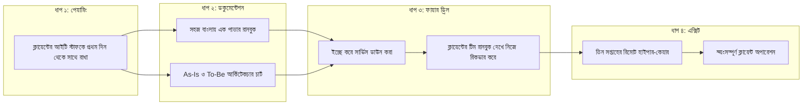

# কনক্লুশন: পারফেক্ট হ্যান্ডওভার ও ফিউচার প্রুফিং

---

### ১. আপনি চলে যাওয়ার পরের দিনটা ও গোল্ডেন হ্যান্ডওভার

বইয়ের প্রায় শেষ পাতায় চলে এসেছি আমরা। এতক্ষণ ধরে ডিসকাভারি, লোকাল আর্কিটেকচার, এআই এজেন্ট আর কেস স্টাডি নিয়ে যত কথা বলেছি, তার সবকিছুর চূড়ান্ত পরীক্ষা হয় একটা মাত্র প্রশ্নে: **আপনি ক্লায়েন্টের অফিস ছেড়ে চলে আসার এক মাস পর সিস্টেমটা কেমন চলছে?**

একজন ফরওয়ার্ড ডেপ্লয়েড ইঞ্জিনিয়ারের আসল সাকসেস কখনোই ডেপ্লয়মেন্টের দিনে মাপা হয় না, কোডের লাইন সংখ্যা দিয়েও মাপা হয় না। আপনি যদি এমন একটা সিস্টেম বানিয়ে দিয়ে আসেন যা চালাতে প্রতিদিন আপনাকে ফোন করতে হয়, তবে আপনি আসলে সমস্যার সমাধান করেননি - আপনি নিজেই সিস্টেমের নতুন একটা বটলনেক হয়ে গেছেন।

ধরুন, চ্যাপ্টার ৫-এর সেই প্রথম ব্রাঞ্চের কাজ আজ শেষ। আগামীকাল থেকে আপনার আর এই অফিসে আসার কথা নেই। ক্লায়েন্টের সেই হেড অব আইটি - যিনি প্রথম দিন এক কাপ চা হাতে এসে আপনাকে টেবিলের নিচের ধুলোমাখা ডেল সার্ভারটা দেখিয়ে দিয়েছিলেন - আজ আপনার পাশের চেয়ারে বসে আছেন। আপনি ল্যাপটপটা তাঁর দিকে ঘুরিয়ে দিয়ে বললেন, *"ভাই, আজ থেকে স্টিয়ারিং আপনার হাতে। আপনি টার্মিনালটা চালান, আমি শুধু পেছনে বসে দেখব।"*

তিনি মুচকি হেসে কিবোর্ডে হাত রাখলেন এবং কোনো দ্বিধা ছাড়াই কমান্ড চালালেন। ঠিক সেই মুহূর্তে আপনি বুঝলেন, আপনার প্রজেক্ট সত্যিকারের সাকসেস পেয়েছে। কোড লেখা শেষ হয়েছে বলে নয়, বরং ক্লায়েন্টের নিজস্ব মানুষ সিস্টেমটার ওনারশিপ নিজের কাঁধে তুলে নিয়েছেন বলে।

এই প্রক্রিয়াটাকে আমরা বলি **গোল্ডেন হ্যান্ডওভার (Golden Handover)**। এটা প্রজেক্টের শেষ দিনের কোনো আনুষ্ঠানিকতা নয়; এর কাজ শুরু হয় ফিল্ডে নামার প্রথম সপ্তাহ থেকেই। গোল্ডেন হ্যান্ডওভারের চারটা পরিষ্কার ধাপ আছে:

১. **প্রথম দিন থেকেই একজন শ্যাডো পার্টনার নেওয়া:** ক্লায়েন্টের নিজস্ব আইটি বা সাপোর্ট টিম থেকে একজন তরুণ ইঞ্জিনিয়ারকে বেছে নিন, যিনি প্রতিদিন আপনার পাশে বসবেন। চ্যাপ্টার ১-এ আপনি যেমন স্টাফদের ছায়া হয়ে তাঁদের কাজ দেখেছিলেন, এবার এই আইটি ইঞ্জিনিয়ার আপনার ছায়া হয়ে দেখবেন আপনি কিভাবে কাজ করেন। আপনি কেন `SQLite WAL` মোড অন করলেন, কেন `Ollama`-র প্রম্পট এভাবে লিখলেন - সব তিনি দেখবেন ও বুঝবেন।
২. **ঘুমচোখে পড়ার মতো এক পাতার রানবুক (Runbook):** প্রজেক্ট শেষে পঞ্চাশ পাতার টেকনিক্যাল ডকুমেন্টেশন কেউ পড়ে না। তাই একদম সহজ বাংলায় মাত্র এক পাতার একটা **রানবুক** লিখে সার্ভার রুমের দেয়ালে বা ডেস্কের সামনে সেঁটে দিন। সেখানে চারটা জিনিস পরিষ্কার লেখা থাকবে - সিস্টেম কিভাবে চালু ও রিস্টার্ট করতে হয়, লগ ফাইল কোন ফোল্ডারে থাকে, সার্ভার হ্যাং করলে প্রথম তিনটা কমান্ড কী চালাতে হবে, এবং কখন আপনাকে ফোন করতে হবে। মনে রাখবেন, এই পাতাটা পড়বেন এমন একজন মানুষ, যিনি রাত দুইটার সময় ফোনের অ্যালার্ম শুনে ঘুমচোখে টার্মিনালের সামনে বসেছেন।
৩. **লাইভ ফায়ার ড্রিল (Fire Drill):** অফিস ছাড়ার দুদিন আগে ক্লায়েন্টের অনুমতি নিয়ে ইচ্ছে করে সিস্টেমের একটা অংশ বন্ধ করে দিন। যেমন ব্যাকগ্রাউন্ডে `Ollama` সার্ভিসটা থামিয়ে দিন কিংবা একটা ভুল কনফিগারেশন পুশ করুন। এবার আপনি হাত গুটিয়ে পেছনে বসে দেখুন, চ্যাপ্টার ৩-এর অটো-রোলব্যাক ঠিকমতো কাজ করছে কি না এবং ক্লায়েন্টের ওই আইটি ইঞ্জিনিয়ার আপনার লেখা এক পাতার রানবুক দেখে নিজে নিজে সিস্টেমটা আবার তুলতে পারছেন কি না।
৪. **ধাপে ধাপে সরে আসা:** হ্যান্ডওভারের পর হুট করে যোগাযোগ বন্ধ করে দেবেন না। প্রথম দু-তিন সপ্তাহ দূর থেকে লগের ওপর নজর রাখুন, তারপর শুধু জরুরি ফোনের জন্য অ্যাভেইলেবল থাকুন। একদিন দেখবেন, পুরো মাসে আপনার ফোনে একটাও কল আসেনি। সেদিনই বুঝবেন আপনার হ্যান্ডওভার ষোলো আনা সফল।



!!! warning "নিজেকে অপরিহার্য বানানোর ফাঁদে পা দেবেন না"
    অনেক ভেন্ডর ইচ্ছে করে কোড আর সার্ভারের পাসওয়ার্ড গোপন রাখেন, যাতে ক্লায়েন্ট সারা জীবন তাঁদের ওপর নির্ভরশীল হয়ে থাকে। এতে সাময়িক কিছু টাকা পাওয়া যায়, কিন্তু ক্লায়েন্টের শ্রদ্ধা পাওয়া যায় না। একজন এফডিইর দর্শন ঠিক উল্টো। আপনার মাথার ভেতরে কোনো "গোপন মন্ত্র" রাখবেন না। সবকিছু সহজ করে লিখে দিন, ক্লায়েন্টের টিমকে হাতে ধরে শিখিয়ে দিন। যেদিন ক্লায়েন্ট আপনাকে ছাড়াই সিস্টেম চালাতে পারবেন, দেখবেন পরের নতুন প্রজেক্টের জন্য তিনি সবার আগে আপনাকেই ডাকছেন।

---

### ২. অটোমেটেড হেলথ চেক: সিস্টেম যখন নিঃশব্দে ভাঙে

ফিল্ডে ডেপ্লয় করা সিস্টেমের সবচেয়ে বড় শত্রু হলো নিঃশব্দ ফেইলিউর (Silent Failure)। ধরুন আপনি চলে আসার এক মাস পর সার্ভারের হার্ডডিস্ক লগ ফাইলে ভরে ৯৯% হয়ে গেল, কিংবা লোডশেডিংয়ের পর পিসি রিস্টার্ট নিয়েছে কিন্তু ব্যাকগ্রাউন্ডের লোকাল এআই মডেলটা (`Ollama`) চালু হয়নি। কেউ কিছু টের পেল না। দুদিন পর যখন স্টাফরা দেখলেন টিকিট বাছাই হচ্ছে না, ততক্ষণে হাজারটা কাজ জমে গেছে।

এই বিপদ ঠেকাতে সাইট ছাড়ার আগে সার্ভারে একটা ছোট **পাহারাদার স্ক্রিপ্ট (Health Check Cron)** বসিয়ে দিয়ে আসতে হয়। এর কাজ খুব সিম্পল - প্রতি পাঁচ মিনিট পরপর সে নিজে থেকেই পুরো সিস্টেমের নাড়ি পরীক্ষা করে দেখবে সব ঠিক আছে কি না।

#### কোড-স্যান্ডউইচ মেথড

**১. কাস্টমারের বাস্তব সংকট:** অন-প্রেম সার্ভারে ডেভঅপস ইঞ্জিনিয়ার চব্বিশ ঘণ্টা মনিটর খুলে বসে থাকেন না। তাই ডিস্ক ভরে গেলে, পাইথন অ্যাপ আটকে গেলে বা লোকাল এলএলএম সার্ভিস বন্ধ হয়ে গেলে স্টাফরা বিপদে পড়ার আগেই যেন আইটি টিমের কাছে সতর্কবার্তা চলে যায়, সেই ব্যবস্থা দরকার।

**২. মূল কোড:** নিচের কুড়ি লাইনের পাইথন স্ক্রিপ্টটি কোনো বাড়তি লাইব্রেরি ছাড়াই সার্ভারের ডিস্ক স্পেস, অ্যাপ্লিকেশন এপিআই এবং `Ollama` মডেলের স্ট্যাটাস একসাথে পরীক্ষা করে:

```python
# FDE Field Tool: Automated On-Prem Health Check (Run every 5 mins via cron)
import shutil, urllib.request, time

def endpoint_alive(url: str) -> bool:
    try:
        return urllib.request.urlopen(url, timeout=3).status == 200
    except Exception:
        return False

def run_health_diagnostics() -> list:
    alerts = []
    disk = shutil.disk_usage("/")
    if (disk.used / disk.total) > 0.85:
        alerts.append("WARNING: সার্ভারের ডিস্ক ৮৫% এর বেশি ভরে গেছে")
    if not endpoint_alive("http://localhost:8000/healthz"):
        alerts.append("CRITICAL: মূল পাইথন অ্যাপ সাড়া দিচ্ছে না")
    if not endpoint_alive("http://localhost:11434/api/tags"):
        alerts.append("CRITICAL: লোকাল এআই মডেল (Ollama) বন্ধ হয়ে আছে")
    return alerts

if __name__ == "__main__":
    issues = run_health_diagnostics()
    status_msg = "OK: সব সিস্টেম সচল" if not issues else " | ".join(issues)
    print(f"{time.strftime('%Y-%m-%d %H:%M')} - {status_msg}")
```

লিনাক্স সার্ভারে এই স্ক্রিপ্টটা প্রতি পাঁচ মিনিট পরপর স্বয়ংক্রিয়ভাবে চালানোর জন্য টার্মিনালে `crontab -e` দিয়ে শুধু নিচের এক লাইন যোগ করে দিন:

```bash
*/5 * * * * /usr/bin/python3 /opt/fde/health_check.py >> /var/log/fde_health.log 2>&1
```

**৩. সিস্টেমের বাস্তব ইমপ্যাক্ট:** সবকিছু ঠিকঠাক চললে `/var/log/fde_health.log` ফাইলে নীরবে এই লাইন জমা হতে থাকবে:

```text
2026-10-28 14:05 - OK: সব সিস্টেম সচল
```

কিন্তু যেই মুহূর্তে ডিস্ক ৮৫%-এর বেশি ভরবে কিংবা `Ollama` ক্র্যাশ করবে, সাথে সাথে লগে ধরা পড়বে:

```text
2026-10-28 14:10 - CRITICAL: লোকাল এআই মডেল (Ollama) বন্ধ হয়ে আছে
```

প্রোডাকশনে কাজ করার সময় আমরা ওই `if issues:` ব্লকের ভেতরে চ্যাপ্টার ৪-এর এসএমএস গেটওয়ে বা হোয়াটসঅ্যাপ ওয়েবহুকটা জুড়ে দিই। এখানে একটা জরুরি ফিল্ড টিপস মনে রাখবেন: **"সব ঠিক আছে" মেসেজ কখনোই এসএমএসে পাঠাবেন না!** দিনে দুইশোটা "সব ঠিক আছে" মেসেজ গেলে আইটি ম্যানেজার বিরক্ত হয়ে নোটিফিকেশন মিউট করে দেবেন। এসএমএস যাবে শুধুমাত্র তখনই, যখন `issues` তালিকায় সত্যিকারের কোনো বিপদ ধরা পড়বে।

**৪. গিটহাব রেফারেন্স:** হেলথ চেক ও অ্যালার্টিং স্ক্রিপ্ট পাবেন বইয়ের অফিশিয়াল কমপ্যানিয়ন রিপোজিটরিতে: [https://github.com/raqueeb/fdebook_companion](https://github.com/raqueeb/fdebook_companion)।

---

### ৩. গো-লাইভের পর প্রথম তিন সপ্তাহের হাইপার-কেয়ার: কাস্টমার ডাকার আগেই সারুন

অনেক সফটওয়্যার টিম প্রজেক্ট লাইভ করার দিন কেক কেটে হাততালি দিয়ে মনে করে যুদ্ধ শেষ। পরদিন থেকেই তারা অন্য ক্লায়েন্টের প্রজেক্টে ডুব দেয়। এই একটা ভুলের কারণে অসংখ্য ভালো সফটওয়্যার ডেপ্লয়মেন্টের পরের মাসেই মরে যায়।

মনে রাখবেন, সিস্টেম লাইভ হওয়ার পরের প্রথম দুই থেকে তিন সপ্তাহ হলো যেকোনো অটোমেশন প্রজেক্টের সবচেয়ে নাজুক সময়। আন্তর্জাতিক এফডিই প্লেবুকে এই সময়টাকে বলা হয় **হাইপার-কেয়ার (Hyper-Care)**।

কেন এই তিন সপ্তাহ এত গুরুত্বপূর্ণ? কারণ অপারেশনের স্টাফরা এই সময়টাতেই প্রথমবার তাঁদের পুরনো লাল খাতা আর এক্সেলের কমফোর্ট জোন ছেড়ে আপনার নতুন সিস্টেমে কাজ শুরু করছেন। তাঁদের মনের কোণে তখনো সূক্ষ্ম একটা সন্দেহ কাজ করে। এই অবস্থায় যদি হঠাৎ কোনো ছোট গ্লিচ দেখা দেয় এবং স্টাফকে বিরক্ত হয়ে ফোন করে বলতে হয়, *"ভাই, আজকেও তো আপনাদের সফটওয়্যার আটকে গেছে!"* - তবে তাঁর বিশ্বাসটা সাথে সাথে ভেঙে যায়। তিনি পাশের কলিগকে বলেন, *"বলেছিলাম না? এসব কম্পিউটারের সিস্টেমে কাজ হয় না, আগের খাতাটাই ভালো ছিল!"*

একজন অভিজ্ঞ এফডিই তাই গো-লাইভের পর প্রথম তিন সপ্তাহ সিস্টেমটাকে একদম নিবিড় পর্যবেক্ষণে রাখেন। তিনি প্রতিদিন সকালে ও বিকেলে হেলথ চেক লগ, ইভ্যালুয়েশন হারনেসের স্কোর এবং ডেটাবেজের রেসপন্স টাইম চেক করেন। 

ক্লায়েন্টের কোনো স্টাফ সমস্যাটা চোখে দেখার আগেই - কিংবা আইটি ম্যানেজার আপনাকে ফোন করার আগেই - আপনি লগ দেখে প্রবলেমটা ধরে ফেলবেন এবং ব্যাকগ্রাউন্ডে ফিক্স করে দেবেন। ফিক্স করার পর ক্লায়েন্টের আইটি ম্যানেজারকে হোয়াটসঅ্যাপে ছোট্ট একটা মেসেজ দেবেন:
> *"রাকিব ভাই, আজ দুপুর বারোটার দিকে বড় একটা পিডিএফ স্ক্যানের কারণে ইনভয়েস পার্সারের মেমোরিতে সামান্য স্পাইক হয়েছিল। আমি মেমোরি বাফার বাড়িয়ে সার্ভিস রিস্টার্ট দিয়ে দিয়েছি, স্টাফদের কাজে কোনো ব্যাঘাত ঘটেনি।"*

বিশ্বাস করুন, আপনার এই এক লাইনের প্রোঅ্যাকটিভ মেসেজটা ক্লায়েন্টের মনে যে ট্রাস্ট তৈরি করবে, তা হাজার পাতার মার্কেটিং ব্রোশিওর দিয়েও তৈরি করা সম্ভব নয়। ক্লায়েন্ট তখন মন থেকে জানেন যে তাঁর সিস্টেমটা একজন সত্যিকারের অভিভাবকের হাতে আছে।

!!! success "হাইপার-কেয়ারের গোল্ডেন রুল"
    গো-লাইভের প্রথম তিন সপ্তাহ কাস্টমারের ফোনের জন্য অপেক্ষা করবেন না। কাস্টমার কোনো সমস্যার কথা জানানোর আগেই নিজের হেলথ চেক ও লগ দেখে তা সমাধান করুন এবং ক্লায়েন্টকে নিজে থেকে আপডেট দিন। প্রথম তিন সপ্তাহে এই নিরবচ্ছিন্ন ভরসাটুকু দিতে পারলে স্টাফদের নতুন হ্যাবিট স্থায়ী হয়ে যায়।

#### কোড-স্যান্ডউইচ মেথড: হাইপার-কেয়ার প্রোঅ্যাকটিভ মেমোরি ও লেটেন্সি ওয়াচডগ

**১. কাস্টমারের বাস্তব সংকট:** গো-লাইভের প্রথম তিন সপ্তাহে হঠাৎ বড় পিডিএফ স্ক্যান বা ডেটাবেজ লোডের কারণে সার্ভিস ধীরগতির হয়ে গেলে স্টাফরা আস্থা হারিয়ে ফেলেন। তাই কাস্টমার বিরক্ত হয়ে ফোন করার আগেই মেমোরি স্পাইক ধরে স্বয়ংক্রিয়ভাবে মেমোরি ফ্লাশ ও আইটি ম্যানেজারের জন্য প্রোঅ্যাকটিভ মেসেজ ড্রাফট করার স্ক্রিপ্ট দরকার।

**২. মূল কোড:** নিচের পনেরো লাইনের পাইথন স্ক্রিপ্টটি ওয়ার্কারের র‍্যাম ও রেসপন্স টাইম মনিটর করে এবং সীমা ছাড়ানোর সাথে সাথে অটো-হিলিং ট্রিগার করে:

```python
# FDE Hyper-Care Tool: Proactive Memory Spike & Latency Watchdog
def monitor_hypercare_worker(worker_name: str, ram_mb: int, latency_sec: float) -> dict:
    RAM_LIMIT_MB, LATENCY_LIMIT_SEC = 1500, 2.5

    # স্টাফদের চোখে পড়ার আগেই মেমোরি বা লেটেন্সি স্পাইক ধরা
    if ram_mb > RAM_LIMIT_MB or latency_sec > LATENCY_LIMIT_SEC:
        return {
            "worker": worker_name,
            "action": "AUTO_FLUSH_BUFFER_AND_RESTART",
            "proactive_msg": f"{worker_name}-এ সামান্য মেমোরি স্পাইক ({ram_mb}MB) হয়েছিল। "
                             f"বাফার বাড়িয়ে রিস্টার্ট দেওয়া হয়েছে, কাজে কোনো ব্যাঘাত ঘটেনি।"
        }
    return {"worker": worker_name, "action": "NONE", "proactive_msg": "STABLE"}

# দুপুর ১২টায় বড় পিডিএফ স্ক্যানের সময় ১৭৫০ মেগাবাইট মেমোরি স্পাইক ডিটেকশন
print(monitor_hypercare_worker("invoice-parser", ram_mb=1750, latency_sec=3.1))
```

**৩. সিস্টেমের বাস্তব ইমপ্যাক্ট ও কোডের ব্যাখ্যা:** স্ক্রিপ্টটা রান করলে আউটপুটে পাবেন:

```text
{'worker': 'invoice-parser', 'action': 'AUTO_FLUSH_BUFFER_AND_RESTART', 'proactive_msg': 'invoice-parser-এ সামান্য মেমোরি স্পাইক (1750MB) হয়েছিল। বাফার বাড়িয়ে রিস্টার্ট দেওয়া হয়েছে, কাজে কোনো ব্যাঘাত ঘটেনি।'}
```

কোডটার ভেতরের কৌশলটা খেয়াল করুন:
* **ক্র্যাশের আগেই প্রতিরোধ (`ram_mb > 1500`):** সার্ভার ক্র্যাশ করে ২ জিবিতে গেলে। কিন্তু আমরা থ্রেশহোল্ড রেখেছি `1500` মেগাবাইট এবং `2.5` সেকেন্ডে। ফলে সার্ভার পুরোপুরি ঝুলে যাওয়ার আগেই সিস্টেম ব্যাকগ্রাউন্ডে বাফার ক্লিয়ার করে রিস্টার্ট নিয়ে নিচ্ছে।
* **প্রোঅ্যাকটিভ ট্রাস্ট মেসেজ (`proactive_msg`):** স্ক্রিপ্টটা শুধু সার্ভিস রিস্টার্টই দিচ্ছে না, সাথে সাথে ক্লায়েন্টকে পাঠানোর জন্য বাংলা মেসেজটাও তৈরি করে দিচ্ছে।

**৪. গিটহাব রেফারেন্স:** সম্পূর্ণ হাইপার-কেয়ার মনিটরিং টুলকিট পাবেন অফিশিয়াল কমপ্যানিয়ন রিপোজিটরিতে: [https://github.com/raqueeb/fdebook_companion](https://github.com/raqueeb/fdebook_companion)।

---

### ৪. দুনিয়া কেন আবার অন-প্রেম এজের দিকে ফিরে আসছে?

এই বইয়ের শুরু থেকেই আমরা একটা বিষয়ের ওপর বারবার জোর দিয়েছি - সব ডেটা চোখ বন্ধ করে পাবলিক ক্লাউডে না পাঠিয়ে ক্লায়েন্টের নিজের লোকাল সার্ভারে (`On-Prem Edge`) অটোমেশন ও ছোট এআই মডেল চালানো। কেউ কেউ ভাবতে পারেন, এটা কি শুধু আমাদের দেশের ইন্টারনেট বা বাজেটের সীমাবদ্ধতার কারণে?

একদমই না। আজ গোটা বিশ্বের টেক ইন্ডাস্ট্রিতেই এই হাওয়া বইতে শুরু করেছে। এর পেছনে চারটা বড় কারণ আছে:
১. **ডেটার সার্বভৌমত্ব ও প্রাইভেসি:** ব্যাংক, হাসপাতাল, প্রতিরক্ষা, টেলিকম এবং বড় ম্যানুফ্যাকচারিং প্রতিষ্ঠানগুলো এখন বুঝে গেছে যে এআইকে দিয়ে কাজ করাতে হলে তাকে প্রতিষ্ঠানের সবচেয়ে গোপন ডেটা পড়তে দিতে হয়। আর সেই ডেটা দেশের বাইরে থার্ড-পার্টি ক্লাউডে পাঠানো মানে নিজের ব্যবসাকে ঝুঁকির মুখে ফেলা।
২. **একতরফা নির্ভরতার ঝুঁকি:** ২০২৬ সালের মাঝামাঝি সময়ে আন্তর্জাতিক এক্সপোর্ট কন্ট্রোল ও নীতির কড়াকড়ির কারণে কয়েকটি বড় ক্লাউড এআই মডেলের এপিআই অ্যাক্সেস হঠাৎ বিভিন্ন অঞ্চলে সীমিত হয়ে গিয়েছিল। সেই ঘটনায় হাজার হাজার কোম্পানি ধাক্কা খেয়ে বুঝেছে, নিজের ব্যবসার মূল ইঞ্জিন যদি অন্য দেশের একটা এপিআই কি (API Key)-এর ওপর ঝুলে থাকে, তবে যেকোনো দিন ব্যবসা অচল হয়ে যেতে পারে।
৩. **ক্লাউড বিলের লাগাম টানা:** প্রোটোটাইপ করার সময় ক্লাউড এপিআই সস্তা মনে হলেও, চব্বিশ ঘণ্টার এন্টারপ্রাইজ অপারেশনে লোকাল হার্ডওয়্যারের খরচ ক্লাউডের মাসিক বিলের তুলনায় অনেক কম ও স্থির।
৪. **ছোট ওপেন সোর্স মডেলের বিপ্লব:** দুবছর আগেও যে ন্যাচারাল ল্যাঙ্গুয়েজ প্রসেসিং বা JSON এক্সট্রাকশনের কাজের জন্য সত্তর বিলিয়ন প্যারামিটারের বিশাল মডেল লাগত, আজ `Qwen 2.5`, `Llama` বা `Gemma`-র মতো দেড় থেকে তিন বিলিয়ন প্যারামিটারের ৪-বিট কোয়ান্টাইজড মডেল সাধারণ সিপিইউতেই সেই কাজ নিখুঁতভাবে করে দিচ্ছে।

অবশ্য এর মানে এই নয় যে ক্লাউড কম্পিউটিং মুছে যাচ্ছে। ভবিষ্যৎ হলো হাইব্রিড আর্কিটেকচারের। কোম্পানির রোজকার সংবেদনশীল অপারেশন, রিয়েল-টাইম ট্রায়াজ এবং ইন্টারনেট-নিরপেক্ষ কাজগুলো চলবে অফিসের লোকাল অন-প্রেম সার্ভারে; আর বিশাল অ্যানালিটিক্স বা পাবলিক ওয়েবসাইটের কাজ চলবে ক্লাউডে। কোন কাজটা লোকালে চলবে আর কোনটা ক্লাউডে যাবে - এই আর্কিটেকচারাল সিদ্ধান্ত নিতে পারার ক্ষমতাই আগামী দিনে একজন ইঞ্জিনিয়ারকে সবচেয়ে মূল্যবান করে তুলবে।

---

### ৫. ফিরে তাকানো: লাল মলাটের খাতার শেষ গল্প

চলুন, বইটা শেষ করার আগে আমাদের সেই শুরুর গল্পটায় আরেকবার ফিরে যাই।

মনে আছে ইন্ট্রোডাকশনের সেই সকালটার কথা? তিন মাস দিনরাত খেটে সব ইউনিট টেস্ট গ্রিন রেখে আপনি সিস্টেম ডেলিভারি দিয়েছিলেন। কিন্তু নব্বই দিন পর গিয়ে দেখলেন, উনষাট জন স্টাফের মধ্যে লগইন করেছেন মাত্র চারজন। হেড অ্যাকাউন্ট্যান্ট সাহেব চশমার ফাঁক দিয়ে তাকিয়ে ক্লান্ত হাসি হেসে বলেছিলেন, *"সফটওয়্যারটা দেখতে ভালোই বাবা। কিন্তু বারোটা ড্রপডাউন পূরণ করতে বিশ সেকেন্ড লাগে, বাইরে ট্রাক দাঁড়িয়ে থাকে। আর মাস শেষে আমার ভ্যাট-রিবেটের হিসাবটা ওতে মেলে না, এই লাল খাতায় মেলে।"*

তারপর মাঝের এই পাঁচটা চ্যাপ্টারে অনেক কিছু বদলে গেছে। আপনি প্রথম আটচল্লিশ ঘণ্টায় ল্যাপটপ ব্যাগে রেখে তাঁদের সাথে চা খেয়েছেন, শ্যাডো সেশনে বসে তাঁদের দীর্ঘশ্বাস আর বটলনেক ডিসকাভারি করেছেন। ওটিপি দিয়ে ম্যানেজারের সইয়ের দুই ঘণ্টার জট সাত মিনিটে নামিয়ে এনেছেন। টেবিলের নিচের ধুলোমাখা ডেল সার্ভারে `Ollama` আর `Qwen 2.5` বসিয়ে ইন্টারনেট ছাড়াই মেসেজ ট্রায়াজ করেছেন। বিশ মিনিটের ডোমেইন স্প্রিন্টে হেড অ্যাকাউন্ট্যান্ট সাহেবের পাশে বসে ভ্যাট-রিবেটের ফাংশন লিখে টেস্ট পাস করিয়েছেন। আর সবশেষে ক্লায়েন্টের আইটি টিমের হাতে এক পাতার রানবুক আর হেলথ চেক স্ক্রিপ্ট বুঝিয়ে দিয়ে গোল্ডেন হ্যান্ডওভার সেরে এসেছেন।

ধরুন, হ্যান্ডওভারের দুমাস পর একদিন বিকেলে আপনি ওই পথ দিয়ে যাচ্ছিলেন। ভাবলেন, একবার ঢুঁ মেরে দেখে যাই সবাই কেমন আছেন।

আপনি অপারেশন ফ্লোরে ঢুকলেন। সার্ভারের ড্যাশবোর্ডে চোখ বুলিয়ে দেখলেন, উনষাট জন স্টাফের মধ্যে একান্ন জনই আজ সিস্টেমে অ্যাক্টিভ কাজ করছেন (বাকি আটজন ছুটিতে বা ফিল্ড ভিজিটে)। গেটের বাইরে ট্রাকের কোনো জট নেই, ড্রাইভারদের কোনো চিৎকার নেই।

আপনি ধীর পায়ে হেড অ্যাকাউন্ট্যান্ট সাহেবের ডেস্কের সামনে গিয়ে দাঁড়ালেন। আপনার চোখ গেল টেবিলের ডান কোণে। সেই চেনা লাল মলাটের খাতাটা এখনো সেখানেই রাখা আছে। কিন্তু খাতাটা আজ আর খোলা নেই - বন্ধ খাতাটার ওপর এক কাপ ধোঁয়া ওঠা চা রাখা, আর চাচা কম্পিউটারের স্ক্রিনে এক ক্লিকে মাসের ভ্যাট রিপোর্ট মেলাচ্ছেন।

আপনাকে দেখেই তাঁর মুখটা উজ্জ্বল হয়ে উঠল। চেয়ার ছেড়ে আধা উঠে বললেন, *"আরে বাবা, ভেতরে এসো, বসো! দেখছ তো, লাল খাতাটা কিন্তু ডাস্টবিনে ফেলে দিইনি, টেবিলের কোণেই রেখে দিয়েছি। মাঝে মাঝে ওটার দিকে তাকালে মনে পড়ে, আমরা আগে কত কষ্টে কাজ করতাম আর আজ কোথায় এসেছি!"*

আপনি মুচকি হাসলেন। সামনের চেয়ারটা টেনে চায়ের কাপটা হাতে নিলেন।

সত্যি বলতে কী, এই পুরো বইয়ের এতগুলো চ্যাপ্টার, এত কোড, এত আর্কিটেকচার ডায়াগ্রাম - সবকিছু লেখা হয়েছে শুধুমাত্র এই একটা মুহূর্তের জন্য। কোড কতটা চমৎকার হলো তার জন্য নয়; বরং আপনার লেখা কয়েক লাইন কোডের কারণে একজন মানুষের রোজকার কাজের স্ট্রেস কমে গিয়ে তাঁর মুখে যে একটুখানি কমফোর্টের হাসি ফুটে উঠল, সেটাই একজন ফরওয়ার্ড ডেপ্লয়েড ইঞ্জিনিয়ারের লাইফের সবচেয়ে বড় সাকসেস।

এবার আপনার পালা।

আজ বইটা পড়া শেষ হলে আগামীকাল সকালে নিজের অফিসের বা পরিচিত কোনো ব্যবসার একজন মানুষের ডেস্কের পাশে গিয়ে বসুন। কোনো ল্যাপটপ ছাড়া, কোনো জাজমেন্ট ছাড়া। শুধু এক ঘণ্টা চুপচাপ দেখুন তিনি কিভাবে কাজ করেন, কোন স্ক্রিনে এসে তাঁর কপাল কুঁচকে যায়, কোন হিসাব মেলাতে গিয়ে তিনি বারবার খাতা বা ক্যালকুলেটর টেনে নেন। দেখবেন, ওই এক ঘণ্টাতেই আপনার নিজের প্রথম এফডিই গল্পটা শুরু হয়ে গেছে।

*(বইয়ের পরবর্তী পাতায় যুক্ত থাকা **অ্যাপেন্ডিক্স ও ফিল্ড রেফারেন্স** অংশে আপনার ফিল্ডে নামার চেকলিস্ট, ল্যাপটপে কোড চালানোর গাইড এবং সম্পূর্ণ শব্দকোষ দেওয়া হলো।)*

---

!!! question "আমার সাথে কথা বলতে চান?"
    আমাকে WhatsApp এ মেসেজ করতে পারেন: [+8801713095767](https://wa.me/+8801713095767)। আমি যেহেতু রোবট, কল থেকে মেসেজেই বেশি অভ্যস্ত। আমার সব আলাপ [মিডিয়াম](https://medium.com/@raqueeb), [ফেসবুক](https://www.facebook.com/raqueeb) আর [লিংকডইনে](https://www.linkedin.com/in/raqueeb/) পাবেন। ভিডিও দেখতে চাইলে আছে [ইউটিউব](https://www.youtube.com/@raqueeb)।

    আমার মাথায় আর কী কী ঘোরে, সেটাও পাবেন [এখানে](https://medium.com/@raqueeb/print-media-write-ups-2024-25-f2896ce92f7b)।

    এখানে পাবেন আমার লেখা [বিভিন্ন রিসোর্স](https://aiwithr.github.io/resources/), [আমি কে](https://aiwithr.github.io/about/) এবং প্রিন্ট মিডিয়াতে আমার [কিছু লেখা](https://aiwithr.github.io/print/)।
