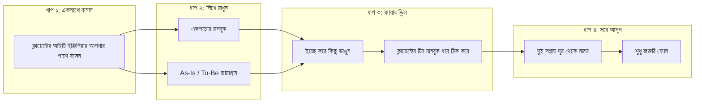

# কনক্লুশন ও ফিল্ড রেফারেন্স: পারফেক্ট হ্যান্ডওভার ও ফিউচার প্রুফিং

---

### ১. আপনি চলে যাওয়ার পরের দিনটা

বই শেষ হয়ে আসছে। এতগুলো পাতা ঘুরে যে কথাটা বলার জন্য এখানে এসেছি, এবার সেটা বলে ফেলি।

একজন এফডিইর আসল সাকসেস মাপা হয় না ডেপ্লয়ের দিনে। কোডের সাইজ দিয়েও না। মাপা হয় একটা সহজ প্রশ্নে: আপনি সাইট ছেড়ে চলে আসার পর সিস্টেমটা কেমন চলছে?

ধরুন, চ্যাপ্টার ৫-এর সেই প্রথম ব্রাঞ্চের কাজ শেষ। আগামীকাল আপনার আর এখানে আসার কথা নেই। ক্লায়েন্টের হেড অব আইটি, যিনি সেই প্রথম দিন ধোঁয়া ওঠা চা হাতে আপনার ডেস্কের পাশে এসে দাঁড়িয়েছিলেন, আজ আপনার পাশে বসে আছেন।

আপনি ল্যাপটপটা তাঁর দিকে ঘুরিয়ে দিয়ে বললেন, "এবার আপনি চালান। আমি পেছনে বসে শুধু দেখব।"

তিনি একটু হাসলেন। তারপর কিবোর্ডে হাত রাখলেন। সেই মুহূর্তে আপনি বুঝলেন, আপনার কাজ ঠিকঠাক শেষ হয়েছে। কোড লেখা শেষ হয়েছে বলে না। একজন মানুষ সিস্টেমটার দায়িত্ব নিয়েছেন বলে।

এই হস্তান্তরের একটা নাম দিয়েছি, **গোল্ডেন হ্যান্ডওভার**। ব্যাপারটা শেষ দিনের কোনো অনুষ্ঠান না। এটা শুরু হয় প্রজেক্টের প্রথম দিন থেকেই। ধাপগুলো এরকম।

**ধাপ ১: প্রথম দিন থেকে সাথে নিন।** ক্লায়েন্টের আইটি টিম থেকে একজনকে বেছে নিন, যিনি আপনার পাশে বসবেন। চ্যাপ্টার ১-এ আপনি কর্মীদের ছায়া হয়ে শিখেছিলেন। এবার উল্টোটা হোক। তিনি আপনার ছায়া হয়ে আপনার কাজ দেখবেন। আপনি কেন একটা সিদ্ধান্ত নিলেন, কেন একটা কমান্ড চালালেন, সব তিনি দেখবেন আর প্রশ্ন করবেন।

**ধাপ ২: একপাতার রানবুক লিখুন।** সিস্টেম কিভাবে চালু হয়, কিভাবে বন্ধ হয়, লগ কোথায় থাকে, ভেঙে পড়লে প্রথম তিনটা কাজ কী, কাকে ফোন করতে হবে। এই পাতাটা সহজ বাংলায় লিখবেন। কারণ এটা পড়বেন এমন কেউ, যিনি রাত দুইটায় ঘুমচোখে ফোনের আওয়াজে উঠেছেন।

**ধাপ ৩: ফায়ার ড্রিল করুন।** ক্লায়েন্টের অনুমতি নিয়ে ইচ্ছে করে সিস্টেমের একটা অংশ ভেঙে দিন। হয়তো একটা সার্ভিস বন্ধ করে দিলেন, কিংবা একটা ভুল আপডেট পুশ করলেন। চ্যাপ্টার ৩-এর রোলব্যাক ঠিকমতো কাজ করে কি না দেখুন। আর ক্লায়েন্টের টিম রানবুক ধরে নিজেরা ঠিক করতে পারে কি না, তাও দেখুন। আপনি পেছনে বসে কিছু বলবেন না, শুধু দেখবেন।

**ধাপ ৪: ধীরে ধীরে সরে আসুন।** প্রথম দুই সপ্তাহ দূর থেকে নজর রাখুন। তারপর শুধু জরুরি ফোনের জন্য থাকুন। একদিন দেখবেন, ফোন আসাই বন্ধ হয়ে গেছে। সেদিনটাই আপনার আসল সাফল্যের দিন।

নিচের ডায়াগ্রামে পুরো পথটা দেখুন:



!!! info "গোল্ডেন হ্যান্ডওভারের পরীক্ষা"
    একটা প্রশ্ন করুন: আমি যদি এক মাস কোনো ফোন না ধরি, ক্লায়েন্টের সিস্টেম কি ঠিকঠাক চলবে? উত্তর যদি "হ্যাঁ" হয়, হ্যান্ডওভার সম্পন্ন। উত্তর যদি "জানি না" হয়, তাহলে আরও একটা ফায়ার ড্রিল বাকি আছে।

!!! warning "নিজেকে অপরিহার্য বানাবেন না"
    কিছু ঠিকাদার ইচ্ছে করে সিস্টেম জটিল রাখেন, যাতে ক্লায়েন্ট তাঁদের ছাড়া চলতে না পারে। এতে সাময়িক লাভ হয়, কিন্তু আস্থা ভেঙে যায়। এফডিইর নীতি উল্টো। আপনার মাথার ভেতরে কোনো গোপন পাসওয়ার্ড, কোনো বিশেষ কৌশল, কোনো "শুধু আমি জানি" ধরনের কিছু রাখবেন না। সবকিছু লিখে দিন, সবকিছু শিখিয়ে দিন। যেদিন ক্লায়েন্ট আপনাকে ছাড়া চলতে পারবেন, সেদিন তিনিই আপনাকে সবচেয়ে বেশি মনে রাখবেন।

---

### ২. হেলথ চেক: সিস্টেম যখন চুপচাপ ভাঙে

সবচেয়ে ভয়ংকর ভাঙন সেটা, যা চুপচাপ ঘটে। কেউ টের পায় না। দুই দিন পর কোনো কর্মী এসে বলেন, "ভাই, কয়েকটা টিকিট আসছে না কেন?" ততক্ষণে ক্ষতি হয়ে গেছে।

এই কারণেই আপনি চলে যাওয়ার আগে সিস্টেমের নিজস্ব একটা পাহারাদার বসিয়ে যাবেন। এর কাজ খুব সোজা। প্রতি কয়েক মিনিট পরপর সিস্টেমকে জিজ্ঞেস করবে, "তুমি ঠিক আছ?" উত্তর না এলে ক্লায়েন্টের আইটি ইঞ্জিনিয়ারের ফোনে খবর চলে যাবে।

তিনটা জিনিস পাহারা দিলেই বেশিরভাগ সমস্যা ধরা পড়ে। অ্যাপ্লিকেশন সাড়া দিচ্ছে কি না। সার্ভারের ডিস্ক ভরে যাচ্ছে কি না। আর চ্যাপ্টার ২-এর সেই লোকাল এআই মডেল চালু আছে কি না।

#### কোড-স্যান্ডউইচ মেথড

**১. মাঠের সংকট:** আপনি সাইট ছেড়ে চলে গেছেন। এক মাস পর সার্ভারের ডিস্ক লগ ফাইলে ভরে গেল, অ্যাপ আটকে গেল। কেউ কিছু টের পেল না, কারণ কেউ দেখছিল না। এমন সময় একটা ছোট পাহারাদার স্ক্রিপ্ট সবচেয়ে বড় বন্ধু।

**২. মূল কোড:** নিচের কুড়ি লাইনের কাছাকাছি স্ক্রিপ্টটা তিনটা জিনিস যাচাই করে:

```python
# FDE Field Tool: লোকাল হেলথ চেক (cron-এ প্রতি ৫ মিনিটে চালান)
import shutil, urllib.request, time

def http_ok(url: str) -> bool:
    try:
        return urllib.request.urlopen(url, timeout=3).status == 200
    except Exception:
        return False

def check_all() -> list:
    problems = []
    disk = shutil.disk_usage("/")
    if disk.used / disk.total > 0.85:
        problems.append("ডিস্ক ৮৫% এর বেশি ভরে গেছে")
    if not http_ok("http://localhost:8000/healthz"):
        problems.append("অ্যাপ সাড়া দিচ্ছে না")
    if not http_ok("http://localhost:11434/api/tags"):
        problems.append("লোকাল এআই মডেল (Ollama) সাড়া দিচ্ছে না")
    return problems

if __name__ == "__main__":
    issues = check_all()
    print(time.strftime("%Y-%m-%d %H:%M"), "সব ঠিক আছে" if not issues else issues)
```

প্রতি পাঁচ মিনিটে এটা নিজে নিজে চালানোর জন্য লিনাক্সের `cron` ব্যবহার করুন। এক লাইনের কাজ:

```bash
*/5 * * * * python3 /opt/fde/health_check.py >> /var/log/fde_health.log
```

**৩. সিস্টেমের বাস্তব বদল:** সব ঠিক থাকলে লগে এই লাইন জমতে থাকবে:

```text
2026-10-27 15:10 সব ঠিক আছে
```

আর কোনো কিছু ভাঙলে এরকম আসবে:

```text
2026-10-27 15:15 ['অ্যাপ সাড়া দিচ্ছে না']
```

কোডটা কী করছে, একটু খুলে বলি। `http_ok` ফাংশন একটা ঠিকানায় ডাক দেয়। তিন সেকেন্ডের মধ্যে ঠিকঠাক উত্তর এলে `True`, না এলে `False`। `check_all` তিনটা জিনিস পরপর যাচাই করে: ডিস্ক পঁচাশি শতাংশের বেশি ভরেছে কি না, অ্যাপের `/healthz` ঠিকানায় সাড়া আছে কি না, আর Ollama-র `/api/tags` ঠিকানা জীবিত কি না। কোনো কিছু ভাঙলে সমস্যার তালিকায় বাংলায় একটা বার্তা জমে।

এই উদাহরণে বার্তা শুধু লগে লেখা হচ্ছে। বাস্তবে `print`-এর জায়গায় চ্যাপ্টার ৪-এর এসএমএস গেটওয়ে বসাবেন, যাতে ক্লায়েন্টের আইটি ইঞ্জিনিয়ারের ফোনে সরাসরি খবর যায়। আপনি চাইলে ডেটাবেজ কত দ্রুত উত্তর দিচ্ছে সেটাও একইভাবে যোগ করতে পারেন।

!!! tip "অ্যালার্ম কম রাখুন"
    দিনে একশোটা সতর্কবার্তা পেলে মানুষ শেষে কোনোটাই পড়ে না। পাহারাদারকে শুধু তখনই ডাকতে বলুন, যখন সত্যিই কিছু ভেঙেছে। "সব ঠিক আছে" বার্তা লগে থাকুক, ফোনে নয়। আর ঠিক করে দিন, কোন সমস্যা আগে সামলাতে হবে। ডিস্ক পঁচাশি শতাংশে পৌঁছালে আজ রাতের মধ্যে ঠিক করলেই চলে, কিন্তু অ্যাপ বন্ধ হলে এই মুহূর্তে।

---

### ৩. প্রথম তিন সপ্তাহের হাইপার-কেয়ার: ক্লায়েন্ট ডাকার আগেই সারুন

ডেপ্লয়মেন্টের দিন সবাই কেক কাটে। ক্লায়েন্ট হাসিমুখে হাত মেলান। সেই মুহূর্তে মনে হতে পারে, কাজ শেষ।

এই ভুলটা কখনো করবেন না।

প্রোডাকশনে যাওয়ার পর প্রথম দুই থেকে তিন সপ্তাহ হলো একটা সফটওয়্যারের জীবনের সবচেয়ে সংকটময় সময়। একে বলা হয় **হাইপার-কেয়ার**।

কেন এই সময়টা এত স্পর্শকাতর?

কারণ এই দুই-তিন সপ্তাহে কর্মীরা প্রথমবারের মতো পুরোনো অভ্যাস ছেড়ে আপনার নতুন সিস্টেমে হাত দিচ্ছেন। তাঁদের মনে এখনো খানিকটা সংশয় আছে। এই সময়ে যদি সিস্টেমে কোনো গ্লিচ দেখা দেয়, আর কর্মীকে ফোন করে জানাতে হয়, "ভাই, সফটওয়্যার তো আটকে গেছে!", তবে সেই হারিয়ে যাওয়া বিশ্বাস সহজে আর ফিরে পাওয়া যায় না। কর্মীরা ভাববেন, "ওই তো, বলেছিলাম না? আগের খাতাটাই ভালো ছিল।"

অভিজ্ঞ এফডিই তাই গো-লাইভের প্রথম তিন সপ্তাহ অন্য কোনো নতুন প্রজেক্টে হাত দেন না। তিনি সাইটের একদম নিঃশ্বাসের দূরত্বে থাকেন।

তিনি সারাদিন হেলথ চেক ড্যাশবোর্ড আর লোকাল লগের দিকে চোখ রাখেন। ক্লায়েন্ট কোনো সমস্যা চোখে দেখার আগেই, বা কোনো কর্মী ফোন দেওয়ার আগেই, তিনি লগ দেখে বুঝতে পারেন কোথায় ড্রপ হচ্ছে।

তিনি শান্ত মাথায় সেটা ব্যাকগ্রাউন্ডে ফিক্স করেন। তারপর ক্লায়েন্টের আইটি ম্যানেজারকে একটা ছোট্ট বার্তা দেন:  
*"রাকিব ভাই, বেলা এগারোটায় ইনভয়েস পার্সারের মেমোরিতে সামান্য একটা স্পাইক হয়েছিল। আমি ফিক্স করে রিস্টার্ট দিয়েছি, কর্মীদের কাজের কোনো বিঘ্ন ঘটেনি।"*

এই একটা প্রোঅ্যাকটিভ বার্তা ক্লায়েন্টের চোখে আপনার মর্যাদাকে এক লাফে অন্য উচ্চতায় নিয়ে যায়। ক্লায়েন্ট তখন বুঝতে পারেন, আপনি শুধু সফটওয়্যার গছিয়ে দিয়ে পালিয়ে যাওয়ার মানুষ নন; আপনি তাঁর কাজের সত্যিকারের পাহারাদার।

!!! success "ফিল্ড রুলস: ক্লায়েন্ট ডাকার আগেই সমস্যা সারুন"
    গো-লাইভের প্রথম তিন সপ্তাহ কোনো ছুটি নেই। এই সময়টাতেই সফটওয়্যারের আসল ভাগ্য নির্ধারিত হয়। ক্লায়েন্ট আপনাকে কোনো ত্রুটি দেখিয়ে দেওয়ার আগেই, নিজের পাহারাদার মনিটরিং দিয়ে তা শনাক্ত করুন আর সমাধান করে দিন। কাস্টমার ডাকার আগেই সমস্যা সারার এই অভ্যাসই আস্থার সবচেয়ে মজবুত ভিত্তি গড়ে তোলে।

---

### ৪. দুনিয়া আবার অন-প্রেমের দিকে তাকাচ্ছে

এই বইয়ের শুরু থেকে আমরা একটা বিষয় ঘুরেফিরে বলেছি। ক্লাউডে সব কিছু তুলে দেওয়া সবসময় সহজ উত্তর না। চ্যাপ্টার ২-এ দেখেছি, টেবিলের নিচের পুরনো সার্ভারেই অনেক কাজ চলে যায়। এখন একটু বড় পরিসরে দেখি, এই ধারাটা শুধু আমাদের মাঠে না, গোটা দুনিয়াতেই জোরালো হচ্ছে।

কারণগুলো খুব বাস্তব।

প্রথম কারণ, ডেটার সীমানা। ব্যাংক, হাসপাতাল, সরকারি দপ্তর, কারখানা, সবাই নিজের স্পর্শকাতর ডেটা নিজের ঘরের বাইরে পাঠাতে অস্বস্তি বোধ করে। এই অস্বস্তি এআইয়ের যুগে আরও বেড়েছে, কারণ এআইকে কাজ করাতে গেলে তাকে ডেটা পড়তে দিতে হয়।

দ্বিতীয় কারণ, একতরফা নির্ভরতার ঝুঁকি। ২০২৬ সালের জুনে একটা বড় এআই কোম্পানির দুটো শীর্ষ মডেলের অ্যাক্সেস কয়েক সপ্তাহের জন্য বন্ধ হয়ে গিয়েছিল, মার্কিন কমার্স ডিপার্টমেন্টের এক্সপোর্ট কন্ট্রোলের কারণে। পরে নিয়ম তুলে নিলে আবার চালু হয়। কিন্তু ওই কয়েক সপ্তাহে বহু প্রতিষ্ঠান টের পেয়েছে, নিজের কাজের একটা জরুরি অংশ অন্য কারও হাতে থাকার মানে কী। সরকারগুলোও এখন নিজেদের মতো করে, নিজেদের ভাষা আর ডেটা দিয়ে চলা এআইয়ের কথা ভাবছে।

তৃতীয় কারণ, খরচ। চ্যাপ্টার ২-এর ক্লাউড বিলের ভয়টা আমাদের মাঠের সবাই চেনেন।

আর চতুর্থ কারণটা আমাদের জন্য সবচেয়ে আশার। ছোট মডেলগুলো প্রতি বছর আগের চেয়ে বেশি কাজের হচ্ছে। দেড় বিলিয়ন বা তিন বিলিয়ন প্যারামিটারের মডেল দিয়ে আজ যে কাজ করা যায়, কয়েক বছর আগে তার জন্য বিশাল মডেল লাগত।

!!! tip "ক্লাউড শেষ হয়ে যাচ্ছে না"
    এখানে একটা সৎ কথা বলে রাখা দরকার। ক্লাউড কোথাও যাচ্ছে না, আর যাওয়ার কথাও না। ভবিষ্যতের সবচেয়ে বাস্তব ছবি হলো মিশ্র ব্যবস্থা। স্পর্শকাতর আর রোজকার ভারী কাজ চলবে লোকাল সার্ভারে। বিশাল গণনার কাজ বা খুব বড় মডেলের দরকার হলে ক্লাউডের সাহায্য নেওয়া হবে। কিন্তু কোনটা কোথায় চলবে, সেই সিদ্ধান্তটা আপনার নিজের হাতে থাকবে। এই সিদ্ধান্ত নিতে পারার ক্ষমতাটাই এফডিইর সম্পদ।

---

### ৫. ল্যাব ছেড়ে মাঠে

এই বইয়ের একদম শুরুর প্রশ্নটায় ফিরে যাই। আপনি তিন মাস ধরে নিখুঁত একটা সিস্টেম বানালেন, অথচ কেউ ব্যবহার করল না। কেন?

এখন আপনি উত্তরটা জানেন। কোড ভালো ছিল। কিন্তু মানুষ, তাদের ভয়, তাদের অলিখিত নিয়ম আর তাদের লাল খাতা, এই জিনিসগুলো আপনার হিসাবে ছিল না।

এখন একটা নতুন বাস্তবতা আসছে। চ্যাপ্টার ৩-এ দেখেছেন, এআই কোডিং এজেন্ট কয়েক মিনিটে কোড লিখে ফেলে। কোড লেখা এখন সস্তা। কিন্তু যেটা সস্তা না, সেটা হলো একজন হেড অ্যাকাউন্ট্যান্টের ভ্যাট রিবেটের মারপ্যাঁচ বোঝা। একজন মিড-লেভেল ম্যানেজারের ভয় ধরতে পারা। বন্দরের ক্লার্কের "শতকরা এক ভাগ" ছাড়ের কথাটা শুনতে পাওয়া। এসব কাজ কোনো এজেন্ট ঘরে বসে করতে পারে না। কাউকে মাঠে গিয়ে, মানুষের পাশে বসে করতে হয়।

আমার ধারণা, তাই আগামী দিনে সবচেয়ে কাজের ইঞ্জিনিয়াররা হবেন তাঁরাই, যাঁরা ল্যাবের নিরাপদ নিঃসঙ্গতা ছেড়ে সরাসরি কাস্টমারের টেবিলের পাশে গিয়ে বসতে পারেন। আমাদের দেশের অনেক ব্যবসা এখনো কাগজ আর এক্সেলে চলে। এআই বসানোর আগে সেখানে অনেক ডিজিটাল জমি তৈরি করতে হবে। সেই কাজটা যাঁরা করবেন, তাঁদের হাতেই বাংলাদেশের পরের দশ বছরের সফটওয়্যার আসল চেহারা পাবে।

---

### ৬. ফিরে তাকানো: লাল খাতার শেষ গল্প

আসুন, শুরুর গল্পে ফিরে যাই।

মনে আছে, আপনি তিন মাস ধরে একটা সিস্টেম বানিয়েছিলেন? লঞ্চের দিন হাততালি পড়েছিল। এক মাস পর ড্যাশবোর্ডে দেখলেন, উনষাট জনের মধ্যে লগইন করেছেন মাত্র চারজন। হেড অ্যাকাউন্ট্যান্ট সাহেব মুচকি হেসে বলেছিলেন, "ভালোই তো। তবে মাস শেষে আমার হিসাবটা ওতে মেলে না, খাতায় মেলে।"

এরপর অনেক কিছু ঘটেছে। আপনি তাঁর পাশে টুল টেনে বসেছেন। তাঁর ভ্যাটের মারপ্যাঁচ শুনেছেন। দুই মিনিটে এজেন্ট দিয়ে টেস্ট পাস করা ফাংশন বানিয়ে তাঁকে দেখিয়েছেন। টেবিলের নিচের ধুলোমাখা সার্ভারে লোকাল মডেল চালিয়েছেন। বৃষ্টির রাতে সিস্টেমকে নিজে নিজে আগের অবস্থায় ফিরে যেতে শিখিয়েছেন। আর শেষে ক্লায়েন্টের আইটি ইঞ্জিনিয়ারের হাতে চাবিটা তুলে দিয়েছেন।

ধরুন, দুই মাস পর আপনি আবার সেই অফিসে এলেন। শুধু একবার দেখা করতে।

ড্যাশবোর্ড খুলে দেখলেন, উনষাট জনের মধ্যে একান্ন জন নিয়মিত লগইন করছেন। বাকিরা ছুটিতে বা অন্য শাখায়।

হেড অ্যাকাউন্ট্যান্ট সাহেবের টেবিলে আপনার চোখ গেল। লাল মলাটের খাতাটা এখনো সেখানেই আছে, একটা কোণে। কিন্তু খোলা নেই। ওপরে এক কাপ চা রাখা। তিনি আপনাকে দেখে হেসে বললেন, "আরে বাবা, আসেন আসেন। খাতাটা ফেলে দিইনি। রেখে দিয়েছি। কখনো মনে করাতে হলে লাগে, আমরা কোথা থেকে এসেছি।"

আপনি কিছু বললেন না। চায়ের কাপটা হাতে নিলেন।

ঠিক এই মুহূর্তটার জন্যই এই বইয়ের এতগুলো পাতা। কোনো কোডের জন্য না, কোনো আর্কিটেকচার ডায়াগ্রামের জন্য না। একজন মানুষ যখন নিজের কাজটা সহজ হয়ে গেছে বলে মনে মনে একটু স্বস্তি পান, আপনি তখন বুঝতে পারেন আপনি ঠিক কাজটাই করেছেন।

এবার আপনার পালা।

বইটা বন্ধ করার পর, আগামীকাল সকালে, আপনার অফিসের বা আশেপাশের কারও ডেস্কের পাশে গিয়ে বসুন। কোনো ল্যাপটপ ছাড়া। কোনো মন্তব্য ছাড়া। শুধু এক ঘণ্টা দেখুন, মানুষটা কিভাবে কাজ করেন, কোথায় তাঁর কপাল কুঁচকে যায়, কোন কাগজের দিকে বারবার তাকান। ওই এক ঘণ্টাতেই আপনার প্রথম এফডিই গল্প শুরু হয়ে যাবে।

---

### অ্যাপেন্ডিক্স: ফিল্ড রেফারেন্স

#### ক. ফিল্ড ডিসকভারি অডিট শিট

ক্লায়েন্টের সাইটে প্রথম সপ্তাহে এই তালিকাটা সাথে রাখুন। প্রতিটা প্রশ্নের উত্তর খাতায় লিখে নিন।

!!! success "ফিল্ড ডিসকভারি অডিট শিট"
    * **মানুষ ও আস্থা:** প্রথম আটচল্লিশ ঘণ্টায় কার কার সাথে চা খেয়েছেন? কে আপনাকে সন্দেহের চোখে দেখছেন? কার ক্ষমতা বা গুরুত্ব এই অটোমেশনে কমে যেতে পারে?
    * **কাগজ বনাম বাস্তব:** এসওপিতে কাজটা কিভাবে লেখা আছে? আসলে কিভাবে হচ্ছে? কোন কোন অলিখিত শর্টকাট আপনি দেখেছেন?
    * **সময়ের হিসাব:** প্রতিটা ধাপে এসওপির সময় আর বাস্তবের সময় কত? কোথায় ফারাকটা সবচেয়ে বেশি?
    * **ডেটার সংবেদনশীলতা:** কোন ডেটা বাইরের সার্ভারে পাঠানো যাবে না? ক্লায়েন্টের কোন নিয়ম বা শর্ত এখানে খাটে?
    * **ইন্টারনেট ও হার্ডওয়্যার:** দিনে কতবার ইন্টারনেট যায়? সার্ভারের প্রসেসর, র‍্যাম আর ডিস্ক কত? জিপিইউ আছে কি?
    * **সিদ্ধান্তের সীমানা:** কোন সিদ্ধান্ত আপনি নিজে নেবেন, কোনটার জন্য ক্লায়েন্টের লিখিত অনুমতি লাগবে?
    * **প্রথম সপ্তাহের জয়:** কোন ছোট সমস্যাটা এক সপ্তাহে সবার চোখে পড়ার মতো সমাধান করা যায়? (চ্যাপ্টার ৫-এর স্কোরার চালিয়ে দেখুন।)
    * **হ্যান্ডওভারের প্রস্তুতি:** ক্লায়েন্টের আইটি টিম থেকে কে আপনার পাশে বসবেন? রানবুক কে পড়বেন? ফায়ার ড্রিলের তারিখ কবে?

#### খ. কোড চালানোর প্রস্তুতি

বইয়ের সব কোড নিজের ল্যাপটপে চালিয়ে দেখতে চাইলে প্রথমে এই প্রস্তুতিটা নিন। কোড রিপোজিটরির ঠিকানা: [https://github.com/aiwithr/fde_book](https://github.com/aiwithr/fde_book)।

```bash
# ১. রিপোজিটরি নামিয়ে আনুন
git clone https://github.com/aiwithr/fde_book.git
cd fde_book

# ২. আলাদা পাইথন পরিবেশ বানান
python3 -m venv .venv
source .venv/bin/activate

# ৩. লোকাল মডেল নামান (Ollama আগে থেকে ইনস্টল থাকতে হবে)
ollama pull qwen2.5:1.5b

# ৪. যেকোনো চ্যাপ্টারের স্ক্রিপ্ট চালান
python3 <স্ক্রিপ্টের_নাম>.py
```

প্রতিটা চ্যাপ্টারের কোড আর টেস্ট ফাইল কোন ফোল্ডারে আছে, সেটা রিপোজিটরির README ফাইলে দেখে নেবেন।

#### গ. শব্দকোষ

| শব্দ | সহজ অর্থ |
| :--- | :--- |
| এফডিই (FDE) | ফরওয়ার্ড ডেপ্লয়েড ইঞ্জিনিয়ার। যিনি কাস্টমারের সাইটে বসে সমস্যা বুঝে সমাধান বানান |
| এসওপি (SOP) | অফিসের লিখিত কাজের নিয়ম। মাঠে যা চলে, তার সাথে প্রায়ই মেলে না |
| শ্যাডো সেশন | কর্মীর পাশে চুপচাপ বসে তাঁর আসল কাজ লক্ষ্য করা |
| As-Is / To-Be | এখনকার এলোমেলো ওয়ার্কফ্লো আর ভবিষ্যতের সহজ, অটোমেটেড ওয়ার্কফ্লো |
| বটলনেক | কাজের সেই ধাপ, যেখানে এসে পুরো প্রসেস আটকে যায় |
| অন-প্রেম (On-Prem) | ক্লায়েন্টের নিজের অফিসের সার্ভারে সিস্টেম চালানো, বাইরের ক্লাউডে না |
| এজ (Edge) | মাঠের একদম কাছের জায়গা, যেখানে ইন্টারনেট দুর্বল থাকে |
| এলএলএম (LLM) | বিশাল ভাষার মডেল, যেমন যে এআই কথা বুঝে উত্তর দেয় |
| ট্রায়াজ (Triage) | অনেক সমস্যার মধ্যে কোনটা আগে, কোনটা কোন বিভাগের, সেটা বাছাই করা |
| কোড ড্রিফট | এআই এজেন্ট বা মানুষের হাতে কোডবেস ধীরে ধীরে নিয়মের বাইরে সরে যাওয়া |
| গার্ডরেইল | এজেন্টের বা ইঞ্জিনিয়ারের কাজের সীমানা ঠিক করে দেওয়া নিয়ম |
| রোলব্যাক | কিছু ভেঙে গেলে আগের ভালো অবস্থায় ফিরে যাওয়া |
| সেলফ-হিলিং | সিস্টেম নিজেই ভুল ধরে নিজেকে ঠিক করে নেওয়া |
| কুইক উইন | প্রথম সপ্তাহে এমন ছোট জয়, যা সবার আস্থা জেতে |
| ওয়েবহুক | একটা প্রোগ্রাম আরেকটাকে "খবর এলে আমাকে ডেকো" বলে রাখার ব্যবস্থা |
| অ্যাসিনক্রোনাস | একসাথে অনেক কাজ সামলানোর ধরন, একটার অপেক্ষায় বসে না থেকে |
| ইটিএল (ETL) | ডেটা তুলে আনা, পরিষ্কার করা, আর নিজের জায়গায় বসানো |
| টলারেন্স | বাস্তবে মেনে নেওয়ার মতো ছোট ফারাকের সীমা |
| হ্যান্ডওভার | কাজ শেষ করে ক্লায়েন্টের টিমের হাতে পুরো দায়িত্ব তুলে দেওয়া |
| রানবুক | সিস্টেম চালানো আর ভাঙলে ঠিক করার একপাতার নির্দেশিকা |
| হেলথ চেক | সিস্টেম ঠিক আছে কি না, তা নিজে নিজে যাচাই করার ছোট প্রোগ্রাম |

---

!!! question "কথা বলতে চান?"
    আমাকে WhatsApp এ মেসেজ করতে পারেন: [+8801713095767](https://wa.me/+8801713095767)। আমি যেহেতু রোবট, কল থেকে মেসেজেই বেশি অভ্যস্ত। আমার সব আলাপ [মিডিয়াম](https://medium.com/@raqueeb), [ফেসবুক](https://www.facebook.com/raqueeb) আর [লিংকডইনে](https://www.linkedin.com/in/raqueeb/) পাবেন। ভিডিও দেখতে চাইলে আছে [ইউটিউব](https://www.youtube.com/@raqueeb)।

    আমার মাথায় আর কী কী ঘোরে, সেটাও পাবেন [এখানে](https://medium.com/@raqueeb/print-media-write-ups-2024-25-f2896ce92f7b)।
