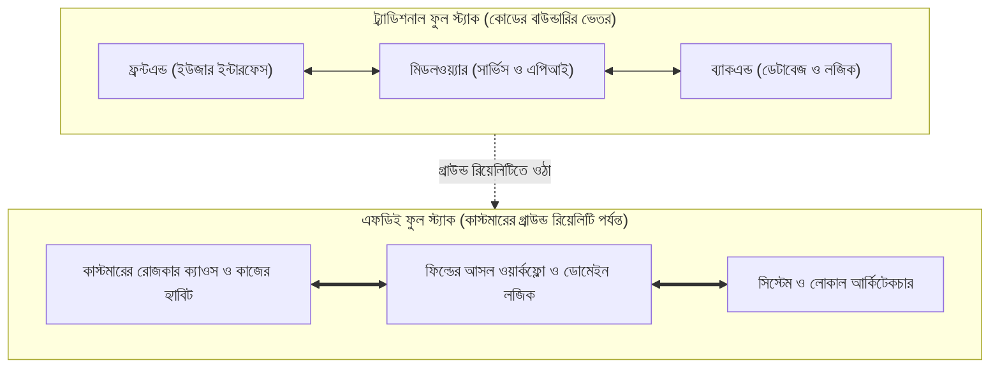

# ইন্ট্রোডাকশন: গ্রাউন্ড রিয়েলিটি এবং কাস্টমারের স্টোরি

---

### ১. ইউএটি সাইন-অফের ১২০ দিন পর: সাইলেন্ট চার্ন ও শ্যাডো আইটি

প্রবলেমটার শুরু খুব চেনা একটা 'সিন' দিয়ে। বইটা কিনেছেন বলে ধরে নিচ্ছি, আপনি একজন সফটওয়্যার ইঞ্জিনিয়ার, কিংবা টেকনোলজি দিয়ে বাস্তব সমস্যার সমাধান করতে চান। শুরুতে আমরা দেখেছি কিভাবে নিজের অফিসের হেডকোয়ার্টারে বসে সবগুলো ইউনিট টেস্ট গ্রিন করে ডেলিভারি দেওয়া সফটওয়্যারও ক্লায়েন্টের ফ্লোরে গিয়ে আটকে যায়। কিন্তু প্রশ্ন হলো, এই আটকে যাওয়ার পেছনের কারণ কী? সব টেস্ট পাস করার পরও একটা এন্টারপ্রাইজ সিস্টেম ভেতর থেকে কীভাবে অকেজো হয়ে পড়ে? এই স্টেজে আমরা সফটওয়্যার প্রজেক্টের সবচেয়ে বড় কিলার **"সাইলেন্ট চার্ন" (Silent Churn)** এবং **শ্যাডো আইটির (Shadow IT)** আলাপ করব।

ক্লায়েন্টের সঙ্গে বসে তাদের ইনপুট নিয়ে কিছু ফিচার এদিক-ওদিক করে ঠিক করে দেওয়ার পর ওখানে হয়তোবা আরও এক মাস সময় লাগল। এরপর ক্লায়েন্টের হেড অফিসের ঠান্ডা বোর্ডরুমে প্রজেক্টরের পর্দায় নতুন ড্যাশবোর্ড দেখে বড় কর্তারা খুশি হয়ে ইউএটি (User Acceptance Test) সাইন-অফ দিলেন, মানে লিখিতভাবে জানিয়ে দিলেন যে সফটওয়্যার তাঁরা বুঝে নিয়েছেন। এরপরে আরও কিছু রিকোয়েস্টের ফিচার যোগ করে বিল পাস হলো, সবাই ভাবল বড় একটা সাকসেস এল বটে।

কিন্তু ইউএটি সাইন-অফ আর বিল পাসের ১২০ দিন পর ক্লায়েন্টের অফিসে গিয়ে যদি দেখি সিস্টেমটা অনেকেই ব্যবহারই করছেন না, তখন আসল ঝামেলা লাগে।

চার মাস পরের একটা রুটিন রিভিউ। কাজটা খুব সাধারণ - ডেটাবেজটা একবার চেক করা আর সার্ভারের পারফরম্যান্স দেখা। আপনি ক্লায়েন্টের অফিসে গিয়ে সোজা সার্ভার রুমে ঢুকলেন। মনিটরে অ্যাডমিন ড্যাশবোর্ড আর ডেটাবেজ লগ ওপেন করতেই বুকের ভেতরটা ছ্যাঁত করে উঠল। কোম্পানির উনষাট জন স্টাফের মধ্যে গত ত্রিশ দিনে সিস্টেমে লগইন করেছেন মাত্র চারজন। আর মূল চালান টেবিলের শেষ এন্ট্রিটা সাতচল্লিশ দিন আগের।

তার মানে দেড় মাস ধরে সিস্টেমে একটা নতুন ট্রানজ্যাকশনও ঢোকেনি। সার্ভার রুমটা যেন একটা পরিত্যক্ত ঘর, কুলিং ফ্যানের একটানা শব্দ ছাড়া সেখানে আর কোনো সাড়া নেই। অথচ ক্লায়েন্টের ব্যবসা একদিনের জন্যও থামেনি। প্রতিদিন কোটি টাকার মাল ডেলিভারি হচ্ছে, গুদামে ট্রাক ঢুকছে আর বেরোচ্ছে। তাহলে কাজটা চলছে কিভাবে?

আপনি সিঁড়ি ভেঙে নিচে নেমে এলেন, একদম অপারেশন ফ্লোরে। কাচঘেরা এসি বোর্ডরুম নয়, এটা হলো আসল কাজের জায়গা। সেখানে পা রাখতেই দেখলেন ডেস্কে কম্পিউটার চালু আছে ঠিকই, কিন্তু আপনার বানানো সফটওয়্যারের ব্রাউজার ট্যাবটা মিনিমাইজ করা। ফিল্ডের টেকনিশিয়ানরা সফটওয়্যারের টিকিটিং মডিউল বাদ দিয়ে হোয়াটসঅ্যাপ গ্রুপে ভয়েস মেসেজ পাঠিয়ে প্রতিদিনের কাজ সারছেন। আর শুরুর অধ্যায়ে বলা সেই চেনা দৃশ্য - অ্যাকাউন্টস আর অপারেশন টেবিলে পুরোদমে চলছে পুরনো খাতা আর লোকাল কম্পিউটারের অফলাইন স্প্রেডশিট। কারখানার ভাষায় একে বলে **শ্যাডো আইটি (Shadow IT)** - অর্থাৎ অফিশিয়াল সফটওয়্যারকে পাশ কাটিয়ে স্টাফদের নিজস্ব তৈরি সমান্তরাল ব্যবস্থা।

আপনি হেড অ্যাকাউন্ট্যান্টের টেবিলের সামনে গিয়ে নরম গলায় জিজ্ঞেস করলেন, "চাচা, আপনারা নতুন সিস্টেমটা ব্যবহার করছেন না কেন?"

তিনি চশমার ফাঁক দিয়ে আপনার দিকে তাকালেন। মুখে একটু ক্লান্ত হাসি। বললেন, "সফটওয়্যারটা ভালোই বানিয়েছ বাবা। কিন্তু একটা চালান এন্ট্রি করতে গেলে বারোটা ড্রপডাউন সিলেক্ট করতে হয়, আর প্রতিটা পেজ লোড হতে লাগে বিশ সেকেন্ড। বাইরে কড়া রোদে ট্রাক দাঁড়িয়ে থাকে, ড্রাইভাররা চিৎকার-চেঁচামেচি করে। আমাদের হাতে ওই বিশ সেকেন্ড সময় নেই। তার ওপর মাস শেষে আমার ভ্যাট আর রিবেটের হিসাবটা তোমাদের ওই সিস্টেমে মেলে না, তাই খাতায় সই।"

আপনার আর কিছু বলার থাকল না। বোর্ডরুমের প্রজেক্টরে যে সফটওয়্যারটা দেখে করতালি পড়েছিল, অপারেশন ফ্লোরের রোদে দাঁড়িয়ে থাকা ট্রাকের চাপের সামনে এসে সেটা টিকতেই পারেনি। বোর্ডরুমে যাঁরা ইউএটি সাইন-অফ দিয়েছিলেন, তাঁরা নিজেরা প্রতিদিন ডেটা এন্ট্রি করেন না। আর যাঁরা রোজ ফ্লোরে বসে কাজটা করেন, সফটওয়্যার বানানোর সময় তাঁদের কাজের ছন্দটা কেউ খেয়ালই করেনি। এটা শুধু একটা কোম্পানির গল্প নয়; আমাদের সফটওয়্যার ইন্ডাস্ট্রির সবচেয়ে অপ্রিয় গ্রাউন্ড রিয়েলিটি এটাই।

!!! question "সফটওয়্যার কেন সাইলেন্টলি ফেইল করে?"
    হেডকোয়ার্টারে সব ইউনিট টেস্ট গ্রিন থাকলেও ক্লায়েন্টের অফিসে গিয়ে সফটওয়্যার ফেইল করে বাস্তব ব্যবসার হিসাবের সাথে কোডের লজিকের অমিল হওয়াতে। স্টাফরা যখন দেখেন নতুন সিস্টেমে কাজ করতে গেলে তাঁদের রোজকার স্ট্রেস আরও বেড়ে যাচ্ছে, তখন তাঁরা কোনো মিটিং ডাকেন না বা কমপ্লেইন্ট করেন না। শুধু চুপচাপ লগইন করা বন্ধ করে দিয়ে নিজেদের চেনা শর্টকাটে ফিরে যান। কিন্তু এটা নিয়ে তো কিছু করতে হবে, ঠিক না?

#### কোড-স্যান্ডউইচ মেথড: সাইলেন্ট চার্ন ও শ্যাডো আইটি ডিটেক্টর

**১. কাস্টমারের বাস্তব সংকট:** সার্ভারের সিপিইউ আর আপটাইম দেখে কখনো বোঝা যায় না ক্লায়েন্টের স্টাফরা সফটওয়্যারটা সত্যিই ব্যবহার করছেন নাকি চুপচাপ পুরনো খাতা ও এক্সেলে ফিরে গেছেন। তাই ফিল্ডে নামার প্রথম দিনেই ডেটাবেজ লগ থেকে এই "সাইলেন্ট চার্ন" (Silent Churn) ধরার জন্য আমাদের একটা ছোট অডিট স্ক্রিপ্ট দরকার।

**২. মূল কোড:** নিচের পাইথন ফাংশনটা কোম্পানির মোট স্টাফ সংখ্যা, গত ৩০ দিনে লগইন করা অ্যাক্টিভ ইউজার এবং শেষ ট্রানজ্যাকশনের তারিখ মিলিয়ে মুহূর্তের মধ্যে সিস্টেমের আসল অবস্থা বের করে আনে:

```python
# FDE Intro Diagnostic: Silent Abandonment & Shadow-IT Detector
from datetime import date

def audit_system_adoption(total_staff: int, active_users_30d: int, last_tx_date: str) -> dict:
    adoption_rate = round((active_users_30d / total_staff) * 100, 1)
    days_stagnant = (date(2026, 10, 29) - date.fromisoformat(last_tx_date)).days

    # অ্যাক্টিভ ইউজার ২০%-এর কম বা ৭ দিন নতুন এন্ট্রি বন্ধ থাকলেই রেড অ্যালার্ট
    is_abandoned = adoption_rate < 20.0 or days_stagnant > 7
    return {
        "adoption_pct": adoption_rate,
        "stagnant_days": days_stagnant,
        "status": "SILENT_CHURN_ALERT" if is_abandoned else "HEALTHY_ADOPTION"
    }

# ইউএটি সাইন-অফের ১২০ দিন পর সার্ভার রুমে পাওয়া আসল ডেটাবেজ লগ
print(audit_system_adoption(total_staff=59, active_users_30d=4, last_tx_date="2026-09-12"))
```

**৩. সিস্টেমের বাস্তব ইমপ্যাক্ট ও কোডের ব্যাখ্যা:** স্ক্রিপ্টটা রান করলে টার্মিনালে আউটপুট পাবেন:

```text
{'adoption_pct': 6.8, 'stagnant_days': 47, 'status': 'SILENT_CHURN_ALERT'}
```

নতুন ডেভেলপাররা কোডটার ভেতরের লজিকটা খেয়াল করুন:
* **অ্যাডপশন রেট (`adoption_pct`):** সাধারণ ডেভঅপস টিম শুধু চেক করে সার্ভার চালু আছে কি না (`200 OK`)। কিন্তু একজন এফডিই প্রথমেই মাপেন `(active_users_30d / total_staff) * 100`। উনষাট জনের মধ্যে চারজন মানে মাত্র `6.8%` মানুষ সিস্টেমে ঢুকছেন।
* **স্ট্যাগন্যান্ট ডেইজ (`stagnant_days`):** `date.fromisoformat(last_tx_date)` দিয়ে আমরা দেখছি মূল টেবিলে শেষ কবে ডেটা ঢুকেছে। ৪৭ দিন ধরে নতুন ডেটা নেই, অথচ কোম্পানির ব্যবসা পুরোদমে চলছে - এর একটাই অর্থ: অপারেশন ফ্লোরে সফটওয়্যারের বদলে "শ্যাডো আইটি" রাজত্ব করছে।

**৪. গিটহাব রেফারেন্স:** বইটির সবগুলো চ্যাপ্টারের সম্পূর্ণ কমপ্যানিয়ন কোড পাবেন অফিশিয়াল রিপোজিটরিতে: [https://github.com/raqueeb/fdebook_companion](https://github.com/raqueeb/fdebook_companion)।

---

### ২. ল্যাবের 'হ্যাপি পাথ' বনাম ফিল্ডের গ্রাউন্ড রিয়েলিটি

আমরা যখন নিজেদের অফিসের ডেস্কে বসে কোড লিখি, তখন অবচেতনভাবেই একটা খুব সুন্দর কল্পনার জগৎ ধরে নিই। সফটওয়্যার ইঞ্জিনিয়ারিংয়ের ভাষায় একে বলে **'হ্যাপি পাথ' (Happy Path)**। অর্থাৎ আমরা ধরেই নিই ইউজার খুব ভদ্রলোকের মতো ফর্মের প্রতিটা ঘর নির্ভুল ইংরেজিতে পূরণ করবেন, অফিসের লিংকথ্রি'র ইন্টারনেট সবসময় রকেটের গতিতে চলবে, আর ডেটাবেজের প্রতিটা কলামে ঝকঝকে পরিষ্কার ডেটা আসবে। আপনার ষোল জিবি র‍্যামের ল্যাপটপে লোকালহোস্টে (`localhost`) সব ফিচার মাখনের মতোই চলবে।

কিন্তু ক্লায়েন্টের ফিল্ডে পা রাখলেই এই 'হ্যাপি পাথ' পাঁচ মিনিটে হাওয়া হয়ে যায়। ল্যাবের পরিবেশ আর ফিল্ডের বাস্তব এনভায়রনমেন্টের মধ্যে এই **টেকনিক্যাল গ্যাপ** তৈরি হয় মূলত তিনটা জায়গায়:

১. **ডেটার বিশৃঙ্খলা ও বাংলিশ রিয়েলিটি:** ল্যাবে আমরা টেস্টিং করি পরিষ্কার ডামি ডেটা (`seed.sql`) দিয়ে, যেখানে কাস্টমারের নাম আর ফোন নম্বর খুব গোছানো থাকে। কিন্তু ফিল্ডে গিয়ে দেখবেন দশ বছরের পুরনো লিগ্যাসি ডেটাবেজ - যেটার নির্মাতা কোম্পানিরই হয়তো এখন আর কোনো হদিস নেই, কোনো এপিআই ডকুমেন্টেশন নেই। সেখানে একই কাস্টমারের নাম এক টেবিলে লেখা `Md. Rahim`, আরেক টেবিলে `মোঃ রহিম`, আর তিন নম্বর টেবিলে `রহিম ট্রেডার্স (পুরান ঢাকা)`। ফোন নম্বরের ঘরে একসাথে দুটো নম্বর কমা বা স্ল্যাশ দিয়ে লেখা (`01711.../01819...`), আর রিমার্কসের ঘরে বাংলা-ইংরেজি মিশিয়ে লেখা `মাল হাফ ডেলিভারি বাকিটা কালকে, ৫০০ টাকা ভাড়া বাদ`। ল্যাবে বসে বানানো আপনার নিখুঁত স্ট্রিং পার্সার বা ফরেন-কি (Foreign Key) লজিক এই 'বাস্তব' ডেটার সামনে পড়লেই সাথে সাথে ক্র্যাশ করে।

২. **হার্ডওয়্যার ও নেটওয়ার্কের বৈষম্য:** ডেভেলপাররা কোড লেখেন শক্তিশালী প্রসেসর, এসএসডি আর হাই-স্পিড ফাইবার ইন্টারনেটে বসে। সেখানে ৩ মেগাবাইটের একটা ভারী জাভাস্ক্রিপ্ট বান্ডেল লোড হতে সময় লাগে এক সেকেন্ডের কম। অথচ ক্লায়েন্টের অপারেশন ডেস্কে গিয়ে দেখবেন সাত বছর আগের পুরনো একটা পিসি, যেখানে মাত্র ৪ জিবি র‍্যাম। ব্রাউজারের চারটা ট্যাব একসাথে খুললেই মেমোরি ফুল হয়ে মাউসের কার্সর আটকে যায়। তার ওপর গুদামঘরে বা ফ্যাক্টরি ফ্লোরে ইন্টারনেট চলে শেয়ার্ড রাউটারে বা মোবাইল হটস্পটে। ফলে আপনার যে ফর্মটা ল্যাবে চোখের পলকে খুলছিল, ক্লায়েন্টের পিসিতে সেটাই ঘুরতে ঘুরতে বিশ সেকেন্ড পার করে দেয়।

৩. **বিজনেস লজিকের অলিখিত ব্যতিক্রম:** ল্যাবের কোডে আমরা ধরে নিই ব্যবসার নিয়ম সবসময় এক সরলরেখায় চলে - যেমন প্রতিটা ইনভয়েসে ফ্ল্যাট ১৫% ভ্যাট যোগ হবে এবং পুরো টাকা পেমেন্ট হলেই কেবল ডেলিভারি চালান প্রিন্ট হবে। কিন্তু ফিল্ডে গিয়ে দেখবেন বাস্তব ব্যবসা চলে ব্যতিক্রমের ওপর। পুরনো পার্টি হলে অর্ধেক বাকিতে মাল ছাড়া হয়, বৃষ্টির কারণে দশ বস্তা সিমেন্ট ভিজে গেলে গেটে বসেই হাতে-হাতে রিবেট অ্যাডজাস্ট করা হয়, কিংবা এমডি সাহেবের এক ফোনে ক্রেডিট লিমিট শিথিল করে ট্রাক ছেড়ে দিতে হয়। সফটওয়্যারে যখন এই বাস্তব ব্যতিক্রমগুলোর জায়গা থাকে না, তখন স্টাফদের সামনে সিস্টেমটা বাদ দেওয়া ছাড়া আর কোনো পথ খোলা থাকে না।

| তুলনার ক্ষেত্র | ল্যাবের 'হ্যাপি পাথ' (Lab Assumption) | ফিল্ডের গ্রাউন্ড রিয়েলিটি (Field Reality) |
| :--- | :--- | :--- |
| **ডেটার ধরন** | পরিপাটি `JSON`, ইউনিক আইডি ও নির্ভুল ইংরেজি বানান | বাংলা-ইংরেজি মেশানো টেক্সট, ডুপ্লিকেট নাম ও অসম্পূর্ণ কলাম |
| **হার্ডওয়্যার ও নেটওয়ার্ক** | ১৬ জিবি র‍্যামের ল্যাপটপ ও জিরো-লেটেন্সি `localhost` | ৪ জিবি র‍্যামের পুরনো পিসি ও ধীরগতির শেয়ার্ড নেটওয়ার্ক |
| **বিজনেস লজিক** | বাঁধাধরা সূত্র ও ফিক্সড ভ্যালিডেশন রুল | আংশিক ডেলিভারি, অন-দ্য-স্পট রিবেট ও জরুরি ওভাররাইড |
| **ইউজারের মনস্তত্ত্ব** | ধৈর্যশীল টেস্টার, যিনি সিস্টেমটা চালানোর জন্যই বসেছেন | প্রচণ্ড কাজের চাপে থাকা স্টাফ, যাঁর সামনে বিশটা ট্রাক অপেক্ষা করছে |

আমাদের দেশে ভেন্ডর আর ক্লায়েন্টের মধ্যে তিক্ততাটা তৈরি হয় ঠিক এই গ্যাপটা থেকে। ভেন্ডর কোম্পানি নিজেদের হেডকোয়ার্টারে বসে গজগজ করে, "ক্লায়েন্টের স্টাফরা টেকনোলজির কিছুই বোঝেন না।" আর ক্লায়েন্ট বিরক্ত হয়ে বলেন, "সফটওয়্যার কোম্পানি আমাদের ব্যবসার মাথামুণ্ডু কিছুই বোঝেনি।" আসলে দোষ কারোরই নয়। সমস্যাটা হলো, ল্যাবে আপনার কোড কথা বলে মেশিনের সাথে; কিন্তু ফিল্ডে আপনার কোডকে লড়তে হয় ভাঙাচোরা ইনফ্রাস্ট্রাকচার আর মানুষের দশ বছরের পুরনো হ্যাবিটের সাথে। এই দুই দুনিয়ার দূরত্ব ঘোচানোর জন্যই দরকার হচ্ছে ফরওয়ার্ড ডেপ্লয়েড ইঞ্জিনিয়ারিং।

---

### ৩. কম্পোনেন্ট থেকে ফুল স্ট্যাক, আর ফুল স্ট্যাক থেকে এফডিইতে ওঠা

সফটওয়্যার ইঞ্জিনিয়ারিংয়ের বিবর্তনটা খেয়াল করলে একটা দারুণ ব্যাপার চোখে পড়বে। গত বিশ বছরে আমরা ধাপে ধাপে কোডের সংকীর্ণ খোলস ছেড়ে কাস্টমারের আসল সমস্যার কাছাকাছি আসার চেষ্টা করেছি।

শুরুতে ছিল **কম্পোনেন্ট ইঞ্জিনিয়ারিংয়ের যুগ**। তখন একটা টিমে সবাই কাজ করতেন আলাদা আলাদা খোপে। ডেটাবেজ অ্যাডমিনিস্ট্রেটর শুধু টেবিল বানিয়ে বসে থাকতেন, ব্যাকএন্ড ইঞ্জিনিয়ার ডুবে থাকতেন এপিআই লজিক নিয়ে, মিডলওয়্যারের মানুষটা দেখতেন দুই পাশের কানেকশন, আর ফ্রন্টএন্ড ডেভেলপার ভাবতেন শুধু ব্রাউজারের ফর্ম আর বাটনের রঙ নিয়ে। কোনো ফিচার কাজ না করলেই শুরু হতো চেনা ব্লেম-গেম। ব্যাকএন্ড বলত, "ভাই, আমার এপিআই থেকে তো `200 OK` যাচ্ছে, বাটন কাজ না করলে ওটা ফ্রন্টএন্ডের দোষ!" আবার ফ্রন্টএন্ড বলত, "ডেটাবেজ থেকে কোয়েরি আসতে দেরি হচ্ছে, আমার কী করার আছে?" মাঝখান থেকে কাস্টমারের সমস্যা আর মিটত না।

এই দূরত্ব ঘোচাতেই এল **ফুল স্ট্যাকের যুগ**। ইন্ডাস্ট্রি বুঝল, আলাদা খোপে বসে কাজ করলে পুরো সিস্টেম দাঁড়াবে না। একজন ইঞ্জিনিয়ারকে ইউজার ইন্টারফেস থেকে শুরু করে ব্যাকএন্ড লজিক, ডেটাবেজ কোয়েরি আর ক্লাউড ডেপ্লয়মেন্ট পর্যন্ত পুরো টেকনিক্যাল পাইপলাইনটা বুঝতে হবে। নিঃসন্দেহে এটা বড় একটা অগ্রগতি ছিল। কিন্তু সময়ের সাথে সাথে দেখা গেল, ট্র্যাডিশনাল ফুল স্ট্যাকেরও একটা অদৃশ্য দেয়াল মানে গ্যাপ আছে।

একজন ফুল স্ট্যাক ইঞ্জিনিয়ারের দুনিয়া শুরু হয় ব্রাউজারের স্ক্রিনে আর শেষ হয় ক্লাউড সার্ভারে। গিটহাব রিপোজিটরিতে কোড মার্জ হয়ে ডকার কন্টেইনার চালু হয়ে গেলেই তিনি কানের হেডফোন খুলে বলেন, "আমার ডেপ্লয়মেন্ট ডান!" কিন্তু আসল ট্র্যাজেডি হলো, সফটওয়্যারটার আসল পরীক্ষা শুরুই হয় ডেপ্লয়মেন্টের পর - কম্পিউটারের মনিটর আর ক্লায়েন্টের চেয়ারের মাঝখানের ওই দুই ফুট জায়গায়। ভুল বলেছি, বলুন?



আজকের এআই আর এন্টারপ্রাইজ অটোমেশনের যুগে শুধু ডকার কন্টেইনার চালু হলে প্রজেক্টকে সেভ করা যায়না। কারণ আসল বটলনেকটা কোডের সিনট্যাক্সে নেই, আছে কাস্টমারের অপারেশন ফ্লোরে। এখান ঝামেলা থেকেই জন্ম নিতে হচ্ছে **ফরওয়ার্ড ডেপ্লয়েড ইঞ্জিনিয়ারিং (FDE)**। 

একজন এফডিই ট্র্যাডিশনাল ফুল স্ট্যাকের সবটুকু টেকনিক্যাল দক্ষতা সাথে নিয়েই কোডের বাউন্ডারি পার হন। তাঁর কাছে `git push` মানে কাজের শেষ নয়, বরং আসল কাজের শুরু। ফুল স্ট্যাকের চেনা তিনটা লেয়ারের (ফ্রন্টএন্ড, মিডলওয়্যার, ব্যাকএন্ড) ওপরে তিনি আরও তিনটা নতুন লেয়ার যোগ করেন:
* **অপারেশনাল আর্কিটেকচার:** স্টাফের টেবিলে ইন্টারনেট না থাকলে বা সার্ভার স্লো হলে সিস্টেমটা লোকাল নেটওয়ার্কে কীভাবে টিকে থাকবে, তার ফিজিক্যাল হিসাব।
* **ডোমেইন ও লিগ্যাসি প্লাম্বিং:** ক্লায়েন্টের দশ বছরের পুরনো সফটওয়্যার বা এক্সেল ফাইলের ডেটাকে না ভেঙে সেটার সাথে নতুন এআই বা অটোমেশন পাইপলাইনের ব্রিজ তৈরি করা।
* **হিউম্যান ওয়ার্কফ্লো ইন্টিগ্রেশন:** বারোটা ড্রপডাউনের ফর্মকে কেটে এক ক্লিকে নামিয়ে আনা, যাতে একজন সাধারণ অপারেটর তাঁর পুরনো হ্যাবিট না বদলেই সিস্টেমটা ব্যবহার করতে পারেন।

!!! note "ফুল স্ট্যাকের নতুন লেভেল: কাস্টমার অপারেশন"
    ট্র্যাডিশনাল ফুল স্ট্যাক থেমে যাবে ফ্রন্টএন্ড, মিডলওয়্যার আর ব্যাকএন্ডে। কিন্তু একজন এফডিইর আসল কাজ শুরু হচ্ছে সেখান থেকে, যেখানে কোডের বাউন্ডারি শেষ - অর্থাৎ কাস্টমারের কাজের হ্যাবিট, ডোমেইনের সূক্ষ্ম হিসাব আর ফিল্ডের 'বাস্তব' সীমাবদ্ধতা।

---

### ৪. ডেভেলপার, কনসালট্যান্ট ও এফডিই: কার কাজ আসলে কী?

নতুন যাঁরা টেক ইন্ডাস্ট্রিতে ঢুকছেন, তাঁদের অনেকেরই মনে একটা স্বাভাবিক প্রশ্ন আসবে - তাহলে এফডিই কি আসলে সাপোর্ট ইঞ্জিনিয়ার, নাকি আইটি কনসালট্যান্ট? 

উত্তরটা হলো - এর কোনোটাই নয়। আমাদের দেশে অনেকেই ফরওয়ার্ড ডেপ্লয়েড ইঞ্জিনিয়ারিংকে সাধারণ কাস্টমার সাপোর্ট বা মেইনটেন্যান্স টিমের সাথে মিশিয়ে ফেলবেন। কাস্টমার সাপোর্ট ইঞ্জিনিয়ারের কাজ হলো সিস্টেমের পাসওয়ার্ড রিসেট করা, ইউজারকে ট্রেনিং দেওয়া বা বাগ পেলে সেটা ডেভেলপারদের কাছে ফরোয়ার্ড করা - মূল সিস্টেমের আর্কিটেকচার বা কোডবেস বদলানোর ক্ষমতা তাঁর হাতে থাকে না। অন্যদিকে একজন এফডিই হলেন প্রথম সারির সফটওয়্যার আর্কিটেক্ট ও কোডার, যিনি সরাসরি প্রোডাকশনের কোর লজিক এবং ডেটা পাইপলাইন নিজের হাতে তৈরি ও ট্রান্সফর্ম করার ক্ষমতা রাখেন।

পার্থক্যটা একদম পানির মতো পরিষ্কার করার জন্য একটা বাস্তব সংকটের কথা বলি। মনে করুন, প্রতিদিন সন্ধ্যা ছয়টায় ক্লায়েন্টের গুদামের ইনভেন্টরি আর অ্যাকাউন্টসের বিলিং ডেটাবেজের হিসাব মিলছে না, ফলে ডেলিভারি ট্রাকের গেট পাস আটকে যাচ্ছে। এই একই সমস্যায় তিনজন মানুষ কীভাবে কাজ করবেন সেটা দেখুন:

১. **কোর সফটওয়্যার ইঞ্জিনিয়ার:** তিনি বসছেন নিজের কোম্পানির হেডকোয়ার্টারে। তাঁর মূল কাজ প্রোডাক্টের কোর ইঞ্জিন বানানো - সিস্টেমটা একসাথে দশ লাখ রিকোয়েস্ট সামলাতে পারবে কি না, অ্যালগরিদমের টাইম কমপ্লেক্সিটি কত, মেমোরি লিক হচ্ছে কি না। সন্ধ্যা ছয়টার ওই সমস্যার কথা কাস্টমারের কাছ থেকে ঘুরে প্রোডাক্ট ম্যানেজারের হাত হয়ে জিরা (Jira) টিকিট আকারে তাঁর কাছে পৌঁছাতেই লেগে যাবে তিন দিন। এরপর তিনি সেটাকে পরের স্প্রিন্টে ফেলবেন এবং দুই সপ্তাহ পর একটা প্যাচ রিলিজ দেবেন। ততদিনে ক্লায়েন্টের গুদামে হাহাকার পড়ে যাবে।

২. **টেকনিক্যাল কনসালট্যান্ট বা বিজনেস অ্যানালিস্ট:** তিনি ক্লায়েন্টের অফিসে যাবেন ফরমাল স্যুট-টাই পরে। এসি বোর্ডরুমে বসে ম্যানেজমেন্টের সাথে মিটিং করবেন, হোয়াইটবোর্ডে সুন্দর ডায়াগ্রাম আঁকবেন এবং শেষে পঞ্চাশ পাতার একটা ঝকঝকে পাওয়ারপয়েন্ট প্রেজেন্টেশন বা পিডিএফ গ্যাপ-অ্যানালাইসিস রিপোর্ট জমা দিয়ে চলে আসবেন। কিন্তু সার্ভারের কালো টার্মিনাল খুলে কোড লেখা বা ভেঙে পড়া ডেটা পাইপলাইন নিজের হাতে সারানোর কাজ উনি করবেন না।

৩. **ফরওয়ার্ড ডেপ্লয়েড ইঞ্জিনিয়ার (FDE):** তিনি হলেন এই দুই দুনিয়ার সেতুবন্ধন মানে ব্রিজ। তিনি কনসালট্যান্টের মতো শুধু স্লাইড দেখিয়ে দায়িত্ব সারবেন না, আবার কোর ডেভেলপারের মতো হেডকোয়ার্টারে বসে টিকিটের অপেক্ষাতেও থাকবেন না। সন্ধ্যা ছয়টায় যখন গেট পাস আটকে যাবে, তিনি সরাসরি অপারেশন ফ্লোরে দাঁড়িয়ে থেকেই সার্ভারের লগ ওপেন করবেন। তিনি দেখবেন পুরনো সফটওয়্যার থেকে আসা সিএসভি (CSV) ফাইলে একটা কলামের নাম বদলে যাওয়ায় ডেটা সিঙ্ক ভেঙে গেছে। তিনি ওই টেবিলে বসেই বিশ লাইনের একটা পাইথন পার্সার ও রিকনসিলিয়েশন স্ক্রিপ্ট লিখে বিশ মিনিটের মধ্যে ট্রাক ছাড়ার ব্যবস্থা করবেন। আর কাজটা সচল করার পর সেই কাস্টম লজিকটুকু জেনারালাইজ করে হেডকোয়ার্টারের কোর প্রোডাক্টে পুশ করে দেবেন।

| তুলনার জায়গা | কোর সফটওয়্যার ইঞ্জিনিয়ার | টেকনিক্যাল কনসালট্যান্ট | ফরওয়ার্ড ডেপ্লয়েড ইঞ্জিনিয়ার (FDE) |
| :--- | :--- | :--- | :--- |
| **কাজের প্রধান জায়গা** | কোম্পানির নিজস্ব হেডকোয়ার্টার বা ল্যাব | ক্লায়েন্টের বোর্ডরুম ও মিটিং রুম | ক্লায়েন্টের আসল অপারেশন ফ্লোর |
| **কাজের মূল টুল** | কোর কোডবেস, আইডিই ও পুল রিকোয়েস্ট | পাওয়ারপয়েন্ট স্লাইড, চার্ট ও অডিট রিপোর্ট | লোকাল কোড, এআই এজেন্ট ও ফিল্ড ডায়াগনস্টিকস |
| **সাকসেসের মাপকাঠি** | কোডের কোয়ালিটি, টেস্ট কভারেজ ও আপটাইম | ক্লায়েন্ট ম্যানেজমেন্টের সাইন-অফ | স্টাফদের কাজের গতি বৃদ্ধি ও রিয়েল প্রবলেম সমাধান |
| **ক্যাওস সামলানোর ধরন** | পরিষ্কার স্পেসিফিকেশন অনুযায়ী কোড লেখা | ফ্রেমওয়ার্ক ও গাইডলাইন তৈরি করা | চরম ক্যাওসের ভেতর রিয়েল-টাইমে কোড লিখে সমাধান |

---

### ৫. এই বই পড়ার নিয়ম: "কোড-স্যান্ডউইচ" মেথড

প্রযুক্তি, এআই বা অটোমেশন নিয়ে যাঁরা নতুন কাজ শুরু করছেন, তাঁরা বই পড়ে প্রায়ই দুটো সমস্যায় পড়েন। হয় বইটা জুড়ে থাকে শুধু উপদেশ আর লেকচার - যেখানে হাত লাগিয়ে দেখার মতো কোনো কোড নেই; নয়তো পাতার পর পাতা জুড়ে থাকে পাঁচশো লাইনের জটিল ফ্রেমওয়ার্ক কোড, যা ছয় মাস পর লাইব্রেরির ভার্সন বদলে গেলেই আর রান করে না।

এই বইয়ে আমি ওই দুই পথের কোনোটাতেই হাঁটিনি। আমার নীতি খুব সোজা - **কনসেপ্ট হেভি, কোড লাইট**। অর্থাৎ আগে গল্পের মতো করে ফিল্ডের আসল সমস্যা আর তার পেছনের দর্শনটা পরিষ্কার করা হয়েছে, তারপর ঠিক যেটুকু কোড ওই সমস্যাটা মেটানোর জন্য দরকার, সেটুকুই দেওয়া হয়েছে। পুরো বইটা সাজানো হয়েছে **"কোড-স্যান্ডউইচ" মেথডে**, যেখানে প্রতিটা কোর চ্যাপ্টারে কোডকে চারটা ধাপে দেয়া হয়েছে:

১. **কাস্টমারের বাস্তব সংকট:** শুরুতে তিন-চার লাইনে ফিল্ডের আসল প্রবলেমটা বলা হবে, যাতে আপনি পরিষ্কার বুঝতে পারেন কোডটা কেন লেখা হচ্ছে এবং কোন বটলনেকটা আমরা ভাঙতে যাচ্ছি।
২. **মূল কোড (১৫-২০ লাইন):** ঠিক যেটুকু লজিক ওই সমস্যাটা মেটাবে, শুধু সেই পনেরো থেকে বিশ লাইনের টেস্টেড পাইথন বা সিআই/সিডি স্ক্রিপ্ট থাকবে। বাড়তি বয়লারপ্লেট দিয়ে পাতা ভরিনি।
৩. **সিস্টেমের বাস্তব ইমপ্যাক্ট:** কোডটা রান করার পর আউটপুট কী এল, কোডের ভেতরে কোন লাইনটা কেন লেখা হলো এবং এতে কাস্টমারের কাজে কী বদল এল - তা একদম সহজ ভাষায় ভেঙে বলা হচ্ছে।
৪. **গিটহাব রেফারেন্স:** পুরো প্রজেক্টের কমপ্যানিয়ন কোড, মক ডেটা আর ওয়ার্কফ্লোর জন্য থাকছে অফিশিয়াল কমপ্যানিয়ন গিটহাব রিপোজিটরি ([https://github.com/raqueeb/fdebook_companion](https://github.com/raqueeb/fdebook_companion))।

!!! tip "নিজের ল্যাপটপে সম্পূর্ণ ফ্রিতে চালিয়ে দেখুন"
    এই বইয়ের কোনো কোড চালাতে আপনার পেইড ক্লাউড অ্যাকাউন্ট, দামি জিপিইউ বা ওপেনএআই এপিআই কি (API Key) লাগবে না। আমরা ইচ্ছে করেই সবগুলো স্ক্রিপ্ট স্ট্যান্ডার্ড পাইথন (`Python 3`), জিরো-কনফিগ ডেটাবেজ (`SQLite WAL`) এবং লোকাল ওপেন সোর্স এআই টুল (`Ollama`, `Qwen 2.5`, `DeepSeek`) দিয়ে তৈরি করেছি। ফলে আপনি ইউনিভার্সিটির স্টুডেন্ট হোন বা কোনো ব্যাংকের অন-প্রেম সার্ভারে কাজ করা ইঞ্জিনিয়ার হোন - নিজের সাধারণ ল্যাপটপেই প্রতিটা প্রজেক্ট এক টাকাও খরচ না করে রান করে দেখতে পারবেন। সেটআপের সব কমান্ড বইয়ের শেষের অ্যাপেন্ডিক্সে দেওয়া আছে।

ফার্স্ট থিং ফার্স্ট - বেসিক গ্রাউন্ড-আপের আলাপ এখানেই শেষ। কল্পনা করুন, আগামীকাল সকালে আপনি পিঠে ল্যাপটপের ব্যাগ ঝুলিয়ে সেই ক্লায়েন্টের অফিসের দরজার সামনে দাঁড়িয়ে আছেন, যেখানে উনষাট জনের মধ্যে মাত্র চারজন সিস্টেমে লগইন করেন। ভীতিকর অবস্থা, তাই না? পরের চ্যাপ্টারে আমরা দেখব, ওই দরজা পার হয়ে ভেতরে ঢোকার পর আপনার প্রথম কাজ কী হবে।