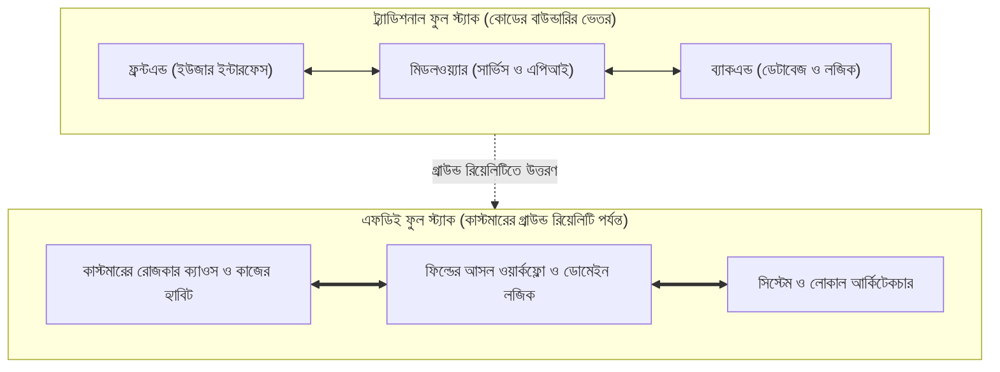

# ইন্ট্রোডাকশন: গ্রাউন্ড রিয়েলিটি এবং কাস্টমারের স্টোরি

---

### ১. ইউএটি সাইন-অফের নব্বই দিন পর

প্রবলেমটার শুরু খুব চেনা একটা 'সিন' দিয়ে। বইটা কিনেছেন বলে ধরে নিচ্ছি, আপনি একজন সফটওয়্যার ইঞ্জিনিয়ার। গত তিন মাস দিনরাত এক করে আপনার টিম একটা এন্টারপ্রাইজ সিস্টেম তৈরি করেছে। নিজের অফিসের হেডকোয়ার্টারে বসে যখন কোড লিখেছেন, তখন সবকিছুই আপনার টাইম মতো চলেছে। কিউএ টেস্টিং, ফিচার টেস্ট, লোড টেস্ট - সবখানেই ভালো আউটপুট। ফাইনালি ডেলিভারির দিন যখন কোড পুশ করলেন, ড্যাশবোর্ডে প্রতিটা ইউনিট টেস্ট গ্রিন। এরপর ক্লায়েন্টের সঙ্গে বসে তাদের ইনপুট নিয়ে কিছু ফিচার এদিক‑ওদিক করে ঠিক করেও দিলেন। ওখানে হয়তোবা আরও এক মাস সময় লাগল। এরপর ক্লায়েন্টের হেড অফিসের বোর্ডরুমে প্রজেক্টরের পর্দায় নতুন ড্যাশবোর্ড দেখে বড় কর্তারা খুশি হয়ে ইউএটি (User Acceptance Test) সাইন-অফ দিলেন, মানে লিখিতভাবে জানিয়ে দিলেন যে সফটওয়্যার তাঁরা বুঝে নিয়েছেন। এরপরে আরও কিছু রিকোয়েস্টের ফিচার যোগ করে বিল পাস হলো, সবাই ভাবল বড় একটা সাকসেস এল বটে।

আসল ধাক্কাটা লাগল ঠিক নব্বই দিন পর।

তিন মাস পরের একটা রুটিন রিভিউ। কাজটা খুব সাধারণ - ডেটাবেজটা একবার চেক করা আর সার্ভারের পারফরম্যান্স দেখা। আপনি ক্লায়েন্টের অফিসে গিয়ে সোজা সার্ভার রুমে ঢুকলেন। মনিটরে অ্যাডমিন ড্যাশবোর্ড আর ডেটাবেজ লগ ওপেন করতেই বুকের ভেতরটা ছ্যাঁত করে উঠল। কোম্পানির উনষাট জন স্টাফের মধ্যে গত ত্রিশ দিনে সিস্টেমে লগইন করেছেন মাত্র চারজন। আর মূল চালান টেবিলের শেষ এন্ট্রিটা সাতচল্লিশ দিন আগের।

তার মানে দেড় মাস ধরে সিস্টেমে একটা নতুন ট্রানজ্যাকশনও ঢোকেনি। সার্ভার রুমটা যেন একটা পরিত্যক্ত ঘর, কুলিং ফ্যানের একটানা শব্দ ছাড়া সেখানে আর কোনো সাড়া নেই। অথচ ক্লায়েন্টের ব্যবসা একদিনের জন্যও থামেনি। প্রতিদিন কোটি টাকার মাল ডেলিভারি হচ্ছে, গুদামে ট্রাক ঢুকছে আর বেরোচ্ছে। তাহলে কাজটা চলছে কিভাবে?

আপনি সিঁড়ি ভেঙে নিচে নেমে এলেন, একদম অপারেশন ফ্লোরে। কাচঘেরা এসি রুম নয়, এটা হলো আসল কাজের জায়গা। সেখানে পা রাখতেই দেখলেন ডেস্কে কম্পিউটার চালু আছে ঠিকই, কিন্তু নতুন সফটওয়্যারের ট্যাবটা মিনিমাইজ করা। হেড অ্যাকাউন্ট্যান্ট সাহেব আগের মতোই তাঁর চেনা লাল মলাটের খাতায় কলম দিয়ে হিসাব লিখছেন। পাশের টেবিলে একজন সিনিয়র স্টাফ পুরনো একটা এক্সেল ফাইলে ডেটা কপি-পেস্ট করছেন। আর ফিল্ডের টেকনিশিয়ানরা হোয়াটসঅ্যাপ গ্রুপে ভয়েস মেসেজ পাঠিয়ে প্রতিদিনের কাজ সারছেন।

আপনি হেড অ্যাকাউন্ট্যান্টের টেবিলের সামনে গিয়ে নরম গলায় জিজ্ঞেস করলেন, "চাচা, আপনারা নতুন সিস্টেমটা ব্যবহার করছেন না কেন?"

তিনি চশমার ফাঁক দিয়ে আপনার দিকে তাকালেন। মুখে একটু ক্লান্ত হাসি। বললেন, "সফটওয়্যারটা দেখতে ভালোই বানিয়েছ বাবা। কিন্তু একটা চালান এন্ট্রি করতে গেলে বারোটা ড্রপডাউন সিলেক্ট করতে হয়, আর প্রতিটা পেজ লোড হতে লাগে বিশ সেকেন্ড। বাইরে কড়া রোদে ট্রাক দাঁড়িয়ে থাকে, ড্রাইভাররা চিৎকার-চেঁচামেচি করে। আমাদের হাতে ওই বিশ সেকেন্ড সময় নেই। তার ওপর মাস শেষে আমার ভ্যাট আর রিবেটের হিসাবটা তোমাদের ওই সিস্টেমে মেলে না, তাই লাল খাতায় সই।"

আপনার আর কিছু বলার থাকল না। তিন মাসের খাটুনি, লাখ লাখ টাকার বাজেট, হেডকোয়ার্টারে গ্রিন হয়ে থাকা শত শত ইউনিট টেস্ট - সবকিছু এই অপারেশন ফ্লোরের বাস্তবতায় এসে সাইলেন্টলি মুখ থুবড়ে পড়েছে। এটা শুধু একটা কোম্পানির গল্প নয়; আমাদের সফটওয়্যার ইন্ডাস্ট্রির সবচেয়ে অপ্রিয় গ্রাউন্ড রিয়েলিটি এটাই।

!!! question "সফটওয়্যার কেন সাইলেন্টলি ফেইল করে?"
    হেডকোয়ার্টারে সব ইউনিট টেস্ট গ্রিন থাকলেও ক্লায়েন্টের অফিসে গিয়ে সফটওয়্যার ফেইল করে বাস্তব ব্যবসার হিসাবের সাথে কোডের লজিকের অমিল হওয়াতে। স্টাফরা যখন দেখেন নতুন সিস্টেমে কাজ করতে গেলে তাঁদের রোজকার স্ট্রেস আরও বেড়ে যাচ্ছে, তখন তাঁরা কোনো মিটিং ডাকেন না বা কমপ্লেইন্ট করেন না। শুধু চুপচাপ লগইন করা বন্ধ করে দিয়ে পুরনো খাতা বা এক্সেল ফাইলে ফিরে যান। কিন্তু এটা নিয়ে তো কিছু তো করতে হবে, ঠিক না?

#### কোড-স্যান্ডউইচ মেথড: সাইলেন্ট চার্ন ও শ্যাডো আইটি ডিটেক্টর

**১. কাস্টমারের বাস্তব সংকট:** সার্ভারের সিপিইউ আর আপটাইম দেখে কখনো বোঝা যায় না ক্লায়েন্টের স্টাফরা সফটওয়্যারটা সত্যিই ব্যবহার করছেন নাকি চুপচাপ পুরনো খাতা ও এক্সেলে ফিরে গেছেন। তাই ফিল্ডে নামার প্রথম দিনেই ডেটাবেজ লগ থেকে এই "নিঃশব্দ বর্জন" (Silent Abandonment) ধরার জন্য আমাদের একটা ছোট অডিট স্ক্রিপ্ট দরকার।

**২. মূল কোড:** নিচের পাইথন ফাংশনটা কোম্পানির মোট স্টাফ সংখ্যা, গত ৩০ দিনে লগইন করা অ্যাক্টিভ ইউজার এবং শেষ ট্রানজ্যাকশনের তারিখ মিলিয়ে মুহূর্তের মধ্যে সিস্টেমের আসল অবস্থা বের করে আনে:

```python
# FDE Intro Diagnostic: Silent Abandonment & Shadow-IT Detector
from datetime import date

def audit_system_adoption(total_staff: int, active_users_30d: int, last_tx_date: str) -> dict:
    adoption_rate = round((active_users_30d / total_staff) * 100, 1)
    days_stagnant = (date(2026, 10, 29) - date.fromisoformat(last_tx_date)).days

    # অ্যাক্টিভ ইউজার ২০%-এর কম বা ৭ দিন নতুন এন্ট্রি বন্ধ থাকলেই রেড অ্যালার্ট
    is_abandoned = adoption_rate < 20.0 or days_stagnant > 7
    return {
        "adoption_pct": adoption_rate,
        "stagnant_days": days_stagnant,
        "status": "SILENT_CHURN_ALERT" if is_abandoned else "HEALTHY_ADOPTION"
    }

# নব্বই দিন পর সার্ভার রুমে পাওয়া আসল ডেটাবেজ লগ
print(audit_system_adoption(total_staff=59, active_users_30d=4, last_tx_date="2026-09-12"))
```

**৩. সিস্টেমের বাস্তব ইমপ্যাক্ট ও কোডের ব্যাখ্যা:** স্ক্রিপ্টটা রান করলে টার্মিনালে আউটপুট পাবেন:

```text
{'adoption_pct': 6.8, 'stagnant_days': 47, 'status': 'SILENT_CHURN_ALERT'}
```

নতুন ডেভেলপাররা কোডটার ভেতরের লজিকটা খেয়াল করুন:
* **অ্যাডপশন রেট (`adoption_pct`):** সাধারণ ডেভঅপস টিম শুধু চেক করে সার্ভার চালু আছে কি না (`200 OK`)। কিন্তু একজন এফডিই প্রথমেই মাপেন `(active_users_30d / total_staff) * 100`। উনষাট জনের মধ্যে চারজন মানে মাত্র `6.8%` মানুষ সিস্টেমে ঢুকছেন।
* **স্ট্যাগন্যান্ট ডেইজ (`stagnant_days`):** `date.fromisoformat(last_tx_date)` দিয়ে আমরা দেখছি মূল টেবিলে শেষ কবে ডেটা ঢুকেছে। ৪৭ দিন ধরে নতুন ডেটা নেই, অথচ কোম্পানির ব্যবসা পুরোদমে চলছে - এর একটাই অর্থ: অপারেশন ফ্লোরে সফটওয়্যারের বদলে "শ্যাডো আইটি" (লাল খাতা বা এক্সেল ফাইল) রাজত্ব করছে।

**৪. গিটহাব রেফারেন্স:** বইটির সবগুলো চ্যাপ্টারের সম্পূর্ণ কমপ্যানিয়ন কোড পাবেন অফিশিয়াল রিপোজিটরিতে: [https://github.com/raqueeb/fdebook_companion](https://github.com/raqueeb/fdebook_companion)।

---

### ২. ল্যাবের নিয়ম বনাম ফিল্ডের নিয়ম

নিজের অফিসের শান্ত ডেস্কে বসে কোড লেখার দুনিয়া আর ক্লায়েন্টের ফিল্ডের দুনিয়া পুরোপুরি আলাদা। আপনার ডেভেলপমেন্ট এনভায়রনমেন্টে কোনো ধুলোবালি নেই, ইন্টারনেট কখনো ড্রপ করে না, আর টেস্ট ডেটাবেজের প্রতিটা কলাম পরিপাটি করে সাজানো। সেখানে আপনি আগে নিয়ম ঠিক করেন, আর সফটওয়্যার আপনার কথা মেনে চলে।

কিন্তু ফিল্ডে নামলে দেখবেন, সেখানে নিয়ম আগে থেকে ছকে বাঁধা যায় না। ফিল্ডের প্রতিদিনের ক্যাওস নিজেই নতুন নিয়ম তৈরি করে ফেলে। 

একটা চেনা উদাহরণ দিই। ধরুন কোম্পানির অফিশিয়াল এসওপিতে (Standard Operating Procedure) লেখা আছে, কোনো ডেলিভারি চালান পাস করতে হলে তিনজন ম্যানেজারের ডিজিটাল অ্যাপ্রুভাল লাগবে। কাগজে পড়তে নিয়মটা দারুণ। কিন্তু বাস্তবে কী ঘটে? দুপুরবেলা গেটে বিশটা ট্রাকের লাইন লেগে গেছে, ওদিকে একজন ম্যানেজার বোর্ড মিটিংয়ে ব্যস্ত, আরেকজন জ্যামে আটকে আছেন। তখন অপারেশনের স্টাফরা কী করেন? কাজ চালু রাখার তাগিদে একজন ম্যানেজারের ইউজারনেম-পাসওয়ার্ড আরেকজন ব্যবহার করেন, কিংবা সাদা কাগজে সই করিয়ে ট্রাক ছেড়ে দেন আর সিস্টেমে এন্ট্রি দেন তিন দিন পর। স্টাফদের কাছে এটা কোনো নিয়ম ভাঙা নয়, এটাই কাজ বাঁচানোর একমাত্র উপায়।

মানুষের ঠেকে শেখা এই অলিখিত শর্টকাটগুলোই হলো অফিসের আসল সিস্টেম।

আমরা যখন হেডকোয়ার্টারে বসে সফটওয়্যার বানাই, তখন ধরে নিই মানুষ কাগজের পলিসি মেনে কাজ করবেন। কিন্তু বাস্তবে মানুষ কাজ করেন নিজের কমফোর্ট আর পুরনো হ্যাবিটের নিয়মে। সফটওয়্যার যখন সেই রোজকার হ্যাবিটের বিরুদ্ধে দাঁড়ায়, তখন মানুষ সফটওয়্যারকেই ছুঁড়ে ফেলেন। আর ঠিক এই জায়গাতেই প্রথাগত সফটওয়্যার ইঞ্জিনিয়ারিংয়ের সীমা শেষ হয়, এবং ফরওয়ার্ড ডেপ্লয়েড ইঞ্জিনিয়ারিংয়ের যাত্রা শুরু হয়।

---

### ৩. কম্পোনেন্ট থেকে ফুল স্ট্যাক, আর ফুল স্ট্যাক থেকে এফডিই

সফটওয়্যার ইঞ্জিনিয়ারিংয়ের বিবর্তনটা খেয়াল করলে দেখবেন, আমরা ধাপে ধাপে কোডের খোলস ছেড়ে বাস্তব সমস্যার কাছাকাছি আসার চেষ্টা করেছি। 

শুরুতে ছিল কম্পোনেন্টের যুগ। তখন একটা টিমে সবাই কাজ করতেন আলাদা আলাদা খোপে। ফ্রন্টএন্ড ডেভেলপার শুধু ব্রাউজারের ফর্ম আর বাটনের রঙ নিয়ে ভাবতেন, ব্যাকএন্ড ইঞ্জিনিয়ার ডুবে থাকতেন ডেটাবেজ কুয়েরি আর এপিআই নিয়ে, আর মিডলওয়্যারের মানুষটা দেখতেন দুই পাশের সংযোগ ঠিক আছে কি না। এক খোপের সাথে আরেক খোপের কথা হতো খুব কম। ফলে কোনো ফিচারে সমস্যা হলে এক দল আরেক দলের ঘাড়ে দোষ চাপাত।

এই দূরত্ব ঘোচাতেই এল ফুল স্ট্যাকের যুগ। ইন্ডাস্ট্রি বুঝল, খোপে বসে কাজ করলে পুরো সিস্টেম দাঁড়ায় না। একজন ইঞ্জিনিয়ারকে ইউজার ইন্টারফেস থেকে শুরু করে ব্যাকএন্ড লজিক আর ডেটাবেজ পর্যন্ত পুরো টেকনিক্যাল পাইপলাইনটা বুঝতে হবে। নিঃসন্দেহে এটা বড় একটা পরিবর্তন ছিল। কিন্তু ফুল স্ট্যাকেরও একটা অদৃশ্য দেয়াল রয়ে গেল। একজন ফুল স্ট্যাক ইঞ্জিনিয়ারের দুনিয়া শুরু হয় ব্রাউজারে আর শেষ হয় ক্লাউড সার্ভারে। গিটহাব রিপোজিটরিতে কোড মার্জ হয়ে ডকার কন্টেইনার চালু হয়ে গেলেই তিনি ধরে নেন তাঁর দায়িত্ব শেষ।



কিন্তু আজকের এআই আর অটোমেশনের যুগে শুধু কোডের পাইপলাইন জোড়া লাগালে প্রজেক্ট বাঁচে না। কারণ আসল বটলনেকটা কোডের ভেতরে নেই, আছে কাস্টমারের ডেস্কের ওপর। এখান থেকেই জন্ম নিয়েছে **ফরওয়ার্ড ডেপ্লয়েড ইঞ্জিনিয়ারিং (FDE)**।

একজন এফডিই ফুল স্ট্যাকের টেকনিক্যাল দক্ষতাটুকু সাথে নিয়েই কোডের বাউন্ডারি পেরিয়ে যান। তিনি সরাসরি চলে যান ক্লায়েন্টের অপারেশন ফ্লোরে - যেখানে ট্রাকের ড্রাইভার তাড়া দিচ্ছেন, যেখানে হেড অ্যাকাউন্ট্যান্ট ক্যালকুলেটরে ভ্যাট মেলাচ্ছেন, আর যেখানে বৃষ্টির দিনে ফাইবার কেটে গিয়ে ইন্টারনেট বন্ধ হয়ে আছে। তিনি ফ্রন্টএন্ড, ব্যাকএন্ড আর লোকাল সার্ভারের আর্কিটেকচারকে কাস্টমারের রোজকার কাজের সাথে এক সুতোয় গেঁথে ফেলেন।

!!! note "ফুল স্ট্যাকের নতুন লেভেল: কাস্টমার অপারেশন"
    ট্র্যাডিশনাল ফুল স্ট্যাক থেমে যায় ফ্রন্টএন্ড, মিডলওয়্যার আর ব্যাকএন্ডে। কিন্তু একজন এফডিইর আসল কাজ শুরু হয় সেখান থেকে, যেখানে কোডের বাউন্ডারি শেষ - অর্থাৎ কাস্টমারের কাজের হ্যাবিট, ডোমেইনের সূক্ষ্ম হিসাব আর ফিল্ডের বাস্তব সীমাবদ্ধতা।

---

### ৪. তিনটা রোলের পরিষ্কার তফাত: ডেভেলপার, কনসালট্যান্ট ও এফডিই

নতুন যাঁরা টেক ইন্ডাস্ট্রিতে ঢুকছেন, তাঁদের অনেকেরই মনে প্রশ্ন জাগে - তাহলে এফডিই কি আসলে সাপোর্ট ইঞ্জিনিয়ার বা আইটি কনসালট্যান্ট? একদমই না। পার্থক্যটা পরিষ্কার করার জন্য তিনজন মানুষকে তিনটা আলাদা পরিস্থিতিতে কল্পনা করুন।

**কোর সফটওয়্যার ইঞ্জিনিয়ার** বসেন নিজের কোম্পানির হেডকোয়ার্টারে। তাঁর মূল কাজ প্রোডাক্টের কোর ইঞ্জিন বানানো। সিস্টেমটা একসাথে দশ লাখ রিকোয়েস্ট সামলাতে পারবে কি না, অ্যালগরিদমের টাইম কমপ্লেক্সিটি কত, মেমোরি লিক হচ্ছে কি না - এসব নিয়েই তাঁর দিন কাটে। কাস্টমারের সাথে তাঁর সরাসরি দেখা হয় না; কাস্টমারের চাহিদা তাঁর কাছে পৌঁছায় প্রোডাক্ট ম্যানেজারের লেখা টিকিটের মাধ্যমে।

**টেকনিক্যাল কনসালট্যান্ট** যান ক্লায়েন্টের অফিসে, ফরমাল পোশাক পরে। তিনি মিটিং রুমে বসে ম্যানেজমেন্টের কথা শোনেন, হোয়াইটবোর্ডে ডায়াগ্রাম আঁকেন এবং শেষে পঞ্চাশ পাতার একটা ঝকঝকে পাওয়ারপয়েন্ট প্রেজেন্টেশন বা পিডিএফ রিপোর্ট জমা দিয়ে চলে আসেন। কিন্তু সার্ভারের টার্মিনাল খুলে কোড লেখা বা ভেঙে পড়া ডেটা পাইপলাইন ঠিক করা তাঁর কাজ নয়।

**ফরওয়ার্ড ডেপ্লয়েড ইঞ্জিনিয়ার (FDE)** হলেন এই দুই দুনিয়ার সেতুবন্ধন। তিনি একদিকে পুরোদস্তুর সফটওয়্যার আর্কিটেক্ট ও কোডার, আবার অন্যদিকে ফিল্ডের মানুষ। তিনি কনসালট্যান্টের মতো শুধু স্লাইড দেখিয়ে চলে যান না। তিনি ক্লায়েন্টের স্টাফদের পাশে বসে আসল বটলনেকটা ডিসকাভারি করেন, তারপর ওই টেবিলে বসেই পাইথন স্ক্রিপ্ট লেখেন, লোকাল সার্ভারে এআই মডেল ডেপ্লয় করেন এবং পুরনো ইআরপির সাথে নতুন পাইপলাইন জোড়া লাগিয়ে কাজটা সচল করে তবেই অফিস ছাড়েন।

| তুলনার ক্ষেত্র | কোর সফটওয়্যার ইঞ্জিনিয়ার | টেকনিক্যাল কনসালট্যান্ট | ফরওয়ার্ড ডেপ্লয়েড ইঞ্জিনিয়ার (FDE) |
| :--- | :--- | :--- | :--- |
| **কাজের প্রধান জায়গা** | কোম্পানির নিজস্ব হেডকোয়ার্টার বা ল্যাব | ক্লায়েন্টের বোর্ডরুম ও মিটিং রুম | ক্লায়েন্টের আসল অপারেশন ফ্লোর |
| **কাজের মূল হাতিয়ার** | কোর কোডবেস, আইডিই ও পুল রিকোয়েস্ট | পাওয়ারপয়েন্ট স্লাইড, চার্ট ও অডিট রিপোর্ট | লোকাল কোড, এআই এজেন্ট ও শ্যাডো সেশন |
| **সাকসেসের মাপকাঠি** | কোডের কোয়ালিটি, টেস্ট কভারেজ ও আপটাইম | ক্লায়েন্ট ম্যানেজমেন্টের সাইন-অফ | স্টাফদের কাজের গতি বৃদ্ধি ও রিয়েল প্রবলেম সমাধান |
| **ক্যাওস সামলানোর ধরন** | পরিষ্কার স্পেসিফিকেশন অনুযায়ী কোড লেখা | তাত্ত্বিক ফ্রেমওয়ার্ক ও গাইডলাইন তৈরি করা | চরম ক্যাওসের ভেতর রিয়েল-টাইমে কোড লিখে সমাধান |

---

### ৫. মিলিটারি ফ্রন্টলাইন থেকে সিলিকন ভ্যালি ও বাংলাদেশের বাস্তবতা

হোমপেজে আমরা দেখেছি, 'ফরওয়ার্ড ডেপ্লয়েড' শব্দটা মূলত এসেছে সামরিক স্ট্র্যাটেজি থেকে। যুদ্ধে সেনাদের নিরাপদ ক্যান্টনমেন্ট বা হেডকোয়ার্টারে বসিয়ে না রেখে পুরো ইউনিটসহ সরাসরি কনফ্লিক্ট জোনের ফ্রন্টলাইনে পাঠিয়ে দেওয়া হয়, যাতে আমলাতান্ত্রিক জটিলতা এড়িয়ে "অন গ্রাউন্ডে" থেকে চোখের পলকে সিদ্ধান্ত নেওয়া যায়। ২০০৭-২০০৮ সালের দিকে ঠিক এই মিলিটারি ডকট্রিনটাই সিলিকন ভ্যালিতে নিয়ে আসে **প্যালান্টির টেকনোলজিস (Palantir Technologies)**। ইউএস মিলিটারি ইন্টেলিজেন্স ও সিআইএ-র জন্য 'গোথাম' নামের জটিল প্ল্যাটফর্ম বানাতে গিয়ে তারা দেখেছিল, শুধু ডোমেইন জানা কনসালট্যান্ট বা সাধারণ সলিউশন ইঞ্জিনিয়ার দিয়ে ক্লাসিফাইড ডেটাবেজের কাজ নামানো যাচ্ছে না। তখন তারা সেরা সফটওয়্যার জেনারেলিস্টদের সরাসরি ফোর্ট ব্র্যাগ ও ল্যাংলির ফিল্ডে পাঠাল এবং 'ইকো' (ডোমেইন বোঝার টিম) ও 'ডেল্টা' (রাফ অ্যান্ড টাফ কোড লেখার টিম) মডেলে 'এমবেডিং' হয়ে কাজ শুরু করল। এই ইঞ্জিনিয়াররা ক্লায়েন্টের পেইন মেটাবলাইজ করে লাইভ ফিল্ডে বসেই সমাধান বের করতেন এবং পালো আলতোর মেইন ল্যাবে ফিডব্যাক পাঠিয়ে ফিল্ডের ট্যাকটিক্যাল কোডকে মূল সফটওয়্যারের স্ট্যান্ডার্ড ফিচারে রূপান্তর করতেন। ফাস্ট-ফরওয়ার্ড আজকের দিনে - ওপেনএআই (OpenAI), অ্যানথ্রপিক (Anthropic), র‍্যাম্প (Ramp) কিংবা এডাব্লুএস ও গুগল ক্লাউডের মতো হাইপারস্কেলার কোম্পানিগুলোও এন্টারপ্রাইজের ডেটা স্ট্যাকের সাথে গভীর কাস্টমাইজেশনের জন্য নিজস্ব এফডিই পড নামাচ্ছে।

আমাদের বাংলাদেশের প্রেক্ষাপটে এই মডেলের গুরুত্ব আরও দশ গুণ বেশি।

আমাদের দেশে বিদেশি বা দেশি বড় সফটওয়্যার প্রজেক্ট কেন ব্যর্থ হয়, তা একটু খেয়াল করলেই বোঝা যায়। এর মূল কারণ সিস্টেমের টেকনিক্যাল দুর্বলতা নয়; বরং আমাদের দেশের মানুষের মন-মানসিকতা এবং কাজের সম্পূর্ণ ভিন্ন পদ্ধতির সাথে স্ট্যান্ডার্ড ওয়ার্কফ্লোগুলো যায় না। এখানে কোথাও ইন্টারনেট দিনে তিনবার ডাউন হয়, কোথাও দশ বছরের পুরনো সফটওয়্যারের সোর্স কোডই হারিয়ে গেছে, আবার কোথাও স্টাফরা জটিল ফর্ম দেখলে ঘাবড়ে যান। এই অবস্থায় ভেন্ডর কোম্পানি যখন নিজেদের হেডকোয়ার্টারের "জানা সিস্টেমের" ভেতরে বসে বানানো একটা রেডিমেড সফটওয়্যার ক্লায়েন্টের ওপর চাপিয়ে দেয়, তখন দুপক্ষের মধ্যেই তিক্ততা তৈরি হয়। ভেন্ডর বলে, "ক্লায়েন্টের স্টাফরা টেকনোলজি বোঝেন না।" আর ক্লায়েন্ট বলেন, "সফটওয়্যার কোম্পানি আমাদের ব্যবসার কিছুই বোঝেনি।"

মাঝখান থেকে কোটি টাকা নষ্ট হয়, আর ক্লায়েন্ট কোম্পানিও বড় ধাক্কা খায়। এই অচলাবস্থা ভাঙতে পারে একমাত্র ফরওয়ার্ড ডেপ্লয়েড ইঞ্জিনিয়ারিং। হোমপেজের সেই ডেনিশ সিস্টেম ইন্টিগ্রেটরের কথা মনে করুন - যিনি প্রজেক্ট সফল করার জন্য দামি হোটেল ছেড়ে অফিসের কাছে অ্যাপার্টমেন্ট ভাড়া করেছিলেন, দেশি খাবার খেয়েছিলেন এবং "বাংলাদেশে সবাই ভাই-ভাই" মনস্তত্ত্বটা বুঝে "কর্নেল ভাই" বলে ডাকতে শুরু করেছিলেন। আপনিও যদি এসি রুমের আরাম ছেড়ে মিলিটারির মতো কাদাপানির মধ্যে নেমে ক্লায়েন্টের সাইটে গিয়ে বসেন, তাঁদের ধুলোমাখা লোকাল সার্ভারেই ছোট এআই মডেল চালান এবং তাঁদের লাল খাতার হিসাবটা বুঝে বিশ মিনিটে কোডে নামিয়ে দেখান, তাহলে দেখবেন সেই স্টাফরাই আপনার সবচেয়ে বড় আপনজন হয়ে গেছেন।

---

### ৬. এই বই পড়ার নিয়ম: "কোড-স্যান্ডউইচ" মেথড

প্রযুক্তি, এআই বা অটোমেশন নিয়ে যাঁরা নতুন কাজ শুরু করছেন, তাঁরা বই পড়তে গেলে প্রায়ই একটা সমস্যায় পড়েন। হয় বইটা জুড়ে থাকে শুধু তাত্ত্বিক কথা - যেখানে কোনো কোড নেই; নয়তো পাতার পর পাতা জুড়ে থাকে পাঁচশো লাইনের জটিল কোড, যা পড়তে গিয়ে আসল কনসেপ্টটাই হারিয়ে যায়।

এই বইয়ে আমরা ওই দুই পথের কোনোটাতেই হাঁটিনি। পুরো বইটা সাজানো হয়েছে **"কোড-স্যান্ডউইচ" মেথডে**। প্রতিটা কোর চ্যাপ্টারে কোডকে চারটা ধাপে পেশ করা হয়েছে:

১. **কাস্টমারের বাস্তব সংকট:** শুরুতে তিন-চার লাইনে ফিল্ডের আসল প্রবলেমটা বলা হবে, যাতে আপনি পরিষ্কার বুঝতে পারেন কোডটা কেন লেখা হচ্ছে।
২. **মূল কোড (১৫-২০ লাইন):** ঠিক যেটুকু লজিক ওই সমস্যাটা মেটায়, শুধু সেই পনেরো থেকে বিশ লাইনের টেস্টেড পাইথন বা সিআই/সিডি স্ক্রিপ্ট থাকবে। বাড়তি বয়লারপ্লেট দিয়ে পাতা ভরানো হয়নি।
৩. **সিস্টেমের বাস্তব ইমপ্যাক্ট:** কোডটা রান করার পর আউটপুট কী এল, কোডের ভেতরে কোন লাইনটা কেন লেখা হলো এবং এতে কাস্টমারের কাজে কী বদল এল - তা একদম সহজ ভাষায় ভেঙে বলা হবে।
৪. **গিটহাব রেফারেন্স:** পুরো প্রজেক্টের কমপ্যানিয়ন কোড, মক ডেটা আর ওয়ার্কফ্লোর জন্য থাকছে অফিশিয়াল কমপ্যানিয়ন গিটহাব রিপোজিটরি ([https://github.com/raqueeb/fdebook_companion](https://github.com/raqueeb/fdebook_companion))।

!!! tip "নিজের ল্যাপটপে ফ্রিতে চালিয়ে দেখুন"
    এই বইয়ের কোনো কোড চালাতে আপনার পেইড ক্লাউড অ্যাকাউন্ট বা ওপেনএআই এপিআই কি (API Key) লাগবে না। নিজের সাধারণ ল্যাপটপেই ওপেন সোর্স টুল (`Ollama`, `Python 3`, `SQLite`) দিয়ে প্রতিটা প্রজেক্ট সম্পূর্ণ ফ্রিতে রান করে দেখতে পারবেন। সেটআপের সব কমান্ড বইয়ের শেষের অ্যাপেন্ডিক্সে দেওয়া আছে।

তাহলে কথা না বাড়িয়ে সরাসরি ফিল্ডে নামা যাক। কল্পনা করুন, আগামীকাল সকালে আপনি পিঠে ল্যাপটপের ব্যাগ ঝুলিয়ে সেই ক্লায়েন্টের অফিসের দরজার সামনে দাঁড়িয়ে আছেন, যেখানে উনষাট জনের মধ্যে মাত্র চারজন লগইন করেন। প্রথম চ্যাপ্টারে আমরা দেখব, ওই দরজা পেরিয়ে প্রথম আটচল্লিশ ঘণ্টায় কিভাবে মানুষের মনের ফিয়ার দূর করতে হয় এবং অফিশিয়াল এসওপির আড়ালে লুকিয়ে থাকা আসল কাজের জট ডিসকাভারি করতে হয়।

---

!!! question "আমার সাথে কথা বলতে চান?"
    আমাকে WhatsApp এ মেসেজ করতে পারেন: [+8801713095767](https://wa.me/+8801713095767)। আমি যেহেতু রোবট, কল থেকে মেসেজেই বেশি অভ্যস্ত। আমার সব আলাপ [মিডিয়াম](https://medium.com/@raqueeb), [ফেসবুক](https://www.facebook.com/raqueeb) আর [লিংকডইনে](https://www.linkedin.com/in/raqueeb/) পাবেন। ভিডিও দেখতে চাইলে আছে [ইউটিউব](https://www.youtube.com/@raqueeb)।

    আমার মাথায় আর কী কী ঘোরে, সেটাও পাবেন [এখানে](https://medium.com/@raqueeb/print-media-write-ups-2024-25-f2896ce92f7b)।

    এখানে পাবেন আমার লেখা [বিভিন্ন রিসোর্স](https://aiwithr.github.io/resources/), [আমি কে](https://aiwithr.github.io/about/) এবং প্রিন্ট মিডিয়াতে আমার [কিছু লেখা](https://aiwithr.github.io/print/)।
