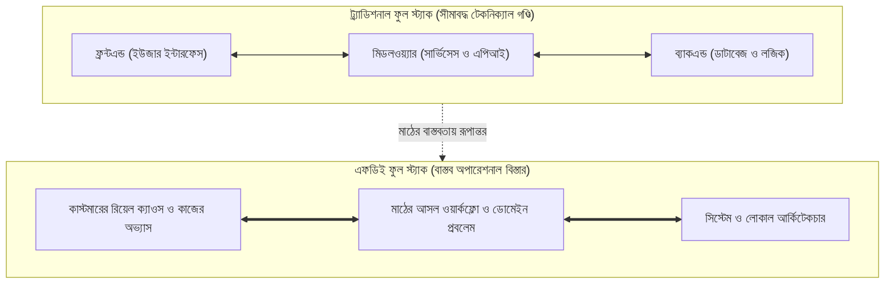

# ইন্ট্রোডাকশন: গ্রাউন্ড রিয়েলিটি এবং কাস্টমারের স্টোরি

---

### ১. কেক কাটার নব্বই দিন পর

ঘটনাটা শুরু হয়েছিল একটা জমকালো সেলিব্রেশন দিয়ে। প্রায় আট মাস দিনরাত এক করে কাজ করেছিল সফটওয়্যার ডেভেলপমেন্ট টিম। ক্লায়েন্টের হেড অফিসের বোর্ডরুমে বড় আয়োজন। প্রজেক্টরের পর্দায় ঝকঝকে ড্যাশবোর্ড। এসি ঘরের ভেতর ঠান্ডা বাতাস। টেবিলে বিশাল কেক কাটা হলো। হাততালিতে ভরে গেল পুরো রুম। ক্লায়েন্টের বড় কর্তারা ইউএটি সাইন-অফ দিলেন। বিল পাস হলো। সফটওয়্যার কোম্পানি ভাবল- বিরাট এক সাকসেস এলো। সবাই ভীষণ খুশি।

আসল ট্র্যাজেডি শুরু হলো ঠিক নব্বই দিন পর।

ত্রৈমাসিক একটা রুটিন রিভিউয়ের কাজ। সফটওয়্যার টিমের লিড আর্কিটেক্ট গেলেন ক্লায়েন্টের অফিসে। উদ্দেশ্য খুব সাধারণ। সিস্টেমের ডাটাবেজ একটু চেক করা। পারফরম্যান্স দেখা। লিফট দিয়ে উঠে সোজা সার্ভার রুমে ঢুকলেন। কিন্তু মনিটরের দিকে তাকাতেই বুকের ভেতর কেমন যেন ছ্যাঁৎ করে উঠল। ডাটাবেজে শেষ এন্ট্রি পড়েছে সাতচল্লিশ দিন আগে! গত দেড় মাসে নতুন একটা ট্রানজ্যাকশনও সিস্টেমে ঢোকেনি। পুরো সার্ভার যেন একটা পরিত্যক্ত ভূতুড়ে বাড়ি। অথচ ক্লায়েন্ট কোম্পানির ব্যবসা কিন্তু একদিনের জন্যও বন্ধ ছিল না। প্রতিদিন কোটি টাকার মালপত্র খালাস হচ্ছে। ব্যবসা রমরমিয়ে চলছে।

সিঁড়ি দিয়ে আর্কিটেক্ট সোজা নেমে এলেন মূল অপারেশনের ফ্লোরে। যেখানে রক্তমাংসের মানুষগুলো কাজ করেন। কাঁচঘেরা এসি রুম নয়। এটা মাঠের আসল কাজের জায়গা। সেখানে গিয়ে তিনি যা দেখলেন, তা কোনো টেকনোলজি বইতে লেখা থাকে না। ডেস্কে কম্পিউটার চালু আছে ঠিকই। কিন্তু আমাদের বানানো কোটি টাকার সফটওয়্যার কেউ ছুঁয়েও দেখছেন না। হেড একাউন্ট্যান্ট আগের মতোই পুরনো লাল মলাটের খাতায় কলম দিয়ে হিসাব লিখে রাখছেন। পাশের টেবিলে আরেকজন সিনিয়র স্টাফ পুরনো একটা এক্সেল ফাইলে ডাটা কপি আর পেস্ট করছেন। আর মাঠের টেকনিশিয়ানরা হোয়াটসঅ্যাপ গ্রুপে ভয়েস মেসেজ পাঠিয়ে কাজ সারছেন।

আর্কিটেক্ট অবাক হয়ে তাকালেন। বিনীত গলায় জিজ্ঞেস করলেন- "আপনারা সিস্টেমটা ব্যবহার করছেন না কেন?"

হেড একাউন্ট্যান্ট চশমার ফাঁক দিয়ে একটু তাকালেন। মুখে ভীষণ ক্লান্ত একটা হাসি। বললেন- "ভাই, আপনাদের সফটওয়্যার খুব সুন্দর। দেখতে চমৎকার। কিন্তু ওই সিস্টেমে একটা চালান এন্ট্রি করতে গেলে বারোটা ড্রপডাউন সিলেক্ট করতে হয়। প্রতিটা পেজ লোড হতে বিশ সেকেন্ড সময় নেয়। এদিকে বাইরে চালানের ট্রাক দাঁড়িয়ে থাকে। ড্রাইভাররা চ্যাঁচামেচি করে। আমাদের হাতে ওই বিশ সেকেন্ড সময় নেই।"

কথাটা শুনলে মাথায় আকাশ ভেঙে পড়ার মতো অবস্থা হয়। ল্যাবের ভেতর বসে আট মাস ধরে যে সিস্টেম বানানো হলো, কোটি টাকা খরচ হলো, টেস্ট কেস সব সবুজ দেখাল- সেই সফটওয়্যার মাটির মানুষের কাছে গিয়ে নিঃশব্দে মুখ থুবড়ে পড়ল। 

এটা শুধু একটা প্রজেক্টের ব্যর্থতা নয়। পুরো সফটওয়্যার ইন্ডাস্ট্রির সবচেয়ে বড় অপ্রিয় সত্যি।

---

### ২. ডেটা-ড্রিভেন পৃথিবীর অদ্ভুত প্যারাডক্স

ল্যাবরেটরির ভেতরের পৃথিবী আর মাঠের ভেতরের দুনিয়া সম্পূর্ণ আলাদা। ল্যাবের ভেতর কোনো ধুলোবালি নেই। সার্ভারের নেটওয়ার্ক কখনো ড্রপ করে না। টেস্ট ডাটাগুলো একদম সুন্দর পরিপাটি থাকে। ল্যাবে আপনি আগে থেকে নিয়ম ঠিক করে সফটওয়্যার চালান। সবকিছু নিয়মের শৃঙ্খলে চলে। 

কিন্তু মাঠের ভেতর কোনো নিয়ম আগে থেকে ঠিক করা যায় না। মাঠের রিয়েল ক্যাওস নিজেই প্রতিদিন নতুন নিয়ম তৈরি করে।

অফিসের অফিশিয়াল নীতিমালায় হয়তো লেখা আছে- কোনো চালান অনুমোদন করতে হলে তিনজন ম্যানেজারের ডিজিটাল স্বাক্ষর লাগবে। এটা হলো কাগজের এসওপি। কিন্তু মাঠে গিয়ে দেখবেন- ম্যানেজার আছেন মিটিংয়ে, ওদিকে গেটে ট্রাক দাঁড়িয়ে আছে জ্যাম পাকিয়ে। তখন স্টাফরা নিজেদের মতো করে অলিখিত শর্টকাট বানিয়ে নেন। এক ম্যানেজারের পাসওয়ার্ড আরেকজন ব্যবহার করেন। কিংবা কাগজ সই করিয়ে পরে এন্ট্রি দেওয়ার কথা বলে ট্রাক ছেড়ে দেন। এই যে মানুষের বাধ্য হয়ে বানানো শর্টকাট- এটাই হলো আসল সিস্টেম।

ল্যাবে বসে আপনি যখন কোড লেখেন, আপনি ভাবেন মানুষ নীতিমালার নিয়মে কাজ করবেন। বাস্তবতা হলো- মানুষ কাজ করেন তার নিজের সুবিধা আর অভ্যাসের নিয়মে। সফটওয়্যার যখন মানুষের এই রোজকার অভ্যাসকে অস্বীকার করে, তখন মানুষ সফটওয়্যারকে ছুঁড়ে ফেলে দেন। কোটি টাকার সিস্টেম তখন নীরবে মরে যায়।

---

### ৩. ফুল স্ট্যাকের আসল রূপান্তর

সফটওয়্যার ইঞ্জিনিয়ারিংয়ের ইতিহাসটা একটু খেয়াল করুন। 

প্রথম যুগে মানুষ কাজ করত আলাদা আলাদা খোপে। যাকে আমরা বলি কম্পোনেন্ট এরা। ফ্রন্টএন্ড ইঞ্জিনিয়ার শুধু ব্রাউজারের বাটন আর কালার নিয়ে ভাবতেন। ব্যাকএন্ড ইঞ্জিনিয়ার শুধু ডাটাবেজ আর কুয়েরি লিখতেন। মিডলওয়্যার ইঞ্জিনিয়ার পাইপলাইনের খেয়াল রাখতেন। মাঝখানে ছিল বিশাল দেয়াল। এক দলের সাথে আরেক দলের কথা হতো কম। 

তারপর এলো ফুল স্ট্যাক এরা। সবাই বলল- এভাবে আলাদা খোপে বসে কাজ চলবে না। একজন ইঞ্জিনিয়ারকে পুরো টেকনিক্যাল পাইপলাইনটাই বুঝতে হবে। ফ্রন্টএন্ড থেকে শুরু করে ব্যাকএন্ড ডাটাবেজ পর্যন্ত সবটুকু তার নখদর্পণে থাকতে হবে। এটা ছিল একটা বড় অগ্রগতি। 

কিন্তু ফুল স্ট্যাকের একটা বড় সীমাবদ্ধতা ছিল। ফুল স্ট্যাক ইঞ্জিনিয়ার কোডের পুরো পাইপলাইন জোড়া লাগাতে পারেন ঠিকই, কিন্তু কাস্টমারের আসল কাজের পাইপলাইন বুঝতে পারেন না। তিনি গিটহাব রিপোজিটরির বাইরে তাকান না। তিনি মনে করেন- কোড ঠিকমতো ডিপ্লয় হয়েছে, তার মানে কাজ শেষ।

এখানেই জন্ম নেয় এফডিই-এর যুগ। ফরওয়ার্ড ডেপ্লয়েড ইঞ্জিনিয়ারিং। 

একজন এফডিই ফুল স্ট্যাকের গণ্ডি ভেঙে অনেক দূর এগিয়ে যান। তিনি শুধু কোডের স্ট্যাক বোঝেন না। তিনি বোঝেন কাস্টমারের অপারেশনাল স্ট্যাক। তিনি কোডের বাউন্ডারি পেরিয়ে সরাসরি পৌঁছে যান কাস্টমারের নিঃশ্বাসের দূরত্বে। যেখানে ট্রাকের ড্রাইভার চিৎকার করছেন, যেখানে হেড একাউন্ট্যান্ট ঘাম মুছছেন, যেখানে নেটওয়ার্কের তার ছিঁড়ে লাল বাতি জ্বলছে- একজন এফডিই ঠিক সেই জায়গায় গিয়ে ল্যাপটপ খুলে বসেন।

কাস্টমার যদি সিস্টেমে স্বস্তি না পান, তাদের রিয়েল বটলনেক যদি দূর না হয়, তবে কোড যত সুন্দরই হোক- ডেপ্লয়মেন্ট একটা চরম ফেইলিউর।

---

### ৪. তিন পেশার স্পষ্ট পার্থক্য

অনেকেই এফডিই-এর কাজকে সাধারণ সফটওয়্যার ডেভেলপমেন্ট বা আইটি কনসালটেন্সির সাথে এক করে ফেলেন। তফাতটা বোঝা খুব দরকার।

* **কোর সফটওয়্যার ইঞ্জিনিয়ার:** তিনি থাকেন কোম্পানির সেন্ট্রাল অফিসে। তার কাজ হলো কোর প্রডাক্টের ফাউন্ডেশন তৈরি করা। তিনি ভাবেন কোডের স্কেলেবিলিটি, অ্যালগরিদমের জটিলতা আর সিস্টেম আর্কিটেকচার নিয়ে। তিনি কাস্টমারের মুখ কখনো সরাসরি দেখেন না। কাস্টমারের সাথে তার যোগাযোগ হয় প্রডাক্ট ম্যানেজারের লেখা রিকোয়ারমেন্ট ডকুমেন্টের মাধ্যমে।
* **টেকনিক্যাল কনসালট্যান্ট:** তিনি ক্লায়েন্টের অফিসে স্যুট-টাই পরে যান। লম্বা লম্বা প্রেজেন্টেশন দেন। মিটিং রুমে বসে কর্মীদের কাজের সমস্যা শোনেন। তারপর শত শত পাতার একটা চমৎকার রিপোর্ট বা সাজেশন লিখে দিয়ে চলে আসেন। কিন্তু কোডের ভেতর হাত দেওয়ার ক্ষমতা বা দায়িত্ব তার থাকে না। পরামর্শ দেওয়া পর্যন্তই তার কাজ শেষ।
* **ফরওয়ার্ড ডেপ্লয়েড ইঞ্জিনিয়ার (FDE):** তিনি একই সাথে একজন হাই-লেভেল সফটওয়্যার আর্কিটেক্ট এবং একজন মাঠের যোদ্ধা। তিনি শুধু পরামর্শ দেন না। তিনি ক্লায়েন্টের অগোছালো অফিসে কর্মীদের পাশে গিয়ে বসেন। সমস্যার নাড়িভুঁড়ি নিজের চোখে দেখেন। তারপর নিজে হাতে কোড লিখে, লোকাল সার্ভারে মডেল ডিপ্লয় করে, পাইপলাইন জোড়া লাগিয়ে সমস্যাটা তাৎক্ষণিকভাবে সমাধান করে দিয়ে আসেন।

| বৈশিষ্ট্যের ক্ষেত্র | কোর সফটওয়্যার ডেভেলপার | টেকনিক্যাল কনসালট্যান্ট | ফরওয়ার্ড ডেপ্লয়েড ইঞ্জিনিয়ার (FDE) |
| :--- | :--- | :--- | :--- |
| **কাজের প্রধান জায়গা** | শান্ত ল্যাব বা নিজস্ব অফিস | ক্লায়েন্টের বোর্ডরুম | ক্লায়েন্টের আসল কাজের গ্রাউন্ড ফ্লোর |
| **কাজের মূল হাতিয়ার** | কোডবেস ও পুল রিকোয়েস্ট | পাওয়ারপয়েন্ট স্লাইড ও রিপোর্ট | লোকাল কোড, আর্কিটেকচার ও শ্যাডো সেশন |
| **সফলতার পরিমাপ** | কোডের কোয়ালিটি ও আপটাইম | ক্লায়েন্ট ম্যানেজমেন্টের সন্তুষ্টি | কর্মীর কাজের গতি ও রিয়েল প্রবলেম সমাধান |
| **অনিশ্চয়তা সামলানো** | স্পেসিফিকেশন মাফিক কাজ | তাত্ত্বিক ফ্রেমওয়ার্ক তৈরি | চরম ক্যাওসের ভেতর রিয়েল-টাইমে সমাধান |

---

### ৫. গ্লোবাল ফিল্ড মডেল ও বাংলাদেশের বাস্তবতা

সিলিকন ভ্যালির সেরা ডাটা কোম্পানিগুলো অনেক বছর আগেই এই সত্যিটা বুঝেছিল। তারা বুঝতে পেরেছিল- জটিল সফটওয়্যার কখনো দূর থেকে বিক্রি করে চালানো যায় না। তাই তারা ক্লায়েন্টের মিলিটারি বেস, বড় ব্যাংক কিংবা গোয়েন্দা সংস্থার হেডকোয়ার্টারে নিজেদের এলিট ইঞ্জিনিয়ারদের সরাসরি পাঠিয়ে দিত। ইঞ্জিনিয়াররা ক্লায়েন্টের কর্মীদের সাথে দিনের পর দিন কাজ করে সিস্টেম দাঁড় করাতেন।

আমাদের দেশে এই মডেলের প্রয়োজনীয়তা এখন সবচেয়ে বেশি।

বাংলাদেশে কোনো সফটওয়্যার প্রজেক্ট যখন মার খায়, তখন ভেন্ডর কোম্পানি দোষ দেয় ক্লায়েন্টের কর্মীদের। বলে- "ওদের কর্মীরা টেকনোলজি বোঝেন না।" আর ক্লায়েন্ট দোষ দেয় সফটওয়্যার কোম্পানিকে। বলে- "ওরা কাজের জিনিস বানাতে পারে না।" 

মাঝখানে কোটি টাকার ক্ষতি হয়। দেশের এন্টারপ্রাইজগুলো অটোমেশনের ওপর ভরসা হারিয়ে ফেলে। 

এই অচলাবস্থা ভাঙার একমাত্র চাবি হলো ফরওয়ার্ড ডেপ্লয়েড ইঞ্জিনিয়ারিং। ক্লায়েন্টের অফিসে বসে কাজ করতে হবে। তাদের সীমাবদ্ধতা নিজের চোখে দেখতে হবে। ইন্টারনেট ডাউন থাকলে কীভাবে লোকাল সার্ভারে কাজ চালানো যায়, সেই মুন্সিয়ানা জানতে হবে। তবেই একটা প্রজেক্ট সত্যি সত্যি আলোর মুখ দেখবে।

---

### ৬. এই বই পড়ার নিয়ম: "কোড-স্যান্ডউইচ" মেথড

প্রযুক্তি বইয়ের পাঠকরা প্রায়ই একটা অভিযোগ করেন। বইতে পাতার পর পাতা বড় বড় তাত্ত্বিক কথা থাকে। কিন্তু হাতেনাতে কাজ করার মতো কিছু থাকে না। মানুষ দেখতে চায়- প্রযুক্তিটা আসলে কাজ করে কি না।

আমাদের এই বইতে কোনো ফাঁকা তাত্ত্বিক লেকচার নেই। পুরো বই সাজানো হয়েছে **"কোড-স্যান্ডউইচ" মেথডে**:

১. **উপরের স্তর (Context):** প্রথমে তিন-চার লাইনে আমরা মাঠের একটা রক্তমাংসের সংকট দেখব।
২. **মাঝের স্তর (The Code):** সেই সংকট মেটানোর জন্য থাকবে পনেরো থেকে বিশ লাইনের মূল পাইথন কোড বা সিআই/সিডি স্ক্রিপ্ট। কোনো অহেতুক লাইব্রেরি দিয়ে পাতা নষ্ট করা হবে না।
৩. **নিচের স্তর (Operational Impact):** কোডটি রান করার পর কাস্টমারের মুখে কীভাবে স্বস্তি এলো, তার ব্যাখ্যা।

প্রতিটা কোড আপনি নিজের ল্যাপটপে বিনামূল্যে লোকাল মডেল দিয়ে রান করতে পারবেন। পুরো প্রজেক্টের কোড থাকবে বইয়ের অফিশিয়াল গিটহাব রিপোজিটরিতে: [https://github.com/aiwithr/fde_book](https://github.com/aiwithr/fde_book)।

চলুন, এবার সরাসরি ফিল্ডে নামা যাক। প্রথম অধ্যায়ে আমরা দেখব- ক্লায়েন্টের সাইটে পা রাখার প্রথম আটচল্লিশ ঘণ্টায় কীভাবে আসল কাজের জট খুঁজে বের করতে হয়।
